# Observability Foundations（可觀測性基礎）

> Observability Foundations 的六個核心學習主題

從基本監控概念，到 Metrics、Logs、Traces，以及 SLI、SLO、SLA、Error Budget 和 Four Golden Signals。

## 課程六大主題

| 主題                                     | 核心內容                                           | 學習目標                             |
| ---------------------------------------- | -------------------------------------------------- | ------------------------------------ |
| 1. What Is Observability                 | Observability vs Monitoring                        | 理解如何透過外部訊號分析系統內部狀態 |
| 2. The Three Pillars                     | Metrics、Logs、Traces                              | 理解三種訊號如何互相補充             |
| 3. Metrics and Histograms                | Counter、Gauge、Histogram、P50/P95/P99             | 衡量效能、延遲與使用者體驗           |
| 4. Logs and Traces                       | Structured Logging、Trace ID、Span                 | 分析錯誤及跨服務執行流程             |
| 5. SLIs, SLOs, and SLAs                  | 可靠性指標、目標及服務承諾                         | 建立可衡量的服務可靠性標準           |
| 6. Error Budgets and Four Golden Signals | Error Budget、Latency、Traffic、Errors、Saturation | 平衡系統可靠性與開發速度             |

## 1. Monitoring vs Observability

| Monitoring（監控）     | Observability（可觀測性）                 |
| ---------------------- | ----------------------------------------- |
| 系統是否正常？         | 為甚麼系統不正常？                        |
| CPU 是否超過 90%？     | 哪個服務或請求造成 CPU 過高？             |
| Payment API 是否出錯？ | 哪個 Microservice 導致 Payment API 失敗？ |
| 偏向已知問題與預設指標 | 支援調查未知問題及複雜關聯                |

Monitoring 是 Observability 的一部分，兩者並不是互斥技術。

## 2. Three Pillars of Observability

| 🔵 Metrics                   | 🟢 Logs                  | 🟠 Traces                      |
| ---------------------------- | ------------------------ | ------------------------------ |
| **What is happening?** | **What happened?** | **Where did it happen?** |
| **Prometheus**         | **Loki**           | **Tempo**                |
| CPU                          | Error                    | Request                        |
| Latency                      | Events                   | Spans                          |
| Error Rate                   | Debug                    | Dependencies                   |

### ⬇️ Combined Observability

**Cross-service troubleshooting and root-cause analysis**

> Combining Metrics, Logs, and Traces provides visibility into **distributed** systems, helping developers identify performance bottlenecks, investigate errors, and determine root causes.

三種訊號可以互相關聯，幫助快速找出系統問題，但仍需要良好的 Instrumentation 才能達到完整的可觀測性。

## 3. Metrics and Histograms

| Metric Type | 用途                   | 實際例子                         |
| ----------- | ---------------------- | -------------------------------- |
| Counter     | 統計累計發生次數       | Payment Requests Total           |
| Gauge       | 顯示可上升或下降的數值 | Active Connections、Memory Usage |
| Histogram   | 統計數值分布           | API Request Duration             |
| Percentiles | 分析延遲分布           | P50、P95、P99                    |

### P50 / P95 / P99 是甚麼？

API Response Time — 示意範例

```text
Percentile	Latency
P50	        100
P95	        500
P99	        2000
```

數值僅供說明，非實際量測資料。

- P50 = 100ms：50% 的 Requests 在 100ms 內完成。
- P95 = 500ms：95% 的 Requests 在 500ms 內完成。
- P99 = 2000ms：99% 的 Requests 在 2 秒內完成。

P95 和 P99 特別適合用來發現少數使用者遭遇的高延遲問題（Tail Latency）。

## 4. Logs and Traces

假設 Payment API 執行時發生 Database Timeout：

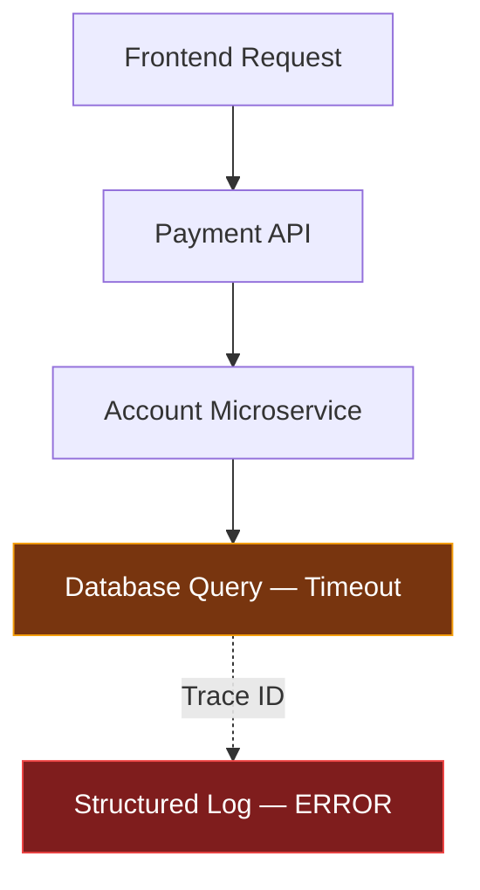

透過同一個 **Trace ID**，開發人員可以在 Tempo 查看執行流程，再從 Loki 查詢相關 Error Logs。

## 5. SLI、SLO、SLA 與 Error Budget

| Concept      | 意思                   | 範例                          |
| ------------ | ---------------------- | ----------------------------- |
| SLI          | 實際衡量的服務品質指標 | Payment Success Rate = 99.95% |
| SLO          | 內部服務品質目標       | Payment Success Rate ≥ 99.9% |
| SLA          | 對客戶的服務水準承諾   | Availability ≥ 99.5%         |
| Error Budget | SLO 所允許的不可靠程度 | 0.1% 的 Requests 可以失敗     |

例如 SLO = 99.9%，每月處理 1,000,000 筆 Payment Requests：

- 目標成功率：99.9%
- 允許失敗率：0.1%
- Error Budget：1,000 筆失敗 Requests

注意：此例假設使用 Request-based SLI，且所有 Requests 均納入相同計算範圍。

## 6. Four Golden Signals

| Signal     | 定義                       | 銀行系統範例                   |
| ---------- | -------------------------- | ------------------------------ |
| Latency    | 請求處理時間               | Payment API P95 Response Time  |
| Traffic    | 系統處理流量               | Transactions Per Second        |
| Errors     | 錯誤比例或次數             | Failed Payment Transactions    |
| Saturation | 系統資源接近容量上限的程度 | Database Connection Pool Usage |

這四個訊號是 Google SRE 推薦的服務監控基線。

## 與 Grafana Observability Stack 的關係

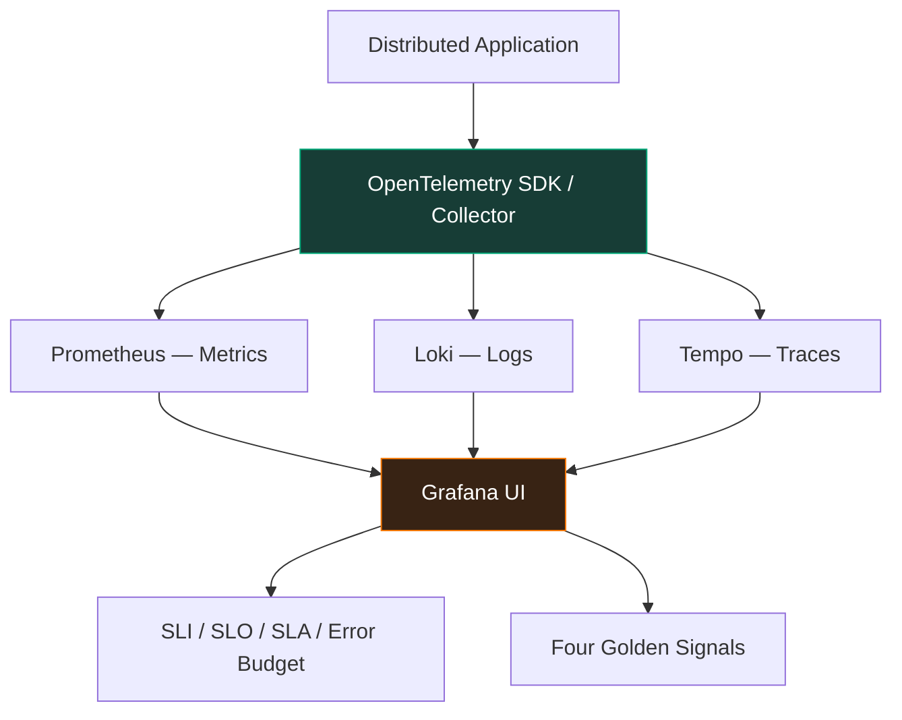

概念架構。Grafana 可用於建立 SLI/SLO Dashboard 與 Alerting；SLA 本身是服務合約承諾，並非 Grafana 自動產生的合約。

最重要的學習重點：

- Metrics / Logs / Traces：提供分析系統行為所需的資料。
- OpenTelemetry：負責 Instrumentation、Telemetry Collection 和 Export。
- Prometheus / Loki / Tempo / Grafana：提供資料儲存、查詢、視覺化及分析能力。
- SLI / SLO / SLA / Error Budget：衡量及管理服務可靠性。
- Four Golden Signals：建立標準化的效能與健康監控基線。

這六個主題結合起來，就是建立 Production-grade Observability 的重要基礎。

---

# What Is Observability?（甚麼是可觀測性？）

Observability（可觀測性） 是透過系統產生的外部訊號（Metrics、Logs、Traces），了解系統內部的運作狀態，並找出問題的根本原因（Root Cause）。

> 使用 E-commerce Checkout Failure（電子商務結帳失敗） 作為例子，說明為甚麼 Distributed Systems 需要 Observability。

## 1. E-commerce系統架構

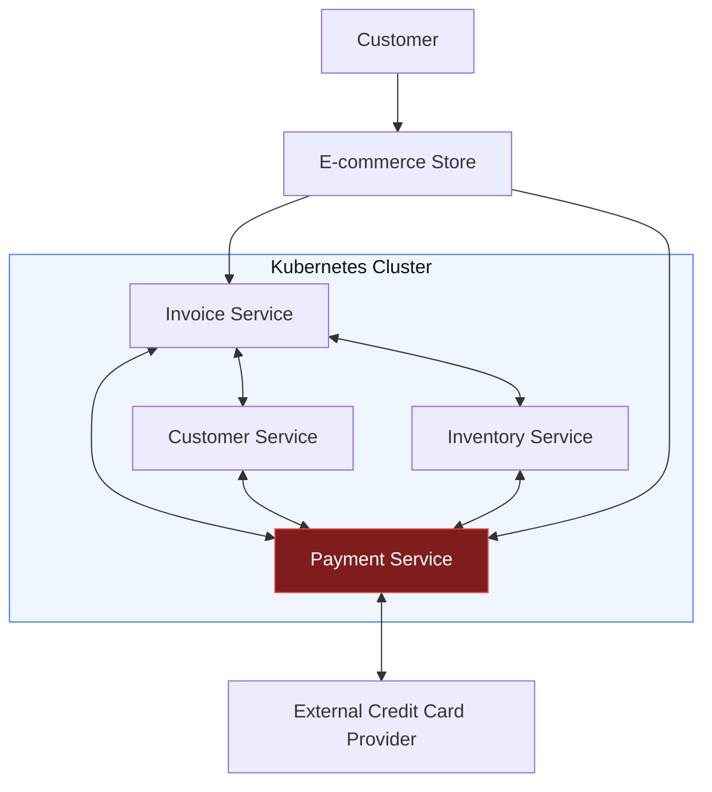

概念示意：圖片顯示服務之間的依賴關係，不代表每次 Checkout 都必須經過所有連線。

> 當使用者看到：**Checkout Failed!**

使用者只知道結帳失敗，卻不知道是哪個 Microservice 出問題。可能原因包括：

- Inventory Service 庫存檢查失敗。
- Payment Service 發生 Timeout。
- Invoice Service 無法建立 Invoice。
- External Credit Card Provider 拒絕交易。
- Kubernetes Pods 或網路連線異常。

## 2. Observability 如何幫助找出問題？

| Signal        | 工具       | 能回答的問題                          |
| ------------- | ---------- | ------------------------------------- |
| Metrics       | Prometheus | Payment API Error Rate 是否突然上升？ |
| Logs          | Loki       | Payment Service 發生甚麼錯誤？        |
| Traces        | Tempo      | Checkout Request 在哪個服務失敗？     |
| Visualization | Grafana    | 如何關聯三種訊號並分析原因？          |

例如：

1. Prometheus 發現 Payment API Error Rate 從 0.1% 上升到 15%。
2. Tempo 顯示 Checkout Request 卡在 Payment Service 呼叫 Credit Card Provider。
3. Loki 顯示 `Credit card provider timeout`。
4. Grafana 關聯 Metrics、Logs、Traces，協助確認問題來源。

## 3. Monitoring vs Observability

| Monitoring                    | Observability                    |
| ----------------------------- | -------------------------------- |
| Checkout 是否失敗？           | 為甚麼 Checkout 失敗？           |
| Payment Error Rate 是否上升？ | 哪個服務或依賴造成錯誤？         |
| CPU 是否超過 90%？            | 哪些 Requests 導致資源消耗增加？ |
| 偵測異常與發出 Alert          | 調查系統行為及 Root Cause        |

核心觀念：Monitoring 告訴你系統可能有問題；Observability 幫助你理解問題如何發生，以及為甚麼發生。

這對 Java、Node.js、Python Microservices 運行在 Kubernetes 的環境尤其重要，因為單一業務交易可能同時涉及多個服務、Database、Message Queue 和外部 API。

---

## 1. Monitoring vs Observability

| 比較項目 | Monitoring（監控）                        | Observability（可觀測性）                          |
| -------- | ----------------------------------------- | -------------------------------------------------- |
| 問題類型 | 已知問題（Known Questions）               | 未知問題（Unknown Questions）                      |
| 分析方式 | 預先定義的儀表板（Predefined Dashboards） | 探索式調查（Exploratory Investigation）            |
| 故障類型 | 已知故障模式（Known Failure Modes）       | 非預期系統行為（Unexpected Behaviors）             |
| 核心問題 | 系統是否健康？（Is the system healthy?）  | 為甚麼這筆請求失敗？（Why did this request fail?） |
| 實際例子 | Error Rate > 1% 時發出告警                | 為甚麼 Request #123 在 13:47 失敗？                |

### Mermaid 版本

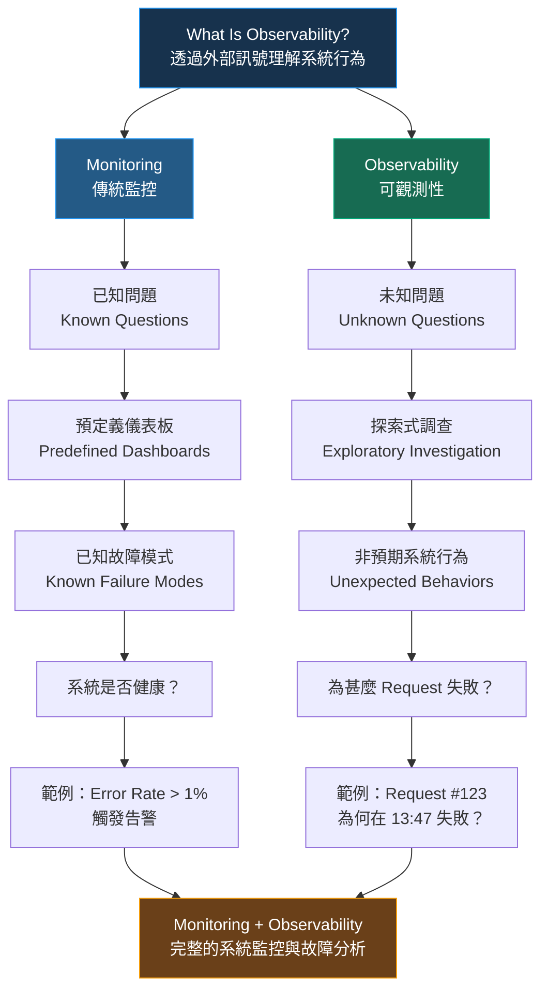

## 2. Modern System Complexity（現代系統複雜性）

| 傳統系統                                         | 現代分散式系統                                           |
| ------------------------------------------------ | -------------------------------------------------------- |
| 單體式應用程式（Monolithic Application）         | 數百個微服務（Microservices）                            |
| 直接函式呼叫（Direct Function Calls）            | 網路通訊（Network Communication）                        |
| 靜態伺服器（Static Servers）                     | 動態容器部署（Dynamic Container Deployment）             |
| 依尖峰負載預先配置資源（Peak-load Provisioning） | 根據需求自動擴縮（Auto-scaling）                         |
| 單點故障（Single Point of Failure）              | 複雜的元件互動造成問題（Complex Component Interactions） |

### 核心觀念

- **Monitoring：** 偵測已知問題，回答「系統是否正常？」
- **Observability：** 探索未知問題，回答「系統為甚麼發生異常？」
- **Modern Distributed Systems：** 由於 Microservices、Network、Containers 和 Auto-scaling 增加了複雜性，因此更需要 Observability。

> Monitoring 與 Observability 是互補關係，而非互相取代。

### Modern System Complexity

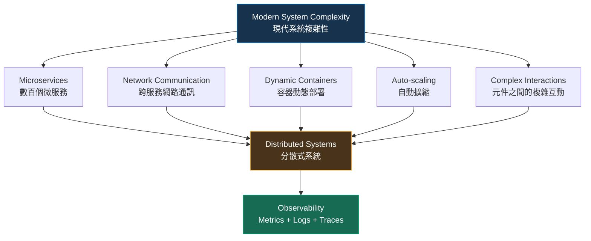

---

# Observability Pillars（可觀測性三大支柱）

**Fundamental Units of Observable Systems（可觀測系統的基本組成單位）**

可觀測性（Observability）主要由三大支柱組成：Metrics、Logs 和 Traces。三者互相補充，協助開發人員掌握系統健康狀態、分析錯誤及定位效能瓶頸。

| 支柱 | Tools | 中文名稱 | 核心功能 |
|---|---|---|---|
| **Metrics** | Prometheus | 指標 | 提供彙總性的數值資料，用於了解系統整體健康狀態、**異常告警**及**容量規劃**（Capacity Planning）。 |
| **Logs** | Loki | 日誌 | 記錄具有豐富上下文資訊的獨立事件，提供特定時間發生的**錯誤訊息**及**系統狀態**。 |
| **Traces** | Tempo | 分散式追蹤 | 追蹤 Request 經過**不同服務**的**完整執行路徑**，協助找出效能瓶頸與延遲來源。 |

## 2. 三大支柱的主要用途

| Pillar | 回答的問題 | 實際例子 | Grafana Stack |
|---|---|---|---|
| **Metrics** | 系統目前狀態如何？ | CPU、Memory、API Latency、Error Rate | Prometheus |
| **Logs** | 特定時間發生了甚麼事件？ | Database Timeout、Application Error | Loki |
| **Traces** | Request 經過哪些服務？哪裡最慢？ | Payment API → Account Service → Database | Tempo |

### 核心觀念

- **Metrics = 數值化監控與趨勢分析**
- **Logs = 事件記錄與錯誤分析**
- **Traces = 跨服務執行路徑與延遲分析**

三者結合可提供更完整的系統可觀測性，協助進行 Troubleshooting、Root Cause Analysis 及 Performance Optimization。

### Observability Pillars 架構圖

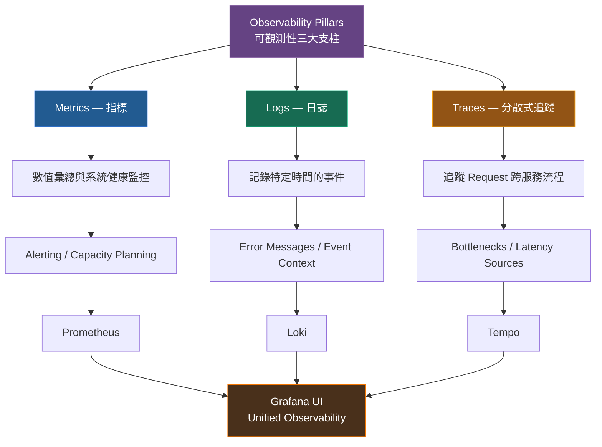
---

# Metrics（指標）

**Quantitative Measurements of a System（系統的量化測量）**

Metrics 是透過數值衡量系統的運作狀態、效能和資源使用情況，主要回答三個問題：

- **How many?（多少次？）**：例如 HTTP Request Count。
- **How much?（使用多少？）**：例如 CPU、Memory Usage。
- **How fast?（有多快？）**：例如 API Response Time。

## 1.1 Metrics Examples（指標範例）

| Metric | 中文說明 | 衡量目的 |
|---|---|---|
| **Request Count** | HTTP 請求總數 | 系統收到多少個 HTTP Requests？ |
| **Error Rate** | 錯誤率 | 有多少比例的 Requests 執行失敗？ |
| **Latency** | 延遲時間 | Requests 需要多久才能完成？ |
| **CPU Usage** | CPU 使用率 | 系統消耗多少 CPU 資源？ |
| **Active Connections** | 活躍連線數 | 目前有多少個 Database Connections？ |

## 1.2 Types of Metrics（指標類型）

| Type | 中文名稱 | 特性 | 實際例子 |
|---|---|---|---|
| **Counter** | 累計計數器 | 數值**只會增加**，重置時除外 | HTTP Request Total、Total Errors、Transferred Bytes |
| **Gauge** | **即時數值指標** | 數值可以**增加或減少** | Memory Usage、Queue Depth、CPU Percentage |
| **Histogram** | 直方圖／分布統計 | 統計數值分布，可用於估算 P95、P99、P99.9<br>Capture distributions of values | API Request Duration、Database Query Latency |

### Counter（累計計數器）

- 適合統計持續累積的事件數量。
- 例如 `http_requests_total`、`payment_failed_total`。
- Counter 在程序重新啟動時可能歸零。
- Prometheus 通常使用 `rate()` 計算單位時間內的平均增加速率。

### Gauge（即時數值）

- 適合監控目前系統的狀態。
- 例如 `memory_usage_bytes`、`active_connections`。
- 可用於觀察 CPU、Memory、Queue Length 的變化。

### Histogram（分布統計）

- 用於統計一組觀測值的分布情況。
- 適合分析 API Latency，而不只是平均回應時間。
- 可以估算 P50、P95、P99、P99.9。
- 例如 `http.server.request.duration`。

## 1.3 核心觀念

- **Counter = How many?（累積發生多少次）**
- **Gauge = How much now?（目前數值是多少）**
- **Histogram = How are values distributed?（數值如何分布）**

> Metrics 提供系統健康狀態的量化資訊，可用於 Monitoring、Alerting、Performance Analysis 和 Capacity Planning。

## 2. Mermaid 版本

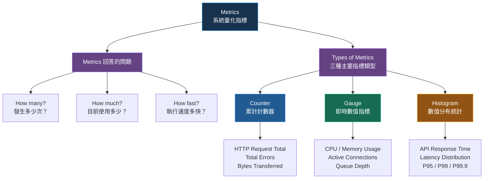

## 3. Counter、Gauge、Histogram 實際差異

假設 Payment API 每秒處理大量交易：

| 監控需求                           | Metric Type | 範例                                    |
| ---------------------------------- | ----------- | --------------------------------------- |
| 累計處理 100,000 筆 Payments       | Counter     | `payment_processed_total`             |
| 累計失敗 200 筆 Payments           | Counter     | `payment_failed_total`                |
| 目前有 50 個 Active DB Connections | Gauge       | `db_active_connections`               |
| 目前有 120 筆 Pending Jobs         | Gauge       | `payment_queue_depth`                 |
| Payment API 的 P95 延遲為 500ms    | Histogram   | `payment_processing_duration_seconds` |

補充： Error Rate 通常是利用 Counter 計算出來的比率，而 P95 / P99 通常是透過 Histogram 的分布資料估算，並非三種 Metric Type 以外的獨立類型。

> 重點：Counter 看累計數量，Gauge 看目前狀態，Histogram 看數值分布及效能尾端延遲。

---


# Histograms（直方圖／分布統計）

**Understand How to Read and Interpret Histograms**

學習如何閱讀及解讀 Histogram，了解 API Request Latency（請求延遲時間）的分布情況。

## 1.1 Histograms（直方圖）

Histogram 用來統計數值分布，提供比平均值（Average）更完整的效能資訊。

例如，將 API Request Latency 分成不同的時間區間（Buckets），統計各區間的請求次數。

| Duration Bucket | 中文說明 | Request 數量 |
|---|---|---|
| 0–10ms | 極快回應 | 少量 |
| 10–50ms | 快速回應 | 中等 |
| 50–100ms | 正常回應 | 較多 |
| 100–200ms | 最主要的回應區間 | 最多 |
| 200–500ms | 較慢回應 | 中等 |
| 500ms–1s | 高延遲 | 少量 |
| 1–2s | 嚴重延遲 | 極少 |
| 2–5s | 非常嚴重的延遲 | 極少 |

> 原圖沒有提供精確 Request 數量，因此上表僅描述相對數量。

## 1.2 Percentiles（百分位數）

**Percentile**（百分位數）是指：在一組觀測資料中，有 X% 的數值小於或等於某個數值 Y。

例如：

| Percentile | 中文說明 | API Latency 範例 |
|---|---|---|
| **P50** | 50% 的 Requests 在此時間內完成 | 100ms |
| **P95** | 95% 的 Requests 在此時間內完成 | 500ms |
| **P99** | 99% 的 Requests 在此時間內完成 | 2s |
| **P99.9** | 99.9% 的 Requests 在此時間內完成 | 5s |

以上為示例數據，並非原圖實際計算結果。

### 為甚麼 Percentiles 比 Average 更有參考價值？

假設 100 筆 API Requests：

- 95 筆在 100ms 內完成。
- 4 筆在 1 秒完成。
- 1 筆花費 10 秒。

即使大多數 Requests 很快，仍有少數使用者面臨嚴重延遲。

因此：

- **Average**：觀察整體平均效能。
- **P50**：觀察典型使用者的延遲。
- **P95**：觀察較慢的 5% Requests。
- **P99**：觀察最慢的 1% Requests。

> P95、P99 對 Production API Monitoring、SLO 和 Performance Troubleshooting 特別重要。

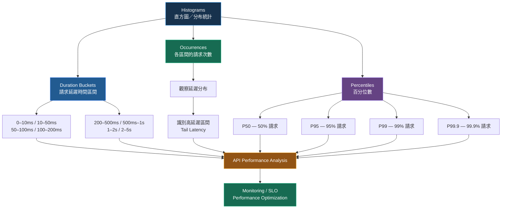

注意：實際 Prometheus Metric 名稱會受到 OpenTelemetry Exporter、命名轉換與 Histogram 類型影響；Native Histogram 的查詢方式也不同。

重點總結：

- Histogram：告訴你 API 回應時間分布在哪些區間。
- P50：典型的回應效能。
- P95 / P99：揭示少數使用者遇到的高延遲問題。
- Prometheus + Grafana：讓你持續監控這些數據並設定 SLO / Alerting。

---

# Logs（日誌）

> 基本概念、Human-readable vs Structured Logs，以及 DEBUG、INFO、WARN、ERROR、FATAL 五個日誌等級。

**Discrete Records of Events（獨立事件記錄）**

Logs 用來記錄 Application 或系統在特定時間發生的事件，包括執行狀態、錯誤訊息及相關上下文。

## 1.1 Logs 核心特性

- ✅ **Raw Details**：記錄個別事件的原始細節。
- ✅ **Storage & Indexing Cost**：相較於 Metrics，Logs 通常需要更多儲存空間與處理成本。
- ✅ **Human-readable Logs**：供人員直接閱讀的文字日誌。
- ✅ **Machine-readable Logs**：使用 JSON 等結構化格式，方便系統解析與查詢。
- ✅ **Log Levels**：DEBUG、INFO、WARN、ERROR、FATAL。

## 1.2 Human-readable vs Structured Logs

| 比較項目 | Human-readable Logs | Structured Logs |
|---|---|---|
| 格式 | 一般文字 | JSON 或結構化欄位 |
| 人工閱讀 | 容易 | 容易，但格式較詳細 |
| 自動解析 | 通常需要 Parser | 可直接解析欄位 |
| 搜尋方式 | Keyword Search | Field-based Search |
| Trace ID | 可以包含 | 可以使用獨立欄位 |
| 適用場景 | 開發、簡單日誌 | Production、Microservices、Observability |

### Human-readable Logs 範例

```text
2024-01-15 14:32:10 INFO User 12345 clicked checkout
2024-01-15 14:32:11 ERROR Payment gateway timeout: 5000ms
2024-01-15 14:32:11 WARN Retrying payment attempt 2/3
```

### Machine-readable（Structured）Logs 範例

```json
{
  "timestamp": "2024-01-15T14:32:10Z",
  "level": "INFO",
  "message": "User clicked checkout",
  "user_id": 12345,
  "cart_items": 3,
  "trace_id": "abc123"
}
```

> Structured Logging 特別適合 OpenTelemetry、Loki、OpenSearch 等 Observability / Log Analytics 系統。

## 2. Log Levels in Detail（日誌等級）

| Level | 中文說明 | 用途 | 範例 |
|---|---|---|---|
| **DEBUG** | 除錯資訊 | 提供詳細的程式執行資訊 | Called function X with parameters Y |
| **INFO** | 正常資訊 | 記錄正常的業務及系統操作，協助了解 Application Flow | User logged in、Order processed |
| **WARN** | 警告資訊 | 發生非預期情況，但尚未構成錯誤，需進一步調查潛在問題 | Rate limit approaching、Cache miss |
| **ERROR** | 錯誤資訊 | 某項操作或功能執行失敗，需要關注及處理 | Payment gateway timeout、Database connection refused |
| **FATAL** | 致命錯誤 | 嚴重故障，Application 無法繼續正常執行 | Out of memory、Critical configuration missing |

### Production Log Level 建議

一般 Production 環境通常設定： **INFO → WARN → ERROR → FATAL**

代表：

- DEBUG：預設不記錄，必要時短暫啟用。
- INFO：記錄重要的正常操作。
- WARN：記錄潛在問題。
- ERROR：記錄執行失敗。
- FATAL：記錄嚴重故障。

> Production 通常使用 INFO 或更高的 Log Level，以控制日誌數量、效能及儲存成本。實際設定需視系統需求而定。

---

## 2. Mermaid：Log Levels

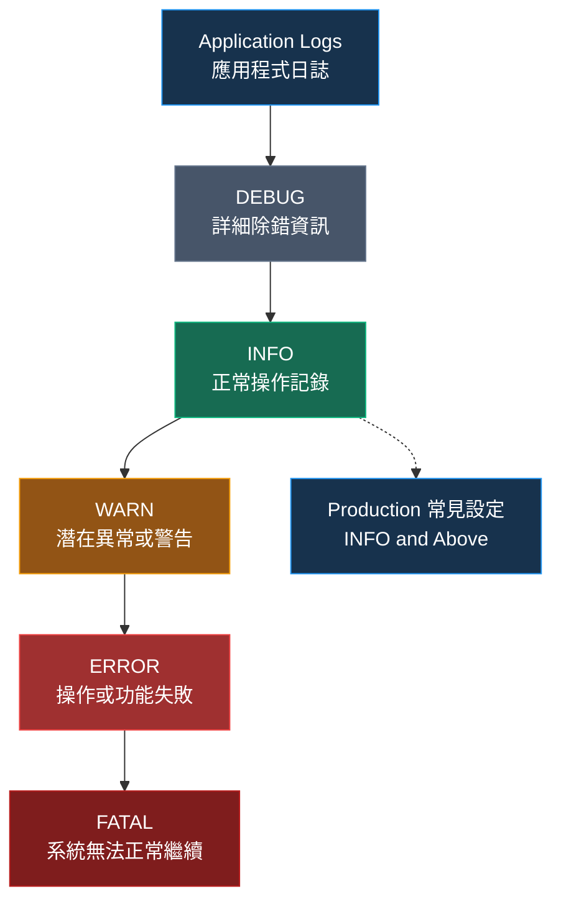

## 3. 與 OpenTelemetry + Loki + Grafana 整合

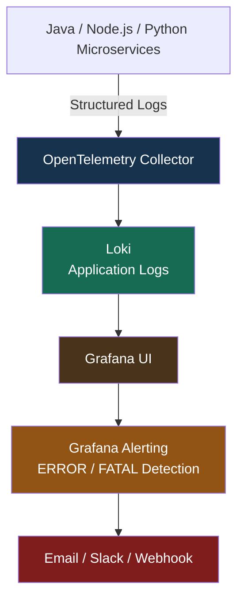

如果採用 OpenTelemetry，建議 Log 中包含以下欄位：

| Attribute          | 用途                    |
| ------------------ | --------------------- |
| `timestamp`        | 事件發生時間                |
| `severity_text`    | INFO、WARN、ERROR 等日誌等級 |
| `severity_number`  | 標準化 Severity 數值       |
| `service.name`     | Microservice 名稱       |
| `trace_id`         | 關聯 Distributed Trace  |
| `span_id`          | 關聯特定 Span             |
| `message` / `body` | 日誌內容                  |
| `error.type`       | 錯誤類型（適用時）             |

`trace_id` 和 `span_id` 應使用符合 OpenTelemetry 規範的識別碼；圖片中的 `abc123` 僅供概念示意。

補充： FATAL 並非所有 Logging Framework 都支援的獨立等級。例如 Python Logging 預設使用 CRITICAL，部分 Java Framework 使用 ERROR 表示最嚴重的錯誤。OpenTelemetry 可透過 Severity Number 將不同 Framework 的等級標準化。

重點：對於 Kubernetes + Microservices，建議使用 Structured Logging + Trace ID + OpenTelemetry + Loki + Grafana，讓 Logs 不只是錯誤文字記錄，而是能夠與 Distributed Tracing 關聯的 Observability Data。

---
# Traces（分散式追蹤）

**The Complete Journey of a Request through the System**

Traces 用來記錄一個 Request 在系統內經過的完整執行流程，包括不同 Microservices、Database 和 External APIs。

主要用途：

- ✅ 追蹤 Request 經過哪些 Microservices。
- ✅ 了解每個 Operation 的執行時間。
- ✅ 分析 Parallel（平行）與 Sequential（循序）操作。
- ✅ 找出 Performance Bottlenecks（效能瓶頸）。
- ✅ 定位 Errors 發生的位置。

## 1.1 Trace vs Span

| Concept | 中文說明 | 主要用途 |
|---|---|---|
| **Trace** | 一個 Request 的完整追蹤紀錄 | 記錄整個 Request Journey |
| **Trace ID** | Trace 的唯一識別碼 | 關聯跨服務的所有 Spans |
| **Span** | Trace 中的單一操作 | 記錄個別 Operation |
| **Span ID** | Span 的唯一識別碼 | 識別特定操作 |
| **Parent Span ID** | 父 Span 識別碼 | 建立 Parent-Child Relationship |

### Trace

Trace 代表一個 Request 從開始到結束的完整故事。

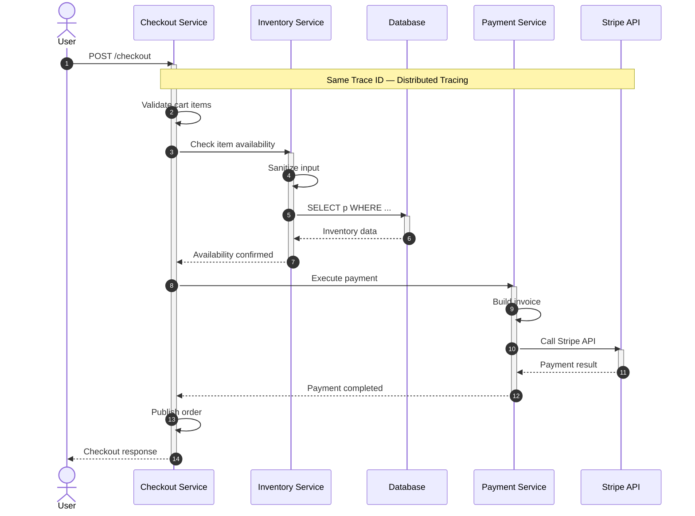

### Trace 與 Span 對應關係

| Service    | Operation / Span        | 類型                       |
| ---------- | ----------------------- | ------------------------ |
| Checkout   | `POST /checkout`        | Root Span                |
| Checkout   | Validate cart items     | Internal Span            |
| Inventory  | Check item availability | Server Span              |
| Inventory  | Sanitize input          | Internal Span            |
| Database   | SELECT p WHERE ...      | Client Span              |
| Payment    | Execute payment         | Server Span              |
| Payment    | Build invoice           | Internal Span            |
| Stripe API | Call Stripe API         | Client Span              |
| Checkout   | Publish order           | Internal / Producer Span |

注意： 這是根據原圖整理的合理循序流程，並非原圖已確認的實際呼叫順序。原圖的 Span Timeline 顯示部分操作可能重疊；若要精確呈現 Parallel Execution，需要真實 Trace 資料確認依賴關係。

重點：Sequence Diagram 顯示服務之間如何呼叫；Gantt Chart 顯示每個 Span 何時開始、結束及持續多久。

## 1.2 Span Elements（Span 的基本資料）


| Element | 中文說明 | 範例 |
|---|---|---|
| **Name** | 操作名稱 | `Execute Payment` |
| **Trace ID** | 所屬 Trace ID | `4bf92f3577b34da6a3ce929d0e0e4736` |
| **Span ID** | 本次操作的識別碼 | `b9c7c989f97918e1` |
| **Start Timestamp** | 開始時間 | `14:32:10.100` |
| **End Timestamp** | 結束時間 | `14:32:10.250` |
| **Duration** | 執行時間 | `150ms` |
| **Attributes** | Key-Value 上下文資訊 | `http.request.method=POST` |
| **Parent Span ID** | 父操作識別碼 | `00f067aa0ba902b7` |
| **Status** | Span 執行狀態 | `OK` / `ERROR` / `UNSET` |

> Root Span 通常沒有 Parent Span。每個 Span 可以擁有多個 Child Spans。
> 重點：同一個 Trace 的各個 Spans 共享 Trace ID，但每個 Span 有自己的 Span ID，而 Child Span 的 Parent Span ID 會指向其 Parent Span 的 Span ID。

### Traces 實際應用

| Information             | 中文說明    | 範例                             |
| ----------------------- | ------- | ------------------------------ |
| Complete Request Path   | 完整請求路徑  | Checkout → Inventory → Payment |
| Operation Duration      | 各操作執行時間 | Payment API = 500ms            |
| Parallel vs. Sequential | 平行或循序執行 | 多個 API 同時執行或依序呼叫               |
| Error Location          | 錯誤發生位置  | Payment → Database Timeout     |

---

## 2. Mermaid：Distributed Tracing 架構

根據第一張圖片的 Checkout、Inventory、Payment 流程：

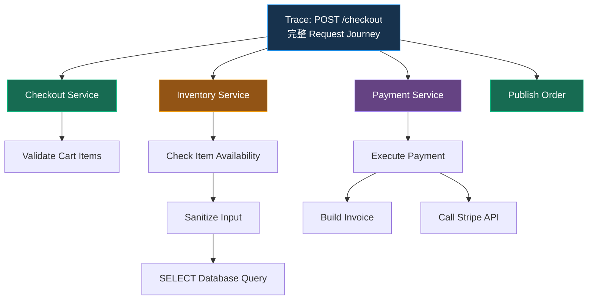

這是依據圖片整理的邏輯示意圖。實際 Trace 中的 Parent-Child Relationships 取決於 Instrumentation，不能僅從圖中的時間位置判定。

## 3. Mermaid：Trace 與 Span 的關係

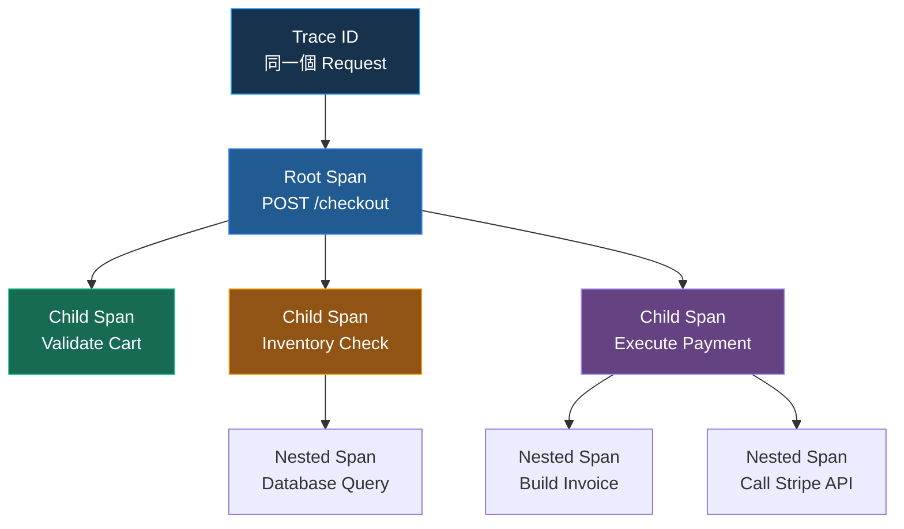


重要觀念：

- Trace ID：整個 Request 使用同一個 ID。
- Span ID：每個 Operation 有自己的 ID。
- Parent Span ID：指出目前 Operation 是由哪個 Parent Span 產生。
- Span Duration：計算某個 Operation 執行多久。
- Nested Spans：表示操作之間的從屬關係，不一定代表循序執行。

## 4. Traces 可以提供甚麼資訊？

| Information           | 中文說明            | 實際例子                            |
| --------------------- | --------------- | ------------------------------- |
| Complete Request Path | Request 經過的完整路徑 | Checkout → Inventory → Payment  |
| Operation Duration    | 每個操作耗時多久        | Database Query = 500ms          |
| Parallel Operations   | 哪些操作平行執行        | Build Invoice 與其他獨立作業           |
| Sequential Operations | 哪些操作依序執行        | Validate Cart → Execute Payment |
| Error Location        | 錯誤發生的位置         | Call Stripe API Timeout         |

## 5. OpenTelemetry + Tempo + Grafana

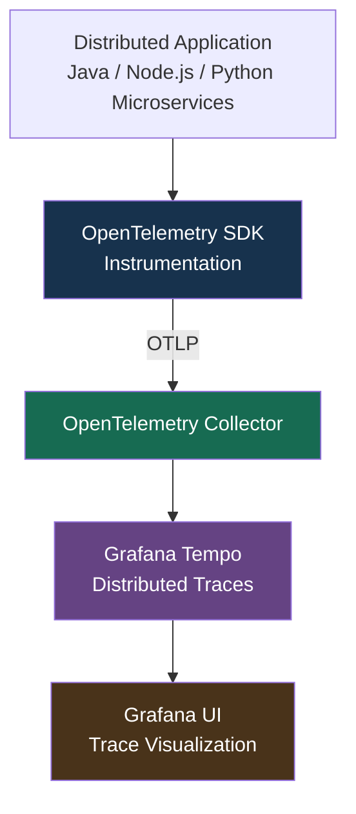

### 實際應用：Payment Transaction

假設 Payment API 總執行時間為 3.2 秒：

| Span                 | Duration |
| -------------------- | -------- |
| Validate Payment     | 80ms     |
| Account Verification | 120ms    |
| Database Query       | 3,000ms  |

這些時間只是示例。實際 Span 可能存在重疊或巢狀關係，因此不能一律直接加總。

透過 Tempo，可以快速發現 Database Query 佔用了大部分執行時間，再利用 Trace ID 關聯 Loki Logs，調查 Database Timeout 或 Slow Query。

## 6. 核心總結

| 名稱                  | 最簡單的理解                          |
| ------------------- | ------------------------------- |
| Trace               | 整筆 Request 的完整執行故事              |
| Trace ID            | 整筆 Request 的共同識別碼               |
| Span                | Request 中的個別操作                  |
| Span ID             | 個別操作的識別碼                        |
| Parent Span ID      | 操作之間的父子關係                       |
| Distributed Tracing | 跨多個 Microservices 追蹤同一筆 Request |
| Tempo               | 儲存及查詢 Traces                    |
| Grafana             | 視覺化 Trace Timeline，分析延遲與錯誤      |

最重要的觀念：一個 Trace 包含多個 Spans；透過 Trace ID 和 Parent-Child Relationships，可以還原一筆 Request 跨不同 Microservices 的完整執行流程。

---
# Which Signals to Use?（應該使用哪些可觀測性訊號？）

> How the Three Signals Complement Each Other（三大訊號如何互相補充）。 Metrics、Traces、Logs 如何互相配合，從偵測系統異常，到定位問題，最後找出錯誤原因。

## 1. 三大訊號的用途

## Metrics、Logs、Traces — 三大可觀測性訊號

| **Metrics（指標）** | **Logs（日誌）** | **Traces（追蹤）** |
|---|---|---|
| ✅ 系統健康狀態儀表板（Dashboards showing system health） | ✅ 詳細錯誤訊息（Detailed error messages） | ✅ 除錯緩慢請求（Debugging slow requests） |
| ✅ 異常條件告警（Alerts on abnormal conditions） | ✅ 業務邏輯除錯（Business logic debugging） | ✅ 服務依賴關係（Service dependencies） |
| ✅ 容量規劃與趨勢分析（Capacity planning and trending） | ✅ 審計追蹤（Audit trails） | ✅ 定位錯誤來源（Finding where errors originate） |
| ✅ 跨服務實例的彙總視圖（Aggregated views across instances） | ✅ 原始數值與豐富上下文（Raw values and rich context） | ✅ 優化關鍵執行路徑（Optimizing critical paths） |

## 2. 三大訊號如何互相配合？ Metrics → Traces → Logs：故障分析流程

### Step 1 — Metrics Alert You（指標發現異常）

Prometheus 偵測到 HTTP Error Rate 持續 5 分鐘超過 1%，觸發告警。

🔴 **HTTP Error Rate > 1% for 5 minutes**

⬇️

### Step 2 — Traces Show You Where（追蹤定位問題）

在 Tempo 搜尋 HTTP 500 的失敗 Requests，檢查 Distributed Trace，找出錯誤發生的 Microservice。

**Checkout → Payment Service → Payment Gateway**

⬇️

### Step 3 — Logs Explain Why（日誌解釋原因）

透過失敗 Request 的 Trace ID，在 Loki 找出詳細 Error Log。

🔴 **ERROR**

```text
Payment gateway returned 503 Service Unavailable — rate limit exceeded.
```

---

### 核心總結

| Signal | 工具 | 主要作用 |
|---|---|---|
| **Metrics** | Prometheus | Detect — 發現異常 |
| **Traces** | Tempo | Locate — 定位問題 |
| **Logs** | Loki | Diagnose — 調查原因 |

**Metrics Alert You → Traces Show You Where → Logs Explain Why**


## Mermaid — 完整故障分析流程

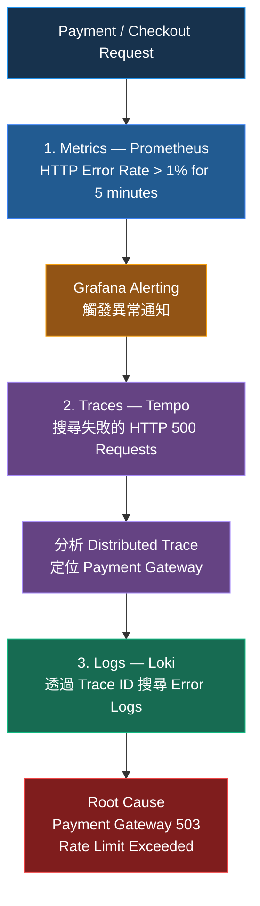

## 4. 核心總結

| Signal  | 關鍵問題             | 工具         |
| ------- | ---------------- | ---------- |
| Metrics | 甚麼時候發生異常？（When?） | Prometheus |
| Traces  | 異常發生在哪裡？（Where?） | Tempo      |
| Logs    | 為甚麼發生異常？（Why?）   | Loki       |

最重要的觀念：

Metrics Alert You → Traces Show You Where → Logs Explain Why

即：

Metrics 發現問題 → Traces 定位問題 → Logs 調查原因

這是非常實用的 Observability 故障分析流程，但並不是固定的調查順序。實際上也可以由 Logs 或 Traces 開始調查，三者互相關聯，才能提高 Root Cause Analysis 的效率。

---
# Service Level Indicators（SLIs） 服務水準指標 

> SLI（Service Level Indicator）是經過特別挑選的指標，用來從使用者的角度，直接衡量服務的實際品質與表現。並非所有 Metrics 都適合作為 SLI。例如 CPU Usage、Memory Usage、Pod Restarts 是重要的系統監控指標，但通常不直接代表使用者體驗。 

## 1. Metrics vs SLI What to Measure?（應該衡量甚麼？）

| Metrics（一般監控指標）  | SLI（服務水準指標）       |
| ----------------------- | ----------------------- |
| HTTP Request Count      | API Availability        |
| HTTP Request Error Rate | API Success Rate        |
| HTTP Request Latency    | Latency Compliance Rate |
| Connection Pool Size    | 通常不是直接的 SLI       |
| DB Query Duration       | DB Query Latency SLI    |
| CPU / Memory Usage      | 通常不是直接的 SLI       |
| Pod Restarts            | 通常不是直接的 SLI       |
| Disk I/O                | 通常不是直接的 SLI       |

重點：Metrics 是原始或衍生的測量數據；SLI 是用來衡量服務品質的特定指標。

## 2. Good SLI Examples（良好的 SLI 範例）

> SLI 是用來衡量服務實際品質的指標，應盡可能反映使用者體驗。

| Service Type | **SLI** | 定義 |
|---|---|---|
| **API Service** | Availability | **非 HTTP 5xx** Responses 的百分比 |
| **API Service** | Latency | 在 500ms 內完成的 Requests 百分比 |
| **Batch Jobs** | Throughput / Timeliness | 在指定時間內完成的 Jobs 百分比 |
| **Batch Jobs** | Correctness | 正確完成的 Jobs 百分比 |
| **Database** | Availability | 成功執行的 Queries 百分比 |
| **Database** | Latency | 在 100ms 內完成的 Queries 百分比 |

注意：API Availability 以非 5xx 回應計算是常見簡化方式，實際應依業務定義哪些請求屬於有效請求，以及哪些回應算成功。例如 HTTP 4xx 不一定代表服務故障。

## 3. SLI 計算方式

### Availability SLI（可用性）

$$
\text{Availability SLI} = \frac{\text{Good Requests}}{\text{Valid Requests}} \times 100\%
$$

例如 10,000 個有效 API Requests，其中 9,990 個成功：

$$
\text{Availability SLI} = \frac{9,990}{10,000} \times 100\% = 99.9\%
$$

### Latency SLI（延遲達標率）

$$
\text{Latency SLI} = \frac{\text{Requests within 500ms}}{\text{Valid Requests}} \times 100\%
$$

例如 10,000 個 Requests，其中 9,800 個在 500ms 內完成：

$$
\text{Latency SLI} = \frac{9,800}{10,000} \times 100\% = 98\%
$$

因此，Latency SLI 與 P95 Latency 不完全相同：

- Latency SLI：在指定時間內完成的 Requests 比例。
- P95 Latency：95% Requests 所對應的延遲時間門檻。

## 4. Mermaid — Metrics 與 SLI 的關係

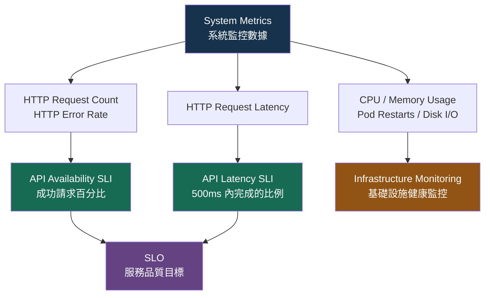

## 5. 對銀行交易系統的實際應用

| Banking Service  | SLI                                | SLO 範例       |
| ---------------- | ---------------------------------- | ------------ |
| Payment API      | Successful Payment Request Rate    | ≥ 99.9%      |
| LC Issuance      | Transaction Completion Latency     | 95% 在 3 秒內完成 |
| Fund Transfer    | Transaction Processing Correctness | ≥ 99.99%     |
| Batch Settlement | On-time Completion Rate            | ≥ 99.9%      |
| Account Inquiry  | API Availability                   | ≥ 99.95%     |

上述 SLO 是示例目標，不是銀行業的統一標準。真正的 SLI 必須明確界定成功、失敗、排除條件及統計窗口。

### 核心觀念

- Metrics：衡量系統運作情況，例如 CPU、Memory、Latency。
- SLI：衡量使用者實際體驗到的服務品質。
- SLO：為 SLI 設定目標，例如 Availability ≥ 99.9%。
- SLA：對客戶作出的服務水準承諾，可能包含違約責任。

Metrics → SLI → SLO → SLA

這是從技術監控指標逐步建立服務可靠性管理的常見思路；SLA 並非每個服務都必須具備。

---
# Service Level Objectives（SLOs）

服務水準目標 — Set Specific Target Values for SLIs（為 SLI 設定具體目標）

> SLO（Service Level Objective）是針對 **SLI**（Service Level Indicator）設定的具體目標值，用來衡量服務是否達到預期的品質與可靠性。

簡單來說：

- SLI = What to Measure?（衡量甚麼？）
- SLO = What Target to Achieve?（要達到甚麼目標？）

## Service Level Objectives（SLOs）

**Set Specific Target Values for SLIs（為 SLI 設定具體目標值）**

SLO 是針對 SLI 設定的服務品質目標，用來定義系統應達到的可靠性、效能與正確性標準。

### 1.1 SLI vs SLO Examples

| Service Type | SLI（衡量指標） | SLO（目標值） |
|---|---|---|
| **API Service** | Availability：非 HTTP 5xx 回應的百分比 | **99.95%** 的 Requests 回傳非 5xx Status Codes |
| **API Service** | Latency：500ms 內完成的 Requests 百分比 | **99%** 的 Requests 在 500ms 內完成 |
| **Batch Jobs** | Timeliness：指定時間內完成的比例 | **99.5%** 的 Reports 在資料到達後 1 小時內產生 |
| **Batch Jobs** | Correctness：正確完成的比例 | **99.99%** 的 Calculations 通過 Validation Checks |

### 1.2 SLI 與 SLO 的關係

- **SLI**：測量實際服務品質，例如 API Availability = 99.97%。
- **SLO**：設定期望的服務品質，例如 API Availability ≥ 99.95%。
- **Evaluation**：比較實際 SLI 與 SLO，判斷服務是否達標。

### Example

- SLI：API Availability = 99.97%
- SLO：API Availability ≥ 99.95%
- Result：PASS（達標）

> SLO 應定義明確的 Measurement Window，例如 Rolling 30 Days，並明確定義哪些 Requests 計入計算。

## 2. Mermaid — SLI → SLO

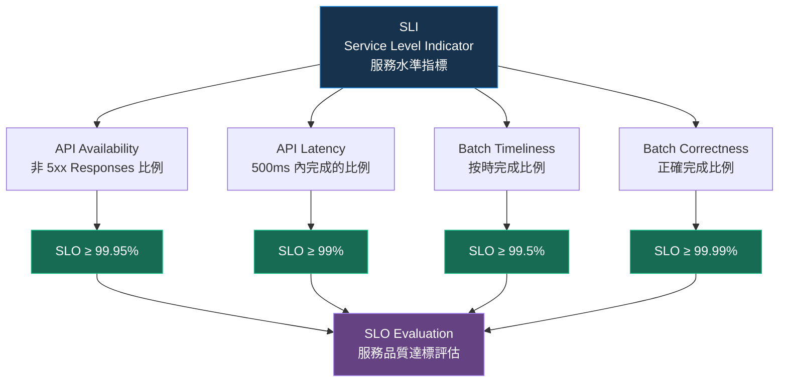

## 3. SLO 的實際計算

假設 API Availability SLO 設定為 99.95%，統計期間為 30 天。

### API Availability SLO（API 可用性目標）

| Metric | Value | Description |
|---|---:|---|
| **API Availability SLO** | **99.95%** | Target（目標可用性） |
| **Total Requests** | **1,000,000** | 一個月內的有效請求總數 |
| **Allowed Bad Requests** | **500** | 允許失敗的最大請求數 |
| **Error Budget** | **0.05%** | 允許的失敗比例 |

### Calculation（計算方式）

$$
\text{Allowed Bad Requests} = 1{,}000{,}000 \times (1 - 0.9995) = 500
$$

### Explanation（說明）

當一個月有 **1,000,000** 個有效 Requests 時：

- **SLO = 99.95%**：至少 99.95% 的 Requests 必須成功。
- **Allowed Bad Requests = 500**：最多允許 500 個失敗 Requests。
- **Error Budget = 0.05%**：允許的失敗比例。

這 **500 個 Bad Requests** 就是這段期間的 **Error Budget（錯誤預算）**。

> **核心觀念：** SLO 定義服務品質目標，而 Error Budget 定義在指定期間內可以容忍多少失敗。


## 4. SLI、SLO、SLA 的差異

| Concept | 核心問題           | 範例                               |
| ------- | -------------- | -------------------------------- |
| SLI     | 實際服務品質是多少？     | API Availability = 99.97%        |
| SLO     | 服務品質至少要多少？     | API Availability ≥ 99.95%        |
| SLA     | 對客戶承諾的服務品質是多少？ | Contractual Availability ≥ 99.9% |

> 核心觀念：SLI 負責測量，SLO 負責設定目標，SLA 負責定義對外服務承諾。

> 對於銀行 Payment、Trade Finance 和其他關鍵交易服務，建議同時設定 Availability、Latency 和 Correctness SLO，而不只是確認 API 有沒有回傳 HTTP 200。

---
# Service Level Agreements（SLAs）

- 服務水準協議 — Contractual Agreements with Customers（與客戶簽訂的服務水準合約）
- SLA（Service Level Agreement）是服務提供者與客戶之間的正式協議，明確規定服務品質、可用性目標，以及未達標時可能產生的合約責任。

**Contractual Agreements with Customers（與客戶簽訂的服務水準合約）**

SLA 是服務提供者向客戶作出的正式服務品質承諾，通常包括 Availability、Performance、Support Response Time，以及未達標時的補償或責任。

## 1.1 SLI vs SLO vs SLA

| Concept | 中文名稱 | 定義 | 範例 |
|---|---|---|---|
| **SLI** | 服務水準指標 | 衡量服務的實際品質 | Availability = 99.97% |
| **SLO** | 服務水準目標 | 內部設定的服務品質目標 | Availability ≥ 99.95% |
| **SLA** | 服務水準協議 | 對客戶作出的合約承諾 | Availability ≥ 99.9% |

### SLO 與 SLA 的關係

一般建議：

**SLO Target ≥ SLA Commitment**

例如：

- Internal SLO：99.95%
- Customer SLA：99.9%
- Internal Buffer：0.05 個百分點

> 建議將內部 SLO 設定得比客戶 SLA 更嚴格，以保留營運緩衝。但這是常見設計原則，並非所有 SLA 的強制規定。

## 1.2 Availability SLA 與允許停機時間

以下以每月 30 天（720 小時）為例：

| Availability SLA | 每月允許停機時間 | 實現難度（示意） |
|---|---|---|
| **99%** | 約 7 小時 12 分鐘 | 相對容易 |
| **99.9%** | 約 43 分 12 秒 | 需要**良好的維運實務** |
| **99.99%** | 約 4 分 19 秒 | 需要**成熟的自動化與高可用架構** |
| **99.999%** | 約 26 秒 | 需要高度可靠的系統及重大投資 |

### Calculation（計算方式）

$$
\text{Allowed Downtime} = \text{Total Time} \times (1-\text{SLA Target})
$$

例如 SLA = 99.9%：

$$
720 \times (1-0.999) = 0.72 \text{ hours}
$$

即約 **43 分 12 秒**。

> 實際 SLA 停機時間取決於合約規定的 Measurement Window、服務時段、排除條件及可用性計算方式。

## 1.3 Why Not Promise More?（為甚麼不承諾更高的 SLA？）

主要原因是 **Cost（成本）與 Opportunity Cost（機會成本）**。

每增加一個 9（例如 99.9% → 99.99%），允許的停機時間便減少 90%。

通常需要投入更多資源，例如：

- High Availability（高可用性架構）
- Redundancy（系統及網路冗餘）
- Automatic Failover（自動故障切換）
- Disaster Recovery（災難復原）
- Continuous Monitoring（持續監控）
- Automated Testing & Deployment（自動化測試與部署）
- 24/7 Operations Support（全天候營運支援）

### 核心觀念

**Higher Availability → Lower Allowed Downtime → Higher Reliability Investment**

可用性要求越高，通常需要投入越多成本與工程資源，但成本不一定以固定的指數比例增加。

因此，SLA 應依照業務重要性、客戶需求、風險承受能力及成本效益來設定。

## 2. Availability SLA 與每月停機時間

每月允許停機時間

假設每月 30 天，單位：秒，便於比較不同 SLA

0 秒7K 秒14K 秒21K 秒28K 秒99%99.9%99.99%99.999%

| Sla     | Seconds |
| ------- | ------- |
| 99%     | 25920   |
| 99.9%   | 2592    |
| 99.99%  | 259.2   |
| 99.999% | 25.92   |

從圖表可見，SLA 每提高一個 9，允許的停機時間就縮減至原來的十分之一。

## 3. SLI、SLO、SLA 的關係

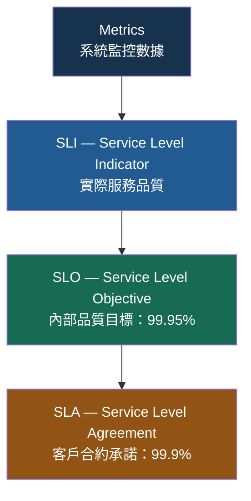

## 4. 銀行系統應如何設定 SLA？

例如 Payment、Trade Finance、SCF、Treasury Settlement 等系統：

| 系統類型                | 建議評估的 SLA 指標                                         |
| ------------------- | ---------------------------------------------------- |
| Payment Processing  | Availability、Transaction Completion、Response Time    |
| Trade Finance       | Application Availability、Transaction Processing Time |
| SCF                 | API Availability、Transaction Processing Correctness  |
| Treasury Settlement | Settlement Timeliness、Service Availability           |
| Batch Processing    | On-time Completion、Successful Processing Rate        |

對銀行業而言，Availability SLA 不應只看 API 是否正常回應，還需要考慮交易是否正確、是否準時完成，以及是否符合業務截止時間（Cut-off Time）。

### 核心總結

- SLI = Measure（衡量）
- SLO = Target（內部目標）
- SLA = Commitment（對客戶的合約承諾）
- Error Budget = Allowed Unreliability（容許的不可靠程度）

實務上可以設定 Internal SLO = 99.95%，Customer SLA = 99.9%，透過更嚴格的內部標準降低違反客戶服務承諾的風險。

---
# Error Budgets（錯誤預算）

**How Much You Can Afford to Fail（可以容忍多少失敗？）**

Error Budget 是 100% 與 SLO Target 之間的差額。 根據 SLO（Service Level Objective）計算出來的允許失敗額度，用來平衡系統可靠性（Reliability）與新功能開發速度（Development Velocity）。

例如，當 Availability SLO = 99.9%：

$$
\text{Error Budget} = 100\% - 99.9\% = 0.1\%
$$

### 1.1 Error Budget Calculation（錯誤預算計算）

假設每月 30 天，服務為 24/7 運作：

| Metric                       |        Value |
| ---------------------------- | -----------: |
| **Availability SLO**   |        99.9% |
| **Error Budget**       |         0.1% |
| **Measurement Period** |      30 Days |
| **Total Minutes**      |       43,200 |
| **Allowed Downtime**   | 43.2 Minutes |

計算方式：

$$
\text{Total Minutes} = 30 \times 24 \times 60 = 43{,}200
$$

$$
\text{Allowed Downtime} = 43{,}200 \times (1-0.999) = 43.2
$$

因此，在 30 天的統計期間內，Availability SLO = 99.9% 代表最多允許 **43.2 分鐘（43 分 12 秒）** 的停機時間。

這 43.2 分鐘就是該期間的 **Error Budget（錯誤預算）**。

> 此例採用 Time-based Availability SLI。若使用 Request-based SLI，則應以允許失敗的 Requests 數量計算 Error Budget。

### 1.2 Error Budget Policy（錯誤預算政策）

| Condition               | Error Budget > 0             | Error Budget ≤ 0            |
| ----------------------- | ---------------------------- | ---------------------------- |
| **Status**        | 尚有剩餘預算                 | 預算已耗盡或超支             |
| Feature Deployment      | 可以評估部署風險較高的新功能 | 暫停高風險部署               |
| Deployment Frequency    | 可以較頻繁部署               | 優先部署修復與可靠性改善     |
| Production Experiments  | 可以進行受控實驗             | 暫緩非必要的高風險實驗       |
| Risk Management         | 承擔經過評估的風險           | 優先降低系統風險             |
| Reliability Improvement | 持續改善                     | 集中資源提升可靠性           |
| Technical Debt          | 正常管理                     | 優先處理影響可靠性的技術債   |
| Root Cause Analysis     | 持續監控與分析               | 調查並修復近期故障的根本原因 |

### 1.3 Error Budget 的核心目的

**Error Budget > 0（仍有預算）**

- ✅ 在風險可控下加快功能交付。
- ✅ 提高部署頻率。
- ✅ 進行受控的 Production Experiments。
- ✅ 在**可靠性**與**創新**之間取得平衡。

**Error Budget ≤ 0（預算耗盡）**

- ✅ 暫停高風險或非必要的功能部署。
- ✅ 優先**改善系統可靠性**。
- ✅ 處理重要 Technical Debt。
- ✅ **調查**及**修復**近期 Outages 的 Root Causes。

> Error Budget Policy 是常見的 SRE 管理方法，不代表預算尚未耗盡就可以無限制冒險。實際部署決策仍應考慮 Error Budget Burn Rate、事故嚴重程度及業務風險。

## 2. Error Budget 如何消耗？

以下用 30 天、Availability SLO = 99.9% 的例子說明。  

> Refer to `README-3.3Error-Budget-calculator.html`

## 3. Mermaid — Error Budget Decision Flow

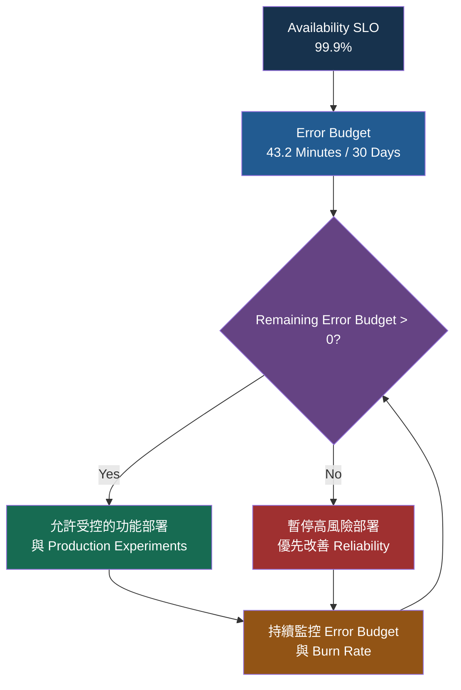

## 4. Error Budget 與 SLI / SLO / SLA 的關係

| Concept      | 定義                    | 範例                                  |
| ------------ | ----------------------- | ------------------------------------- |
| SLI          | 實際服務品質            | Availability = 99.95%                 |
| SLO          | 內部可靠性目標          | Availability ≥ 99.9%                 |
| SLA          | 對客戶的服務品質承諾    | Availability ≥ 99.5%                 |
| Error Budget | SLO 允許的不可靠程度    | 0.1%                                  |
| Burn Rate    | Error Budget 的消耗速度 | 目前消耗速度為預算允許平均速度的 5 倍 |

### 核心觀念

Error Budget 是可靠性與開發速度之間的管理工具。

- Budget Remaining：可以在風險可控的條件下持續交付。
- Budget Exhausted：優先解決可靠性問題。
- High Burn Rate：即使還有預算，也可能需要提前採取行動。

對於銀行 Payment、Trade Finance、SCF、Treasury 等關鍵交易系統，應特別注意：Error Budget 並不代表可以容許錯誤付款、資金損失或違反合規要求。 這類問題應設有獨立且更嚴格的 Correctness、Security 與業務風險控制。

---
# The Four Golden Signals（四大黃金監控訊號）

Google SRE （Site Reliability Engineering）建議透過**四個核心指標**監控服務的健康狀態：

| Golden Signal | 核心問題 | 監控內容 |
|---|---|---|
| **Latency（延遲）** | How long does it take? | API Response Time、P50 / P95 / P99 |
| **Traffic（流量）** | How much demand? | Requests per Second、Queries per Second |
| **Errors（錯誤）** | What's the rate of failures? | HTTP Error Rate、Failed Transactions、Timeouts |
| **Saturation（飽和度）** | How full is the system? | CPU、Memory、Disk、Network、DB Connections |

## 1.1 Latency（延遲）

**How long does it take?（處理請求需要多久？）**

- ✅ 測量 Requests 的 **Response Time**。
- ✅ 區分成功 Requests 與失敗 Requests 的延遲。
- ✅ 監控 **P50、P95、P99**，而不只是 Average Latency。

例如：

- P50 = 100ms
- P95 = 500ms
- P99 = 2,000ms

## 1.2 Traffic（流量）

**How much demand?（系統承受多少請求？）**

- ✅ 測量 Requests per Second（**RPS**）。
- ✅ 測量 Queries per Second（**QPS**）。
- ✅ 根據業務類型定義適合的流量單位。
- ✅ 協助了解系統負載及容量需求。

例如：

- Payment API = 500 RPS
- Database = 2,000 QPS

## 1.3 Errors（錯誤）

**What's the rate of failures?（請求失敗率是多少？）**

- ✅ 測量**失敗 Requests** 的百分比。
- ✅ 明確定義哪些回應屬於 Error。
- ✅ 根據業務需求判斷 **HTTP 4xx** 是否計入錯誤率。
- ✅ 將 Timeout、**HTTP 5xx** 及其他業務失敗納入適當的錯誤指標。

例如：

- HTTP 500 Internal Server Error
- HTTP 503 Service Unavailable
- Database Timeout

## 1.4 Saturation（飽和度）

**How full is the system?（系統資源使用接近上限了嗎？）**

- ✅ 監控 CPU、Memory、Disk、Network Bandwidth。
- ✅ 監控 Database Connection Pool 使用情況。
- ✅ 觀察系統是否接近資源或處理容量上限。
- ✅ 提前發現可能造成效能下降的容量瓶頸。

例如：

- CPU Usage = 90%
- Memory Usage = 85%
- Database Connection Pool = 95%

> 高 Saturation 代表系統接近某項資源的容量限制，可能導致 Latency 增加、Queue 堆積或 Error Rate 上升。

## 2. Mermaid — Four Golden Signals

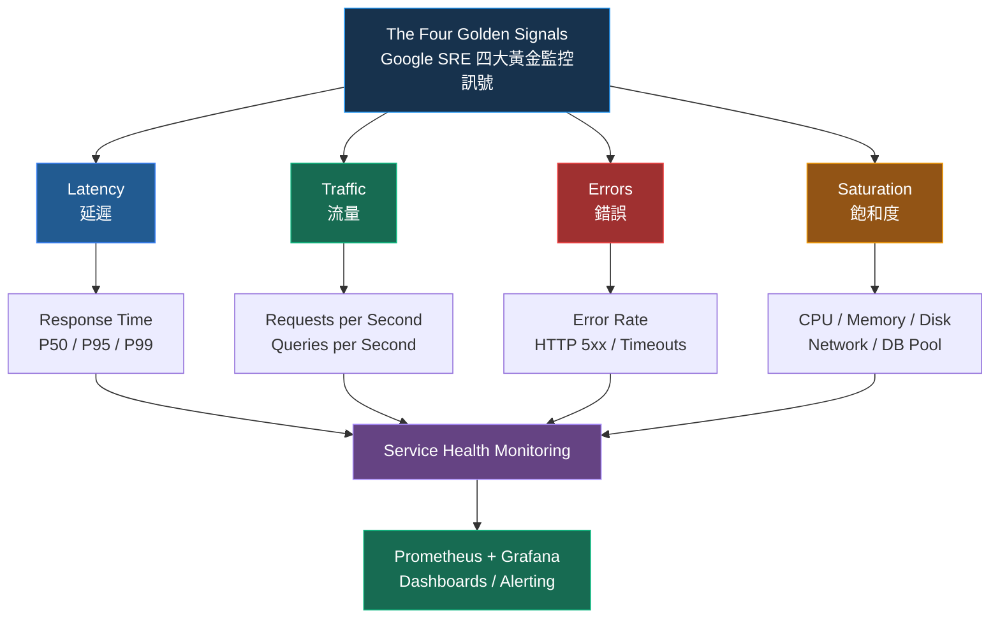

## 3. 銀行 Microservices 實際應用

| Golden Signal | Payment Microservice 範例   | 可能的 Alert        |
| ------------- | ------------------------- | ---------------- |
| Latency       | Payment API P95 = 2 秒     | P95 > 1 秒        |
| Traffic       | 500 Transactions / Second | TPS 異常下降         |
| Errors        | Payment Failure Rate = 2% | Error Rate > 1%  |
| Saturation    | DB Connection Pool = 95%  | Pool Usage > 90% |

以上均為示例值，實際 Threshold 應根據系統容量、流量基線及 SLO 設定。

## 4. Four Golden Signals 與 SLI / SLO 的關係

| Golden Signal | 能否作為 SLI？  | SLO 範例                                  |
| ------------- | ---------- | --------------------------------------- |
| Latency       | ✅ 常見       | 99% 的 Requests 在 500ms 內完成              |
| Traffic       | 視需求        | 每秒處理能力達到指定容量                            |
| Errors        | ✅ 常見       | Request Success Rate ≥ 99.95%           |
| Saturation    | 通常屬於內部監控指標 | DB Connection Pool Usage 保持低於 85%（營運目標） |

關鍵差異： Four Golden Signals 用來監控服務的整體運作，而 SLI / SLO 主要用來衡量及管理服務品質目標。

### 核心總結

- Latency：系統處理得有多快？
- Traffic：系統正在處理多少工作？
- Errors：有多少工作執行失敗？
- Saturation：系統距離資源容量上限還有多遠？

Four Golden Signals + SLI / SLO + Error Budget + Prometheus / Grafana，可以建立一套實用的 Production Service Reliability Monitoring Framework。

---
