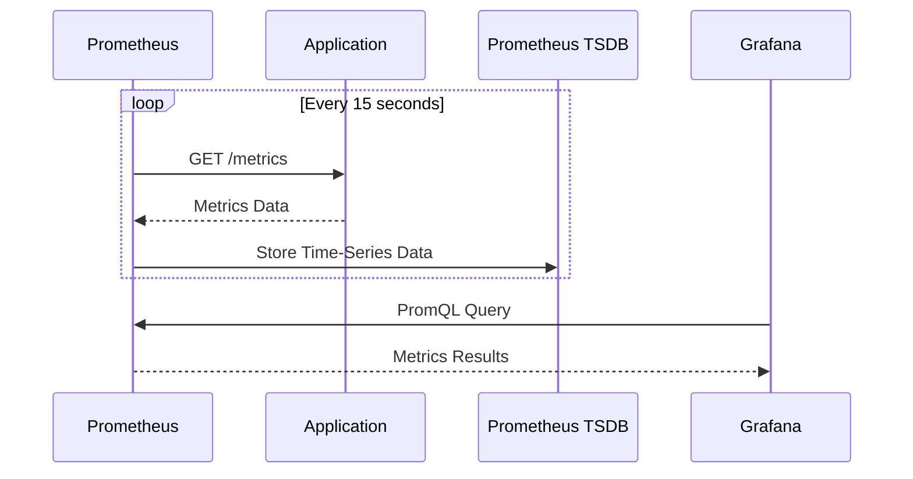
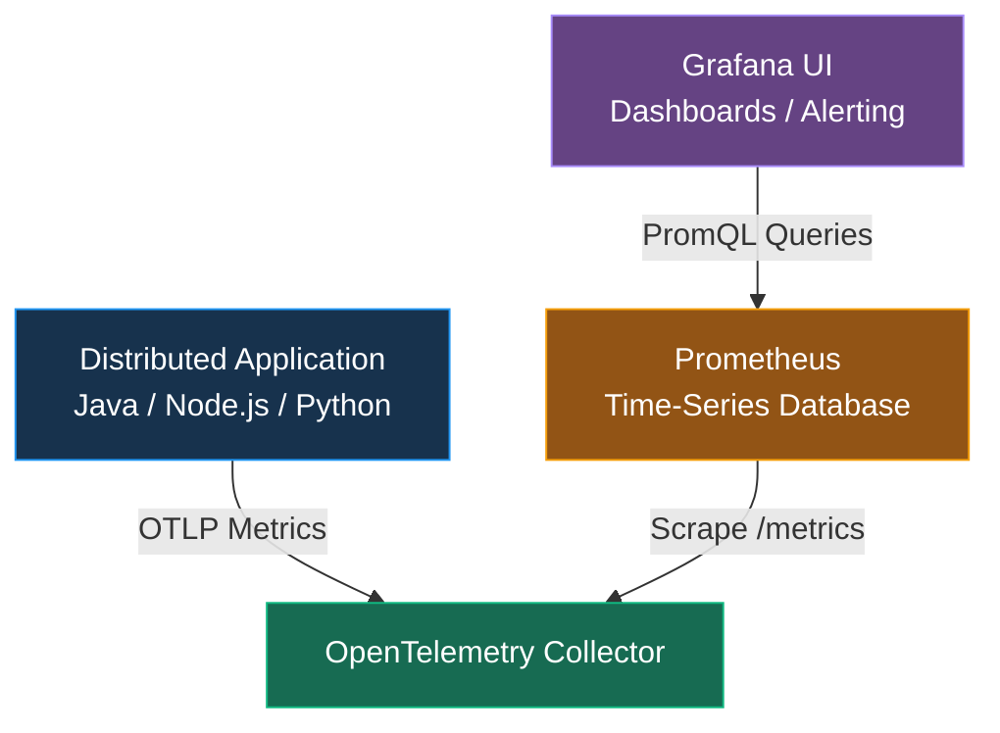
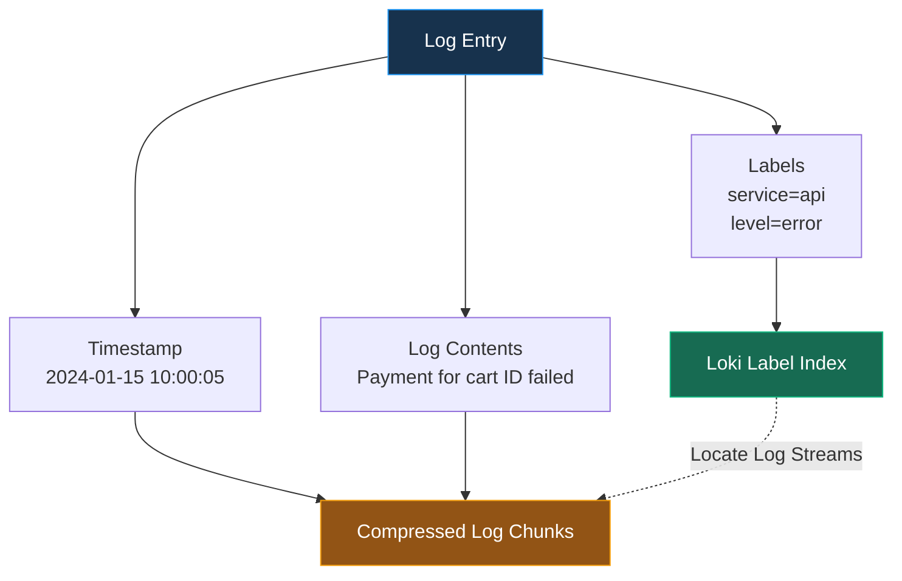
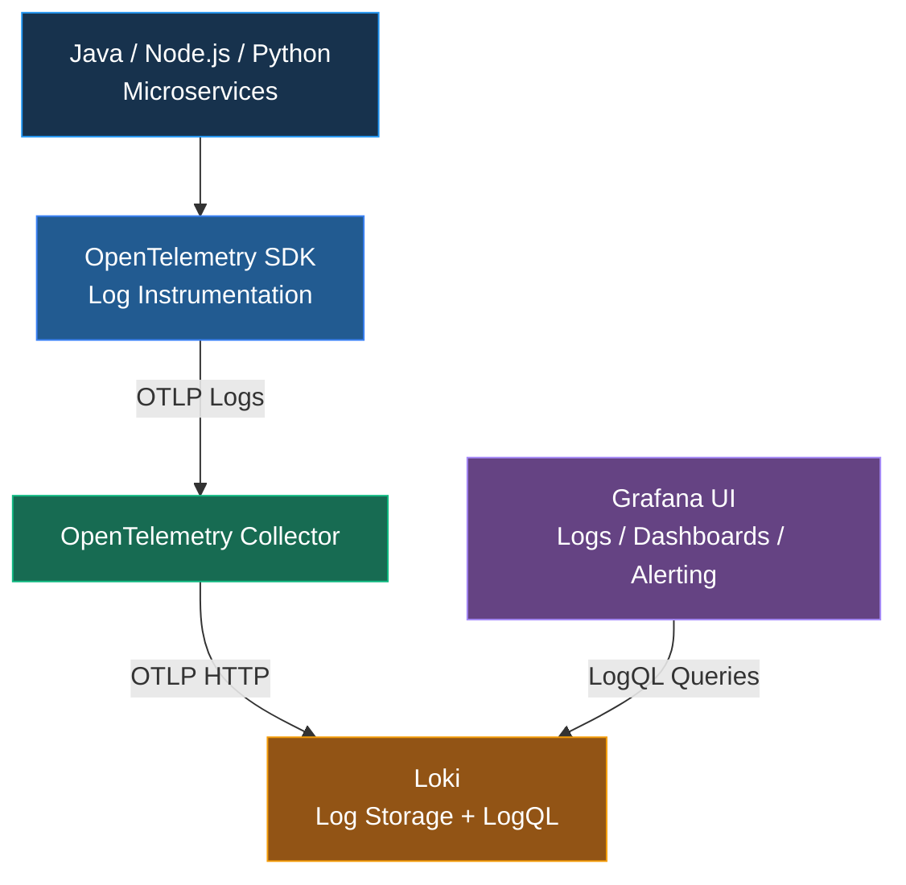
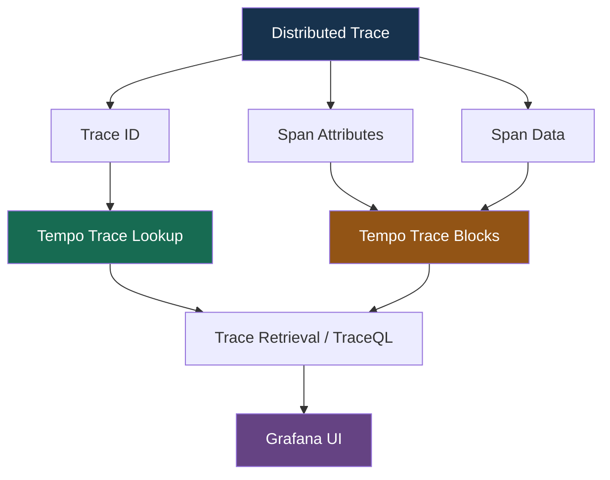
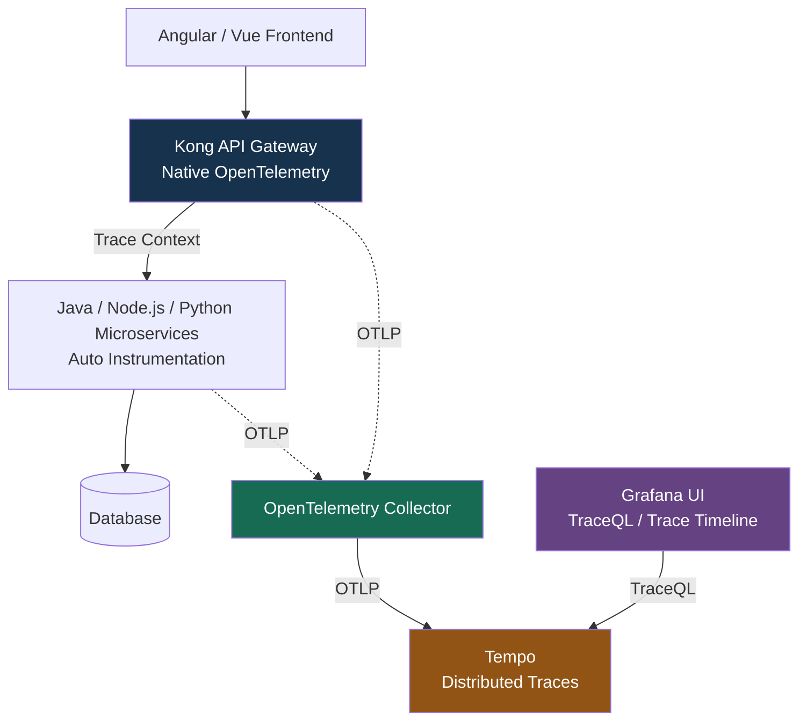
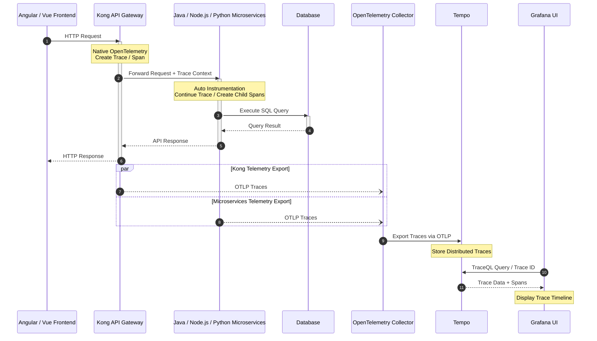
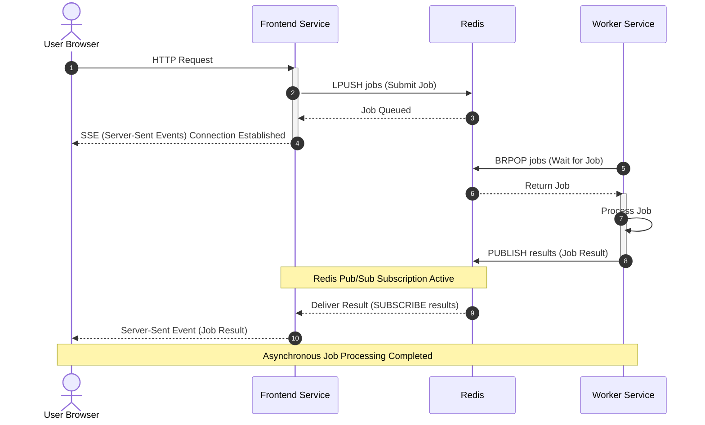
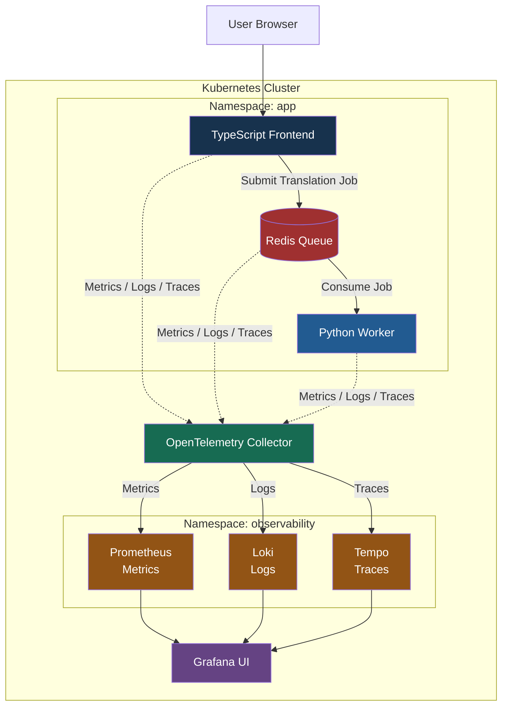
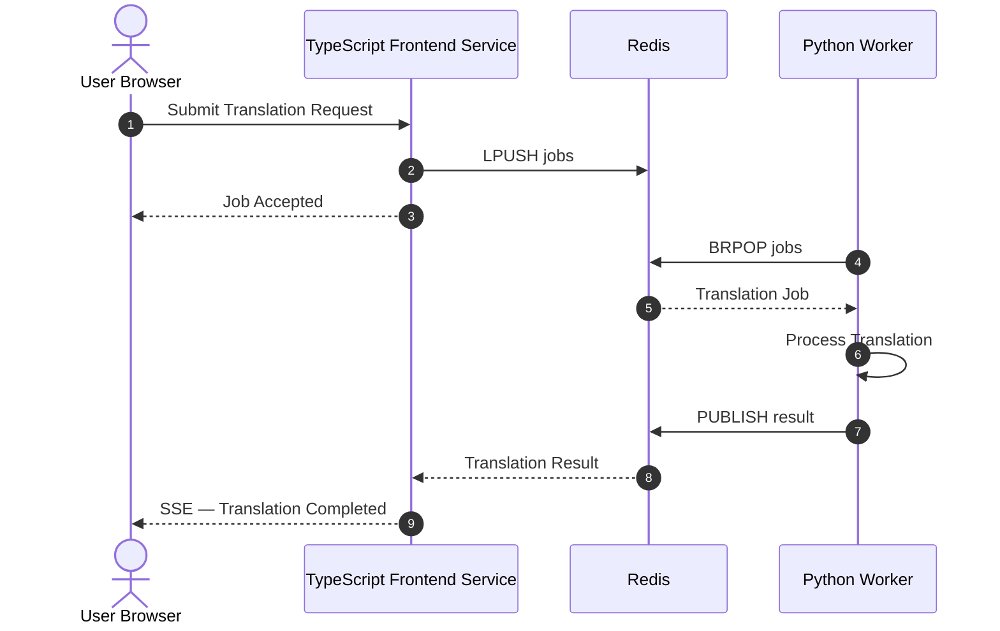

# Setting Up the Observability Stack（建立可觀測性技術架構）

## Section Overview（章節概覽）

### 1. Local Environment Setup（本地環境設定）

- 建立本地開發及測試環境。
- 準備 Docker / Docker Compose，以部署 Observability Stack。

### 2. Deploy Observability Backends（部署可觀測性後端）

1. 了解 **Prometheus、Loki、Tempo 和 Grafana** 在 Observability Stack 中各自扮演的角色。
2. 使用 **Docker Compose** 部署及運行各項服務。

| Component | Responsibility（主要職責） |
|---|---|
| **Prometheus** | Metrics Collection & Storage（指標收集與儲存） |
| **Loki** | Logs Storage & Query（日誌儲存與查詢） |
| **Tempo** | Distributed Tracing（分散式追蹤） |
| **Grafana** | Unified Visualization & Alerting（統一視覺化與告警） |

### 3. Application and Architecture（應用程式與系統架構）

1. 使用 **Distributed Translation Application（分散式翻譯應用程式）** 作為課程的 Instrumentation Target（監控埋點對象）。
2. 了解 Telemetry Signals（Metrics、Logs、Traces）如何從 Application 傳送至 Observability Backends，最後透過 Grafana UI 統一查詢及呈現。

### 核心架構

**Distributed Application → OpenTelemetry → Prometheus / Loki / Tempo → Grafana UI**

> **學習目標：** 能夠在本地使用 Docker Compose 建立完整的 Observability Stack，並理解 Application Telemetry Data 的收集、傳送、儲存及視覺化流程。

---

# Environment Check

Refer to `lab-setup.md`

```bash
# Docker
docker --version

# k8s
kubectl version
​kubectl config current-context

```

---

# Prometheus in 5 Minutes（5 分鐘了解 Prometheus）

Understand the Main Components and Characteristics of Prometheus（了解 Prometheus 的主要元件與特性）

Prometheus 是一個開源的 Time-Series Database（時間序列資料庫）與 Monitoring System，主要用來收集、儲存、查詢 Metrics，並支援監控與告警。

## 1. Prometheus 核心概念

| Component / Concept | 中文說明                      | 主要用途                         |
| ------------------- | ------------------------- | ---------------------------- |
| Prometheus          | 時間序列資料庫及監控系統              | 儲存與查詢 Metrics                |
| Pull-Based System   | 主動抓取監控數據                  | 定期從 `/metrics` Endpoint 收集指標 |
| Time-Series Data    | 時間序列資料                    | 記錄 Metrics 隨時間的變化            |
| Labels              | 指標的 Key-Value 屬性          | 區分 HTTP Method、Path、Status   |
| PromQL              | Prometheus Query Language | 查詢、聚合及計算 Metrics             |
| Exporter            | 指標匯出元件                    | 將系統或服務資訊暴露為 Metrics          |
| Grafana             | 視覺化平台                     | Dashboard、查詢及 Alerting       |

> OTLP — OpenTelemetry Protocol（OpenTelemetry 傳輸協定）

## 2. Pull-Based System（主動抓取模式）

Prometheus 預設透過 Pull-Based 方式收集 Metrics。



`15 seconds` 是常見的 Scrape Interval 範例，**可自行配置**。

## 3. Data Structure（資料結構）

Prometheus Metrics 由 Metric Name + Labels + Timestamp + Value 組成。

例如：

```json
http_requests_total{method="GET", path="/api/users"}
http_requests_total{method="POST", path="/api/users"}

```

這兩筆 Metrics 使用相同的 Metric Name，但 Labels 不同，因此屬於不同的 Time Series。

| Element     | 說明        | 範例                     |
| ----------- | --------- | ---------------------- |
| Metric Name | 指標名稱      | `http_requests_total`  |
| Label       | 用來區分指標的維度 | `method="GET"`         |
| Timestamp   | 採樣時間      | `2026-10-20T10:00:00Z` |
| Value       | 指標數值      | `1250`                 |

## 4. PromQL — Prometheus Query Language

PromQL 是用於查詢及計算時間序列資料的語言。

### PromQL 常用語法

| 功能 | PromQL 範例 | 說明 |
|---|---|---|
| **Filter by Labels** | `http_requests_total{status="500"}` | 查詢 HTTP 500 的累計請求數 |
| **Rate** | `rate(http_requests_total[5m])` | 計算最近 5 分鐘的每秒平均請求增加率 |
| **Aggregation** | `sum by (path) (rate(http_requests_total[5m]))` | 依 API Path 統計每秒請求量 |
| **Percentiles** | `histogram_quantile(0.99, ...)` | 估算 P99 Latency |

> 以上假設相應 Metric Names 與 Labels 已存在，並且使用對應的 Prometheus Histogram 類型。

## 5. Prometheus + OpenTelemetry + Grafana 架構



此圖代表 Collector 暴露 Prometheus 相容的 `/metrics` Endpoint，再由 Prometheus 抓取。實際配置也可以使用 Prometheus OTLP Receiver 接收 Push Metrics。

## 6. Prometheus、Loki、Tempo 的差異

| Component  | Data Type             | Query Language     |
| ---------- | --------------------- | ------------------ |
| Prometheus | Metrics               | PromQL             |
| Loki       | Logs                  | LogQL              |
| Tempo      | Distributed Traces    | TraceQL            |
| Grafana    | Unified Visualization | 透過各 Data Source 查詢 |

### 核心觀念

- Prometheus = Metrics Collection + Time-Series Storage + PromQL
- OpenTelemetry = Instrumentation + Telemetry Collection / Export
- Grafana = Unified Dashboard + Visualization + Alerting

對你的 Kubernetes + Microservices 架構而言，Prometheus 特別適合監控 API Request Rate、Error Rate、P95/P99 Latency、CPU/Memory Usage，以及 Database Connection Pool Saturation。

另外，應避免使用高基數（High Cardinality）的 Metrics Labels，例如每一筆交易的 Transaction ID 或每位客戶的 ID；這些識別資訊較適合放在 Logs 或 Traces，以免造成 Prometheus Time-Series 數量急劇增加。

---

## Hands on Prometheus

Refer to `opentelemetry-course/labs/section-setup/lab-deploy-prometheus.md` 

Create 3 files in folder `handson-lab/componse`: # 9090 => 9100

- prometheus.yaml
- compose.observability.yaml
- compose.yaml

```bash
cd handson-labs/compose/
docker compose up

docker compose up -d
docker compose ps
```

- Open http://localhost:9100 in your browser => Status > Target health

Try these queries in the Prometheus UI:

- **Current scrape duration**: `scrape_duration_seconds`
- **Rate of HTTP requests**: `rate(prometheus_http_requests_total[5m])`
- **Memory usage**: `process_resident_memory_bytes / 1024 / 1024` (converts to MB)
- **Uptime**: `time() - process_start_time_seconds`

---
# Loki in 5 Minutes（5 分鐘了解 Loki）

- Grafana Loki 是一個開源的 Log Aggregation System（日誌聚合系統），專門用來集中儲存、查詢及分析 Application Logs。
- Loki 的主要設計特色是 Metadata Indexing（中繼資料索引）：主要索引 Labels，而**不是對所有 Log Contents 建立全文索引**，因此通常可以降低日誌索引及儲存成本。


## 1.1 Loki 核心概念

| Component / Concept | 中文說明 | 主要用途 |
|---|---|---|
| **Loki** | 日誌聚合系統（Log Aggregation System） | 集中儲存及查詢 Application Logs |
| **Metadata Indexing** | 中繼資料索引 | 主要索引 Labels，不對所有 Log Contents 建立全文索引 |
| **Labels** | Key-Value 標籤 | 區分 Service、Environment、Namespace |
| **Log Streams** | 日誌資料流 | 將具有相同 Labels 的 Logs 組成一個 Stream |
| **LogQL** | Loki Query Language | 查詢、篩選、解析及統計 Logs |
| **OpenTelemetry Collector** | Telemetry 收集及轉送 | 將 Application Logs 傳送至 Loki |
| **Grafana** | 統一視覺化平台 | 查詢 Logs、Dashboard、Alerting |

## 1.2 Metadata Indexing（中繼資料索引）

Loki 將 Logs 分成兩個主要部分：


### Loki — Log Storage Structure - Metadata Indexing

| Log Entry | Example | Loki Storage | Description |
|---|---|---|---|
| **Timestamp** | `2024-01-15 10:00:05` | Log Chunks + 時間範圍索引資訊 | 記錄事件發生時間，協助依時間範圍查詢 |
| **Labels** | `service="api"`、`level="error"` | Label Index | 索引 Metadata，用來定位相關 Log Streams |
| **Log Contents** | `Payment for cart {id} failed` | Compressed Log Chunks | 儲存實際日誌內容，不建立一般全文索引 |

### 核心觀念

- **Labels**：用來快速找到相關 Log Streams。
- **Log Contents**：保存實際事件、錯誤及上下文。
- **Metadata Indexing**：減少全面建立文字索引所需的資源。

> Loki 仍然支援 Log Contents 搜尋，但不像 OpenSearch 那樣主要依賴文件欄位及全文索引進行搜尋。



## 2. LogQL — Loki Query Language

LogQL 是 Loki 的查詢語言，結合 Label Selection、Log Filtering、Parsing 以及 Metrics Aggregation。

### LogQL 常用語法

| 功能 | LogQL 範例 | 說明 |
|---|---|---|
| **Filter by Labels** | `{job="frontend", environment="production"}` | 查詢 Production Frontend Logs |
| **Line Filter** | `{job="frontend"} \|= "error"` | 搜尋包含 `error` 的 Logs |
| **Regex Filter** | `{job="frontend"} \|~ "timeout\|failed"` | 使用 Regex 搜尋 Timeout 或 Failed |
| **JSON Parser** | `{job="frontend"} \| json \| status_code >= 500` | 解析 JSON 並查詢 HTTP 5xx |
| **Log Rate** | `sum(rate({job="frontend"} \|= "error" [5m]))` | 計算最近 5 分鐘每秒平均 Error Log 數量 |

上述查詢假設對應 Labels 與 JSON 欄位存在。

### LogQL 實際範例

查詢 Payment Service 的 Error Logs：

```sql
{service_name="payment-service"} |= "ERROR"
```

如果 Application 使用 Structured JSON Logging：

```sql
{service_name="payment-service"} | json | level="ERROR"
```

可依照 JSON 欄位進行更精確的篩選。

## 3. Loki + OpenTelemetry + Grafana 架構



這裡的 OpenTelemetry SDK 負責 Log Instrumentation，Collector 負責接收及轉送。

對 Kubernetes Container stdout/stderr Logs，也可以使用 Collector 的 `filelog` Receiver 或其他 Log Agent 收集，不一定需要在 Application 內加入 Logging SDK。

## 4. Loki 與 OpenSearch 的差異

| 比較項目                 | Loki                               | OpenSearch                            |
| -------------------- | ---------------------------------- | ------------------------------------- |
| 主要用途                 | Log Aggregation                    | Search & Analytics                    |
| Indexing             | 主要索引 Labels                        | 索引文件欄位                                |
| Query Language       | LogQL                              | Query DSL / PPL / SQL                 |
| Log Storage          | 壓縮 Log Chunks                      | Indexed Documents                     |
| Full-text Search     | 支援掃描內容搜尋                           | 強大的全文索引搜尋                             |
| Trace ID Correlation | 支援                                 | 支援                                    |
| Grafana Integration  | 原生整合                               | 可透過 Data Source 整合                    |
| 資源成本                 | 通常較低                               | 通常較高                                  |
| 適合用途                 | Microservices Logs、Troubleshooting | Complex Log Analytics、Security Search |

## 5. 核心總結

- Loki = Log Aggregation + Metadata Indexing + LogQL
- OpenTelemetry = Log Instrumentation + Collection + Export
- Grafana = Unified Log Visualization + Alerting

對 Kubernetes + Microservices 架構而言，Loki 特別適合集中管理 Application Logs，並透過 Trace ID 關聯 Tempo 的 Distributed Traces。

> 建議在 Production 使用 Structured JSON Logging，並合理設計 Labels，避免將 Transaction ID、User ID 或 Trace ID 等高基數資料設定為一般索引 Labels，以免增加 Loki 的資源消耗。

## 6. Loki vs Prometheus vs Tempo

| Component  | Data Type | Query Language     | 主要功能        |
| ---------- | --------- | ------------------ | ----------- |
| Prometheus | Metrics   | PromQL             | 指標與效能監控     |
| Loki       | Logs      | LogQL              | 日誌搜尋及錯誤分析   |
| Tempo      | Traces    | TraceQL            | 分散式追蹤       |
| Grafana    | All Three | 透過各 Data Source 查詢 | 統一查詢、視覺化與告警 |

最重要的觀念：Prometheus 告訴你系統何時出現異常；Tempo 協助定位問題發生在哪裡；Loki 提供詳細 Logs，幫助分析為甚麼發生異常。

---

## Hands on Loki

Refer to `opentelemetry-course/labs/section-setup/lab-deploy-loki.md` 

Create 1 file in folder `handson-lab/componse`: 

- loki-config.yaml
- Then update `compose.observability.yaml` & `prometheus.yaml`

> Change to port 3110 for Loki

```bash
docker compose up -d
docker compose ps
docker network inspect observability
docker network ls | grep observability

docker compose restart prometheus
```

```json docker network inspect observability
{
  "Containers": {
    "abc123": {
      "Name": "prometheus"
    },
    "def456": {
      "Name": "loki"
    }
  }
}
```

### Test Loki
1. Check health
curl http://localhost:3110/ready

2. Check metrics
curl http://localhost:3110/metrics

3. List label names (may be empty at first)
curl http://localhost:3110/loki/api/v1/labels

- http://localhost:9100/targets


### Prometheus - Loki

```sql - Loki
loki_build_info
loki_bytes_per_line_bucket
```
---

## Test Scripts

`handson-labs/compose` folder

- compose.yaml
- compose.observability.yaml
- loki-config.yaml
- prometheus.yaml
- scrapepad.md

`handson-labs/compose/test_scripts` folder

- validate-loki.sh
- cleanup-loki.sh
- loki-promql-queries.md


The scripts:

- Use Loki at `http://localhost:3110`
- Require only `curl`
- Send and query a test log
- Clean up logs asynchronously
- Work with Git Bash on Windows ARM

Run:

```bash
cd test_scripts
bash validate-loki.sh
bash cleanup-loki.sh
```

Git Bash syntax validation passed. A live Loki test was not run because Docker’s engine pipe was inaccessible from this environment.

---

# Loki checks in Prometheus

```sql promql
loki_build_info
up{job="loki"}

loki_distributor_lines_received_total[5m]
loki_distributor_lines_received_total

rate(loki_distributor_lines_received_total[30m])

rate(loki_request_duration_seconds_count{job="loki", method="POST", route="loki_api_v1_push", status_code=~"2.."}[5m])
rate(loki_request_duration_seconds_count{status_code=~"5.."}[5m])

process_resident_memory_bytes{job="loki"} / 1024 / 1024

histogram_quantile(
  0.99,
  sum by (le, route) (
    rate(loki_request_duration_seconds_bucket[5m])
  )
)

histogram_quantile(
  0.99,
  sum by (le, route) (
    rate(
      loki_request_duration_seconds_bucket{
        job="loki",
        route=~"loki_api_v1_query.*"
      }[10h]
    )
  )
)

loki_ingester_memory_streams
loki_ingester_memory_chunks
loki_ingester_flush_queue_length
rate(loki_ingester_chunks_flushed_total[5m])
loki_compactor_pending_delete_requests_count

rate(
  loki_request_duration_seconds_count{
    job="loki",
    method="POST",
    route="loki_api_v1_push",
    status_code=~"2.."
  }[5m]
)

rate(loki_request_duration_seconds_count{
  job="loki",
  method="POST",
  route="loki_api_v1_delete",
  status_code="204"
}[5m])

```

---
# 1. Tempo in 5 Minutes（5 分鐘了解 Tempo）

- Understand the Main Components and Characteristics of Tempo（了解 Tempo 的主要元件與特性）
- **Grafana Tempo** 是一個開源的 Distributed Tracing Backend（分散式追蹤後端），專門用來儲存及查詢 Traces，協助分析跨 Microservices 的 Request Flow、Latency、Errors 及 Service Dependencies。
- Tempo 的核心特色是 低成本、大規模 Trace Storage + TraceQL 查詢語言。

## 1.1 Tempo 核心概念

| Component / Concept | 中文說明 | 主要用途 |
|---|---|---|
| **Tempo** | 分散式追蹤後端（Distributed Tracing Backend） | 儲存、搜尋及分析 Traces |
| **Trace ID** | 追蹤識別碼 | 唯一識別一條 Distributed Trace |
| **Span** | 單一操作追蹤區段 | 記錄 Operation、Duration、Attributes、Status |
| **Context Propagation** | 追蹤上下文傳遞 | 跨 Microservices 維持相同的 Trace ID |
| **Minimal Indexing** | 最小化索引 | 降低大規模 Trace Storage 成本 |
| **TraceQL** | Tempo Query Language | 查詢 Trace Attributes、Duration、結構關係 |
| **OpenTelemetry Collector** | Telemetry 收集及轉送 | 將 Traces 傳送至 Tempo |
| **Grafana** | 統一視覺化平台 | Trace Timeline、Service Dependencies、Troubleshooting |


## 1.2 Metadata Indexing（中繼資料索引）

Tempo 採用以 Trace ID 為核心的 Distributed Trace Storage 架構，使用 Parquet Columnar Storage 儲存及搜尋 Traces，避免對所有 Span Attributes 建立傳統全文索引。

| Trace Entry | Example | Tempo Storage | Description |
|---|---|---|---|
| **Trace ID** | `4bf92f3577b34da6a3ce929d0e0e4736` | Trace Lookup / Parquet Blocks | 用於定位和查詢完整 Trace |
| **Span Attributes** | `service.name="payment-service"` | Parquet Columns / Trace Data | 記錄服務名稱、HTTP Method、錯誤等上下文，支援 TraceQL 查詢 |
| **Span Contents** | `Execute Payment`、`Database Query` | Trace Data Blocks | 儲存 Span、Duration、Events、Relationships |

### 核心觀念

- **Trace ID**：識別及查詢完整 Distributed Trace。
- **Span Attributes**：提供查詢條件與上下文資訊。
- **Trace Data Blocks**：儲存實際 Trace 與 Span 資料。
- **Parquet Columnar Storage**：使用欄式資料格式提高查詢效率，降低對傳統全文索引的依賴。
- **TraceQL**：根據 Attributes、Duration、Status 和 Span Relationships 搜尋 Traces。


> Tempo 並非完全沒有索引。現代 Tempo 使用 Trace ID Lookup、Block Metadata，以及適合 TraceQL 查詢的資料結構。

## 2. TraceQL — Tempo Query Language

> TraceQL 是 Grafana Tempo 的查詢語言，可以根據 Span Attributes、Resource Attributes、Duration 和 Trace Structure 進行搜尋。


## TraceQL 常用語法

| 功能 | TraceQL 範例 | 說明 |
|---|---|---|
| **Filter by Attributes** | `{resource.service.name="frontend" && span.http.request.method="GET"}` | 查詢指定服務的 GET Requests |
| **Duration Filtering** | `{resource.service.name="frontend" && duration > 100ms}` | 查詢執行超過 100ms 的 Spans |
| **Error Filtering** | `{status = error}` | 查詢 Span Status 為 Error 的 Traces |
| **Structural Queries** | `{span.http.request.method="GET"} >> {status = error}` | 查詢 GET Span 的後代中存在 Error Span 的 Traces |
| **Aggregations** | `{status = error} \| count() by (resource.service.name)` | 依 Service Name 統計符合條件的 Spans（TraceQL Metrics） |

> `>>` 表示 Ancestor–Descendant 關係；若需要直接 Parent–Child 關係，應使用 `>`。TraceQL Metrics Aggregation 需要相應版本及功能支援。

## 3. Tempo — Trace 與 Span 的儲存關係



## 4. OpenTelemetry + Tempo + Grafana 架構



在這個架構中：

- Kong：建立或接續 API Request Trace，並傳遞 Trace Context。
- Microservices：透過 OpenTelemetry Auto Instrumentation 產生 Spans。
- Collector：接收及轉送 Traces。
- Tempo：儲存與查詢 Traces。
- Grafana：以 Trace Timeline 呈現每個 Span 的執行過程。

Angular 不一定需要安裝 OpenTelemetry SDK，但沒有 Browser Instrumentation 時，Trace 一般從 Kong 或第一個已埋點的後端服務開始。

## Mermaid Sequence Diagram — OpenTelemetry + Tempo + Grafana



### Sequence 說明

| Step | Component                        | Action                              |
| ---- | -------------------------------- | ----------------------------------- |
| 1    | Angular / Vue                    | 發送 HTTP Request                     |
| 2    | Kong                             | 建立 Trace / Span                     |
| 3    | Kong → Microservices             | 傳遞 `traceparent`（Trace Context）     |
| 4    | Microservices                    | Auto Instrumentation 建立 Child Spans |
| 5    | Microservices → Database         | 執行 SQL Query                        |
| 6    | Microservices → Kong             | 回傳 API Response                     |
| 7    | Kong / Microservices → Collector | **透過 OTLP 匯出 Traces**             |
| 8    | Collector → Tempo                | 儲存 Distributed Traces               |
| 9    | Grafana → Tempo                  | 透過 TraceQL 或 Trace ID 查詢            |
| 10   | Tempo → Grafana                  | 回傳 Traces 與 Spans                   |

重點：

- Angular / Vue：**不需要** OpenTelemetry SDK；Trace 從 Kong 開始。
- Kong：**Native OTel Instrumentation**，可建立 Trace 並傳遞 Context。
- Microservices：使用 **Auto Instrumentation** 建立自己的 Spans。
- OTLP：將 Telemetry Data 傳送至 Collector / Tempo。
- Grafana：查詢 Tempo，呈現完整 Distributed Trace Timeline。

補充：OTLP 匯出通常透過批次非同步執行，不必等到 API Response 完成才開始傳送，因此 Sequence Diagram 中的匯出位置是邏輯示意。

## 5. Prometheus vs Loki vs Tempo

| Component  | Data      | Query Language      | Indexing Strategy                         |
| ---------- | --------- | ------------------- | ----------------------------------------- |
| Prometheus | Metrics   | PromQL              | Time-Series Labels                        |
| Loki       | Logs      | LogQL               | 主要索引 Log Stream Labels                    |
| Tempo      | Traces    | TraceQL             | Minimal Indexing + Trace-Oriented Storage |
| Grafana    | All Three | 各 Data Source 的查詢語言 | Unified Visualization                     |

## 6. 實際例子：Payment Transaction

假設 Payment Transaction 的 Trace 包含：

| Service         | Span              | Duration |
| --------------- | ----------------- | -------- |
| Kong Gateway    | `POST /payments`  | 3,200ms  |
| Payment Service | `process_payment` | 3,100ms  |
| Account Service | `verify_account`  | 100ms    |
| Database        | `SELECT account`  | 2,800ms  |

這些是示例數據，Span 可能彼此重疊，不應直接加總。

透過 Tempo 可以：

1. 根據 Trace ID 找到整筆 Payment Transaction。
2. 查看各個 Span 的開始時間和持續時間。
3. 確認 Database Query 佔用了大量處理時間。
4. 利用 Trace ID 關聯 Loki Logs，找出 Slow Query 或 Timeout 的相關錯誤資訊。

### 核心總結

- Tempo = Distributed Tracing Storage + TraceQL
- OpenTelemetry = Trace Instrumentation + Context Propagation + Export
- Grafana = Trace Visualization + Troubleshooting

三個 Observability Backends 的角色可以簡單理解為：

- Prometheus：What is happening?
- Loki：Why did it happen?（提供調查線索）
- Tempo：Where and how did it happen?

結合三者，便能從 Metrics 異常、Trace 執行路徑及 Logs 詳細事件中，逐步定位 Microservices 的效能瓶頸及故障原因。

---

## Hands on Deploy Tempo

- Create ​`tempo-config.yaml`
- Update `compose.observability.yaml` & `prometheus.yaml`

```bash
cd ..
docker compose up -d
docker compose ps

docker network inspect observability
docker network inspect observability | grep Name
docker network ls | grep observability

docker compose restart prometheus
```

- http://localhost:9100/targets


### Test the Tempo API

```bash
# Check ready status
curl http://localhost:3200/ready

# Check metrics endpoint
curl http://localhost:3200/metrics | head -20

# Validate Tempo
cd test_scripts
bash validate-tempo.sh

cd ..
```

## Check Tempo Metrics

```promql
up{job="tempo"}
tempo_build_info

rate(tempo_distributor_traces_per_batch_sum[5m])
rate(tempo_distributor_push_duration_seconds_count[5m])
rate(tempo_query_frontend_queue_duration_seconds_count[5m])

tempo_tcp_connections
tempo_consul_request_duration_seconds_sum
```

---
# Deploy Grafana

1. Create `grafana-datasources.yaml`
2. Update `​compose.observability.yaml` & `prometheus.yaml`

```bash
docker compose up -d
docker network inspect observability | grep Name

docker compose restart prometheus
```
---

1. **Access Grafana**
   - Open http://localhost:3010 in your browser

2. **Verify Data Sources**
   - Navigate to **Connections → Data Sources**
   - You should see three data sources:
     - **Prometheus** (default)
     - **Loki**
     - **Tempo**

   Click on each data source and scroll to the bottom. Click **"Save & Test"** button. You should see a green success message for all three.

3. **Explore Prometheus Metrics**
   - Click **Explore** (compass icon) in the left sidebar
   - Ensure "**Prometheus**" is selected in the data source dropdown (top left) and Query with **Code**
   - Try these queries in the query builder:
     - `up` - Shows which services are up
     - `up{job="loki"}` - Filter by job label
     - `rate(prometheus_http_requests_total[5m])` - Request rate

   Switch between "Table", "Graph", and "Stats" visualizations.

4. **Connections** > **Data sources**
   - Loki
   - Prometheus
   - Tempo

   => Double click, then **Test**
---

# Deployment Application

- Refer to `lab-deploy-application.md`

## 1. **Review the Application Architecture**

  Before deploying, understand the component diagram:



流程重點：

1. HTTP：Browser 提交 Job。
2. Redis List（LPUSH）：Frontend 將 Job 加入 Queue。
3. Redis List（BRPOP）：Worker 從 Queue 取得 Job。
4. Redis Pub/Sub（PUBLISH）：Worker 發布處理結果。
5. Redis Pub/Sub（SUBSCRIBE）：Frontend 接收結果。
6. SSE(Server-Sent Events)：Frontend 即時將結果推送給 Browser。

注意： `LPUSH + BRPOP` 是 Queue 模式，而 `PUBLISH + SUBSCRIBE` 是即時訊息廣播。Redis Pub/Sub 不保證訊息持久化，若 Frontend 暫時斷線，可能遺失結果通知。Production 環境可考慮使用 Redis Streams 或持久化 Job Result。

---

# Deploy Application

- Refer to `lab-deploy-application.md`

## Setup Application

- Create `compose.app.yaml`
- Update `compose.yaml`

## Deploy App

```bash
docker compose up -d
docker compose ps

# Check observability network
docker network inspect observability | grep Name

# Check app network
docker network inspect app | grep Name
```

**Access the Translation Application**
Open http://localhost:3001

## Monitor Redis Activity

```bash
# Access Redis CLI
docker exec -it redis redis-cli

# Check queue length (should be 0 after translations complete)
LLEN translation:jobs

# List all keys (sessions are stored as hashes)
KEYS *

# Inspect a session (replace SESSION_ID with actual ID from URL)
HGETALL session:SESSION_ID

# Check pub/sub channels
PUBSUB CHANNELS

# Exit Redis CLI
exit
```

## Check Container Logs

```bash
# Frontend logs (HTTP requests, SSE connections)
docker compose logs frontend --tail=50

# Worker logs (job processing, translation times)
docker compose logs worker --tail=50

# Redis logs
docker compose logs redis --tail=50
```

---

# System Architecture（系統架構）

Understand the Application and Observability Stack We Will Work With（了解課程使用的應用程式與可觀測性架構）

一個部署在 Kubernetes Cluster 中的 Distributed Translation Application（分散式翻譯應用程式），以及如何使用 OpenTelemetry、Prometheus、Loki、Tempo 和 Grafana 進行監控。

## 1. 主要架構元件

| Namespace     | Component               | Responsibility（主要職責）            |
| ------------- | ----------------------- | ------------------------------- |
| app           | TypeScript Frontend     | 接收使用者翻譯請求，並將 Job 加入 Queue       |
| app           | Redis Queue             | 暫存 Translation Jobs，供 Worker 取得 |
| app           | Python Worker           | 從 Redis Queue 取得並處理翻譯工作         |
| observability | OpenTelemetry Collector | 收集、處理與轉送 Telemetry              |
| observability | Prometheus              | Metrics 儲存與查詢                   |
| observability | Loki                    | Logs 儲存與查詢                      |
| observability | Tempo                   | Distributed Traces 儲存與查詢        |
| observability | Grafana                 | 統一視覺化、查詢及告警                     |

## 2. Mermaid — System Architecture

以下使用上下排列方式，方便在 Markdown 中閱讀。



架構示意：Collector 在圖中獨立顯示以保持清楚，實際部署通常位於 observability Namespace。Redis Metrics / Logs / Traces 的收集方式不同，並非 Redis 必然原生提供所有三種訊號。

## 3. Application Processing Flow

根據之前討論的 Redis Queue、Worker 和 Browser 通知機制，可以將業務流程整理成：



這個應用程式的主要特性是 Asynchronous Processing（非同步處理）。

## 4. Observability 如何追蹤這個流程？

| Signal        | Tool       | Monitoring Example                                     |
| ------------- | ---------- | ------------------------------------------------------ |
| Metrics       | Prometheus | Translation Jobs Total、Queue Depth、Processing Duration |
| Logs          | Loki       | Translation Failed、Worker Error、Redis Connection Error |
| Traces        | Tempo      | Frontend → Redis → Worker 的完整處理路徑                      |
| Visualization | Grafana    | Dashboard、Trace Timeline、Error Investigation           |

特別需要注意 Distributed Context Propagation：當 Frontend 將 Job 寫入 Redis Queue 時，應將 Trace Context 與 Job 一起傳遞，讓 Worker 可以建立關聯的 Span。

否則 Frontend 和 Python Worker 可能產生兩條無法自動關聯的 Traces。

## 5. 核心觀念

這張圖其實包含兩個獨立但互相關聯的系統：

- Application Stack

    TypeScript Frontend → Redis Queue → Python Worker

- Observability Stack

    OpenTelemetry Collector → Prometheus / Loki / Tempo → Grafana UI

> 其中，Application 負責執行業務，OpenTelemetry 負責 Telemetry Collection，而 Grafana Stack 負責監控和分析。

這正是後續課程要實作的 Kubernetes Distributed Application + End-to-End Observability 架構。

---
