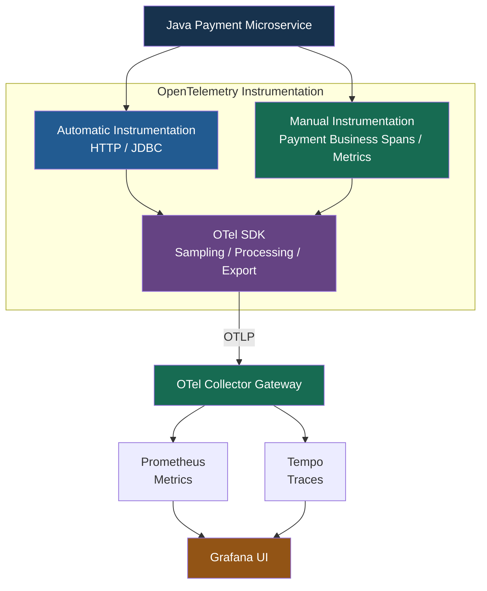
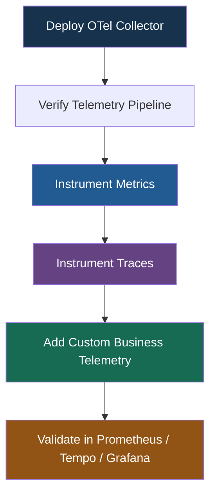
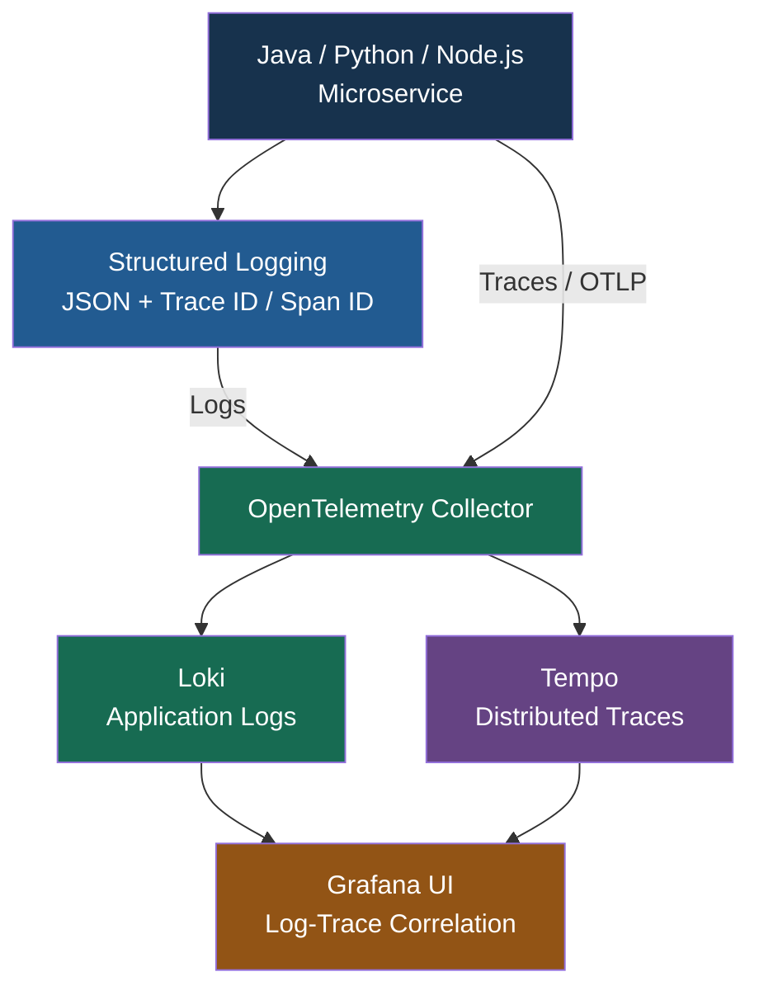
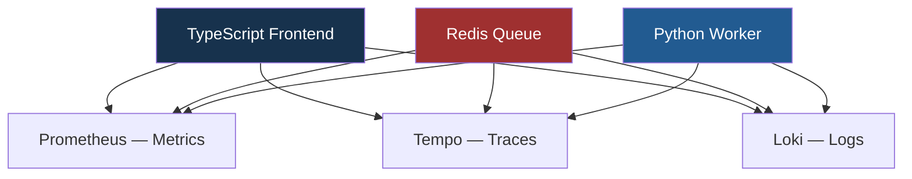
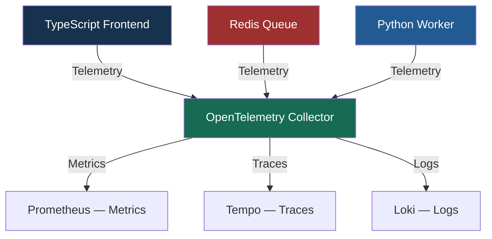
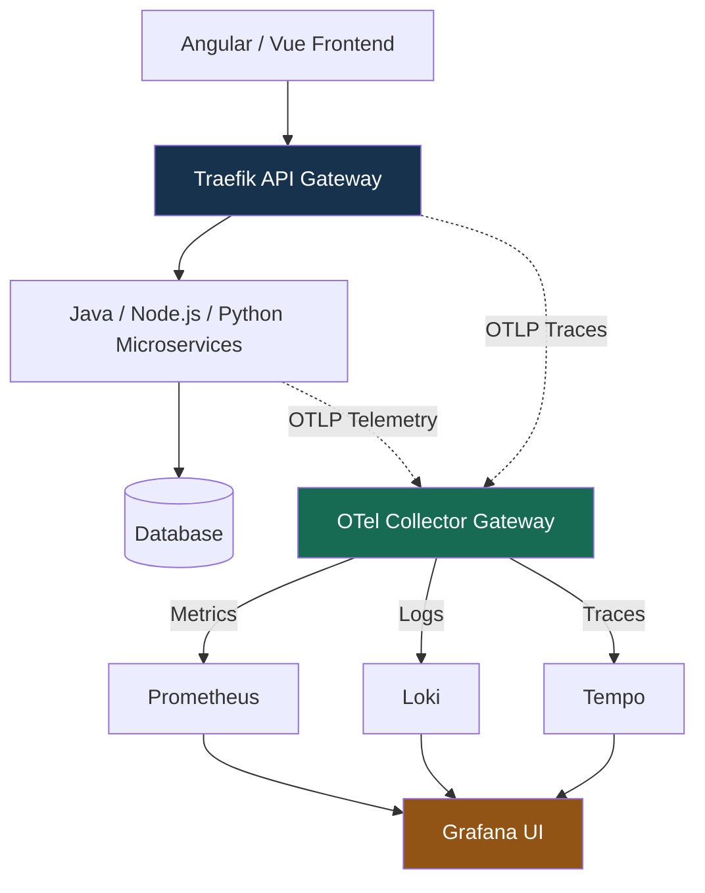
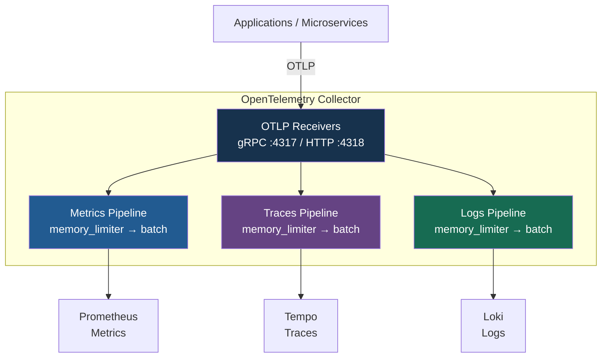
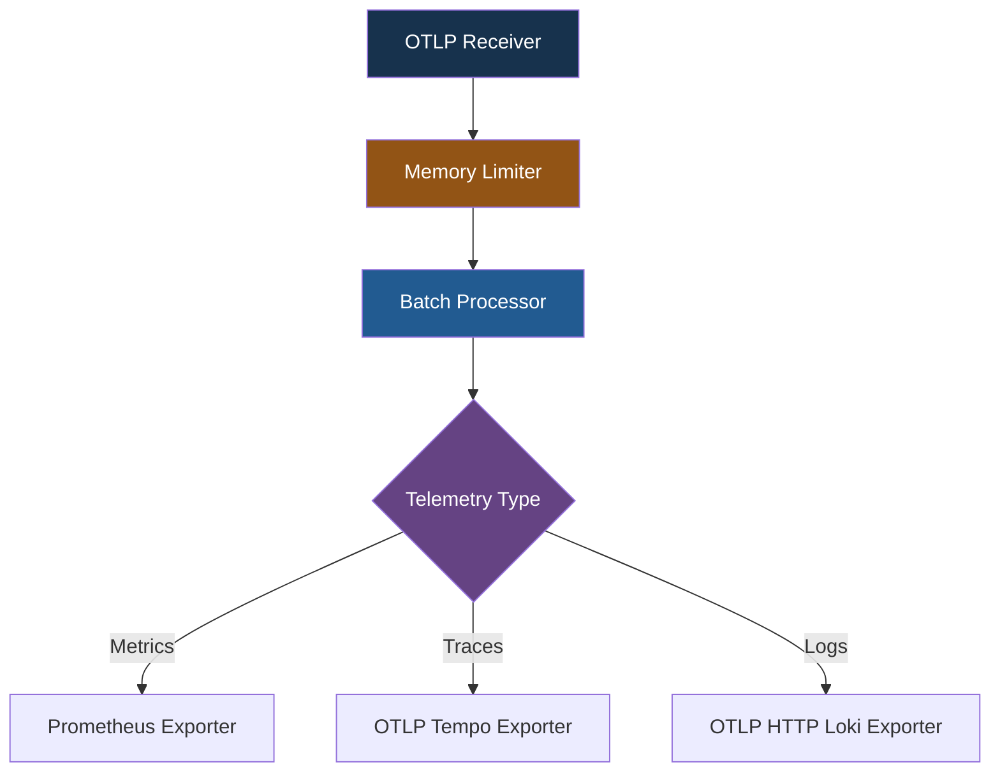
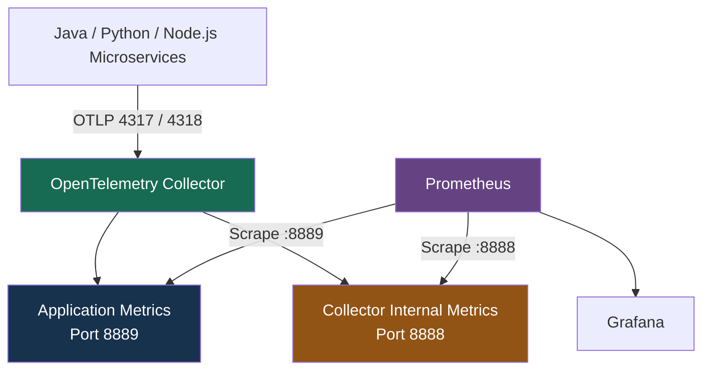

# Instrumenting Single Services（單一服務的監控埋點）

Section Overview（章節概覽）

這個章節主要介紹如何對單一 Application / Microservice 加入 OpenTelemetry Instrumentation，包括部署 OTel Collector、收集 Metrics，以及建立 Automatic / Manual Traces。

## 1. 三大學習主題

| Topic                                  | 中文名稱                       | 主要學習內容                                                              |
| -------------------------------------- | -------------------------- | ------------------------------------------------------------------- |
| Setting Up the OpenTelemetry Collector | 部署 OpenTelemetry Collector | 建立 Vendor-neutral Telemetry Pipeline，驗證資料流及 Collector 健康狀態          |
| Instrumenting Metrics                  | 指標監控埋點                     | Automatic Metrics、Custom Business Metrics、Labels                    |
| Instrumenting Traces                   | 分散式追蹤埋點                    | Automatic Spans、Custom Business Spans、Error Handling、Span Lifecycle |

## 2. Instrumenting Single Services（單一服務的監控埋點）Section Overview（章節概覽）

### 2.1. Setting Up the OpenTelemetry Collector

**部署 OpenTelemetry Collector**

1. 將 Collector 部署在 Application 與 Observability Backends 之間，作為 Vendor-neutral Telemetry Pipeline。
2. 驗證 End-to-End Telemetry Data Flow，並監控 Collector 自身的 Operational Health。

### 2.2 Instrumenting Metrics

**指標監控埋點**

1. 使用 Automatic Instrumentation 收集 Framework-level Metrics，並透過 Manual Instrumentation 建立 Custom Business Metrics。
2. 使用 Labels / Attributes 增加 Metrics 的分析維度，並透過 Prometheus 查詢。

### 2.3. Instrumenting Traces

**追蹤監控埋點**

1. 使用 Automatic Instrumentation 建立 Framework Spans，並為重要 Business Logic 建立 Custom Spans。
2. 管理 Span Lifecycle、Exception Handling，並將 Instrumentation Code 重構成容易維護的形式。

### 核心觀念

- **Collector**：集中接收、處理及轉送 Telemetry。
- **Metrics**：衡量系統效能、負載及重要業務指標。
- **Traces**：記錄服務內部操作及執行時間。
- **Automatic Instrumentation**：自動監控 HTTP、Database、Framework。
- **Manual Instrumentation**：監控 Custom Business Operations。

## 3. Single Service Instrumentation 架構

以下以 Java Payment Microservice 為例：



概念架構：Prometheus 可以抓取 Collector 暴露的 Metrics，或使用 OTLP Receiver；實際資料流取決於 Collector 配置。

## 4. Automatic vs Manual Instrumentation

| Operation                     | Instrumentation | Telemetry                          |
| ----------------------------- | --------------- | ---------------------------------- |
| `POST /payments`              | Automatic       | HTTP Server Span / Request Metrics |
| JDBC SQL Query                | Automatic       | Database Span                      |
| `validatePayment()`           | Manual          | Custom Business Span               |
| `checkAccountBalance()`       | Manual          | Custom Business Span               |
| `executePayment()`            | Manual          | Custom Business Span               |
| `payment_processed_total`     | Manual          | Custom Counter Metric              |
| `payment_processing_duration` | Manual          | Custom Histogram Metric            |

Manual Metrics 可以協助衡量業務處理量和時間，但應避免將 Transaction ID、Account Number 等高基數或敏感欄位加入 Metrics Labels。

## 5. Collector Health Monitoring

部署 Collector 後，除了確認 Application 的 Telemetry 能成功送達 Backend，也需要監控 Collector 本身。

| Monitoring Item        | 目的                          |
| ---------------------- | --------------------------- |
| Receiver Accepted Data | 確認 Collector 正在接收 Telemetry |
| Receiver Refused Data  | 偵測接收失敗或拒絕的資料                |
| Exporter Sent Data     | 確認資料成功匯出                    |
| Exporter Send Failures | 偵測 Backend 連線或匯出異常          |
| Exporter Queue Size    | 觀察資料是否開始堆積                  |
| Collector CPU / Memory | 監控資源使用情況                    |

這些指標可透過 Collector 的 Internal Telemetry Metrics 監控，實際 Metrics 名稱依 Collector 版本及配置而定。

## 6. 核心總結

這個章節的學習順序可以整理成：



最重要的觀念：

- Collector：確保 Telemetry 能正確接收、處理與匯出。
- Automatic Instrumentation：用較少程式碼取得 Framework / Technical Observability。
- Manual Instrumentation：加入重要的 Business Metrics、Business Spans 和 Context。
- Grafana Stack：驗證 Metrics 和 Traces 是否能正確查詢及關聯。

對你的 Java / Node.js / Python Banking Microservices，我建議先完成單一 Payment Service 的 Metrics + Traces，再逐步擴展至多個服務的 Distributed Tracing。

---
## 4. Instrumenting Logs（日誌監控埋點）

> Instrumenting Logs 主要介紹如何建立 Structured Logging（結構化日誌）、加入 Trace Context，以及透過 Grafana 關聯 Logs 和 Traces。

### 4.1 學習重點

1. **Structured Logging with Trace Context Injection**
   - 配置 Structured JSON Logging。
   - 自動注入 `trace_id`、`span_id` 等 Trace Context。
   - 加入 Manual Log Statements，記錄重要 Business Events。

2. **Log-Trace Correlation and Environment Configuration**
   - 在 Grafana 中建立 Loki Logs 與 Tempo Traces 的關聯。
   - 使用 Trace ID 從 Logs 導航至 Distributed Traces。
   - 透過 Environment Variables 管理 Logging Level、OTLP Endpoint 等設定。

### 核心觀念

- **Structured Logging**：使用 JSON 格式記錄 Logs，方便解析及查詢。
- **Trace Context Injection**：將 Trace ID / Span ID 加入 Logs。
- **Manual Logging**：記錄重要業務事件及錯誤資訊。
- **Log-Trace Correlation**：透過 Trace ID 關聯 Loki 和 Tempo。
- **Environment Configuration**：將 Logging / Telemetry 設定與 Business Code 分離。


### 4.2 實際例子：Payment Microservice

假設 Payment Service 產生以下 Structured Log：

```json

{
  "timestamp": "2026-10-23T10:00:00Z",
  "level": "ERROR",
  "service": "payment-service",
  "trace_id": "4bf92f3577b34da6a3ce929d0e0e4736",
  "span_id": "00f067aa0ba902b7",
  "message": "Payment processing failed",
  "error.type": "DATABASE_TIMEOUT"
}

```

透過 `trace_id`，可以在 Grafana 中將 Loki 的 Error Log 與 Tempo 的 Distributed Trace 關聯起來。

### 4.3 Mermaid — Log-Trace Correlation



這是概念架構。Logs 可透過 OTLP SDK 或 Container stdout/stderr 搭配 Log Collector 收集；Trace ID 注入與 Grafana 關聯仍需正確配置。

### 4.4 與前三個章節的關係

| Section | Topic                                  | Learning Objective                                               |
| ------- | -------------------------------------- | ---------------------------------------------------------------- |
| 1       | Setting Up the OpenTelemetry Collector | 部署及驗證 Telemetry Pipeline                                         |
| 2       | Instrumenting Metrics                  | Automatic / Custom Metrics、Labels                                |
| 3       | Instrumenting Traces                   | Automatic / Manual Spans、Lifecycle                               |
| 4       | Instrumenting Logs                     | Structured Logging、Trace Context Injection、Log-Trace Correlation |

核心總結：

- Metrics：衡量系統健康與效能。
- Traces：定位 Request 在哪個操作發生異常。
- Logs：取得詳細錯誤及業務事件資訊。
- Trace Context Injection：將 Logs 與 Traces 連結起來。

完成 Section 4 後，便能將 Metrics + Logs + Traces 整合成完整的 Single Service Observability。

---

## Hands on Lab Local Development

Refer to `lab-local-development.md`

1. In this lab, you'll create two additional compose files for different environments:

    - `compose.dev.yaml` - Development environment with hot-reload
    - `compose.prod.yaml` - Production environment with registry images

2. **Delete the `image` configuration from compose.app.yaml**:

3. Extract `api-versions\code` folder from `v1.1.0.zip`

```bash
cd handson-labs/app-versions/code/frontend/
npm ci

cd ../worker/
pyenv global 3.12.10
pyenv local 3.12.10

# Remove line `-e /Users/lauromueller/Documents/courses/_labs/lm_labs` in the requirements.txt
pip install -r requirements.txt
uv sync --all-extras

cd ../../../..
```

4. This allows you to select environments with the `-f` flag:

- Development: `docker compose -f compose.dev.yaml up`
- Production: `docker compose -f compose.prod.yaml up`

5. **Start Development Environment**

```bash
cd handson-labs/compose/
docker compose -f compose.dev.yaml up --build -d
docker compose -f compose.dev.yaml ps

docker network inspect observability | grep Name
docker network inspect app | grep Name
docker network ls | grep observability
docker network ls | grep app
```

    - **Frontend Test:**

    Make a change to `app-versions/code/frontend/src/index.ts`. You should see tsx detecting the change and restarting the frontend service.

    - **Worker Test:**

    Make a change to `app-versions/code/worker/src/main.py`. You should see watchmedo detecting the change and restarting the Python worker.

```bash
docker compose -f compose.dev.yaml logs frontend
docker compose -f compose.dev.yaml logs worker
```
6. **Switch to Production Mode**

   To use pre-built images:

```bash
docker compose -f compose.dev.yaml down
docker compose -f compose.prod.yaml up -d
docker compose -f compose.prod.yaml ps

docker network inspect observability | grep Name
docker network inspect app | grep Name
docker network ls | grep observability
docker network ls | grep app
```

---
# OpenTelemetry Collector — 有無 Collector 的架構差異

Explore the Use Case and Architecture of the OpenTelemetry Collector（了解 Collector 的使用情境與架構）

這張圖片主要比較 Without a Collector（沒有 Collector） 與 With a Collector（使用 Collector） 的差異。

核心觀念是：OTel Collector 將 Application 與 Observability Backends 解耦，集中管理 Metrics、Logs、Traces 的接收、處理及轉送。

## 1. Without vs With Collector

| 比較項目                    | Without Collector         | With Collector              |
| ----------------------- | ------------------------- | --------------------------- |
| Telemetry Export        | Application 直接連接 Backends | Application 統一傳送至 Collector |
| Backend Configuration   | 各 Application 分別配置        | Collector 集中管理              |
| Metrics / Logs / Traces | 各自處理傳輸                    | 統一接收及路由                     |
| Vendor Switching        | 可能需修改多個服務配置               | 主要調整 Collector              |
| Filtering / Transform   | 分散處理                      | 集中處理                        |
| Multi-backend Export    | 各 Application 自行配置        | Collector 統一分發              |
| 維護成本                    | 隨服務數量增加                   | 通常較容易集中管理                   |
| 額外基礎設施                  | 較少                        | 需要部署 Collector              |

## 2. Without Collector（沒有 Collector）

每個 Application 直接與各個 Observability Backend 整合。



這是課程的概念圖。實際上 Prometheus 通常使用 Scrape，Redis 也不一定原生產生 Logs / Traces，更不代表所有服務都必須直接連接三個 Backend。

缺點： 當 Microservices 增加時，Backend Endpoint、Exporters、Security、Sampling 等配置可能分散於多個服務中。

## 3. With Collector（使用 Collector）

Application 統一將 Telemetry 送至 Collector，再由 Collector 分流。



優點： Application 可以統一使用 OTLP，Collector 再按照不同的資料類型配置 Pipelines。

## 4. Collector 的實際價值

| Collector Capability | 說明                                    |
| -------------------- | ------------------------------------- |
| Receivers            | 接收 OTLP、Prometheus Scrape、Filelog 等資料 |
| Processors           | Batch、Filter、Transform、Sampling       |
| Exporters            | 轉送至 Prometheus、Loki、Tempo 等           |
| Multiple Pipelines   | Metrics / Logs / Traces 分別處理          |
| Backend Decoupling   | 降低 Application 與特定 Vendor 的依賴         |

## 5. 對你的 Microservices 架構的建議



實際部署中，Prometheus 可以 Scrape Metrics，Logs 可以經 Log Agent 收集，再由 Collector 處理；不是所有資料都必須使用相同的傳輸協定。

### 核心總結

- Without Collector：每個 Application 需自行處理與 Observability Backends 的整合。
- With Collector：Application 專注產生 Telemetry，Collector 集中處理及轉送資料。
- OTel Collector Gateway：很適合多個 Microservices 共用的 Observability 架構。

對你目前的 Docker Compose 或單節點 Kubernetes 環境，我推薦先使用一個 OTel Collector Gateway。 未來需要跨節點收集 Container Logs、Node Metrics 或高可用部署時，再評估增加 Collector Agents 與 Gateway Replicas。

---
# OpenTelemetry Collector — Architecture（收集器架構）

Explore the Use Case and Architecture of the OpenTelemetry Collector（了解 Collector 的使用情境與內部架構）

**OpenTelemetry Collector** 的**三大核心元件**：

- Receivers → 
- Processors → 
- Exporters

Collector 可以同時建立 Metrics、Traces、Logs 三條獨立的 **Telemetry Pipelines**，並對每條 Pipeline 設定不同的資料處理和輸出方式。

## 1. Collector 的三大核心元件

| Component  | 中文名稱 | Responsibility                                    |
| ---------- | ---- | ------------------------------------------------- |
| Receivers  | 接收器  | 接收 OTLP/gRPC、OTLP/HTTP 等 Telemetry                |
| Processors | 處理器  | Memory Limiting、Batching、Filtering、Transformation |
| Exporters  | 匯出器  | 將 Telemetry 傳送至 Prometheus、Tempo、Loki 等 Backend   |
| Pipelines  | 資料管線 | 定義 Receivers、Processors、Exporters 的組合與順序          |

## 2. Collector Architecture — Mermaid

以下使用垂直排列，避免 Markdown Preview 中圖形過寬。



三條 Pipelines 可以共享 Receiver 與 Processor 的設定，但各 Pipeline 處理的是不同 Signal Type。

## 3. Processors — 資料處理元件

圖片中的主要設定是 `memory_limiter` 和 `batch`。

| Processor        | 功能                  | 用途                             |
| ---------------- | ------------------- | ------------------------------ |
| `memory_limiter` | 記憶體限制               | 控制 Collector 記憶體使用，降低 OOM 風險   |
| `batch`          | 批次處理                | 將多筆 Telemetry 合併後匯出，提升效率       |
| `attributes`     | Attribute 處理        | 增加、修改、刪除 Attributes            |
| `filter`         | 資料過濾                | 排除不需要的 Logs / Metrics / Traces |
| `tail_sampling`  | 尾端採樣                | 根據 Trace 結果、延遲或其他條件決定是否保留      |
| `k8sattributes`  | Kubernetes Metadata | 補充 Namespace、Pod、Node 等資訊      |
| `transform`      | 資料轉換                | 透過 OTTL 修改 Telemetry           |

部分 Processors 需要使用 OpenTelemetry Collector Contrib 發行版本。

## 4. Collector YAML Configuration

以下是圖片中 `memory_limiter` 和 `batch` 的設定。

```yaml

processors:
  memory_limiter:
    check_interval: 1s
    limit_mib: 512
    spike_limit_mib: 128

  batch:
    timeout: 10s
    send_batch_size: 1024
    send_batch_max_size: 2048

```

### 各項參數說明

| Parameter             | Value  | Description                  |
| --------------------- | ------ | ---------------------------- |
| `check_interval`      | `1s`   | 每秒檢查 Collector 記憶體使用情況       |
| `limit_mib`           | `512`  | Memory Limiter 使用的記憶體上限（MiB） |
| `spike_limit_mib`     | `128`  | 預留給突發記憶體用量的空間                |
| `timeout`             | `10s`  | Batch 最長等待時間                 |
| `send_batch_size`     | `1024` | 觸發 Batch 匯出的資料數量門檻           |
| `send_batch_max_size` | `2048` | 單一 Batch 最多包含的資料數量           |

`memory_limiter` 是保護機制，不等於 Kubernetes Container 的 Memory Limit。當記憶體使用過高時，Collector 可能拒絕部分新資料，因此需要搭配監控、Retry 和適當的資源配置。

另外，`send_batch_size` 是觸發匯出的門檻，不代表每次 Batch 必然剛好包含 1024 筆資料。

## 5. 完整 `otel-config.yaml` 範例

以下示範三種 Telemetry 如何分別傳送至 Prometheus、Tempo 和 Loki。

```yaml

receivers:
  otlp:
    protocols:
      grpc:
        endpoint: 0.0.0.0:4317
      http:
        endpoint: 0.0.0.0:4318

processors:
  memory_limiter:
    check_interval: 1s
    limit_mib: 512
    spike_limit_mib: 128

  batch:
    timeout: 10s
    send_batch_size: 1024
    send_batch_max_size: 2048

exporters:
  prometheus:
    endpoint: 0.0.0.0:8889

  otlp/tempo:
    endpoint: tempo:4317
    tls:
      insecure: true

  otlphttp/loki:
    endpoint: http://loki:3100/otlp

service:
  pipelines:
    metrics:
      receivers: [otlp]
      processors: [memory_limiter, batch]
      exporters: [prometheus]

    traces:
      receivers: [otlp]
      processors: [memory_limiter, batch]
      exporters: [otlp/tempo]

    logs:
      receivers: [otlp]
      processors: [memory_limiter, batch]
      exporters: [otlphttp/loki]

```

此範例假設使用包含 Prometheus Exporter 的 Collector 發行版本、Tempo 已啟用 OTLP/gRPC Receiver、Loki 已啟用 OTLP HTTP Ingestion，並且所有服務位於可互通的 Docker Network。Prometheus 需另外配置 Scrape Target `otel-collector:8889`。範例中的無 TLS 連線僅適用於受信任的本地開發網路。

## 6. Pipeline 的處理順序



這是方便理解的概念流程。實際 Collector 會在 Receiver 後將不同 Signal 分配到各自的 Pipeline，而不是經過同一個 Batch Processor 才分流。

## 7. 為甚麼要分開三條 Pipelines？

| Pipeline | 使用者需求                                     | Backend    |
| -------- | ----------------------------------------- | ---------- |
| Metrics  | API Latency、Error Rate、CPU、Memory         | Prometheus |
| Traces   | Distributed Tracing、Span Duration、TraceQL | Tempo      |
| Logs     | ERROR、WARN、INFO、LogQL                     | Loki       |

因為各種 Telemetry 的處理需求不同，所以你可以：

- 對 Traces 加入 `tail_sampling`。
- 對 Logs 加入 `filter` 或 `transform`。
- 對 Metrics 加入適當的 Attribute / Cardinality 控制。
- 對不同 Pipelines 設定不同的 Exporters。

## 8. 核心總結

OTel Collector = Receivers + Processors + Exporters + Pipelines

- Receivers：Where telemetry comes from.
- Processors：How telemetry is processed.
- Exporters：Where telemetry goes.
- Pipelines：How the components are connected.

對你的 Docker Compose / Kubernetes Observability Stack，這種架構可以集中管理 Metrics、Logs 和 Traces 的處理方式，不需要每個 Java / Python / Node.js Microservice 都自行處理與 Prometheus、Loki、Tempo 的直接整合。

最重要的設計原則：在 `otel-config.yaml` 的 `service.pipelines` 中明確定義三條資料管線，並將 `memory_limiter` 放在 `batch` 前面，以提高 Collector 的穩定性。

---

# Handson - Deploy OpenTelemetry Collector

- Refer to `lab-deploy-collector.md`

1. Create `otel-collector-config.yaml​`:
2. Update Observability Stack to Include Collector `compose.observability.yaml`
3. Update Prometheus to Scrape Collector Metrics `prometheus.yaml`
4. Review `tempo-config.yaml`​ to ensure the distributor has OTLP receivers configured
5. Start the Complete Observability Stack

```bash
docker compose -f compose.dev.yaml down  # Stop existing services
docker compose -f compose.dev.yaml up -d # Start with Collector included
docker compose -f compose.dev.yaml restart prometheus

# Check all services are up
docker compose -f compose.dev.yaml ps
docker compose -f compose.dev.yaml ps otel-collector
# Check Collector logs - look for success messages
docker compose -f compose.dev.yaml logs otel-collector | tail -30

docker compose -f compose.dev.yaml up -d --force-recreate tempo grafana
docker compose -f compose.dev.yaml logs -f tempo

```
---

## Test that the Collector endpoints are accessible:

```bash
# Test HTTP endpoint (should return 404, which confirms it's listening)
curl -i http://localhost:4318/

# Check Collector's own metrics are exposed
curl -is http://localhost:8889/metrics | head -20

```

---

# Lab: Test & Monitor the Collector

- Refer to `lab-test-collector.md`

## 1. Send Test Trace to Collector

```bash
# Verify Tempo is actually responding
curl -i http://localhost:3200/ready # Until it is ready

curl -i "http://localhost:3200/api/search/tags"
docker compose -f compose.dev.yaml logs --tail=100 tempo

curl -X POST http://localhost:4318/v1/traces \
  -H "Content-Type: application/json" \
  -d '{
    "resourceSpans": [{
      "resource": {
        "attributes": [
          {"key": "service.name", "value": {"stringValue": "test-app"}}
        ]
      },
      "scopeSpans": [{
        "scope": {"name": "test-instrumentation"},
        "spans": [{
          "traceId": "'$(openssl rand -hex 16)'",
          "spanId": "'$(openssl rand -hex 8)'",
          "name": "test-operation",
          "kind": 1,
          "startTimeUnixNano": "'$(date +%s)000000000'",
          "endTimeUnixNano": "'$(( $(date +%s) + 1 ))000000000'",
          "status": {"code": 0}
        }]
      }]
    }]
  }'

# {"partialSuccess":{}}

curl -X POST http://localhost:4318/v1/traces \
  -H "Content-Type: application/json" \
  -d '{
    "resourceSpans": [{
      "resource": {
        "attributes": [
          {"key": "service.name", "value": {"stringValue": "test-app"}}
        ]
      },
      "scopeSpans": [{
        "spans": [{
          "traceId": "5B8EFFF798038103D269B633813FC60C",
          "spanId": "7BBAF3A1C2D4E5F6",
          "name": "manual-span",
          "kind": 1,
          "startTimeUnixNano": "1730000000000000000",
          "endTimeUnixNano": "1730000001000000000"
        }]
      }]
    }]
  }'
```
## 2. Verify Trace in Tempo

Open Grafana at http://localhost:3010:

* Go to **Explore** → Select **Tempo**
* Click **Search** tab in Query Type → **Run query**
* Find your trace with service.name = "test-app"
* Click on it to see the span details

## 3. Check Collector Metrics

Open Prometheus at http://localhost:9100 and verify the Collector is healthy:

```bash
curl -s http://localhost:8888/metrics | grep otelcol
curl -s http://localhost:8888/metrics | grep otelcol_receiver_accepted_spans
curl -s http://localhost:8888/metrics | grep otelcol_exporter_sent_spans

```

```promql
# Collector is up
up{job="otel-collector"}

# Spans were received
otelcol_receiver_accepted_spans_total
otelcol_exporter_sent_spans_total

# Spans were received to Collector
otelcol_receiver_accepted_spans_total{receiver="otlp"}

# Spans were sent to Tempo
otelcol_exporter_sent_spans_total{exporter="otlp/tempo"}

# No errors
otelcol_receiver_refused_spans_total
otelcol_receiver_failed_spans_total
```

```bash
curl -is http://localhost:8889/metrics | head -20
curl -is http://localhost:8888/metrics | head -20

curl -is http://localhost:8888/metrics | grep otel
```

---
# 在 OpenTelemetry Collector 中，Port 8888 與 8889 都可以讓 Prometheus Scrape Metrics，但兩者用途完全不同。

- **8888** = Collector Internal Metrics：**監控 OpenTelemetry Collector 自己的健康狀態**及運作效能。
- **8889** = Application Metrics Exporter：Collector 將**收到的 Application Metrics 轉換成 Prometheus** 可以抓取的格式。

## 1. Port 8888 vs 8889

| 比較項目                     | Port **8888**                      | Port **8889**                             |
| ------------------------ | ------------------------------ | ------------------------------------- |
| 主要用途                     | Collector Internal Monitoring  | Application Metrics Export            |
| Metrics 來源               | Collector 本身                   | Java / Python / Node.js Microservices |
| 資料收集方式                   | Collector 自動產生                 | Application → OTLP → Collector        |
| Prometheus 抓取            | ✅                              | ✅                                     |
| 是否需要 Prometheus Exporter | ❌                              | ✅                                     |
| 典型用途                     | Collector Health / Performance | Business / Application Metrics        |
| Port 是否固定                | 可配置，常見為 8888                   | 可配置，8889 是常見範例                        |

例如：

8888（Collector 本身的 Metrics）

```
otelcol_receiver_accepted_spans
otelcol_exporter_sent_spans
otelcol_exporter_send_failed_spans
otelcol_process_memory_rss
```

8889（Application Metrics）

```
http_server_request_duration_seconds
payment_processed_total
payment_failed_total
```

實際 Metrics 名稱取決於 Collector、SDK、Exporter 版本，以及所使用的命名轉換規則。

## 2. 資料流程圖



## 3. 對應的 Collector 配置

你的 `prometheus.yaml` 已經配置兩個 Scrape Jobs，但也必須確保 Collector 真的在這兩個 Port 提供 Metrics。

Port 8889 — Application Metrics

在 `otel-config.yaml`：

```
exporters:
  prometheus:
    endpoint: 0.0.0.0:8889

service:
  pipelines:
    metrics:
      receivers: [otlp]
      processors: [memory_limiter, batch]
      exporters: [prometheus]
```

Port 8888 — Collector Internal Metrics

對較新的 Collector，可明確配置：

```
service:
  telemetry:
    metrics:
      readers:
        - pull:
            exporter:
              prometheus:
                host: 0.0.0.0
                port: 8888
```

要特別注意，Collector 的 Internal Metrics 預設可能只綁定 `127.0.0.1:8888`。在 Docker Compose 裡，Prometheus 是另一個 Container，因此需要綁定 `0.0.0.0` 才能跨容器抓取。

[image](https://www.google.com/s2/favicons?domain=https://github.com\&sz=32)

GitHub

+1


## 4. 你的 `prometheus.yaml` 設定正確嗎？

✅ 是的，兩個 Scrape Job 的設計正確。

```
  - job_name: 'otel-collector'
    static_configs:
      - targets: ['otel-collector:8889']

  - job_name: 'otel-collector-internal'
    static_configs:
      - targets: ['otel-collector:8888']
```

只要 Collector 已在這兩個 Port 正確啟用對應 Endpoint，且 Docker Network 允許連線，就能收集兩種類型的 Metrics。

## 5. 如何驗證？

在 Prometheus UI（你的 Host Port 是 9100）開啟：

`http://localhost:9100`

執行以下 PromQL：

```
up{job="otel-collector"}
```

```
up{job="otel-collector-internal"}
```

結果代表：

| Value | Meaning                   |
| ----- | ------------------------- |
| `1`   | Prometheus 成功抓取該 Endpoint |
| `0`   | Scrape 失敗                 |
| 沒有資料  | 該 Target 尚未建立、沒有被發現或沒有資料  |

注意：`up=1` 只證明 Scrape 成功，不代表 Application Metrics 一定已經成功進入 Collector。 還需要查詢具體業務指標確認資料流。

### 核心總結

| Port | 用途                         | 你要監控甚麼？             |
| ---- | -------------------------- | ------------------- |
| 4317 | OTLP/gRPC Receiver         | 接收 Telemetry        |
| 4318 | OTLP/HTTP Receiver         | 接收 Telemetry        |
| 8888 | Collector Internal Metrics | Collector 自身健康與效能   |
| 8889 | Prometheus Exporter        | Application Metrics |

簡單記住：8888 監控 Collector 本身；8889 監控經過 Collector 的 Application Metrics。

因此我建議你保留這兩個 Prometheus Scrape Jobs，因為它們用途不同，而且可以讓你同時觀察 Application 與 Telemetry Pipeline 的健康狀態。

---
