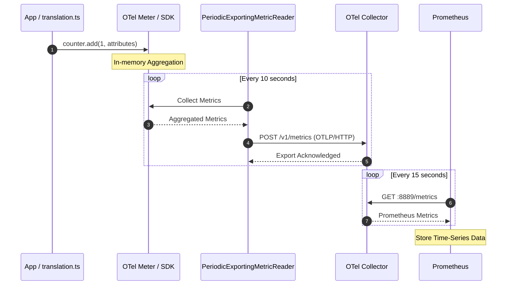
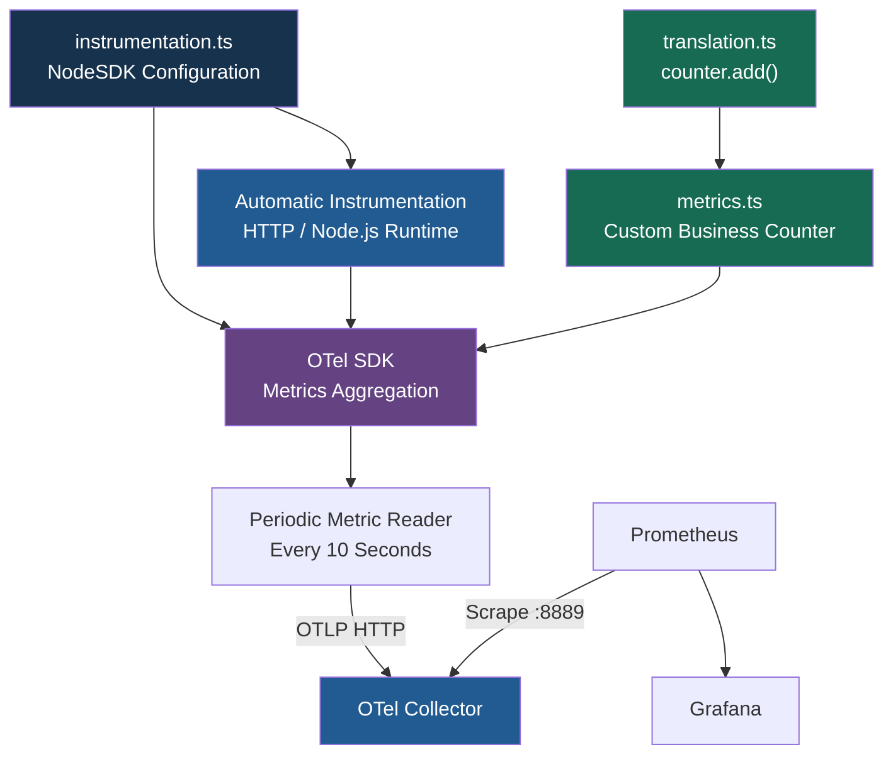
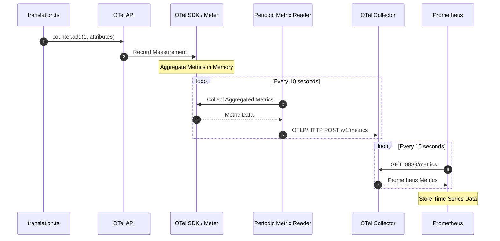
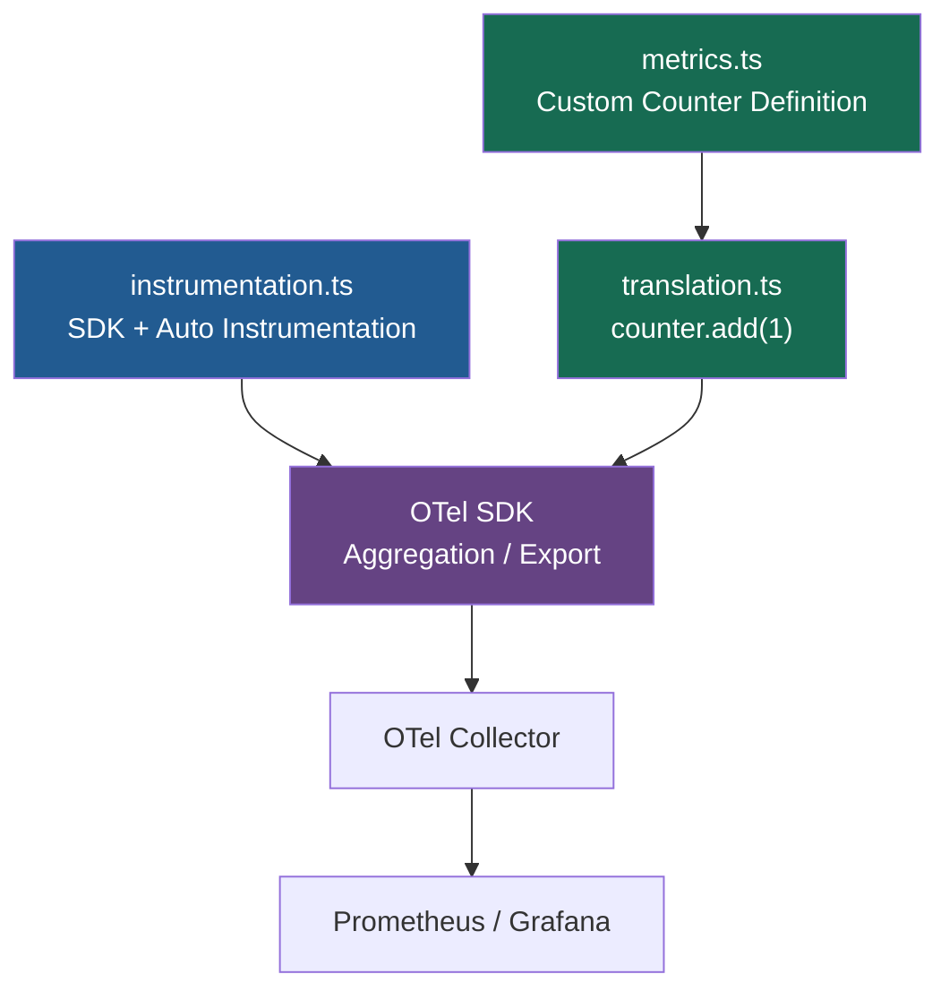

# Metrics Instrumentation（指標監控埋點）

Understand the Role of the OpenTelemetry SDK and Instrumentation Techniques（了解 OpenTelemetry SDK 的角色與 Metrics Instrumentation 技術）

> Application 如何透過 OTel API、OTel SDK、PeriodicExportingMetricReader、Collector 和 Prometheus，完成 End-to-End Metrics Collection。

## 1. End-to-End Metrics Data Flow

整個流程可以分成五個階段：

| Component                      | Responsibility             | 說明                                  |
| ------------------------------ | -------------------------- | ----------------------------------- |
| Application (`translation.ts`) | Record Metrics             | 使用 OTel API 記錄 Counter 等指標          |
| **OTel Meter / SDK**               | Aggregate Metrics          | 在記憶體中彙總 Metrics                     |
| PeriodicExportingMetricReader  | Periodic Export            | 定期讀取彙總數據並觸發匯出                       |
| **OTel Collector**                 | Receive / Process / Export | 接收 OTLP Metrics，轉換並提供 Prometheus 格式 |
| Prometheus                     | Scrape / Store             | 定期從 Collector 抓取並儲存 Metrics         |

## 2. Mermaid — Metrics End-to-End Sequence

以下使用 Sequence Diagram 重現原圖。



此圖的 10 秒是 SDK Export Interval 範例，15 秒是 Prometheus Scrape Interval 範例。Collector 的 8889 Endpoint 必須配置 Prometheus Exporter。OTLP/HTTP 可以使用 Protobuf 或 JSON，並非固定使用 JSON。

## 3. OTel API vs SDK 的實際工作

### A. Application 使用 OTel API

例如 TypeScript：

```ts

import { metrics } from '@opentelemetry/api';

const meter = metrics.getMeter('translation-service');

const counter = meter.createCounter(
  'translation.jobs.processed',
  {
    description: 'Number of processed translation jobs',
    unit: '{job}'
  }
);

// 每完成一筆 Translation Job
counter.add(1, {
  'translation.status': 'success',
  'translation.target_language': 'es'
});

```

這是 Manual Metrics Instrumentation。

當 Application 呼叫 `counter.add(1, ...)`：

- OTel API 提供 `Counter` 操作介面。
- OTel SDK 負責接收及彙總 Metric Measurement。
- Metric Reader 定期讀取及匯出 Metrics。

注意：這些 Attributes 應控制 Cardinality，不建議使用 Job ID 作為 Metrics Label。

### B. SDK 配置 PeriodicExportingMetricReader

```ts

import { MeterProvider } from '@opentelemetry/sdk-metrics';
import { PeriodicExportingMetricReader } from '@opentelemetry/sdk-metrics';
import { OTLPMetricExporter } from '@opentelemetry/exporter-metrics-otlp-http';
import { metrics } from '@opentelemetry/api';

const exporter = new OTLPMetricExporter({
  url: 'http://otel-collector:4318/v1/metrics'
});

const reader = new PeriodicExportingMetricReader({
  exporter,
  exportIntervalMillis: 10000
});

const meterProvider = new MeterProvider({
  readers: [reader]
});

metrics.setGlobalMeterProvider(meterProvider);

```

此例採用手動 SDK Configuration。若使用 Node.js Auto Instrumentation / NodeSDK，應由該 SDK 統一配置 Metric Reader，避免重複初始化。

## 4. Collector 與 Prometheus 的資料流

Invalid or unsupported diagram

```promql
up{job="otel-collector-internal"}
```

回傳 `1` 表示 Prometheus 成功 Scrape 指定 Endpoint。

也可以查詢實際匯入的 Application Metric，例如 `translation.jobs.processed` 對應的 Prometheus Metric Name；最終名稱取決於 Exporter 的命名轉換及設定。

## 7. 核心總結

| Technology                    | Responsibility                   |
| ----------------------------- | -------------------------------- |
| OTel API                      | `counter.add()`，記錄測量值            |
| OTel Meter / SDK              | 彙總 Metrics                       |
| PeriodicExportingMetricReader | 定期讀取及觸發匯出                        |
| OTLP                          | 傳送 Metrics 至 Collector           |
| OTel Collector                | 接收、處理並提供 Metrics                 |
| Prometheus                    | Scrape、Store、PromQL              |
| Grafana                       | Dashboard、Visualization、Alerting |

最重要的觀念：

Application 記錄 Metrics → OTel SDK 在記憶體中彙總 → Metric Reader 定期匯出 → Collector 接收並暴露 Metrics → Prometheus 定期 Scrape → Grafana 視覺化。

這個流程也說明了：OTel SDK Export Interval（例如 10 秒）與 Prometheus Scrape Interval（例如 15 秒）是兩個獨立的設定，不需要相同。

---
# Metrics Instrumentation — Automatic vs Manual

Understand the Role of the OpenTelemetry SDK and Instrumentation Techniques（了解 OTel SDK 在自動與手動 Metrics 埋點中的作用）

這張圖片主要說明：在 Node.js / TypeScript Application 中，可以透過 同一個 OTel SDK，同時收集 Automatic Metrics 與 Manual Business Metrics。

## 1. 三個程式檔案的作用

| File                 | Instrumentation                          | Responsibility                          |
| -------------------- | ---------------------------------------- | --------------------------------------- |
| `instrumentation.ts` | SDK Configuration + **Auto** Instrumentation | 初始化 OTel SDK、配置 Metrics Exporter、啟用自動埋點 |
| `metrics.ts`         | **Manual** Instrumentation                   | 定義 Custom Business Metrics              |
| `translation.ts`     | **Manual** Instrumentation                   | 在業務流程中記錄 Metrics，例如 `counter.add(1)`    |

### 架構關係



## 2. `instrumentation.ts` — SDK Configuration

圖片的核心程式如下：

```ts instrumentation.ts

import { NodeSDK } from '@opentelemetry/sdk-node';
import { PeriodicExportingMetricReader } from '@opentelemetry/sdk-metrics';
import { OTLPMetricExporter } from '@opentelemetry/exporter-metrics-otlp-http';
import { getNodeAutoInstrumentations } from '@opentelemetry/auto-instrumentations-node';

const sdk = new NodeSDK({
  serviceName: 'translation-frontend',

  metricReader: new PeriodicExportingMetricReader({
    exporter: new OTLPMetricExporter({
      url: 'http://otel-collector:4318/v1/metrics'
    }),
    exportIntervalMillis: 10000
  }),

  instrumentations: [
    getNodeAutoInstrumentations()
  ]
});

sdk.start();

```

其中：

| Setting                         | Purpose                                         |
| ------------------------------- | ----------------------------------------------- |
| `NodeSDK`                       | 初始化 OpenTelemetry                               |
| `serviceName`                   | 設定服務名稱                                          |
| `PeriodicExportingMetricReader` | 定期收集並匯出 Metrics                                 |
| `OTLPMetricExporter`            | 透過 OTLP/HTTP 傳送 Metrics                         |
| `exportIntervalMillis: 10000`   | 每 10 秒匯出一次                                      |
| `getNodeAutoInstrumentations()` | 啟用受支援的 Framework / Library Auto Instrumentation |

圖片左下方的 Automatic Metrics，包括：

```conf
http_server_duration_milliseconds_count{...}
nodejs_eventloop_utilization_ratio{...}
```

這些是課程的示意名稱。實際 Metric Names 取決於 Instrumentation 套件與版本，而且不同自動埋點套件產生的 Metrics 並不一定相同。

## 3. `metrics.ts` — Custom Business Metric

定義一個 Translation Request Counter：

```ts metrics.ts

import { metrics } from '@opentelemetry/api';

const meter = metrics.getMeter(
  'translation-frontend',
  '1.0.0'
);

export const translationRequestsCounter =
  meter.createCounter(
    'translation.requests.total',
    {
      description: 'Total translation requests',
      unit: '{request}'
    }
  );

```

此處的 `translation.requests.total` 是自訂 Business Metric。

## 4. `translation.ts` — Manual Instrumentation

在業務程式碼中呼叫 Counter：

```ts translation.ts

import {
  translationRequestsCounter
} from '../metrics';

router.post('/', async (req, res) => {
  // Existing translation business logic

  translationRequestsCounter.add(1, {
    status: 'success',
    language_count: String(targetLanguages.length)
  });

  res.json({ status: 'success' });
});

```

這個範例中的 Counter 是在成功處理之後增加，因此實際上只計算成功處理的 Requests。若希望統計所有請求，應在適當的入口增加 Counter，並在完成後記錄 Outcome。

## 5. Automatic vs Manual Metrics

| Metric                            | Instrumentation                     | 作用           |
| --------------------------------- | ----------------------------------- | ------------ |
| HTTP Request Duration             | Automatic                           | API 處理時間     |
| HTTP Request Count                | Automatic（若套件支援）                    | HTTP 流量      |
| Node.js Event Loop Utilization    | Automatic / Runtime Instrumentation | Node.js 執行效能 |
| `translation.requests.total`      | Manual                              | 翻譯業務請求計數     |
| `translation.jobs.failed`         | Manual                              | 翻譯工作失敗次數     |
| `translation.processing.duration` | Manual                              | 翻譯業務處理時間     |

## 6. Metrics End-to-End Flow



## 7. 對 Banking Microservices 的實際應用

相同的方式可應用於 Java / Python / Node.js 的銀行系統。

| Banking Metric            | Instrumentation | Type                             |
| ------------------------- | --------------- | -------------------------------- |
| HTTP Request Duration     | Automatic       | Histogram                        |
| JDBC Query Duration       | Automatic       | Histogram（依支援程度）                 |
| `payment.processed.total` | Manual          | Counter                          |
| `payment.failed.total`    | Manual          | Counter                          |
| `lc.issuance.total`       | Manual          | Counter                          |
| `lc.issuance.duration`    | Manual          | Histogram                        |
| `settlement.pending.jobs` | Manual          | UpDownCounter / Observable Gauge |

需要透過統一的 Business Telemetry Data Dictionary 規範自訂 Metric Names、Units、Attributes 和 Allowed Values。

## 8. 核心總結

- Automatic Instrumentation：自動提供 HTTP、Runtime 等技術 Metrics。
- Manual Instrumentation：開發人員使用 OTel API 定義及記錄重要 Business Metrics。
- OTel SDK：負責 Metric Aggregation、Periodic Reading 和 Exporting。
- OTel Collector：接收 Metrics，進行處理並提供給 Prometheus。
- Prometheus + Grafana：負責 Metrics Storage、Query、Dashboard 和 Alerting。

最重要的觀念：Automatic + Manual Instrumentation 可以共用同一個 OTel SDK，不需要兩套獨立的 Metrics Pipeline。

---
✅ 更精確地說：

- `instrumentation.ts` = SDK Configuration + **Automatic Instrumentation** Setup（設定及啟用自動埋點）。
- `translation.ts` = **Manual Instrumentation**（在業務程式碼中手動記錄 Metrics）。
- `metrics.ts` = **Custom Metric Definition**（定義自訂業務指標）。

| File                 | Responsibility                                             | Instrumentation   |
| -------------------- | ---------------------------------------------------------- | ----------------- |
| `instrumentation.ts` | 初始化 NodeSDK、設定 Exporter、啟用 `getNodeAutoInstrumentations()` | Automatic Setup   |
| `metrics.ts`         | 使用 OTel API 定義 `translationRequestsCounter`                | Manual Definition |
| `translation.ts`     | 呼叫 `translationRequestsCounter.add(1, ...)`                | Manual Recording  |

### 執行流程



重要： `instrumentation.ts` 本身不是被自動埋點的業務程式，而是負責啟用 Automatic Instrumentation。

另外，這三個檔案的 Metrics 都使用同一個 OTel SDK，不需要建立兩套 SDK。

簡單記住：`instrumentation.ts` = Auto Setup；`metrics.ts` = Manual Definition；`translation.ts` = Manual Recording。

---
# Hands on Auto Instrumentation for Metrics

- Refer to `lab-metrics-auto.md`

## 1. Install OpenTelemetry Packages

```bash
cd handson-labs/app-versions/code/frontend
npm install --save-exact \
  @opentelemetry/sdk-node@0.212.0 \
  @opentelemetry/auto-instrumentations-node@0.70.1 \
  @opentelemetry/exporter-metrics-otlp-http@0.212.0
```
## 2. Create `instrumentation.ts`

```typescript
import { NodeSDK } from '@opentelemetry/sdk-node';
import { getNodeAutoInstrumentations } from '@opentelemetry/auto-instrumentations-node';
import { OTLPMetricExporter } from '@opentelemetry/exporter-metrics-otlp-http';
import { PeriodicExportingMetricReader } from '@opentelemetry/sdk-metrics';

const sdk = new NodeSDK({
  serviceName: 'translation-frontend',
  metricReader: new PeriodicExportingMetricReader({
    exporter: new OTLPMetricExporter({
      url: 'http://otel-collector:4318/v1/metrics',
    }),
    exportIntervalMillis: 10000,
  }),
  instrumentations: [getNodeAutoInstrumentations()],
});

sdk.start();
```

## 3. Update `index.ts`

Add at the very top (before any other imports):

```typescript
import './instrumentation';

// ... rest of imports
```

## 4. Deploy

```bash
cd cd ../../../compose/
docker compose -f compose.dev.yaml up --build -d
```

## 5. Generate Traffic

```bash
curl -X POST http://localhost:3001/api/translate \
  -H "Content-Type: application/json" \
  -d '{"text": "Hello world", "targetLanguages": ["es", "fr"]}'
```

## 6. Verify in Prometheus

Open http://localhost:9100, query:

- `http_server_duration_milliseconds_count{exported_job="translation-frontend"}`
- `rate(http_server_duration_milliseconds_count{exported_job="translation-frontend"}[5m])`
- `nodejs_eventloop_utilization_ratio{exported_job="translation-frontend"}`

```bash # Auto Instrumention
curl -is http://localhost:8889/metrics
curl -is http://localhost:8889/metrics | grep translation-frontend

```

---

# Grafana Explore — Prometheus Metrics Query

## 1. Grafana Navigation

**Home → Explore → Prometheus**

| Setting | Value |
|---|---|
| **Data Source** | Prometheus |
| **Query Mode** | Builder |
| **Metric** | `http_client_duration_milliseconds_bucket` |
| **Label** | `exported_job` |
| **Operator** | `=` |
| **Label Value** | `translation-frontend` |
| **Format** | Time series |
| **Step** | Auto |
| **Query Type** | Both |
| **Exemplars** | False |

## 2. PromQL Query

```promql
http_client_duration_milliseconds_bucket{exported_job="translation-frontend"}
```

---

# Manual Instrumentation for Metrics - Lab Overview

- Refer to `lab-metrics-manual.md`

## 1. Create `metrics.ts`

```typescript
import { metrics } from '@opentelemetry/api';

const meter = metrics.getMeter('translation-frontend', '1.0.0');

export const translationRequestsCounter = meter.createCounter(
  'translation.requests.total',
  { description: 'Total translation requests' },
);

export const jobsEnqueuedCounter = meter.createCounter(
  'translation.jobs.enqueued.total',
  { description: 'Total translation jobs enqueued' },
);

export const requestDuration = meter.createHistogram(
  'translation.request.duration',
  { description: 'Translation request processing time', unit: 'ms' },
);

export const validationErrorsCounter = meter.createCounter(
  'translation.validation.errors.total',
  { description: 'Translation validation errors' },
);

export const serverErrorsCounter = meter.createCounter(
  'translation.server.errors.total',
  { description: 'Translation API 5xx server errors' },
);

```

```bash
cd ..
cd app-versions/code/frontend/

npm i --save-exact @opentelemetry/api@1.9.1

```

## 2. Instrument `/routes/translation.ts`

```typescript
import {
  translationRequestsCounter,
  jobsEnqueuedCounter,
  requestDuration,
  validationErrorsCounter,
  serverErrorsCounter,
} from '../metrics.js';

...

router.post('/', async (req: Request, res: Response) => {
  try {
    const start = Date.now();
    const body = req.body as TranslateRequest;

    // Validation with error tracking
    if (!body.text || typeof body.text !== 'string' || !body.text.trim()) {
      validationErrorsCounter.add(1, { error_type: 'empty_text' });
      res.status(400).json({
        error: 'Text is required',
        details: 'Text must be a non-empty string',
      });
      return;
    }

    if (!Array.isArray(body.targetLanguages) || body.targetLanguages.length === 0) {
      validationErrorsCounter.add(1, { error_type: 'empty_languages' });
      res.status(400).json({
        error: 'At least one target language is required',
        details: 'targetLanguages must be a non-empty array',
      });
      return;
    }

    if (body.targetLanguages.length > 3) {
      validationErrorsCounter.add(1, { error_type: 'too_many_languages' });
      res.status(400).json({
        error: 'Maximum 3 target languages allowed',
        details: `You requested ${body.targetLanguages.length} languages`,
      });
      return;
    }

    const unsupportedLanguages = body.targetLanguages.filter(
      (lang) => !SUPPORTED_LANGUAGES.includes(lang as any),
    );

    if (unsupportedLanguages.length > 0) {
      validationErrorsCounter.add(1, { error_type: 'invalid_languages' });
      res.status(400).json({
        error: `Unsupported language: ${unsupportedLanguages.join(', ')}`,
        supportedLanguages: [...SUPPORTED_LANGUAGES],
      });
      return;
    }

    const sessionId = uuidv4();
    const jobs = new Map<string, JobStatus>();

    const jobsList: TranslationJob[] = [];
    for (const targetLanguage of body.targetLanguages) {
      const job: TranslationJob = {
        jobId: uuidv4(),
        sessionId,
        text: body.text,
        sourceLanguage: 'en',
        targetLanguage,
        createdAt: new Date().toISOString(),
      };

      jobsList.push(job);
      jobs.set(targetLanguage, { status: 'queued' });
      await queueService.enqueueJob(job);
      jobsEnqueuedCounter.add(1, { target_language: targetLanguage });
    }

    const session: TranslationSession = {
      sessionId,
      text: body.text,
      sourceLanguage: 'en',
      status: 'queued',
      jobs,
    };
    await queueService.saveSession(session);

    const response: TranslateResponse = {
      sessionId,
      status: 'queued',
      jobs: jobsList.map((job) => ({
        jobId: job.jobId,
        targetLanguage: job.targetLanguage,
        status: 'queued',
      })),
    };

    // Track request duration
    requestDuration.record(Date.now() - start, {
      target_language_count: body.targetLanguages.length.toString(),
    });
    // Track successful request
    translationRequestsCounter.add(1, {
      status: 'success',
      language_count: body.targetLanguages.length.toString(),
    });
    res.status(201).json(response);
  } catch (error) {
    console.error('Error creating translation session:', error);
    serverErrorsCounter.add(1, { operation: 'create_translation' });
    res.status(500).json({
      error: 'Internal server error',
      details: error instanceof Error ? error.message : 'Unknown error',
    });
  }
});
```

Increment the same 5xx counter in the other route handlers:

```typescript
// GET /api/translate/:sessionId
} catch (error) {
  console.error('Error fetching session:', error);
  serverErrorsCounter.add(1, { operation: 'get_session' });
  res.status(500).json({
    error: 'Internal server error',
    details: error instanceof Error ? error.message : 'Unknown error',
  });
}

// GET /api/translate/:sessionId/events
} catch (error) {
  console.error('Error establishing SSE connection:', error);
  serverErrorsCounter.add(1, { operation: 'session_events' });
  res.status(500).json({
    error: 'Internal server error',
    details: error instanceof Error ? error.message : 'Unknown error',
  });
}
```

## 3. Update `index.ts` & `queue.ts`

```ts index.ts
import './instrumentation.js';

import express from 'express';
import cors from 'cors';
import { dirname, join } from 'path';
import { fileURLToPath } from 'url';
import type { Server } from 'http';
import { QueueService } from './services/queue.js';
import { SSEManager } from './services/sse.js';
import { createTranslationRouter } from './routes/translation.js';
import type { TranslationResult } from './types.js';

const __filename = fileURLToPath(import.meta.url);
const __dirname = dirname(__filename);

```

```ts queue.ts
import { Redis } from 'ioredis';

```

## 4. Deploy

```bash
cd ../../../compose/
docker compose -f compose.dev.yaml up --build -d
```

Note: For development with hot-reload, use `docker compose -f compose.dev.yaml up --build` instead.

## 5. Generate Various Request Types

```bash
# Successful requests with different language combinations
curl -X POST http://localhost:3001/api/translate \
  -H "Content-Type: application/json" \
  -d '{"text": "Hello", "targetLanguages": ["es"]}'

curl -X POST http://localhost:3001/api/translate \
  -H "Content-Type: application/json" \
  -d '{"text": "Good morning", "targetLanguages": ["es", "fr", "de"]}'

# Validation errors
curl -X POST http://localhost:3001/api/translate \
  -H "Content-Type: application/json" \
  -d '{"text": "", "targetLanguages": ["es"]}'
```

## 6. Verify in Prometheus

Query:

- `translation_requests_total` - Request counts by language combination
- `rate(translation_requests_total[5m])` - Request rate
- `translation_jobs_enqueued_total{target_language="es"}` - Jobs per language
- `histogram_quantile(0.95, (rate(translation_request_duration_milliseconds_bucket[5m])))` - 95th percentile latency in milliseconds
- `translation_validation_errors_total` - Validation failures by error type
- `translation_server_errors_total` - 5xx server errors by operation

