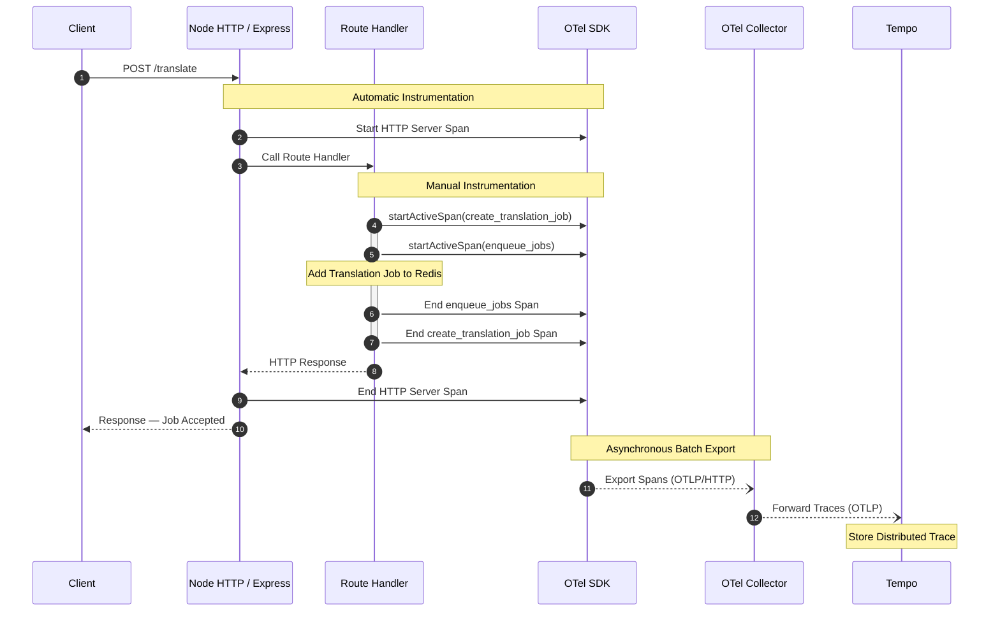
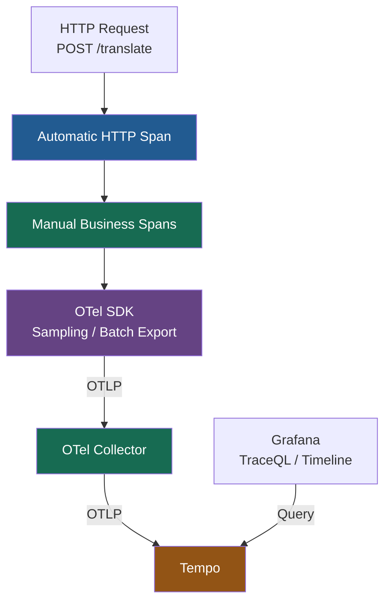
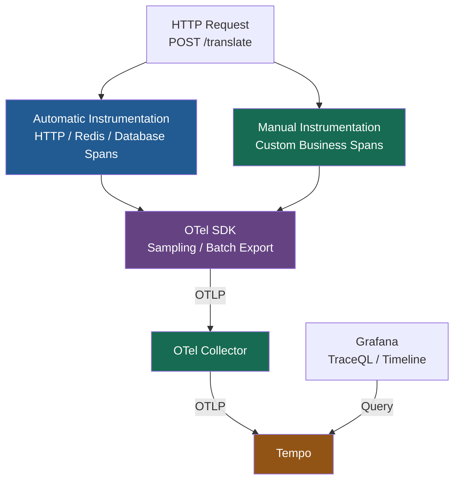
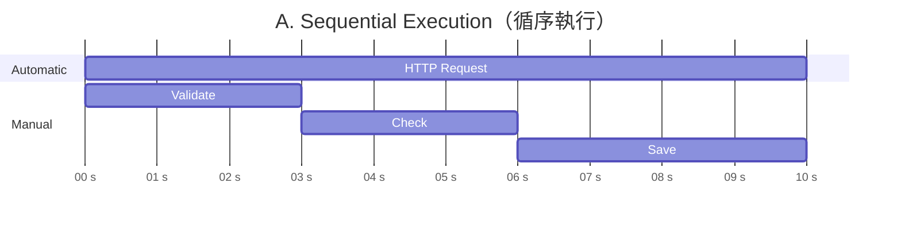
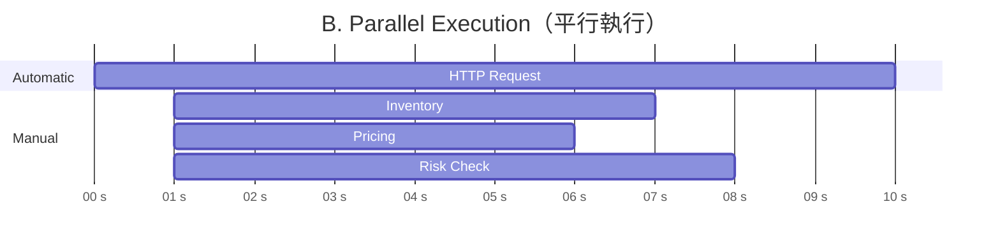
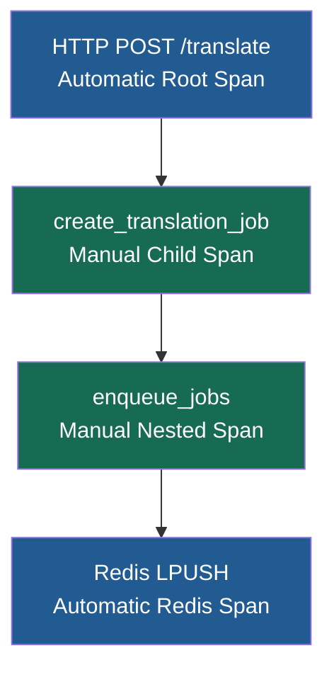
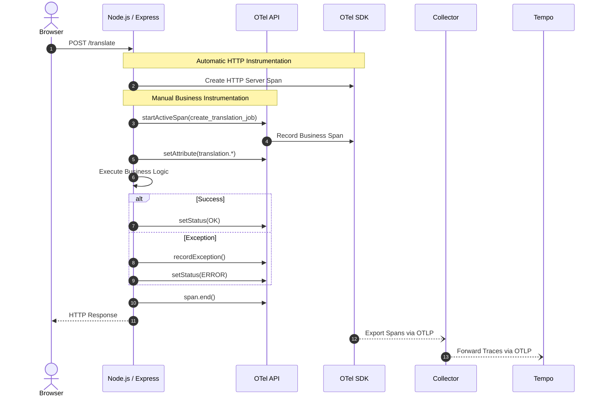

# Traces Instrumentation（分散式追蹤埋點）

Understand the Role of the OpenTelemetry SDK and Instrumentation Techniques（了解 OpenTelemetry SDK 與追蹤埋點技術）

Node.js / Express Application 如何透過 Automatic + Manual Instrumentation 建立 Spans，再由 OTel SDK、Collector 傳送到 Tempo。

## 1. End-to-End Trace Data Flow

| Component           | Responsibility                    | Instrumentation |
| ------------------- | --------------------------------- | --------------- |
| Client              | 發送 `POST /translate`              | HTTP Request    |
| Node HTTP / Express | 接收 HTTP Request，自動建立 Server Span  | Automatic       |
| Route Handler       | 執行翻譯業務及排隊邏輯                       | Manual          |
| OTel SDK            | 管理 **Spans**、Sampling、Batching、Export | SDK             |
| OTel Collector      | 接收並轉送 Traces                      | Collector       |
| Tempo               | 儲存及查詢 Distributed Traces          | Backend         |

## 2. Mermaid — End-to-End Sequence Diagram



這是概念流程。實際 **Span** 是由 SDK 支援的 **Tracer API** 建立，通常不需要由 HTTP Framework 直接呼叫 SDK；Batch Export 也不一定在 HTTP Response 後才發生。

## 3. Automatic vs Manual Instrumentation

圖片中的 `POST /translate` 是 Automatic Span，而 `create_translation_job` 和 `enqueue_jobs` 是 Manual Business Spans。

| Span Name                | Type      | Created By                     |
| ------------------------ | --------- | ------------------------------ |
| `POST /translate`        | Automatic | HTTP / Express Instrumentation |
| `create_translation_job` | Manual    | `tracer.startActiveSpan()`     |
| `enqueue_jobs`           | Manual    | `tracer.startActiveSpan()`     |

在 Tempo 中，理想的 Trace Structure 如下：


### Trace Structure — Automatic vs Manual Instrumentation

```text
🔵 POST /translate                  **Automatic** — Root Span
    │
    └── 🟢 create_translation_job   **Manual** Span
            │
            └── 🟢 enqueue_jobs     **Manual** Span
```
兩個 Manual Spans 共享同一個 Trace ID，並透過 Parent Span ID 建立巢狀關係。

**Span Relationships：**

| Span Name | Instrumentation | Parent Span |
|---|---|---|
| `POST /translate` | 🔵 Automatic | None（Root Span） |
| `create_translation_job` | 🟢 Manual | `POST /translate` |
| `enqueue_jobs` | 🟢 Manual | `create_translation_job` |

**核心觀念：**

- 三個 Spans 共享相同的 **Trace ID**。
- 每個 Span 擁有獨立的 **Span ID**。
- Child Span 透過 **Parent Span ID** 建立巢狀關係。
- Automatic Instrumentation 負責 HTTP Tracing。
- Manual Instrumentation 負責 Custom Business Operations。


## 4. TypeScript — Manual Tracing Example

在 `translation.ts` 使用 OTel API：

```ts

import { trace, SpanStatusCode } from '@opentelemetry/api';

const tracer = trace.getTracer('translation-service');

router.post('/translate', async (req, res) => {
  await tracer.startActiveSpan(
    'create_translation_job',
    async (parentSpan) => {
      try {
        await tracer.startActiveSpan(
          'enqueue_jobs',
          async (childSpan) => {
            try {
              await enqueueTranslationJob(req.body);
            } finally {
              childSpan.end();
            }
          }
        );

        res.status(202).json({
          status: 'accepted'
        });

      } catch (error) {
        parentSpan.recordException(
          error instanceof Error ? error : String(error)
        );
        parentSpan.setStatus({
          code: SpanStatusCode.ERROR
        });
        res.status(500).json({
          error: 'Failed to enqueue job'
        });

      } finally {
        parentSpan.end();
      }
    }
  );
});

```

`enqueueTranslationJob()` 代表你現有的 Redis Job Queue 操作。這是示例，不包含 Redis Client 初始化。

如果啟用 Redis Auto Instrumentation，`enqueue_jobs` 下還可能自動出現 Redis Command Span，例如 `LPUSH translation:jobs`。

## 5. 與 Metrics Instrumentation 的差異

| 比較       | Metrics                     | Traces                     |
| -------- | --------------------------- | -------------------------- |
| OTel API | `metrics.getMeter()`        | `trace.getTracer()`        |
| 手動記錄     | `counter.add(1)`            | `tracer.startActiveSpan()` |
| SDK 處理   | Aggregation / Metric Reader | Sampling / Span Processor  |
| Export   | OTLP Metrics                | OTLP Traces                |
| Backend  | Prometheus                  | Tempo                      |
| 查詢       | PromQL                      | TraceQL                    |
| 主要用途     | 分析整體效能和趨勢                   | 分析個別 Request 的執行過程         |

## 6. 核心總結

Traces Instrumentation 的完整流程：



最重要的觀念：

- Automatic Instrumentation：HTTP Framework 自動建立 `POST /translate` Span。
- Manual Instrumentation：開發人員建立 `create_translation_job`、`enqueue_jobs` 等業務 Spans。
- OTel SDK：管理 Trace Context、Sampling、Span Processing 與 Export。
- Collector → Tempo：集中傳送及儲存 Traces。
- Grafana：查看每個 Span 的執行時間、父子關係與錯誤資訊。

如果後續翻譯任務由 Python Worker 透過 Redis Queue 非同步處理，還需要傳遞 Trace Context，才能讓 Worker 的執行過程與原始 HTTP Request 正確關聯。

---
# ✅ Yes! Automatic Spans and Manual Spans can run in parallel, sequentially, or as nested Parent-Child Spans.

實際上，Automatic 和 Manual Instrumentation 是兩種建立 Span 的方式，不是必須依序執行的階段。

## 1. 正確的架構：Auto + Manual → Same SDK



這張圖是 Instrumentation Architecture，而不是實際執行順序。

## 2. 實際 Trace：Parent-Child Spans 可以重疊執行

以 `POST /translate` 為例：

```text
POST /translate                  [Automatic HTTP Span]
│
├── validate_translation         [Manual Span]
│
├── create_translation_job       [Manual Span]
│   │
│   └── Redis LPUSH              [Automatic Redis Span]
│
└── publish_notification         [Manual Span]
```

其中：

- HTTP Root Span 可以涵蓋整個 Request 的處理時間。
- Manual Business Spans 可以是 Root Span 的 Child Spans。
- Redis Automatic Span 也可以成為 Manual Business Span 的 Child Span。
- 多個 Child Spans 可以同時執行，也可以依序執行。

## 3. Sequential vs Parallel 範例

A. Sequential Execution（循序執行）


Business Operations 依次執行，不互相重疊。

B. Parallel Execution（平行執行）



多個 Child Spans 在相同時間區間執行，彼此重疊。

## 4. 三個容易混淆的概念

| Concept                | 意思                     |
| ---------------------- | ---------------------- |
| Automatic vs Manual    | Span 是透過自動埋點還是開發人員手動建立 |
| Parent vs Child        | Spans 之間的追蹤上下文及父子關係    |
| Sequential vs Parallel | Operations 實際執行的時間關係   |

這三個維度彼此獨立。

例如 `POST /translate` 可能是 Automatic Root Span，而兩個 Manual Child Spans 在同一個 HTTP Request 內平行執行。

最重要的觀念：Auto / Manual 決定 Span 如何產生；Parent / Child 決定追蹤關係；Sequential / Parallel 決定實際執行時間。OTel SDK 可以同時接收這些 Spans 並統一匯出至 Tempo。

---
# Traces Instrumentation — `startActiveSpan()` 與 Trace Context

如何在 Node.js / TypeScript 中結合 Automatic Instrumentation + Manual Instrumentation，並透過 `startActiveSpan()` 自動建立 Parent-Child Span Relationships。

## 1. `instrumentation.ts` vs `translation.ts`

| File                 | Instrumentation        | Responsibility                                             |
| -------------------- | ---------------------- | ---------------------------------------------------------- |
| `instrumentation.ts` | Automatic Setup        | 初始化 NodeSDK、配置 OTLP Trace Exporter、啟用 Auto Instrumentation |
| `translation.ts`     | Manual Instrumentation | 建立 Custom Business Spans、加入 Attributes、記錄錯誤                |
| OTel SDK             | Shared SDK             | Sampling、Span Processing、Batch Export                      |
| OTel Collector       | Telemetry Pipeline     | 接收及轉送 Traces 至 Tempo                                       |

## 2. `instrumentation.ts` — SDK Configuration

```ts

import { NodeSDK } from '@opentelemetry/sdk-node';
import { OTLPTraceExporter } from '@opentelemetry/exporter-trace-otlp-http';
import { getNodeAutoInstrumentations } from '@opentelemetry/auto-instrumentations-node';

const sdk = new NodeSDK({
  serviceName: 'translation-frontend',

  traceExporter: new OTLPTraceExporter({
    url: 'http://otel-collector:4318/v1/traces'
  }),

  instrumentations: [
    getNodeAutoInstrumentations()
  ]
});

sdk.start();

```

這段程式會啟用支援的 HTTP / Framework Automatic Instrumentation，並將 Traces 送往 OTel Collector。

## 3. `translation.ts` — Manual Instrumentation

以下是圖片中的 Manual Instrumentation 概念，整理成完整範例。

```ts

import { trace, SpanStatusCode } from '@opentelemetry/api';

const tracer = trace.getTracer('translation-frontend', '1.0.0');

router.post('/', async (req, res, next) => {
  try {
    const result = await tracer.startActiveSpan(
      'create_translation_job',
      async (span) => {
        try {
          const { text, targetLanguages } = req.body;

          span.setAttribute(
            'translation.text_length',
            text.length
          );

          span.setAttribute(
            'translation.target_languages',
            targetLanguages
          );

          // Existing business logic
          const jobId = await createTranslationJob(
            text,
            targetLanguages
          );

          span.setStatus({
            code: SpanStatusCode.OK
          });

          return { jobId };
        } catch (error) {
          span.recordException(
            error instanceof Error ? error : String(error)
          );

          span.setStatus({
            code: SpanStatusCode.ERROR
          });

          throw error;
        } finally {
          span.end();
        }
      }
    );

    res.status(202).json(result);
  } catch (error) {
    next(error);
  }
});

```

這裡使用的 `translation.*` 是 Custom Business Attributes，需要由團隊制定一致的 Naming Convention。

## 4. `startSpan()` vs `startActiveSpan()`

這是圖片最重要的部分。

| Method              | 建立 Span | 設為 Active Context | Child Span 自動繼承      |
| ------------------- | ------- | ----------------- | -------------------- |
| `startSpan()`       | ✅       | ❌                 | 不會僅因建立 Span 就自動繼承    |
| `startActiveSpan()` | ✅       | ✅                 | ✅，在 Context 正確傳遞的情況下 |

### `startActiveSpan()` 如何建立 Parent-Child Relationship？



例如：

```ts

tracer.startActiveSpan('create_translation_job', (parentSpan) => {
  try {
    tracer.startActiveSpan('enqueue_jobs', (childSpan) => {
      try {
        // Enqueue translation jobs
      } finally {
        childSpan.end();
      }
    });
  } finally {
    parentSpan.end();
  }
});

```

只要 `create_translation_job` 執行時有正確的 Active HTTP Span，它就會自動成為 HTTP Span 的 Child。

同樣地，`enqueue_jobs` 會繼承當時的 Active Context，成為 `create_translation_job` 的 Child Span。

這不代表兩個操作一定循序執行；Parent-Child 是 Context Relationship，Spans 在時間上也可以重疊。

## 5. `setAttribute()`、`recordException()` 和 `setStatus()`

| API                 | Purpose            | Example                         |
| ------------------- | ------------------ | ------------------------------- |
| `setAttribute()`    | 記錄 Span Attributes | `translation.text_length = 500` |
| `recordException()` | 記錄 Exception Event | Translation Service Error       |
| `setStatus(OK)`     | 標記操作成功             | Successful Translation          |
| `setStatus(ERROR)`  | 標記操作失敗             | Translation Failed              |
| `span.end()`        | 結束 Span            | 記錄結束時間                          |

圖片中的 `finally { span.end(); }` 非常重要，因為無論成功或失敗，都應正確結束 Span。

## 6. 完整 End-to-End Trace Flow



這是邏輯示意。SDK 通常透過非同步 Batch Processor 匯出 Spans，HTTP Server Span 也由 Auto Instrumentation 管理其生命週期。

## 7. 核心總結

- `instrumentation.ts`：初始化 OTel SDK，啟用 Automatic Instrumentation。
- `translation.ts`：使用 OTel API 建立 Manual Business Spans。
- `startActiveSpan()`：建立 Span 並將其設為 Active Context，使後續 Spans 能自動建立父子關係。
- `setAttribute()`：補充業務上下文。
- `recordException()` / `setStatus()`：記錄錯誤狀態。
- `span.end()`：結束 Span。
- OTel SDK → Collector → Tempo：負責處理、傳輸及儲存 Traces。

最重要的觀念：`startActiveSpan()` 可以自動繼承目前的 Trace Context，讓 Automatic HTTP Span 與 Manual Business Spans 成為同一條 Distributed Trace，而不需要開發人員手動指定 Parent Span ID。

前提是 SDK、Async Context Manager 及 Framework Instrumentation 已正確初始化，且需要跨服務追蹤時已正確傳遞 Trace Context。

---

# Hands on Auto Traces

- Refer to `lab-traces-auto.md`

## 1. Update `instrumentation.ts`

Install the `@opentelemetry/exporter-trace-otlp-http` package:

```bash
cd handson-labs/app-versions/code/frontend/
npm install --save-exact \
  @opentelemetry/exporter-trace-otlp-http@0.212.0
```

Add trace exporter to the existing SDK configuration:

### 1.1 update `instrumentation.ts`

```typescript
...
import { OTLPTraceExporter } from '@opentelemetry/exporter-trace-otlp-http';
...

  serviceName: 'translation-frontend',
  traceExporter: new OTLPTraceExporter({
    url: 'http://otel-collector:4318/v1/traces',
  }),
  metricReader: new PeriodicExportingMetricReader({
  ...

```

### 1.2 `package.json` applies to the production command:

```json
"start": "node --experimental-loader=@opentelemetry/instrumentation/hook.mjs dist/index.js"
```

### 1.3 `compose.dev.yaml` applies to the development command:

```yaml
- NODE_OPTIONS=--experimental-loader=@opentelemetry/instrumentation/hook.mjs
```

## 2. Deploy

```bash
cd ../../../compose/
docker compose -f compose.dev.yaml up --build -d
```

Note: For development with hot-reload, use `docker compose -f compose.dev.yaml up --build` instead.

## 3. Generate Traffic**

```bash
curl -X POST http://localhost:3001/api/translate \
  -H "Content-Type: application/json" \
  -d '{"text": "Hello world", "targetLanguages": ["es", "fr"]}'
```

## 4. Verify in Grafana Tempo**

- Open Grafana (http://localhost:3010) → Explore → Tempo
- Search for `"translation-frontend"` service traces.

Expected span hierarchy:

```text
POST /api/translate (HTTP span)
  ├─ Redis LPUSH (job enqueue for "es")
  ├─ Redis LPUSH (job enqueue for "fr")
  └─ Redis HSET (session data)
```

## 5. Examine Span Attributes

Click on the HTTP span, verify semantic conventions:

- `http.request.method: POST`
- `http.route: /api/translate`
- `http.response.status_code: 200`
- `server.address`, `server.port`

Click on Redis spans, verify:

- `db.system: redis`
- `db.operation: LPUSH` or `HSET`
- `db.statement` (the actual Redis command)

---

# Traces - Manual Instrumenting

- Refer to `lab-traces-manual.md`

## 0. Create `tracers.ts`

```ts
import { trace, SpanStatusCode } from '@opentelemetry/api';

export { SpanStatusCode };
export const tracer = trace.getTracer('translation-frontend', '1.0.0');

```

## 1. Update `routes/translation.ts`

Add tracer import and create manual spans:

```typescript
import { tracer, SpanStatusCode } from '../tracers.js'
//...
  // POST /api/translate - Submit translation request
  router.post("/", async (req: Request, res: Response) => {
    await tracer.startActiveSpan(
      "create_translation_session",
      async (sessionSpan) => {
        const start = Date.now();
        const body = req.body as TranslateRequest;

        try {
          const text = body?.text;
          const targetLanguages = body?.targetLanguages;

          // Add business attributes to the session span.
          sessionSpan.setAttribute(
            "translation.text_length",
            typeof text === "string" ? text.length : 0,
          );
          sessionSpan.setAttribute(
            "translation.target_language_count",
            Array.isArray(targetLanguages) ? targetLanguages.length : 0,
          );
          sessionSpan.setAttribute(
            "translation.target_languages",
            Array.isArray(targetLanguages) ? targetLanguages : [],
          );

          // Validation with error tracking and a dedicated business span.
          const validationSucceeded = await tracer.startActiveSpan(
            "validate_request",
            async (validationSpan) => {
              try {
                // Validate text
                if (!text || typeof text !== "string" || !text.trim()) {
                  validationErrorsCounter.add(1, { error_type: "empty_text" });
                  // validationSpan Error - Empty text
                  validationSpan.setStatus({
                    code: SpanStatusCode.ERROR,
                    message: "Empty text",
                  });
                  res.status(400).json({
                    error: "Text is required",
                    details: "Text must be a non-empty string",
                  });
                  return false;
                }

                // Validate targetLanguages
                if (!Array.isArray(targetLanguages) || targetLanguages.length === 0) {
                  validationErrorsCounter.add(1, { error_type: "empty_languages" });
                  // validationSpan Error - No target languages
                  validationSpan.setStatus({
                    code: SpanStatusCode.ERROR,
                    message: "No target languages",
                  });
                  res.status(400).json({
                    error: "At least one target language is required",
                    details: "targetLanguages must be a non-empty array",
                  });
                  return false;
                }

                // Check max languages
                if (targetLanguages.length > 3) {
                  validationErrorsCounter.add(1, { error_type: "too_many_languages" });
                  // validationSpan Error - Too many target languages
                  validationSpan.setStatus({
                    code: SpanStatusCode.ERROR,
                    message: "Too many target languages",
                  });
                  res.status(400).json({
                    error: "Maximum 3 target languages allowed",
                    details: `You requested ${targetLanguages.length} languages`,
                  });
                  return false;
                }

                // Validate each language
                const unsupportedLanguages = targetLanguages.filter(
                  (lang) => !SUPPORTED_LANGUAGES.includes(lang as any),
                );

                if (unsupportedLanguages.length > 0) {
                  validationErrorsCounter.add(1, { error_type: "invalid_languages" });
                  // validationSpan Error - Unsupported languate
                  validationSpan.setStatus({
                    code: SpanStatusCode.ERROR,
                    message: "Unsupported language",
                  });
                  res.status(400).json({
                    error: `Unsupported language: ${unsupportedLanguages.join(", ")}`,
                    supportedLanguages: [...SUPPORTED_LANGUAGES],
                  });
                  return false;
                }

                // validationSpan OK
                validationSpan.setStatus({ code: SpanStatusCode.OK });
                return true;
              } finally {
                validationSpan.end();
              }
            },
          );

          if (!validationSucceeded) {
            // sessionSpan Error - Invalid translation requrest
            sessionSpan.setStatus({
              code: SpanStatusCode.ERROR,
              message: "Invalid translation request",
            });
            return;
          }

          // TypeScript can narrow these values after the validation span, but
          // keep the guard explicit because the validation runs asynchronously.
          if (typeof text !== "string" || !Array.isArray(targetLanguages)) {
            return;
          }

          // Create session
          const sessionId = uuidv4();
          sessionSpan.setAttribute("translation.session_id", sessionId);
          const jobs = new Map<string, JobStatus>();
          
          // Create and enqueue jobs
          const jobsList: TranslationJob[] = [];

          await tracer.startActiveSpan(
            "enqueue_translation_jobs",
            async (enqueueSpan) => {
              try {
                // Create and enqueue jobs
                enqueueSpan.setAttribute(
                  "translation.jobs_count",
                  targetLanguages.length,
                );

                const enqueuePromises = targetLanguages.map((targetLanguage) => {
                  const jobId = uuidv4();
                  const job: TranslationJob = {
                    jobId,
                    sessionId,
                    text,
                    sourceLanguage: "en",
                    targetLanguage,
                    createdAt: new Date().toISOString(),
                  };

                  jobsList.push(job);
                  jobs.set(targetLanguage, { status: "queued" });

                  // Enqueue job & Track each job enqueued
                  return queueService.enqueueJob(job).then(() => {
                    jobsEnqueuedCounter.add(1, { target_language: targetLanguage });
                  });
                });
                await Promise.all(enqueuePromises);

                // enqueueSpan OK
                enqueueSpan.setStatus({ code: SpanStatusCode.OK });
              } catch (error) {
                enqueueSpan.recordException(
                  error instanceof Error ? error : String(error),
                );

                // enqueueSpan Error - error.message
                enqueueSpan.setStatus({
                  code: SpanStatusCode.ERROR,
                  message: error instanceof Error ? error.message : String(error),
                });
                throw error;
              } finally {
                enqueueSpan.end();
              }
            },
          );

          // Save session
          const session: TranslationSession = {
            sessionId,
            text,
            sourceLanguage: "en",
            status: "queued",
            jobs,
          };

          await queueService.saveSession(session);

          // Return response
          const response: TranslateResponse = {
            sessionId,
            status: "queued",
            jobs: jobsList.map((job) => ({
              jobId: job.jobId,
              targetLanguage: job.targetLanguage,
              status: "queued",
            })),
          };

          console.log(
            `Created translation session ${sessionId} with ${jobsList.length} jobs`,
          );

          // Track request duration
          requestDuration.record(Date.now() - start, {
            target_language_count: targetLanguages.length.toString(),
          });
          // Track successful request
          translationRequestsCounter.add(1, {
            status: "success",
            language_count: targetLanguages.length.toString(),
          });

          // sessionSpan OK
          sessionSpan.setStatus({ code: SpanStatusCode.OK });
          res.status(201).json(response);
        } catch (error) {
          console.error("Error creating translation session:", error);
          sessionSpan.recordException(
            error instanceof Error ? error : String(error),
          );

          // sessionSpan Error - error.message
          sessionSpan.setStatus({
            code: SpanStatusCode.ERROR,
            message: error instanceof Error ? error.message : String(error),
          });
          serverErrorsCounter.add(1, { operation: "create_translation" });
          res.status(500).json({
            error: "Internal server error",
            details: error instanceof Error ? error.message : "Unknown error",
          });
        } finally {
          sessionSpan.end();
        }
      },
    );

  });
```

## 2. Deploy

```bash
cd handson-labs/compose/
docker compose -f compose.dev.yaml up --build -d
```

Note: For development with hot-reload, use `docker compose -f compose.dev.yaml up --build` instead.

## 3. Generate Traffic

```bash
# Successful request
curl -X POST http://localhost:3001/api/translate \
  -H "Content-Type: application/json" \
  -d '{"text": "Hello world", "targetLanguages": ["es", "fr", "de"]}'

# Validation error
curl -X POST http://localhost:3001/api/translate \
  -H "Content-Type: application/json" \
  -d '{"text": "", "targetLanguages": ["es"]}'

docker compose -f compose.dev.yaml logs frontend
```

## 4. Verify in Grafana Tempo

Search for traces, expect enriched hierarchy:

```text
POST /api/translate (auto)
  └─ create_translation_session (manual)
       ├─ validate_request (manual)
       └─ enqueue_translation_jobs (manual)
            ├─ Redis LPUSH (auto) - es
            ├─ Redis LPUSH (auto) - fr
            └─ Redis LPUSH (auto) - de

HTTP request
└── sessionSpan: create_translation_session
    ├── validationSpan: validate_request
    └── enqueueSpan: enqueue_translation_jobs            
```

## 5. Examine Custom Attributes

Click on `create_translation_session` span:

- `translation.text_length`
- `translation.target_language_count`
- `translation.target_languages`
- `translation.session_id`

Click on `enqueue_translation_jobs` span:

- `translation.jobs_count`

---