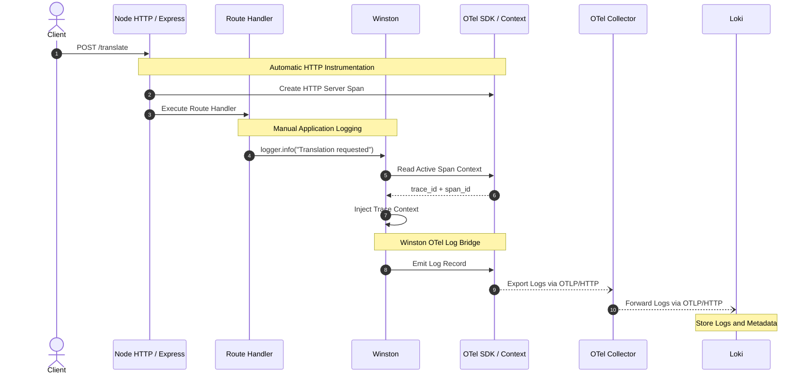
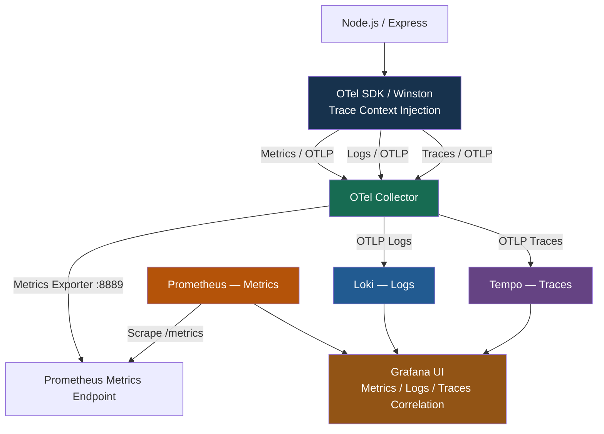
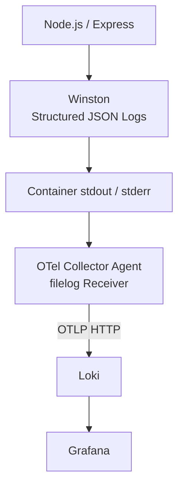
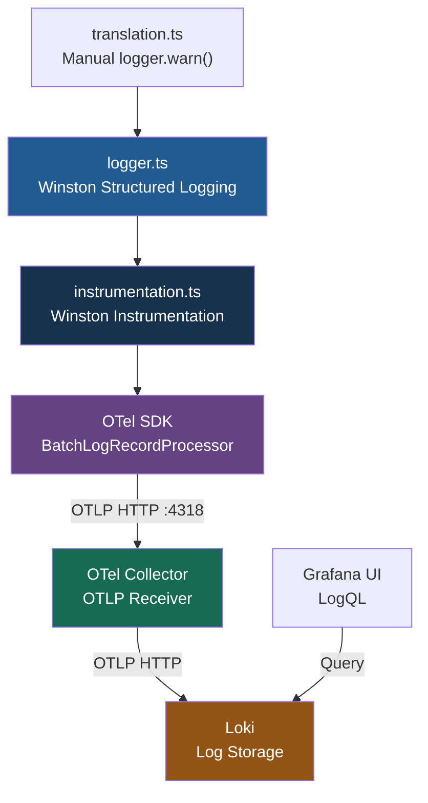

# Logs Instrumentation（日誌監控埋點）

**Understand the Role of the OpenTelemetry SDK and Instrumentation Techniques**

本章說明如何在 Node.js / Express Application 中，整合 **Winston + OpenTelemetry SDK**，將 `trace_id` 和 `span_id` 加入 Structured Logs，再透過 OpenTelemetry Collector 將 Logs 傳送至 Loki。

同時整合 Metrics → Prometheus、Traces → Tempo，建立完整的 Observability Architecture。

**核心概念：Log-Trace Correlation（日誌與追蹤關聯）。**

## 1. End-to-End Logs Data Flow

| Component | Responsibility | 主要用途 |
|---|---|---|
| **Client** | 發送 `POST /translate` | HTTP Request |
| **Node HTTP / Express** | 自動建立 HTTP Server Span | Automatic Instrumentation |
| **Route Handler** | 執行業務邏輯與 Logging | Manual Logging |
| **Winston** | 產生 Structured Application Logs | JSON Logging |
| **OTel SDK** | Trace Context、Sampling、Log Processing、Export | Telemetry Processing |
| **OTel Collector** | 接收、處理及轉送 Metrics、Logs、Traces | OTLP Pipeline |
| **Prometheus** | 儲存及查詢 Metrics | PromQL |
| **Loki** | 儲存及查詢 Logs | LogQL |
| **Tempo** | 儲存及查詢 Distributed Traces | TraceQL |
| **Grafana** | 統一查詢及關聯三種訊號 | Visualization / Alerting |

## 2. Mermaid — End-to-End Logs Sequence Diagram



**注意：**

- Winston 不會天然將 Logs 匯出至 OpenTelemetry。
- 需要正確配置 Winston Instrumentation / Log Bridge。
- OTel SDK 通常使用非同步 Batch Export。
- HTTP Span 由 HTTP Instrumentation 管理，並非 Express Route Handler 直接操作 SDK。
- Trace Context Injection 必須正確配置，Logs 才能包含 `trace_id` 和 `span_id`。

## 3. `instrumentation.ts` — SDK + Automatic Instrumentation

Node.js 可以使用 OTel Auto Instrumentation 啟用 HTTP Tracing，並配置 Winston Log Correlation。

以下示範同時啟用 Traces、Metrics 與 Logs 的 SDK。

### 3.1 SDK Configuration

```typescript
import { NodeSDK } from '@opentelemetry/sdk-node';

import { OTLPTraceExporter } from
  '@opentelemetry/exporter-trace-otlp-http';

import { OTLPMetricExporter } from
  '@opentelemetry/exporter-metrics-otlp-http';

import { OTLPLogExporter } from
  '@opentelemetry/exporter-logs-otlp-http';

import { PeriodicExportingMetricReader } from
  '@opentelemetry/sdk-metrics';

import { BatchLogRecordProcessor } from
  '@opentelemetry/sdk-logs';

import { getNodeAutoInstrumentations } from
  '@opentelemetry/auto-instrumentations-node';

const sdk = new NodeSDK({
  serviceName: 'translation-frontend',

  traceExporter: new OTLPTraceExporter({
    url: 'http://otel-collector:4318/v1/traces'
  }),

  metricReader: new PeriodicExportingMetricReader({
    exporter: new OTLPMetricExporter({
      url: 'http://otel-collector:4318/v1/metrics'
    }),
    exportIntervalMillis: 10000
  }),

  logRecordProcessors: [
    new BatchLogRecordProcessor(
      new OTLPLogExporter({
        url: 'http://otel-collector:4318/v1/logs'
      })
    )
  ],

  instrumentations: [
    getNodeAutoInstrumentations({
      '@opentelemetry/instrumentation-winston': {
        disableLogCorrelation: false,
        disableLogSending: false
      }
    })
  ]
});

sdk.start();
```

上述範例採用支援 `logRecordProcessors` 的 NodeSDK 版本。實際使用時應鎖定相容的 OpenTelemetry Packages，確認 Winston Instrumentation 可正常將 Log Records 送入 SDK。

### 3.2 Configuration Responsibilities

| Setting | Responsibility |
|---|---|
| `NodeSDK` | 初始化 OTel SDK |
| `OTLPTraceExporter` | 將 Traces 傳送至 Collector |
| `PeriodicExportingMetricReader` | 定期讀取並匯出 Metrics |
| `OTLPMetricExporter` | 將 Metrics 傳送至 Collector |
| `BatchLogRecordProcessor` | 批次處理 Logs |
| `OTLPLogExporter` | 將 Logs 傳送至 Collector |
| `getNodeAutoInstrumentations()` | 啟用受支援的 Automatic Instrumentation |
| `instrumentation-winston` | Winston Log Correlation / Log Sending |

**重要：** SDK 應在 Express、Winston 等受 Instrumentation 影響的模組載入之前初始化。

## 4. `translation.ts` — Manual Logging

使用 Winston 記錄業務事件及異常。

```typescript
import winston from 'winston';

const logger = winston.createLogger({
  level: 'info',

  format: winston.format.json(),

  transports: [
    new winston.transports.Console()
  ]
});

router.post('/translate', async (req, res, next) => {
  try {
    logger.info('Translation requested');

    const result = await translateContent(req.body);

    logger.info('Translation completed');

    res.json(result);
  } catch (error) {
    logger.error('Translation failed', {
      error_type:
        error instanceof Error
          ? error.name
          : 'UnknownError'
    });

    next(error);
  }
});
```

### Automatic vs Manual Logging

| Operation | Instrumentation |
|---|---|
| HTTP Request Tracing | Automatic |
| Trace Context Propagation | Automatic（正確配置時） |
| Winston Trace Context Injection | Automatic（Winston Instrumentation） |
| `logger.info()` | Manual Logging |
| `logger.error()` | Manual Logging |
| Log Processing / Export | OTel SDK |

Winston Instrumentation 可以注入 Trace Context，並透過 OTel Log Bridge 發送 Log Records。

## 5. Structured Log Example

```json
{
  "timestamp": "2026-10-26T10:00:00Z",
  "level": "INFO",
  "service": "translation-frontend",
  "message": "Translation requested",
  "trace_id": "4bf92f3577b34da6a3ce929d0e0e4736",
  "span_id": "00f067aa0ba902b7"
}
```

| Attribute | Description |
|---|---|
| `timestamp` | Log 發生時間 |
| `level` | INFO、WARN、ERROR 等 |
| `service` | 產生日誌的 Application |
| `message` | Log 內容 |
| `trace_id` | 關聯整條 Distributed Trace |
| `span_id` | 關聯 Trace 中的特定 Span |

> 上述為結構化 JSON 日誌示意。使用 OpenTelemetry Log Data Model 時，Trace ID、Span ID 和 Resource Attributes 可能分別存在於 Log Record 的標準欄位，而非全部放在 JSON Body 中。

## 6. Grafana — Metrics / Logs / Traces Correlation



### 三種 Telemetry Data Flow

| Signal | Data Flow |
|---|---|
| **Metrics** | Application → OTel SDK → Collector → Prometheus Exporter → Prometheus |
| **Logs** | Winston → OTel SDK → Collector → Loki |
| **Traces** | OTel Tracer → OTel SDK → Collector → Tempo |

### Log-Trace Correlation Example

假設一筆 Translation Request 發生錯誤：

1. 在 Loki 搜尋 `Translation failed`。
2. 從 Log 取得 `trace_id`。
3. 在 Grafana 使用 Logs-to-Traces Correlation 開啟 Tempo Trace。
4. 找到失敗的 Span、相關 Attributes 與執行時間。

Grafana 需要正確配置 Loki / Tempo Data Sources，以及 Trace ID 的關聯功能。

## 7. Metrics、Traces、Logs Instrumentation 比較

| Comparison | Metrics | Traces | Logs |
|---|---|---|---|
| **OTel API / Integration** | Meter | Tracer | Winston / Log Bridge |
| **Application API** | `counter.add()` | `startActiveSpan()` | `logger.info()` |
| **SDK Processing** | Aggregation | Sampling / Span Processing | Log Processing |
| **OTLP Endpoint** | `/v1/metrics` | `/v1/traces` | `/v1/logs` |
| **Backend** | Prometheus | Tempo | Loki |
| **Query Language** | PromQL | TraceQL | LogQL |
| **Purpose** | 效能及趨勢 | 執行路徑與耗時 | 詳細事件及錯誤 |

## 8. Alternative — Winston stdout → Log Agent → Loki

不一定需要讓 Application 使用 OTel SDK 直接匯出 Logs。

另一種常見架構是：



這種方式：

- Application 使用 Winston 輸出 Structured JSON Logs。
- Log Agent 從 Container stdout / stderr 收集 Logs。
- Collector 處理及轉送至 Loki。
- Application 不一定需要配置 OTLP Logs Exporter。
- 若要關聯 Tempo Traces，仍需要確保 Logs 包含有效的 Trace Context。

## 9. 核心總結

| Component | Responsibility |
|---|---|
| **Automatic HTTP Instrumentation** | 建立 HTTP Request Trace Context |
| **Winston** | 記錄 Application / Business Events |
| **Trace Context Injection** | 加入 `trace_id`、`span_id` |
| **OTel SDK** | Metrics、Logs、Traces Processing / Export |
| **OTel Collector** | 集中接收、處理及轉送 Telemetry |
| **Prometheus** | Metrics Storage / PromQL |
| **Loki** | Logs Storage / LogQL |
| **Tempo** | Distributed Traces / TraceQL |
| **Grafana** | Unified Visualization / Correlation / Alerting |

### 最重要的觀念

**Automatic Instrumentation**：監控 HTTP、Framework、Database 等技術操作。

**Manual Instrumentation / Logging**：記錄 Translation、Payment、LC Issuance 等重要業務事件。

**Trace Context Injection**：使用共同的 Trace ID，關聯 Logs 與 Traces。

**OTel Collector**：集中管理 Metrics、Logs、Traces 的傳輸及路由。

完整架構：

**Node.js / Express → OTel SDK + Winston → OTel Collector → Prometheus / Loki / Tempo → Grafana UI**

> 如果 Application 同時使用 OTLP Log Export 與 stdout Log Collection，應避免相同 Logs 重複進入 Loki。Production 環境應選擇清楚的 Log Collection 策略，並保護敏感資料。

---
# Logs Instrumentation — Winston + OpenTelemetry SDK

這張圖片進一步說明 Node.js / TypeScript 如何將 Automatic Instrumentation 與 Manual Logging 整合，並使用 OpenTelemetry SDK 將日誌傳送至 Collector。

核心設計是將程式拆成三個檔案：

| File                 | Responsibility                                          | Type                  |
| -------------------- | ------------------------------------------------------- | --------------------- |
| `instrumentation.ts` | 初始化 OTel SDK、配置 Log Exporter、啟用 Winston Instrumentation | Automatic Setup       |
| `logger.ts`          | 配置 Winston Logger、Log Level、JSON Format                 | Logging Configuration |
| `translation.ts`     | 使用 Logger 記錄業務事件和異常                                     | Manual Logging        |

## 1. `instrumentation.ts` — OTel SDK Configuration

```ts

import { NodeSDK } from '@opentelemetry/sdk-node';
import { BatchLogRecordProcessor } from '@opentelemetry/sdk-logs';
import { OTLPLogExporter } from '@opentelemetry/exporter-logs-otlp-http';
import { WinstonInstrumentation } from '@opentelemetry/instrumentation-winston';

const sdk = new NodeSDK({
  serviceName: 'translation-frontend',

  logRecordProcessors: [
    new BatchLogRecordProcessor(
      new OTLPLogExporter({
        url: 'http://otel-collector:4318/v1/logs'
      })
    )
  ],

  instrumentations: [
    new WinstonInstrumentation({
      disableLogCorrelation: false,
      disableLogSending: false
    })
  ]
});

sdk.start();

```

此範例的主要功能：

- `BatchLogRecordProcessor`：批次處理 Log Records。
- `OTLPLogExporter`：透過 OTLP/HTTP 將 Logs 送至 Collector。
- `WinstonInstrumentation`：整合 Winston Logging 與 OpenTelemetry。
- `disableLogCorrelation: false`：允許注入 Trace Context。
- `disableLogSending: false`：啟用支援的 Winston Log Sending 功能。

注意： 此範例只展示 Logs Pipeline。要自動建立 HTTP Server Spans，仍需啟用 HTTP / Express Tracing Instrumentation。OTel SDK 必須在 Winston 模組載入前初始化。

## 2. `logger.ts` — Winston Logger Configuration

```ts

import winston from 'winston';

export const logger = winston.createLogger({
  level: process.env.LOG_LEVEL?.toLowerCase() || 'info',

  format: winston.format.combine(
    winston.format.timestamp(),
    winston.format.json()
  ),

  transports: [
    new winston.transports.Console()
  ]
});

```

這個檔案負責 Winston Logging Configuration，而不是直接建立 OTel Spans。

| Setting       | Description             |
| ------------- | ----------------------- |
| `LOG_LEVEL`   | 控制最低 Log Level          |
| `timestamp()` | 加入時間戳記                  |
| `json()`      | 輸出 Structured JSON Logs |
| `Console()`   | 輸出至 stdout              |

## 3. `translation.ts` — Manual Logging

```ts

import { logger } from '../logger';

// Translation request validation
if (body.targetLanguages.length > 3) {
  logger.warn('Validation failed: too many languages', {
    reason: 'too_many_languages',
    requested_count: body.targetLanguages.length,
    max_allowed: 3
  });

  // Existing validation response handling
}

```

這段程式會手動產生 WARN Log。

| Attribute         | Value                                   | Description               |
| ----------------- | --------------------------------------- | ------------------------- |
| `level`           | `warn`                                  | Log Severity              |
| `message`         | `Validation failed: too many languages` | 業務事件                      |
| `reason`          | `too_many_languages`                    | Validation Failure Reason |
| `requested_count` | 實際語言數量                                  | Requested Languages       |
| `max_allowed`     | `3`                                     | Allowed Limit             |

這裡屬於 Manual Logging，因為開發人員自行決定何時呼叫 `logger.warn()`，以及記錄哪些 Business Attributes。

## 4. Logs 如何進入 Loki？



這是邏輯資料流程。Winston Instrumentation 在 Logger 呼叫過程中提供相關整合，並不是 Log Record 必須經過的一個獨立執行服務。

## 5. Log-Trace Correlation 的重要條件

圖片中雖然啟用了 Winston Instrumentation，但要讓 Logs 包含有效的 `trace_id` 和 `span_id`，執行 Logging 時必須存在有效的 Active Span Context。

例如完整的 Application 同時啟用了 HTTP Tracing：

```text
HTTP POST /translate           ← Automatic HTTP Span
  └── validate_translation     ← Manual Business Span
        └── logger.warn()       ← Manual Log with Trace Context
```

這樣 Winston Instrumentation 才能取得正在執行的 Span Context，並將日誌關聯到 Tempo Trace。

## 6. 核心總結

| Component            | 最簡單的理解                            |
| -------------------- | --------------------------------- |
| `instrumentation.ts` | 配置 OTel SDK + Winston Integration |
| `logger.ts`          | 配置 Logger                         |
| `translation.ts`     | 手動記錄 Business Logs                |
| OTel SDK             | 批次處理並匯出 Logs                      |
| OTel Collector       | 集中接收及轉送                           |
| Loki                 | 儲存及查詢 Logs                        |
| Tempo                | 儲存 Traces，供日誌關聯分析                 |

最重要的觀念：

- `instrumentation.ts` = Automatic Integration Setup
- `logger.ts` = Structured Logger Configuration
- `translation.ts` = Manual Business Logging

三者可以配合，讓開發人員專注記錄重要的 Business Events，而由 OpenTelemetry 統一管理 Trace Context 與 Log Export。

另外，若同時啟用 Winston OTLP Log Sending 和 Kubernetes stdout Log Collection，應避免相同日誌重複送進 Loki。

---
# Hands on Auto Instrumentation for Logs

- Refer to `lab-logs-auto.md`

## 1. Install Winston and Instrumentation

```bash
cd handson-labs/app-versions/code/frontend
npm install --save-exact \
  winston@3.19.0 \
  @opentelemetry/instrumentation-winston@0.56.0 \
  @opentelemetry/winston-transport@0.10.0 \
  @opentelemetry/exporter-logs-otlp-http@0.212.0 \
  @opentelemetry/sdk-logs@0.212.0
```

**Package Purposes:**

- `winston`: Popular structured logging library for Node.js
- `@opentelemetry/instrumentation-winston`: Auto-instrumentation that injects trace context (`trace_id`, `span_id`) into Winston logs
- `@opentelemetry/winston-transport`: Required peer dependency — forwards log records through the OpenTelemetry SDK pipeline to the collector
- `@opentelemetry/exporter-logs-otlp-http`: Exports log records to the OpenTelemetry Collector via OTLP HTTP
- `@opentelemetry/sdk-logs`: Provides `BatchLogRecordProcessor` for buffering and flushing log records

## 2. Create `logger.ts`

```typescript
import winston from 'winston';

export const logger = winston.createLogger({
  level: 'info',
  format: winston.format.combine(
    winston.format.timestamp(),
    winston.format.json(),
  ),
  transports: [new winston.transports.Console()],
});
```

## 3. Update `instrumentation.ts`

Add `WinstonInstrumentation` to the instrumentations array:

```typescript
...

import { WinstonInstrumentation } from '@opentelemetry/instrumentation-winston';
import { OTLPLogExporter } from '@opentelemetry/exporter-logs-otlp-http';
import { BatchLogRecordProcessor } from '@opentelemetry/sdk-logs';


const sdk = new NodeSDK({
...
  logRecordProcessors: [
    new BatchLogRecordProcessor(
      new OTLPLogExporter({
        url: 'http://otel-collector:4318/v1/logs',
      }),
    ),
  ],
  instrumentations: [
    getNodeAutoInstrumentations(),
    new WinstonInstrumentation(),
  ],
});  
...

```

## 4. Replace `console.log` calls with `logger`

Add the logger import at the top of `routes/translation.ts`:

```typescript
import { logger } from '../logger';
```

Then replace the `console.log` / `console.error` calls:

**In `routes/translation.ts` — session created:**

```typescript
// Before:
console.log(
  `Created translation session ${sessionId} with ${jobsList.length} jobs`,
);

// After:
logger.info('Translation session created', {
  sessionId,
  jobCount: jobsList.length,
  targetLanguages: body.targetLanguages,
});
```

**In `routes/translation.ts` — session error:**

```typescript
// Before:
console.error('Error creating translation session:', error);

// After:
logger.error('Error creating translation session', {
  error: error instanceof Error ? error.message : 'Unknown error',
  stack: error instanceof Error ? error.stack : undefined,
});
```

**In `index.ts` — add the logger import and replace startup logs:**

```typescript
import { logger } from './logger.js';

// Before:
console.log('Initializing services...');

// After:
logger.info('Initializing services');

// Before:
console.log(`Frontend server listening on port ${PORT}`);

// After:
logger.info('Frontend server started', { port: PORT });
```

```prompt

In the handson-labs folder refer to `labs/section-single-system/lab-logs-auto.md` file we have a few examples of refactorings that migrate from `console.*` to `logger.*` and leverage the correct log level and add relevant attributes to the logs. Please go through the code in the frontend folder under `app-versions/code` and refactor existing logs to match the new version (using the logger exported from `logger.ts`). Do one file at a time. 

If there are too many changes, implement a few and pause to ask for feedback.

```

## 5. Deploy

```bash
cd ../../../compose/
docker compose -f compose.dev.yaml up --build -d

docker compose -f compose.dev.yaml logs frontend
```

## 6. Generate Traffic

Run the request generator from the `handson-labs` directory. It sends 10 valid
requests and 5 warning-producing requests covering the frontend validation
rules:

```bash
cd ..
bash test_logs.sh
```

To generate application `ERROR` logs, stop Redis after the frontend has
started and run the two backend-failure cases:

```bash
RUN_ERROR_CASES=true bash test_logs.sh
```

Restart Redis after the test completes.

To use a different frontend address:

```bash
FRONTEND_URL=http://localhost:3001 bash test_logs.sh
```
### 6.1 Try ERROR

```bash
cd handson-labs/compose
docker compose -f compose.dev.yaml stop redis

cd ..
RUN_ERROR_CASES=true bash test_logs.sh

cd compose
docker compose -f compose.dev.yaml start redis

```

## 7. Verify in Grafana Loki

Open Grafana → Explore → Loki

Query:

```logql
{service_name="translation-frontend"}
{service_name="translation-frontend"} |= "Translation request validation failed"
{service_name="translation-frontend"} |= "Error creating translation session"
```

Find logs with `trace_id` and `span_id` fields. You can then search for them in Tempo to retrieve the relevant spans and traces.

---
#  Manual Instrumentation for Logs

- Refer to `lab-logs-manual.md`

## 1. Update `routes/translation.ts`

Add structured business logs throughout the request flow:

```typescript
  ...

  if (validationError) {
    logger.warn('Validation failed', {
      reason: validationError.errorType,
      ip: req.ip,
    });
    ...
  }

  // Log session creation
  const sessionId = uuidv4();
  logger.info('Translation session created', {
    session_id: sessionId,
    text_length: text.length,
    target_languages: targetLanguages,
    language_count: targetLanguages.length,
  });

// Confirm that each job was accepted for processing.
return queueService.enqueueJob(job).then(() => {
  logger.info(`Translation job accepted for processing - ${targetLanguage}`, {
    job_id: jobId,
    session_id: sessionId,
    target_language: targetLanguage,
    queue: 'translation_queue',
  });
  recordJobEnqueued(targetLanguage);
});

...
recordTranslationRequest("success", targetLanguages.length);

// Log session ready
logger.info('Translation session ready', {
  session_id: sessionId,
  jobs_count: targetLanguages.length,
  status: 'queued',
});

// sessionSpan OK

```

Also add an SSE connection log in the `GET /:sessionId/events` route in `routes/translation.ts`, after calling `sseManager.addConnection`:

```typescript
sseManager.addConnection(sessionId, res);

logger.info('SSE connection established', {
  session_id: sessionId,
  ip: req.ip,
});
```

```prompt
In the hands-on folder, under labs/section-single-system/lab-logs-manual.md you will find a couple of examples of meaningful business context logs to add to the frontend application (under app-versions/code/frontend). Your task is simple: go through the code and add relevant log statements where you see fit. Use the correct log level. Implement one file at a time, and pause for feedback.
```

```prompt
It seems that there is still work to be done. Go through all the files of the frontend application and identify places where logs can add value. Implement these logs. Go beyond the scope of the lab (the lab was just for the sake of providing implementation examples).
```

## 3. Deploy

```bash
cd compose/
docker compose -f compose.dev.yaml up --build frontend -d

docker compose -f compose.dev.yaml logs frontend
```

Note: For development with hot-reload, use `docker compose -f compose.dev.yaml up --build` instead.

## 4. Generate Various Request Types

```bash
# Successful request
curl -X POST http://localhost:3001/api/translate \
  -H "Content-Type: application/json" \
  -d '{"text": "Hello world", "targetLanguages": ["es", "fr"]}'

# Validation errors
curl -X POST http://localhost:3001/api/translate \
  -H "Content-Type: application/json" \
  -d '{"text": "", "targetLanguages": ["es"]}'

curl -X POST http://localhost:3001/api/translate \
  -H "Content-Type: application/json" \
  -d '{"text": "Hello", "targetLanguages": "invalid"}'
```

## 5. Verify in Grafana Loki

Query for session lifecycle:

```logql
{service_name="translation-frontend"} | session_id != ""
```

Query for validation errors:

```logql
{service_name="translation-frontend"} | detected_level = "warn"
```

Query for specific session:

```logql
{service_name="translation-frontend"} | session_id="<paste-session-id-here>"
```

Query for Tracer Id

```logql
{service_name="translation-frontend"} | trace_id != ""
```

## 6. Practice Log-to-Trace Correlation

1. Find a "Translation session created" log
2. Note the `session_id`
3. Click the `trace_id` link → opens the trace
4. In trace, find the `create_translation_session` span
5. Verify the span has the same `translation.session_id` attribute

---

# SSE（Server-Sent Events，伺服器發送事件）

SSE 是一種讓伺服器可以持續、即時將事件推送給瀏覽器的技術。

在這個翻譯應用程式中：

1. 瀏覽器建立 SSE 連線：

```text
GET /api/translate/:sessionId/events
```

2. 伺服器保持連線開啟。
3. 翻譯工作完成或失敗時，伺服器主動傳送事件：

```text
translation_complete
translation_error
session_complete
```

4. 瀏覽器收到事件後，更新翻譯進度或結果。

SSE 是單向通訊：

```text
伺服器 → 瀏覽器
```

如果需要雙向即時通訊，通常會使用 WebSocket。 單獨使用 curl POST 不會建立 SSE 連線。

---
# Logs Traces Correlation

- Refer to `lab-logs-traces-correlation.md`

## 1. Stop the stack and wipe the Grafana volume

Removing the Grafana volume ensures the updated provisioning config is applied from scratch on restart:

```bash
cd handson-labs/compose/
docker compose -f compose.dev.yaml down
docker volume ls
docker volume ls | grep grafana
docker volume rm compose_grafana-data
```

## 2. Add UIDs to all datasources

Open `compose/grafana-datasources.yaml`. Cross-datasource linking requires stable UIDs so datasources can reference each other. Ensure all three datasources have explicit `uid` fields:

```yaml
datasources:
  - name: Prometheus
    uid: prometheus
    # ...

  - name: Loki
    uid: loki
    # ...

  - name: Tempo
    uid: tempo
    # ...
```

## 3. Configure trace-to-log correlation in Tempo

Add `tracesToLogsV2` to the Tempo datasource `jsonData`. This enables a **Logs** button inside Tempo's trace view that queries Loki for logs matching the same trace:

```yaml
- name: Tempo
  uid: tempo
  type: tempo
  access: proxy
  url: http://tempo:3200
  editable: false
  jsonData:
    tracesToLogsV2:
      datasourceUid: loki
      filterByTraceID: true
      filterBySpanID: false
      tags:
        - key: service.name
          value: service_name
```

- `filterByTraceID: true` — adds a `trace_id` filter to the generated Loki query automatically
- `tags` — maps the OTel span attribute `service.name` to the Loki stream label `service_name`, scoping the log query to the correct service

## 4. Configure log-to-trace correlation in Loki

Add `derivedFields` to the Loki datasource `jsonData`. This creates a clickable **Trace ID** link on every log line that has a `trace_id` stream label:

```yaml
- name: Loki
  uid: loki
  type: loki
  access: proxy
  url: http://loki:3100
  editable: false
  jsonData:
    maxLines: 1000
    derivedFields:
      - name: Trace ID
        matcherType: label
        matcherRegex: 'trace_id'
        datasourceUid: tempo
        url: '$${__value.raw}'
        urlDisplayLabel: 'Trace ID'
```

- `matcherType: label` — matches the `trace_id` stream label directly (trace context is stored as a label, not embedded in the log body, when using OTLP ingestion)
- `url: '$${__value.raw}'` — `$$` is the provisioning escape for a literal `$`; at runtime Grafana substitutes the extracted label value as the trace ID query to Tempo

```yaml grafana-datasources.yaml
apiVersion: 1

datasources:
  - name: Prometheus
    # Change here
    uid: prometheus
    type: prometheus
    access: proxy
    url: http://prometheus:9090
    isDefault: true
    editable: false
    jsonData:
      timeInterval: 15s
      httpMethod: POST

  - name: Loki
    # Change here
    uid: loki
    type: loki
    access: proxy
    url: http://loki:3100
    editable: false
    jsonData:
      maxLines: 1000
      # Change here
      derivedFields:
        - name: Trace ID
          matcherType: label
          matcherRegex: 'trace_id'
          datasourceUid: tempo
          url: '$${__value.raw}'
          urlDisplayLabel: 'Trace ID'

  - name: Tempo
    # Change here
    uid: tempo
    type: tempo
    access: proxy
    url: http://tempo:3200
    editable: false
    jsonData:
      tracesToLogsV2:
        # Change here
        datasourceUid: loki
        filterByTraceID: true
        filterBySpanID: false
        tags:
          - key: service.name
            value: service_name
      tracesToMetrics:
        # Change here
        datasourceUid: prometheus
      serviceMap:
        datasourceUid: prometheus

```

## 5. Deploy

```bash
docker compose -f compose.dev.yaml up -d
```

## 6. Generate Traffic

```bash
curl -X POST http://localhost:3001/api/translate \
  -H "Content-Type: application/json" \
  -d '{"text": "Hello world", "targetLanguages": ["es", "fr"]}'
```

## 7. Verify log-to-trace correlation

Open Grafana (http://localhost:3000) → Explore → Loki

Run the query:

```logql
{service_name="translation-frontend"}
{service_name="translation-frontend"} | trace_id != ""
```

Expand a log line — a **Trace ID** link appears at the bottom of the detail panel. Click it to open the corresponding trace in Tempo.

## 8. Verify trace-to-log correlation

Open Grafana → Explore → Tempo

Search for recent traces from `translation-frontend`. Open a trace and click the **Logs** button at the top of the trace view. Grafana queries Loki and displays the logs for that service scoped to the same trace.

---
# Frontend Refactoring

- Refer to `lab-frontend-refactorings.md`

**Key environment variables used in this lab:**

| Variable                      | Purpose                                                   |
| ----------------------------- | --------------------------------------------------------- |
| `OTEL_SERVICE_NAME`           | Service name reported in all telemetry signals            |
| `OTEL_EXPORTER_OTLP_ENDPOINT` | Base URL for all OTLP exporters (traces, metrics, logs)   |
| `OTEL_METRIC_EXPORT_INTERVAL` | Metrics export interval in milliseconds (default `60000`) |

## 1. Review the Current `instrumentation.ts`

Open `app-versions/code/frontend/instrumentation.ts` and note the hardcoded values:

```typescript
const sdk = new NodeSDK({
  serviceName: 'translation-frontend', // ← hardcoded
  traceExporter: new OTLPTraceExporter({
    url: 'http://otel-collector:4318/v1/traces', // ← hardcoded
  }),
  metricReader: new PeriodicExportingMetricReader({
    exporter: new OTLPMetricExporter({
      url: 'http://otel-collector:4318/v1/metrics', // ← hardcoded
    }),
    exportIntervalMillis: 10000, // ← hardcoded
  }),
  logRecordProcessors: [
    new BatchLogRecordProcessor(
      new OTLPLogExporter({
        url: 'http://otel-collector:4318/v1/logs', // ← hardcoded
      }),
    ),
  ],
  instrumentations: [
    getNodeAutoInstrumentations(),
    new WinstonInstrumentation(),
  ],
});
```

Every endpoint and the service name are baked into the code. Changing the collector address requires a code edit and a new image build.

## 2. Refactor `instrumentation.ts`

Replace the full file content with the version below. The OTel Node SDK automatically reads `OTEL_SERVICE_NAME` and `OTEL_EXPORTER_OTLP_ENDPOINT`, so no arguments need to be passed to any exporter or to `NodeSDK`:

```typescript
import { NodeSDK } from '@opentelemetry/sdk-node';
import { getNodeAutoInstrumentations } from '@opentelemetry/auto-instrumentations-node';
import { OTLPMetricExporter } from '@opentelemetry/exporter-metrics-otlp-http';
import { PeriodicExportingMetricReader } from '@opentelemetry/sdk-metrics';

import { OTLPTraceExporter } from '@opentelemetry/exporter-trace-otlp-http';

import { WinstonInstrumentation } from '@opentelemetry/instrumentation-winston';
import { OTLPLogExporter } from '@opentelemetry/exporter-logs-otlp-http';
import { BatchLogRecordProcessor } from '@opentelemetry/sdk-logs';

// All configuration is driven by standard OTel environment variables:
//   OTEL_SERVICE_NAME                   — service name (required)
//   OTEL_EXPORTER_OTLP_ENDPOINT         — base URL for all signals, e.g. http://otel-collector:4318
//   OTEL_EXPORTER_OTLP_TRACES_ENDPOINT  — override traces endpoint
//   OTEL_EXPORTER_OTLP_METRICS_ENDPOINT — override metrics endpoint
//   OTEL_EXPORTER_OTLP_LOGS_ENDPOINT    — override logs endpoint
//   OTEL_METRIC_EXPORT_INTERVAL         — metrics export interval in ms (default 60000)
const sdk = new NodeSDK({
  traceExporter: new OTLPTraceExporter(),
  metricReader: new PeriodicExportingMetricReader({
    exporter: new OTLPMetricExporter(),
    exportIntervalMillis: parseInt(
      process.env.OTEL_METRIC_EXPORT_INTERVAL || '60000',
      10,
    ),
  }),
  logRecordProcessors: [new BatchLogRecordProcessor(new OTLPLogExporter())],
  instrumentations: [
    getNodeAutoInstrumentations(),
    new WinstonInstrumentation(),
  ],
});

sdk.start();
```

What changed:

- `serviceName` removed — SDK reads `OTEL_SERVICE_NAME` from the environment
- `url` option removed from all exporters — SDK reads `OTEL_EXPORTER_OTLP_ENDPOINT` and appends the signal-specific path automatically (`/v1/traces`, `/v1/metrics`, `/v1/logs`)
- `exportIntervalMillis` now reads from `OTEL_METRIC_EXPORT_INTERVAL`, with a sensible default of `60000` ms

NOTE:

When you configure only:

```env
OTEL_EXPORTER_OTLP_ENDPOINT=http://localhost:4318
```

the OpenTelemetry OTLP HTTP exporters automatically use:

```text
/v1/traces
/v1/metrics
/v1/logs
```

So the effective URLs become:

```text
http://localhost:4318/v1/traces
http://localhost:4318/v1/metrics
http://localhost:4318/v1/logs
```

You **only** need to define the three signal-specific variables when those signals use different endpoints.

---

## 3. Add OTel Environment Variables to `compose/compose.app.yaml`

Open `compose/compose.app.yaml` and add the two OTel environment variables to the `frontend` and `worker` services:

```yaml
frontend:
  container_name: frontend
  ports:
    - '3001:3000'
  environment:
    - REDIS_HOST=redis
    - REDIS_PORT=6379
    - PORT=3000
    - LOG_LEVEL=info
    - SOURCE_LANGUAGE=en
    - OTEL_SERVICE_NAME=translation-frontend
    - OTEL_EXPORTER_OTLP_ENDPOINT=http://otel-collector:4318
```

```yaml
worker:
  container_name: worker
  environment:
    - REDIS_HOST=redis
    - REDIS_PORT=6379
    - LOG_LEVEL=info
    - SOURCE_LANGUAGE=en
    - OTEL_SERVICE_NAME=translation-worker
    - OTEL_EXPORTER_OTLP_ENDPOINT=http://otel-collector:4318
```

This is the single place where environment-specific configuration lives. Swapping to a different collector (e.g. in a staging environment) is now a one-line change here rather than a code change.

```env
PORT=3000
REDIS_HOST=localhost
REDIS_PORT=6379
LOG_LEVEL=info

# OpenTelemetry
OTEL_SERVICE_NAME=translation-frontend
OTEL_EXPORTER_OTLP_ENDPOINT=http://localhost:4318
OTEL_METRIC_EXPORT_INTERVAL=10000

```

### 3.1 `package.json`

```json
  ...
  "scripts": {
    "dev": "node --env-file-if-exists=.env node_modules/tsx/dist/cli.mjs watch src/index.ts",
    "build": "tsc",
    "start": "node --env-file-if-exists=.env --experimental-loader=@opentelemetry/instrumentation/hook.mjs dist/index.js",
    "test": "jest --maxWorkers=1",
    "test:watch": "jest --watch --maxWorkers=1",
    "test:coverage": "jest --coverage --maxWorkers=1"
  },
  ...
```

```ts queue.ts
await this.client.lpush(this.queueKey, jobJson);
logger.info(`Translation job enqueued - ${job.targetLanguage}`, {
  jobId: job.jobId,
  sessionId: job.sessionId,
  targetLanguage: job.targetLanguage,
});
```

```ts translation.ts
logger.info(
  `Translation job accepted for processing - ${targetLanguage}`,
  {
    job_id: jobId,
    session_id: sessionId,
    target_language: targetLanguage,
    queue: "translation_queue",
  },
);

...
logger.info("Translation session created", {
  session_id: sessionId,
  text_length: text.length,
  target_languages: targetLanguages,
  language_count: targetLanguages.length,
});

await queueService.saveSession(session);

...

// Log session ready
logger.info("Translation session ready", {
  session_id: sessionId,
  jobs_count: targetLanguages.length,
  status: "queued",
});

```

## 4. Deploy

```bash
cd handson-labs/compose/
docker compose -f compose.dev.yaml up --build frontend -d

docker compose -f compose.dev.yaml logs frontend
```

Note: To rebuild all services with hot-reload use `docker compose -f compose.dev.yaml up --build` instead.

## 5. Verify Configuration Is Picked Up

Check the frontend container logs for the service name being reported correctly:

```bash
docker logs frontend 2>&1 | head -20
```

Generate a request and verify signals still arrive in Grafana:

```bash
curl -X POST http://localhost:3001/api/translate \
  -H "Content-Type: application/json" \
  -d '{"text": "Hello world", "targetLanguages": ["es", "fr"]}'
```

```logql
{service_name="translation-frontend"}
{service_name="translation-frontend"} | trace_id != ""
```

Open Grafana (http://localhost:3000) and confirm:

- **Tempo** → traces tagged with `service.name = translation-frontend`
- **Prometheus** → metrics labelled `exported_job="translation-frontend"`
- **Loki** → logs with `service_name="translation-frontend"`

All three signals should appear identically to before the refactoring — this is a pure configuration change, not a behaviour change.

---
