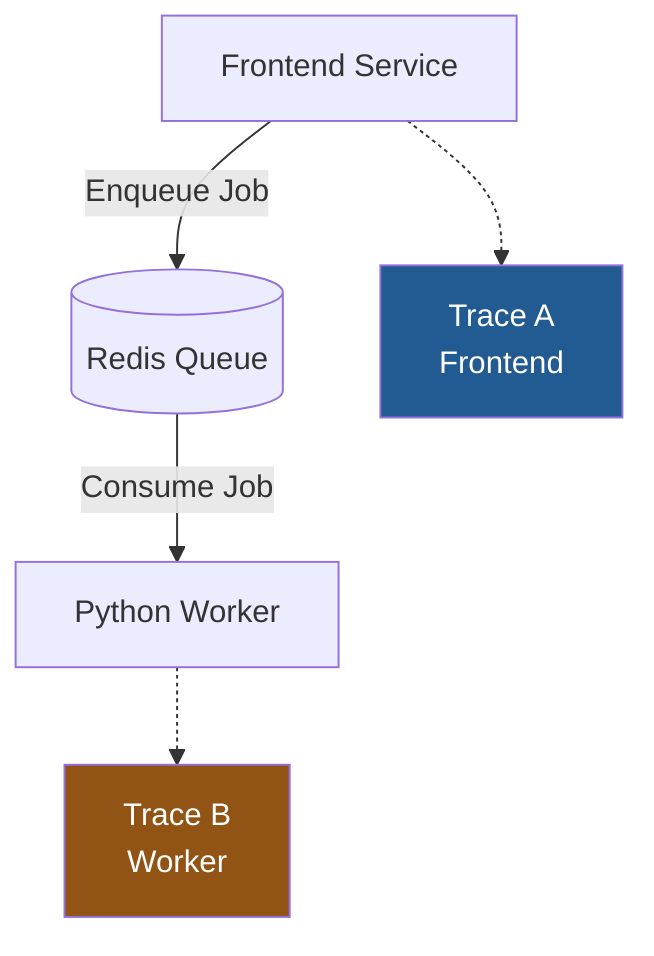
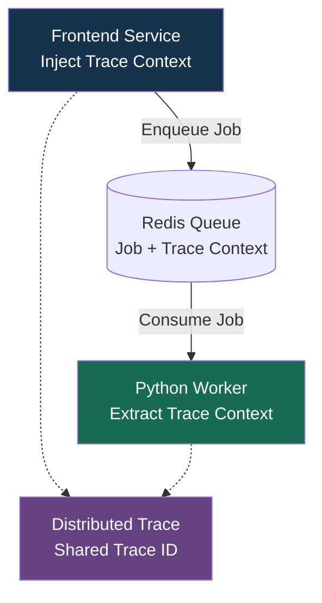
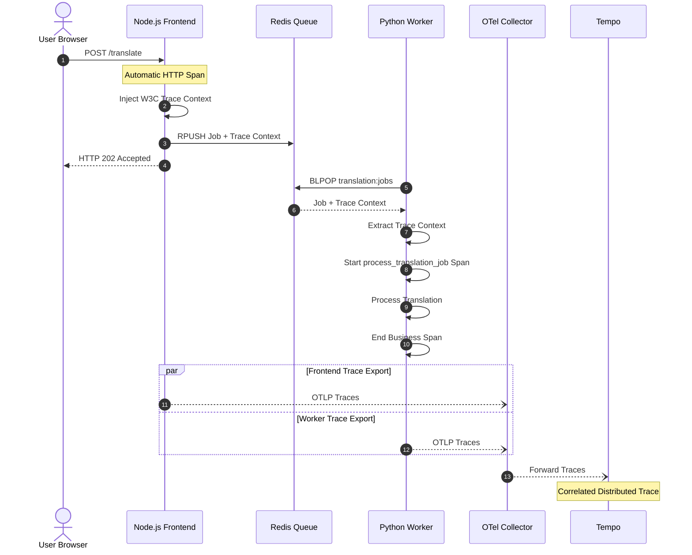
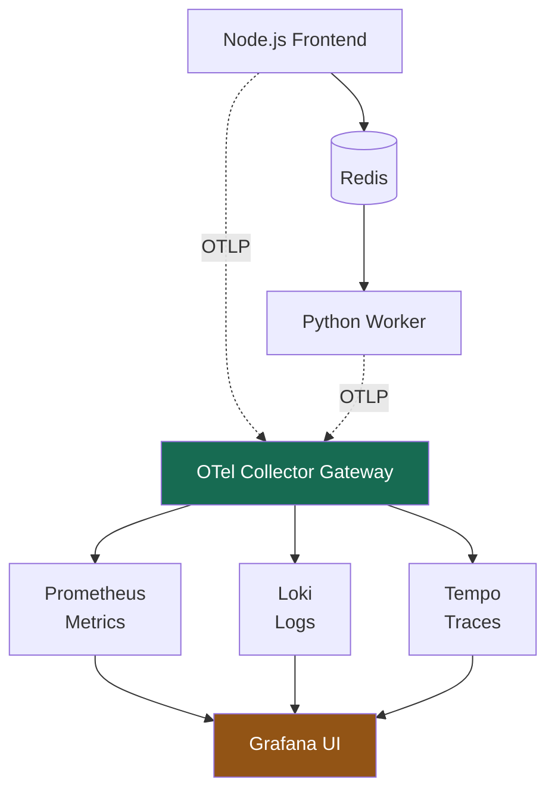

# Instrumenting Distributed Systems（分散式系統監控埋點）

這個章節主要說明如何使用 OpenTelemetry，將原本獨立的 Frontend Service（Node.js / TypeScript） 與 Worker Service（Python） 串接成完整的 Distributed Trace，並整合 Metrics、Logs、Traces。

課程涵蓋三大主題 - 

## Section Overview（章節概覽）

### 1. Auto-Instrumenting the Python Worker（Python Worker 自動埋點）

1. 使用 Automatic Instrumentation，自動收集 Worker Service 的 Metrics、Logs 和 Traces。
2. 觀察 **Worker Spans** 與 **Frontend Traces** 最初彼此獨立的情況，並理解其原因。

### 2. Distributed Context Propagation（分散式上下文傳遞）

1. 在非同步 Message Queue 邊界，透過 Inject / Extract 傳遞 **Trace Context。**
2. 完成 Frontend 與 Python Worker 之間的 **Trace Context Propagation**，使**兩個服務**的 **Spans** 能夠關聯為**同一條** **Distributed Trace**。

### 3. Advanced Worker Instrumentation（進階 Worker 埋點）

1. 建立 Custom Metrics 和 Custom Spans，使用 Redis Exporter 監控 Redis，並透過 Environment Variables 管理配置。
2. 將 Python Worker Logs 轉換為 Structured Logging，支援跨服務查詢及 Log-Trace Correlation。

### 核心觀念

- **Automatic Instrumentation**：自動監控 Python Worker 的 Framework、Redis 和受支援的技術操作。
- **Context Propagation**：讓 Frontend 與 Worker 共用 Trace ID。
- **Manual Instrumentation**：補充重要 Business Spans / Metrics。
- **Redis Exporter**：收集 Redis Server Metrics。
- **Structured Logging**：透過 Trace ID 關聯 Frontend 與 Worker Logs。

## 2. 為甚麼需要 Distributed Context Propagation？

假設 Frontend 將翻譯工作加入 Redis Queue，再由 Python Worker 處理。

沒有 Context Propagation：



Frontend 和 Worker 雖然處理同一筆 Job，但 OpenTelemetry 不一定知道它們有關聯，因此可能產生兩條獨立 Traces。

加入 Context Propagation 後：



Frontend 在 Job Payload 中加入 W3C Trace Context；Worker 取出後建立新的 Span，便能將兩個服務的處理流程關聯起來。

## 3. Mermaid — End-to-End Distributed Tracing



圖中的 RPUSH + BLPOP 是 FIFO Queue 的一種組合。實際 Trace 是否採 Parent-Child 或 Span Links，需依 Messaging Semantic Conventions 與非同步處理模型設計。BLPOP 的阻塞等待時間不應誤認為 Worker 的業務處理時間。

## 4. Advanced Worker Instrumentation

| Component                | Instrumentation    | Example                           |
| ------------------------ | ------------------ | --------------------------------- |
| Python Worker HTTP / DB  | Automatic          | HTTP Requests、Database Calls      |
| Redis Operations         | Automatic          | `BLPOP translation:jobs`          |
| Translation Processing   | Manual Span        | `process_translation_job`         |
| Translation Job Count    | Manual Metric      | `translation.jobs.processed`      |
| Translation Job Duration | Manual Histogram   | `translation.processing.duration` |
| Redis Server             | Redis Exporter     | Memory、Connected Clients、Commands |
| Worker Logs              | Structured Logging | ERROR / INFO + Trace ID           |

Redis Exporter 主要收集 Redis Server Metrics，與 Redis Client Auto Instrumentation 所產生的 Redis Command Spans 是不同的功能。

## 5. 與 Observability Stack 的整合



概念架構：Prometheus 可 Scrape Collector Exporter 和 Redis Exporter；Structured Logs 可透過 OTLP 或 Log Agent 送至 Loki。

## 6. 核心總結

| Topic                           | Learning Objective                        |
| ------------------------------- | ----------------------------------------- |
| Auto-Instrumenting Python Worker  | 讓 Python Worker 自動產生 Metrics、Logs、Traces  |
| Distributed Context Propagation | 跨 Redis Queue 關聯 Frontend 與 Python Worker Traces |
| Custom Metrics / Spans          | 追蹤 Translation Business Operations        |
| Redis Exporter                  | 監控 Redis Infrastructure                   |
| Structured Logging              | 透過 Trace ID 關聯多個服務的 Logs                  |

最重要的觀念：

單一服務 Instrumentation 只能了解個別服務的運作；**Distributed Context Propagation** 才能讓 OpenTelemetry 將**多個非同步 Microservices** 的 **Spans 關聯**起來，提供完整的 **End-to-End Observability**。

---
# Hands on Worker Metrics Auto-Instrumentation

- Refer to `lab-worker-metrics-auto.md`

## 1. Add OpenTelemetry packages to `pyproject.toml`

Update `app-versions/code/worker/pyproject.toml` and add the OTel dependencies:

```toml
[project]
name = "translation-worker"
version = "1.0.0"
description = "Translation queue worker service"
requires-python = ">=3.11"
dependencies = [
    "redis==7.2.0",
    "argostranslate==1.11.0",
    # Change here
    "opentelemetry-api==1.40.0",
    "opentelemetry-sdk==1.40.0",
    "opentelemetry-exporter-otlp-proto-http==1.40.0",
    "opentelemetry-instrumentation-redis==0.61b0",
    "opentelemetry-instrumentation-system-metrics==0.61b0",
]
```

```bash
cd app-versions/code/worker/
uv sync --all-extras

```

##　2. Create `instrumentation.py`

Create a new file `app-versions/code/worker/instrumentation.py`:

```python
import os
import logging

from opentelemetry import metrics
from opentelemetry.sdk.metrics import MeterProvider
from opentelemetry.sdk.metrics.export import PeriodicExportingMetricReader
from opentelemetry.exporter.otlp.proto.http.metric_exporter import OTLPMetricExporter
from opentelemetry.sdk.resources import Resource
from opentelemetry.instrumentation.redis import RedisInstrumentor
from opentelemetry.instrumentation.system_metrics import SystemMetricsInstrumentor

logger = logging.getLogger(__name__)


def setup_instrumentation() -> None:
    """Configure OpenTelemetry metrics pipeline."""
    resource = Resource(
        {
            "service.name": os.getenv("OTEL_SERVICE_NAME", "translation-worker"),
        }
    )

    otlp_endpoint = os.getenv(
        "OTEL_EXPORTER_OTLP_ENDPOINT", "http://otel-collector:4318"
    )

    metric_reader = PeriodicExportingMetricReader(
        exporter=OTLPMetricExporter(
            endpoint=f"{otlp_endpoint}/v1/metrics",
        ),
        export_interval_millis=int(
            os.getenv("OTEL_METRIC_EXPORT_INTERVAL_MS", "10000")
        ),
    )

    meter_provider = MeterProvider(
        resource=resource,
        metric_readers=[metric_reader],
    )
    metrics.set_meter_provider(meter_provider)

    # Auto-instrument Redis client — patches redis-py to create spans for every Redis command.
    # Note: the Python RedisInstrumentor produces traces only, not metrics.
    # Business metrics will be added manually in Lab 5.
    RedisInstrumentor().instrument()

    # Auto-collect system and process metrics: CPU, memory, network I/O, GC counts.
    SystemMetricsInstrumentor().instrument()

    logger.info("OpenTelemetry instrumentation initialised")

```

##　3. Update `main.py` to initialise instrumentation

Add the instrumentation call at the start of `main()`, before any other setup:

```python
# Before:
from .config import Config
from .queue import QueueConsumer
from .translator import Translator

# After (add the import):
from .config import Config
from .queue import QueueConsumer
from .translator import Translator

# Change Here After (add the import):
from .instrumentation import setup_instrumentation
```

Then call it at the very beginning of `main()`:

```python
def main() -> None:
    """Main worker loop."""
    global shutdown_flag

    # Register signal handlers
    signal.signal(signal.SIGTERM, handle_shutdown)
    signal.signal(signal.SIGINT, handle_shutdown)

    # Change here Initialise OpenTelemetry before anything else
    setup_instrumentation()

    # Load configuration
    config = Config.from_env()
    # ... rest of function unchanged
```

## 4. Check OTel environment variables to `compose/compose.app.yaml`

Check `OTEL_SERVICE_NAME` and `OTEL_EXPORTER_OTLP_ENDPOINT` to the worker service:

```yaml
worker:
  container_name: worker
  environment:
    - REDIS_HOST=redis
    - REDIS_PORT=6379
    - LOG_LEVEL=info
    - SOURCE_LANGUAGE=en
    - OTEL_SERVICE_NAME=translation-worker
    - OTEL_EXPORTER_OTLP_ENDPOINT=http://otel-collector:4318
```

## 5. Rebuild and deploy the worker

```bash
cd ../../../compose/
docker compose -f compose.dev.yaml up --build worker -d

docker compose -f compose.dev.yaml logs worker
```

The `--build` flag is required because new Python packages were added to `pyproject.toml`.

## 6. Generate traffic

```bash
curl -X POST http://localhost:3001/api/translate \
  -H "Content-Type: application/json" \
  -d '{"text": "Hello world", "targetLanguages": ["es", "fr"]}'
```

## 7. Verify metrics in Prometheus

Open Prometheus at http://localhost:9100 and run:

```promql
system_cpu_time_seconds_total{exported_job="translation-worker"}
```

Also try:

```promql
process_runtime_cpython_memory_bytes{exported_job="translation-worker"}
```

Expected: series labelled `exported_job="translation-worker"` with non-zero values.

Also verify the worker appears in the Prometheus targets list at http://localhost:9090/targets (it exports via the OTel Collector scrape endpoint).

> **Note:** `RedisInstrumentor` produces _traces_ (visible in Tempo), not metrics. Business-level metrics such as job throughput and translation latency are added in Lab 5.

## 8. Verify metrics in Garfana

- http://localhost:3010/

- Explorer => Prometheus => Metrics / Label filters

| Metrics  | Label filders
|----------|--------------|
| system_cpu_time_seconds_total | translation-worker |
| process_runtime_cpython_memory_bytes | translation-worker |


---

# Hands on Worker Logs Auto-Instrumentation 

- Refer to `lab-worker-logs-auto.md`

## 1. Update code 

### 1.1 Update `instrumentation.py` — add the log pipeline

Update `app-versions/code/worker/instrumentation.py`:

```python
import os
import logging

from opentelemetry import metrics
from opentelemetry.sdk.metrics import MeterProvider
from opentelemetry.sdk.metrics.export import PeriodicExportingMetricReader
from opentelemetry.exporter.otlp.proto.http.metric_exporter import OTLPMetricExporter
from opentelemetry.sdk.resources import Resource
from opentelemetry.instrumentation.redis import RedisInstrumentor
from opentelemetry.instrumentation.system_metrics import SystemMetricsInstrumentor

# Change here ...
from opentelemetry._logs import set_logger_provider
from opentelemetry.sdk._logs import LoggerProvider, LoggingHandler
from opentelemetry.sdk._logs.export import BatchLogRecordProcessor
from opentelemetry.exporter.otlp.proto.http._log_exporter import OTLPLogExporter

logger = logging.getLogger(__name__)

# Change here by AI ...
_meter_provider: MeterProvider | None = None
_logger_provider: LoggerProvider | None = None
_otel_handler: LoggingHandler | None = None


def setup_instrumentation() -> None:
    """Configure OpenTelemetry metrics and logs pipelines."""
    # Change here by AI ...
    global _meter_provider, _logger_provider, _otel_handler

    # Refactor here ...
    resource = Resource.create()

    metric_reader = PeriodicExportingMetricReader(
        exporter=OTLPMetricExporter(),
        export_interval_millis=int(
            os.getenv("OTEL_METRIC_EXPORT_INTERVAL", "10000")
        ),
    )

    _meter_provider = MeterProvider(
        resource=resource,
        metric_readers=[metric_reader],
    )

    metrics.set_meter_provider(_meter_provider)

    # Change here ...
    _logger_provider = LoggerProvider(resource=resource)
    _logger_provider.add_log_record_processor(
        BatchLogRecordProcessor(OTLPLogExporter())
    )
    set_logger_provider(_logger_provider)
    # Attach OTel handler to Python root logger.
    # This exports all log records via OTLP and injects trace_id/span_id automatically
    # when the log is emitted inside an active span.
    _otel_handler = LoggingHandler(logger_provider=_logger_provider)
    logging.getLogger().addHandler(_otel_handler)

    RedisInstrumentor().instrument()

    # Auto-collect system and process metrics: CPU, memory, network I/O, GC counts.
    SystemMetricsInstrumentor().instrument()

    logger.info("OpenTelemetry instrumentation initialised")

# Change here by AI ...
def shutdown_instrumentation() -> None:
    """Flush and shut down OpenTelemetry providers."""
    root_logger = logging.getLogger()

    if _otel_handler:
        root_logger.removeHandler(_otel_handler)

    if _logger_provider:
        _logger_provider.shutdown()

    if _meter_provider:
        _meter_provider.shutdown()

```

## 1.2 Update main.py

```python
# Change here After (add the import):
from .instrumentation import setup_instrumentation
...
logger.info("Worker stopped")
shutdown_instrumentation()

```

<!-- ## 1.3 Update `compose.dev.yaml`

```yaml
    environment:
      - PYTHONUNBUFFERED=1
      # - LOG_LEVEL=debug
      - LOG_LEVEL=info
``` -->

## 2. Deploy

```bash
docker compose -f compose.dev.yaml up --build worker -d

docker compose -f compose.dev.yaml logs worker
```

## 3. Generate traffic

```bash
curl -X POST http://localhost:3001/api/translate \
  -H "Content-Type: application/json" \
  -d '{"text": "Hello world", "targetLanguages": ["es"]}'

curl -X POST http://localhost:3001/api/translate \
  -H "Content-Type: application/json" \
  -d '{"text": "Hello world", "targetLanguages": [""]}'  
```

## 4. Verify in Grafana Loki

Open Grafana at http://localhost:3010 → Explore → Loki

Query:

```logql
{service_name="translation-worker"}
```

Expected log messages include:

- `OpenTelemetry instrumentation initialised`
- `Starting translation worker`
- `Worker ready, waiting for jobs...`
- `Processing job ...`

Once trace instrumentation is added in the next lab, log entries emitted within a span will also show `trace_id` and `span_id` as stream labels — enabling the same log-to-trace correlation links you set up in the single-system section.

---

# Hands on Worker Traces Auto-Instrumentation

- Refer to `lab-worker-traces-auto.md`

## 1. Update `src/instrumentation.py` — add the trace pipeline

Add trace imports at the top of `app-versions/code/worker/src/instrumentation.py`:

```python
# Add these imports alongside the existing ones:
from opentelemetry import metrics, trace

...
from opentelemetry.sdk.trace import TracerProvider
from opentelemetry.sdk.trace.export import BatchSpanProcessor
from opentelemetry.exporter.otlp.proto.http.trace_exporter import OTLPSpanExporter

...
_tracer_provider: TracerProvider | None = None
```

Then add the trace pipeline block inside `setup_instrumentation()`, after the logs setup:

```python
def setup_instrumentation() -> None:
    ...

    # --- Traces pipeline (new) ---
    tracer_provider = TracerProvider(resource=resource)
    tracer_provider.add_span_processor(BatchSpanProcessor(OTLPSpanExporter()))
    trace.set_tracer_provider(tracer_provider)

    RedisInstrumentor().instrument()
    ...

    if _tracer_provider:
        _tracer_provider.shutdown()
```

> **Why does the trace pipeline enable Redis spans automatically?**
> `RedisInstrumentor().instrument()` checks for a configured `TracerProvider` when patching the Redis client. Now that a real provider is set, every Redis command creates a span.

## 2. Deploy

```bash
docker compose -f compose.dev.yaml up --build worker -d

docker compose -f compose.dev.yaml logs worker
```

## 3. Generate traffic

```bash
curl -X POST http://localhost:3001/api/translate \
  -H "Content-Type: application/json" \
  -d '{"text": "Hello world", "targetLanguages": ["es", "fr"]}'
```

## 4. Verify Redis spans in Grafana Tempo

Open Grafana at http://localhost:3010 → Explore → Tempo → Search

Filter by `service.name = translation-worker`.

Expected spans:

- `BRPOP` — blocking read from the queue
- `PUBLISH` — publishing the result to the results channel

**Span attributes to examine:**

- `db.system: redis`
- `db.operation: BRPOP` or `PUBLISH`
- `net.peer.name: redis`
- `net.peer.port: 6379`

> **Note:** At this point the worker spans appear as isolated traces — they are not connected to the corresponding frontend `create_translation_session` span. This is the problem context propagation solves in the next lab.

---
`BRPOP` is a Redis command meaning:

- `B` = blocking
- `RPOP` = remove and return the last item from a list

In this worker:

```python queue.py
result = self.client.brpop([self.queue_key], timeout=timeout)  # type: ignore
```

It waits up to one second for a translation job.

Flow:

```text
Frontend → LPUSH translation job → Redis list
Worker   → BRPOP translation job ← Redis list
```

Seeing repeated `BRPOP` spans means the worker is alive and polling Redis. A `BRPOP` span every one second usually means the queue was empty during that interval. `PUBLISH` appears only after the worker receives and processes a job.

---
