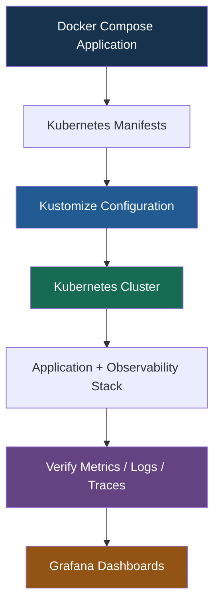

# Deploying to Kubernetes（部署至 Kubernetes）

## Section Overview（章節概覽）

### 1. Application Kubernetes Manifests（應用程式部署配置）

1. 將 Translation Application Services 從 Docker Compose 遷移至 Kubernetes Resources。
2. 為每個 Component 設定適當的 Resource Allocation（資源分配）和 Service Exposure（服務對外存取），遵循 Kubernetes 最佳實務。

### 2. Observability Stack Manifests（可觀測性平台部署配置）

1. 建立 Kubernetes Manifests，部署以下 Observability Components：
   - OpenTelemetry Collector
   - Prometheus
   - Loki
   - Tempo
   - Grafana
2. 加入 **Kube State Metrics**，並配置所需的 **RBAC Permissions**，以取得 Kubernetes Cluster 的資源狀態資訊。

### 3. Kustomize Configuration（Kustomize 配置管理）

1. 使用 Kustomize 組織 Kubernetes Manifests，確保 Deployment 一致、可重複且容易維護。
2. 自動產生所需的 Kubernetes Configuration Resources，並管理不同 Namespaces / Environments 的 Container Image Versions。

### 4. Deploying and Verifying Telemetry End to End（部署及驗證端到端遙測）

1. 將完整 Application + Observability Stack 部署至本地 Kubernetes Cluster，並監控各 Namespaces 中的服務啟動狀態。
2. 確認 Metrics、Logs、Traces 能正確通過 Kubernetes Observability Stack，並在對應的 Backend 中查詢。

## Learning Objectives（學習目標）

| Topic | Key Objective | Technologies |
|---|---|---|
| **Application Manifests** | 將 Application 從 Docker 遷移至 Kubernetes | Deployment、StatefulSet、Service |
| **Resource Allocation** | 管理 CPU / Memory Requests 與 Limits | Kubernetes Resources |
| **Service Exposure** | 設定內部與外部服務存取 | ClusterIP、Ingress / Gateway API |
| **Observability Stack** | 部署 Metrics、Logs、Traces Backends | OTel Collector、Prometheus、Loki、Tempo、Grafana |
| **Kube State Metrics** | 監控 Kubernetes Objects 狀態 | KSM、Prometheus |
| **RBAC** | 控制 Cluster Monitoring Permissions | ServiceAccount、Role / ClusterRole |
| **Kustomize** | 管理及重用 Kubernetes Manifests | Base、Overlays |
| **End-to-End Validation** | 驗證 Telemetry 資料流 | PromQL、LogQL、TraceQL |

## End-to-End Deployment Flow

## End-to-End Telemetry Validation

| Signal | Data Flow | Validation |
|---|---|---|
| **Metrics** | Application → OTel Collector → Prometheus | PromQL |
| **Logs** | Application / Log Agent → OTel Collector → Loki | LogQL |
| **Traces** | Frontend / Worker → OTel Collector → Tempo | TraceQL |
| **Kubernetes State** | Kube State Metrics → Prometheus | PromQL |
| **Visualization** | Prometheus / Loki / Tempo → Grafana | Grafana Explore / Dashboards |

> Prometheus 通常透過 Scrape 收集 Metrics；Application Traces 透過 OTLP 傳送至 Collector。Logs 可以透過 OTLP 或 Kubernetes Log Agent 收集。

## Core Takeaway（核心總結）

**Kubernetes Manifests + Kustomize + OTel Collector + Prometheus / Loki / Tempo + Grafana**

本章最終目標是完成：

- Application 在 Kubernetes 正常運行。
- Observability Stack 在 Kubernetes 正常運行。
- Metrics 能夠在 Prometheus 查詢。
- Logs 能夠在 Loki 查詢。
- Distributed Traces 能夠在 Tempo 查詢。
- Grafana 可以統一呈現及關聯三種 Telemetry Signals。

**最重要的觀念：不只是成功部署 Kubernetes Resources，而是必須驗證 Application → OpenTelemetry → Observability Backends 的完整資料流。**

---
