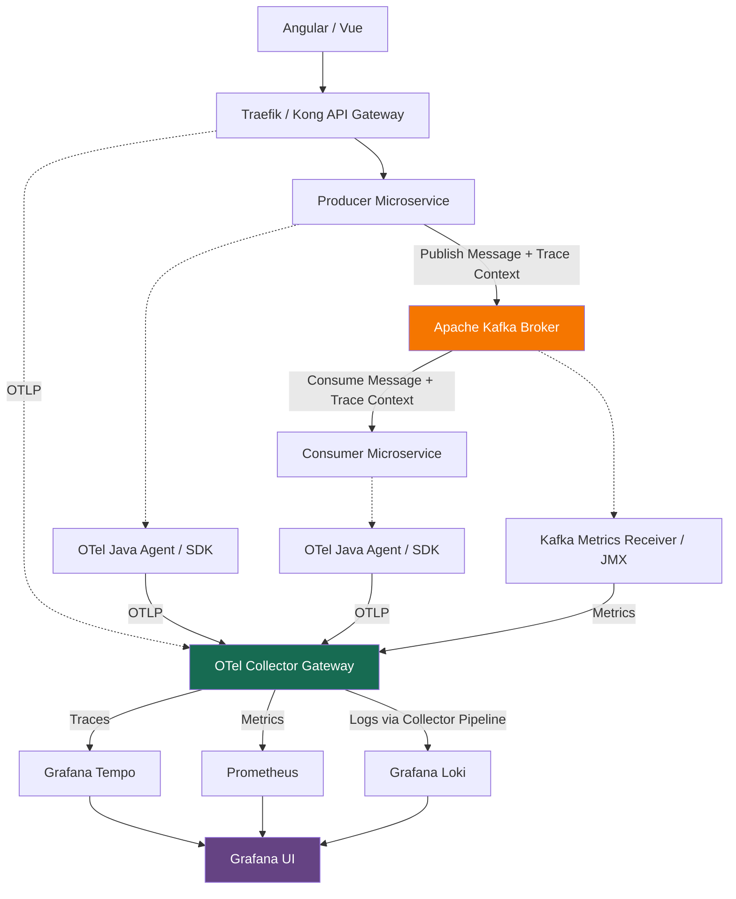
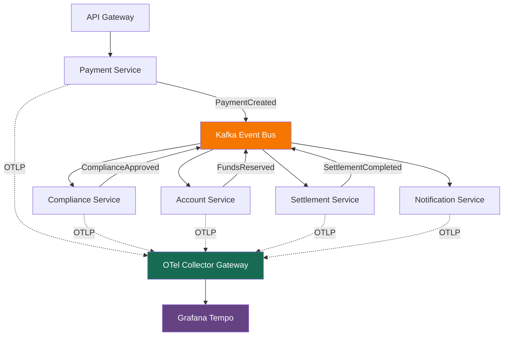
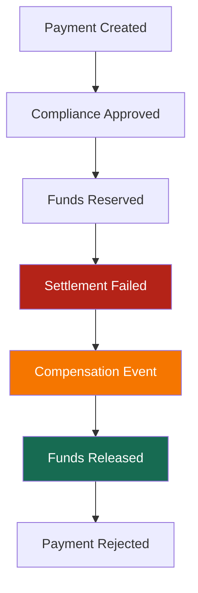

# Architecture

Yes. Apache Kafka supports OpenTelemetry (OTel) integration, including distributed tracing, metrics, and logs.

However, unlike Traefik, Kafka typically relies on **OpenTelemetry instrumentation** in producers/consumers and JMX or Kafka receivers for broker monitoring, rather than a single native OTLP configuration.

## 1. Kafka OpenTelemetry Support

| Capability                | Supported | How                                            |
| ------------------------- | --------- | ---------------------------------------------- |
| Distributed Tracing       | Yes | OTel SDK / Java Agent on Producer and Consumer |
| Broker Metrics            | Yes | JMX Exporter / OTel Collector                  |
| Consumer Lag              | Yes | Kafka Metrics Receiver                         |
| Logs                      | Yes | Filelog Receiver / Log Collector               |
| Trace Context Propagation | Yes | Kafka Message Headers                          |
| OTLP Export               | Yes | Via instrumented applications / Collector      |

OpenTelemetry supports instrumentation for Kafka Producer/Consumer, Kafka Streams, and Kafka Connect APIs.


## 2. Recommended Architecture

For your Grafana Observability platform, I recommend monitoring Kafka at two levels: application message tracing and Kafka broker health monitoring.



The Loki pipeline additionally requires log collection from the Kafka brokers and applications, such as an OTel Collector `filelog` receiver.

## 3. Example: Distributed Tracing Across Kafka

Consider a banking transaction that publishes an event to Kafka:

End-to-end transaction trace

1. API Gateway

   `POST /payments` receives a payment request.
2. Payment Service — Producer

   Validates payment and publishes `payment.created` to Kafka with a `traceparent` header.
3. Kafka Broker

   Stores and delivers the event to its consumer group.
4. Settlement Service — Consumer

   Extracts the trace context, processes settlement, and records its processing span.
5. Grafana Tempo

   Displays the correlated trace across the producer and consumer.

Kafka does not automatically generate an application-level tracing span for every internal broker operation. The producer and consumer instrumentation is responsible for the message tracing, and asynchronous processing may use span links instead of a strict parent-child structure.

## 4. Example: Java Kafka Producer and Consumer

For Java microservices, the simplest approach is usually the OpenTelemetry Java Agent:

```bash

java \
  -javaagent:opentelemetry-javaagent.jar \
  -Dotel.service.name=payment-service \
  -Dotel.exporter.otlp.endpoint=http://otel-collector:4317 \
  -Dotel.exporter.otlp.protocol=grpc \
  -jar payment-service.jar

```

Do the same for `settlement-service`, using a different service name. The agent can automatically instrument supported Kafka clients, including injecting and extracting trace context through message headers.

## 5. Recommended Kafka Observability Metrics

| Metric                      | Purpose                               |
| --------------------------- | ------------------------------------- |
| Consumer Lag                | Detect consumers falling behind       |
| Messages In / Sec           | Kafka throughput                      |
| Bytes In / Out              | Network throughput                    |
| Under-Replicated Partitions | Detect replication problems           |
| Offline Partitions          | Identify availability risks           |
| Producer Error Rate         | Detect publishing failures            |
| Consumer Processing Latency | Measure application processing delays |

Kafka exposes broker metrics through JMX, and OpenTelemetry Collector integrations can also collect cluster-level data.

Bottom line: For your Kubernetes observability architecture, Kafka is fully compatible with the OpenTelemetry ecosystem.

I recommend:

- Producer / Consumer: OpenTelemetry Java Agent / SDK → Collector → Tempo.
- Kafka Broker: Kafka Metrics Receiver / JMX → Collector → Prometheus.
- Kafka Logs: Filelog Receiver → Collector → Loki.

This integrates Kafka into your existing Grafana observability architecture without requiring you to replace the Kafka broker or messaging infrastructure.

---

For multiple microservices communicating through Apache Kafka using Saga Patterns (I assume you mean Saga, rather than Sage), OpenTelemetry is particularly useful.

Yes, OpenTelemetry can provide end-to-end distributed tracing across the entire Saga workflow, including asynchronous Kafka events, multiple microservices, retries, and compensation transactions.

However, there is an important distinction:

- OpenTelemetry tracks the technical execution of individual services and messages.
- Saga Orchestrator / Choreography manages the business transaction workflow.
- Kafka transports events between participating microservices.

## 1. Example: Kafka + Saga + OpenTelemetry

Consider a banking payment transaction implemented with the Saga Choreography Pattern.



With correctly configured OpenTelemetry instrumentation, Grafana Tempo can help you trace a payment request through the services that participate in the Saga.

## 2. What happens when a Saga fails?

Suppose the Settlement Service fails after funds have been reserved.



OpenTelemetry can record both the failed settlement and the subsequent compensation processing.

However, standard automatic instrumentation alone will not tell you whether the overall business Saga succeeded, failed, or was compensated. That requires additional business-level instrumentation.

## 3. Recommended Instrumentation

| Component                  | Instrumentation          | Result                      |
| -------------------------- | ------------------------ | --------------------------- |
| API Gateway                | Native OTel              | Incoming request trace      |
| Producer Service           | OTel Java Agent / SDK    | Kafka publish spans         |
| Kafka Broker               | JMX / Kafka Receiver     | Broker health and lag       |
| Consumer Service           | OTel Java Agent / SDK    | Message processing spans    |
| Saga Coordinator (if used) | Custom OTel spans        | Saga step/status visibility |
| Compensation Handler       | Custom OTel spans        | Rollback activity           |
| OTel Collector             | OTLP receivers/exporters | Centralized telemetry       |
| Grafana Tempo              | TraceQL                  | Trace investigation         |

For each Saga, I recommend attaching consistent correlation attributes:

```

saga.id: "SAGA-20261023-001"
saga.type: "PAYMENT_SETTLEMENT"
saga.step: "RESERVE_FUNDS"
saga.status: "COMPLETED"
saga.attempt: 1

```

These are custom business attributes, not standard OpenTelemetry semantic convention fields.

Keep `saga.id` available in trace spans and structured logs, but avoid using it as a Prometheus metric label because its high cardinality can cause significant storage overhead.

## 4. Important: One Saga does not always equal one Trace

This is especially important for Kafka.

The OpenTelemetry messaging specification recommends Span Links to associate producers and consumers, particularly when messages are batched or processed asynchronously. A Saga can therefore span several traces rather than appear as one uninterrupted parent-child trace.

For reliable business-level visibility:

- Propagate W3C `traceparent` through Kafka headers.
- Maintain a stable `saga.id` across every step, retry, and compensation.
- Use `saga.id` to correlate multiple traces.
- Store authoritative Saga state in your application database or Saga coordinator, not in Tempo.
- Configure sampling carefully so critical failures and compensation activities remain observable.

Recommendation: For your Kafka-based microservices, use OpenTelemetry automatic instrumentation + custom Saga instrumentation + Grafana Tempo, with Loki for business-event correlation and Prometheus for operational metrics.

This gives you visibility into both technical execution (traces) and business transaction progress (Saga state) without making Kafka itself responsible for Saga observability.

---

OpenTelemetry + Kafka + Saga Pattern + Grafana Tempo，可以讓跨 Microservices 的執行流程清楚呈現在 Trace / Span 中，大幅降低問題追蹤的難度。

不過有一個重要前提：必須正確設定 **Trace Context Propagation**，以及 **Saga ID Correlation**。

## 1. Grafana Tempo 可以看到什麼？

例如 Payment Saga 經過 5 個 Microservices：

### Payment Saga — Distributed Trace

Status: Settlement Failed

示意圖：Span 執行時間及服務關係

| Microservice         | Duration | Status  |
| -------------------- | -------- | ------- |
| API Gateway          | 120 ms   | 🔵 正常執行 |
| Payment Service      | 95 ms    | 🔵 正常執行 |
| Compliance Service   | 45 ms    | 🔵 正常執行 |
| Account Service      | 35 ms    | 🔵 正常執行 |
| Settlement Service   | 40 ms    | 🔴 失敗   |
| Compensation Service | 30 ms    | 🟠 補償交易 |

### Span Timeline（示意）

```
API Gateway          ██████████████████████████ 120ms
Payment Service       █████████████████████     95ms
Compliance Service       ██████████             45ms
Account Service             ████████           35ms
Settlement Service             █████████       40ms ❌
Compensation Service                ███████    30ms ↩
```

### Status Legend

- 🔵 正常執行 — Successfully completed
- 🔴 失敗 — Execution failed
- 🟠 補償交易 — Compensation transaction

Note: The timeline is illustrative, not an actual Tempo trace. Duration and positioning are not drawn to a common precise time scale.

你可以追蹤：

| 追蹤項目                    | 可以看到                         |
| ----------------------- | ---------------------------- |
| 哪個 Microservice 出問題     | Settlement Service           |
| 哪個 Span 發生錯誤            | Settlement Processing        |
| 錯誤原因                    | Exception / Error Attributes |
| 每個服務耗費時間                | Span Duration                |
| Kafka Message 流程        | Producer / Consumer Spans    |
| Saga Compensation       | 補償交易的執行 Span                 |
| Transaction Correlation | Trace ID + Saga ID           |

## 2. Kafka + Saga 有一個特別需要注意的地方

Kafka 是 Asynchronous Messaging，因此：

一個 Saga 不一定只有一個 Trace ID。

例如：

```
Saga ID: SAGA-001
│
├── Trace A
│   ├── Payment Service
│   └── Kafka Producer
│
├── Trace B
│   ├── Kafka Consumer
│   └── Compliance Service
│
├── Trace C
│   ├── Account Service
│   └── Settlement Service (FAILED)
│
└── Trace D
    └── Compensation Service
```

所以建議：

- Trace ID：追蹤技術執行路徑。
- Span ID：定位個別執行操作。
- Saga ID：關聯整個 Business Transaction。
- Span Links：連結不同的非同步 Trace。

正確實作後，即使 Kafka Saga 跨越多個 Trace，也可以透過 Saga ID、Span Links 及相關日誌追查整個業務流程。

## 3. 結論

對你的 Kubernetes + Kafka + Microservices 架構：

OTel Java Agent → OTel Collector Gateway → Grafana Tempo 是非常合適的方案。

但我會建議不要只依賴 Auto-Instrumentation，而是加上 Saga ID、Saga Step、Saga Status 和 Compensation Status 的 Custom Instrumentation。

這樣才能同時回答兩種問題：

1. Technical Observability：哪個 Microservice、Kafka Message 或 Span 出錯？
2. Business Observability：哪一筆 Saga 卡住？執行到哪一步？補償是否成功？

這兩者結合，才是真正完整的 End-to-End Saga Observability。

---
