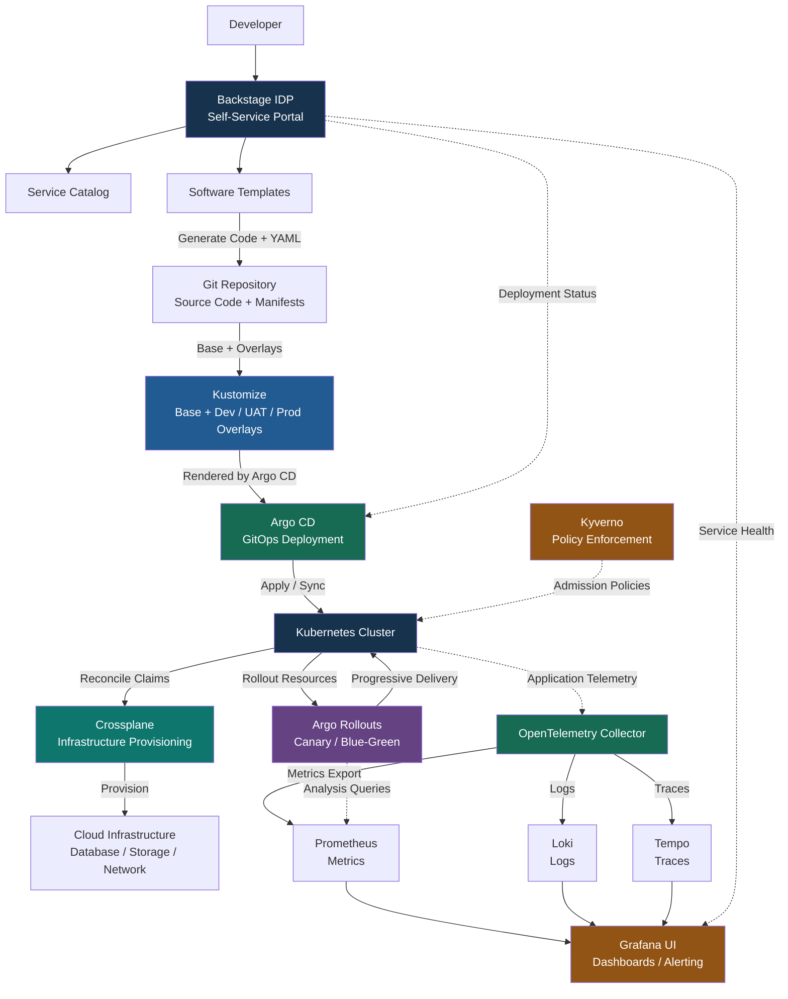
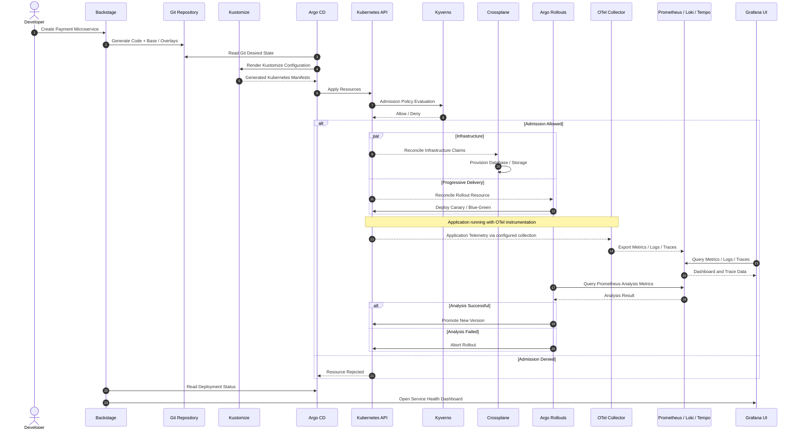
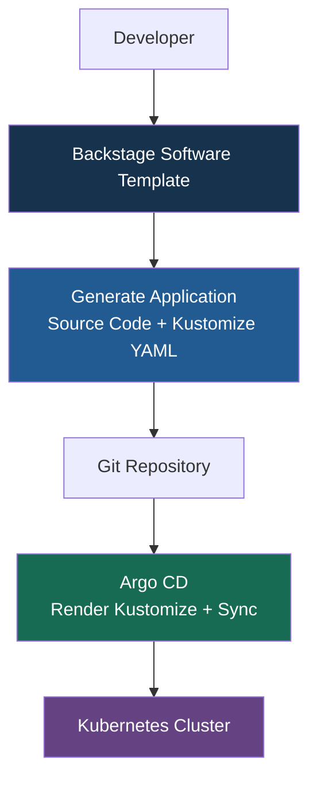
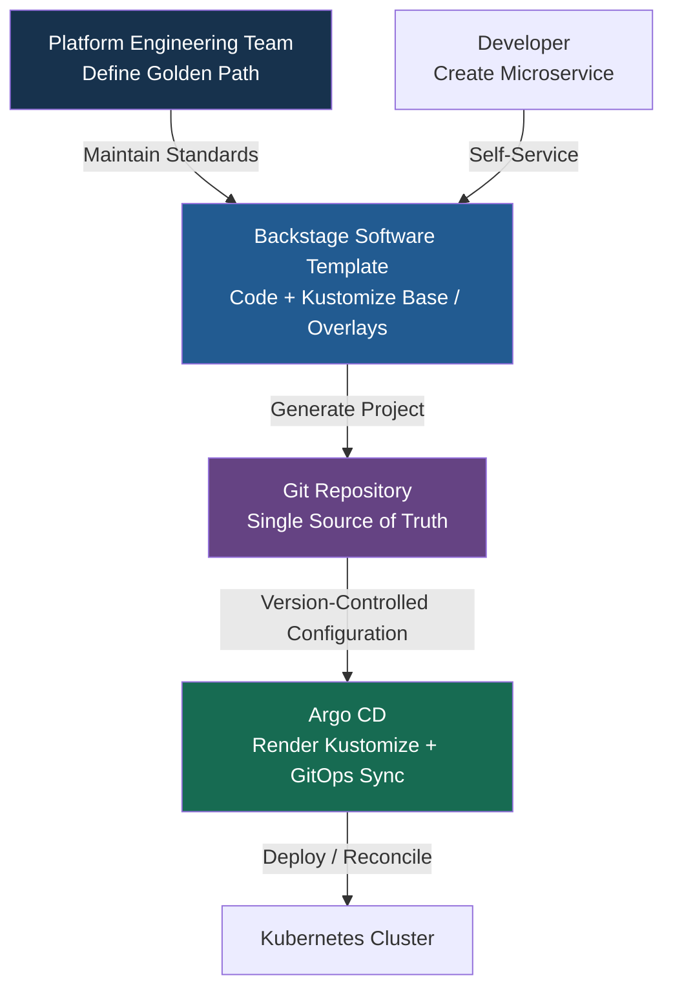

# Kustomize vs IDP — Enterprise Internal Developer Platform Architecture

**整合 Backstage、Kustomize、Argo CD、Argo Rollouts、Crossplane、Kyverno、Kubernetes 與 OpenTelemetry / Grafana**

## 1. 核心概念：Kustomize 與 IDP 有何不同？

**Kustomize 與 IDP 不互相取代，而是不同層級、可以整合的技術。**

- **Kustomize**：Kubernetes Configuration Management Tool，用 Base + Overlays 管理與客製化 Kubernetes YAML Manifests。
- **IDP（Internal Developer Platform）**：整合 Service Catalog、Software Templates、CI/CD、GitOps、Infrastructure、Security 和 Observability 的標準化開發者平台；**Backstage** 可作為其 Developer Portal。

> **Kustomize = How to configure Kubernetes deployments.**  
> **IDP = How developers build, deploy, and operate applications through a standardized platform.**

### 1.1 Kustomize vs IDP 比較

| Comparison | Kustomize | IDP（以 Backstage 為 Portal） |
|---|---|---|
| 主要定位 | Kubernetes Configuration Tool | Developer Self-Service Platform |
| 主要用途 | 管理與產生 YAML Manifests | 統一建立、部署及維運流程 |
| 主要使用者 | DevOps / Platform Engineers | Developers / Platform Teams |
| Kubernetes YAML | 核心功能 | 透過 Kustomize 等工具整合 |
| Dev / UAT / Production | Base + Overlays | 平台層環境管理與工作流程 |
| Service Catalog | 不提供 | 提供 |
| Software Templates | 不提供 | 提供 |
| CI/CD / GitOps | 由外部工具執行 | 可整合 Argo CD / CI Pipeline |
| Deployment Self-Service | 不提供 Portal | 可以提供 |
| Governance | 依 Kubernetes 與其他控制工具 | 可整合 Kyverno / RBAC / 審批 |
| Observability | 不提供 | 可整合 OpenTelemetry / Grafana |

## 2. Kustomize：Base + Overlays 配置管理

不同環境可以共用 Base Manifests，再用 Overlays 定義環境差異。

```text
k8s/
├── base/
│   ├── deployment.yaml
│   ├── service.yaml
│   └── kustomization.yaml
└── overlays/
    ├── dev/
    │   └── kustomization.yaml
    ├── uat/
    │   └── kustomization.yaml
    └── production/
        └── kustomization.yaml
```

本機可用以下指令預覽或部署：

```bash
kubectl kustomize k8s/overlays/production
kubectl apply -k k8s/overlays/production
```

在 GitOps 模式下，通常由 **Argo CD 直接讀取 Git 中的 Kustomize 路徑並 Render / Sync**；Kustomize 不需要作為獨立 Server 運作。

## 3. Enterprise IDP：完整技術分工

| Component | Role | Key Capability |
|---|---|---|
| **Backstage** | Developer Portal | Self-Service、Service Catalog、Software Templates |
| **Kustomize** | Kubernetes Configuration | Base、Overlays、Image Version Pinning |
| **Argo CD** | GitOps Continuous Delivery | Desired State Sync、Drift Reconciliation |
| **Argo Rollouts** | Progressive Delivery | Canary、Blue-Green、Analysis、Promotion / Abort |
| **Crossplane** | Infrastructure Control Plane | Cloud Database、Storage、Networking Resources |
| **Kyverno** | Policy as Code | Admission Validation、Mutation、Policy Reporting |
| **Kubernetes** | Application Runtime | Pods、Services、Workloads、Controllers |
| **OpenTelemetry** | Telemetry Collection | Metrics、Logs、Traces |
| **Grafana Stack** | Observability | Prometheus、Loki、Tempo、Grafana UI |

### 3.1 Enterprise IDP Architecture（Mermaid）



**圖示解讀：** Backstage 提供 Portal；Kustomize 作為 Git 中的配置，由 Argo CD Render；Argo CD 經 Kubernetes API 建立資源；Crossplane、Argo Rollouts 和 Kyverno 分別以 Kubernetes Controllers / Admission Controls 運作。Argo Rollouts 使用 Prometheus 等 Metrics Provider 做 Analysis 時，必須另行配置。

## 4. 實際應用：建立 Payment Microservice

以下是**概念性流程**：開發者使用 Backstage 樣板建立服務，GitOps 部署到 Kubernetes，再由不同 Controllers 執行 Infrastructure、Policy 與 Progressive Delivery。



**注意：** 這是職責與流程示意，Crossplane 和 Argo Rollouts 不需要互相等待才開始工作；實際順序由 Kubernetes Controllers、資源依賴、Health Checks 和 Argo CD Sync Policies 決定。

## 5. Governance 與 Platform Engineering Controls

| Control | Technology |
|---|---|
| Approved Application Templates / Golden Paths | Backstage |
| Git-based Change Management | Git + Argo CD |
| Base / Overlay Configuration 與 Image Version Pinning | Kustomize |
| Require Resource Requests / Limits、Approved Registries | Kyverno |
| Restrict Privileged Containers | Kyverno |
| Standardized Infrastructure Provisioning | Crossplane |
| Canary / Blue-Green、Automatic Analysis | Argo Rollouts |
| Error Rate / Latency / SLO Monitoring | Prometheus + Grafana |
| Distributed Tracing / Log Correlation | OpenTelemetry + Tempo + Loki |

Platform Engineering Team 應集中維護 **Golden Paths、Software Templates、Policy Rules、Crossplane Compositions、Argo CD Application Patterns 與 Observability Baselines**。Application Teams 則可以在標準範圍內自助建立、部署及營運服務。

## 6. 核心總結

| Technology | 最簡單的理解 |
|---|---|
| Backstage | **Developer Experience / Self-Service** |
| Kustomize | **Configuration Management** |
| Argo CD | **GitOps Continuous Delivery** |
| Argo Rollouts | **Progressive Delivery** |
| Crossplane | **Infrastructure Provisioning** |
| Kyverno | **Policy Enforcement** |
| Kubernetes | **Application Runtime** |
| **OpenTelemetry** | **Telemetry Collection** Metrics, Logs, Traces |
| **Grafana Stack** | **Observability** |

**完整平台架構：**

**Backstage → Git + Kustomize → Argo CD → Kubernetes**，搭配 **Argo Rollouts（部署策略）、Crossplane（基礎設施）、Kyverno（治理）**，並由 **OpenTelemetry + Prometheus / Loki / Tempo + Grafana** 提供可觀測性。

> **結論：Kustomize 是 IDP 可整合的 Kubernetes 配置工具；IDP 則是將開發、部署、基礎設施、治理和可觀測性整合為 Developer Self-Service Experience 的平台。**

---

# Kustomize 是 Backstage template 的一部分 還是分開的設定?

✅ 兩種方式都可以，但我推薦將 Kustomize 整合到 Backstage Software **Template** 中，由 Backstage 自動產生 Kustomize 配置，後續再由 Argo CD 管理部署。

不過要特別區分：

- Backstage Software Template：負責建立 Application 的標準化專案結構，包括 **Kustomize Manifests**。
- **Kustomize**：負責管理 **Kubernetes Base + Overlays**。
- Argo CD：負責讀取 Git Repository 中的 Kustomize 配置，Render YAML 並同步至 Kubernetes。

## 1. 兩種整合方式

| 比較                  | Kustomize 包含在 Backstage Template | Kustomize 獨立管理         |
| ------------------- | -------------------------------- | ---------------------- |
| 建立方式                | Backstage 自動產生                   | Platform / DevOps 手動建立 |
| Base / Overlays     | Template 預先定義                    | 獨立配置                   |
| 標準化                 | ✅ 高                              | 取決於團隊管理                |
| Application Team    | 不必從零建立 YAML                      | 需要自行管理配置               |
| Argo CD Integration | ✅                                | ✅                      |
| Platform Governance | 易於統一管理                           | 可集中於獨立 Repo            |
| 建議情境                | 新 Microservices / Golden Paths   | 共用平台資源、既有系統            |

對新的 Banking Microservices，推薦方案一；對 Prometheus、Loki、Tempo 等共用基礎設施，可以使用獨立的 GitOps Repository 管理。

## 2. 推薦的實際架構



Backstage 的 Software Template 可以使用 Skeleton Files 產生預先設計的專案檔案，並發布至 Git Repository；Argo CD 則原生支援辨識與渲染 Kustomize 配置。

## 3. Backstage Template 與生成後的專案結構

Backstage Template Repository

```text
templates/
└── java-microservice/
    ├── template.yaml
    └── skeleton/
        ├── src/
        ├── Dockerfile
        └── k8s/
            ├── base/
            └── overlays/    
```

Generated Payment Service Repository

```text
payment-service/
├── src/
├── Dockerfile
├── catalog-info.yaml
└── k8s/
    ├── base/
    │   ├── deployment.yaml
    │   └── kustomization.yaml
    └── overlays/
        ├── dev/
        ├── uat/
        └── production/    
```

重要的是，Kustomize YAML 由 Backstage Template 產生，但後續存在 Git Repository 中，由 Argo CD 使用，不是每次部署都需要重新執行 Backstage Template。

## 4. 與完整 IDP 的分工

| Component                     | Responsibility                           |
| ----------------------------- | ---------------------------------------- |
| Backstage                     | 產生標準化 Application / Kustomize 配置         |
| Kustomize                     | Base + Overlays，管理不同環境                   |
| Argo CD                       | 讀取 Git、渲染 Kustomize 並同步部署                |
| Argo Rollouts                 | Canary / Blue-Green Progressive Delivery |
| Crossplane                    | 基礎設施資源配置                                 |
| Kyverno                       | Policy Enforcement                       |
| OpenTelemetry + Grafana Stack | Observability                            |

### 最終建議

對你的 Enterprise IDP，我建議採用：

- Backstage Template（建立標準）→ Git Repository（保存配置）→ Argo CD + Kustomize（部署）→ Kubernetes（運行）
- Crossplane Compositions、Kyverno Policies、共用 Observability Stack 則應由 Platform Engineering Team 在獨立、受控的 Platform GitOps Repository 中管理。

這樣既能確保新 Microservices 自動遵循 Golden Path，也能讓平台團隊集中維護安全及基礎設施標準。

---
# ✅ 推薦的 Enterprise IDP 標準化管理方式。

將 Kustomize 作為 Backstage Software Template 的一部分，再以 Git 作為 Single Source of Truth（唯一配置事實來源），由 Argo CD 執行 GitOps Deployment，可以建立一致、可追蹤、可重複的 Kubernetes 部署流程。

但要區分：Backstage 負責建立標準，Git 負責保存及版本控制，Argo CD 負責持續部署與同步。

## 1. 推薦架構



## 2. 各元件的責任

| Component          | Responsibility                                       |
| ------------------ | ---------------------------------------------------- |
| Backstage Template | 統一 Application Skeleton、Kustomize、CI/CD、OTel 配置      |
| Kustomize          | 管理 Dev / UAT / Production 的 Base + Overlays          |
| Git                | Version Control、Pull Request、Code Review、Audit Trail |
| Argo CD            | GitOps Deployment、Drift Detection、Reconciliation     |
| Kyverno            | 防止不符合安全及部署政策的資源進入 Cluster                            |
| Crossplane         | 標準化 Infrastructure Provisioning                      |
| Argo Rollouts      | 控制 Canary / Blue-Green Deployment                    |

## 3. 需要特別注意：Template 更新不會自動更新既有專案

這是 Platform Engineering 最重要的治理問題。

假設 Backstage Template 從 v1.0 更新為 v2.0：

- New Microservices：使用 v2.0 Template。
- Existing Microservices：仍然保留原本生成的 Kustomize 配置。
- Git / Argo CD：不會因 Template 更新，就自動修改既有專案。

因此，真正的統一管理不能只依賴 Backstage Template。

我建議搭配 Template Versioning + Automated Upgrade PRs + Kyverno Policies，讓既有服務也能逐步符合最新平台標準。

## 4. 最終建議

對你的 Enterprise Platform Engineering，應建立以下管理原則：

- Backstage = Standardized Creation
- Kustomize = Standardized Configuration
- Git = Version Control + Single Source of Truth
- Argo CD = Standardized Deployment
- Kyverno = Continuous Policy Enforcement

這樣可以達到三個重要目標：

1. Standardization：新建服務遵循一致的 Golden Path。
2. Governance：透過 Git PR、4-Eyes Review、Kyverno 控制變更與合規。
3. Maintainability：透過版本化 Templates、共用配置及升級機制維護既有服務。

結論：將 Kustomize 納入 Backstage Template 是很好的標準化起點；但要做到真正的統一管理，還需要 GitOps、Policy Enforcement，以及既有專案的 Template Upgrade / Configuration Drift 管理機制。

---
