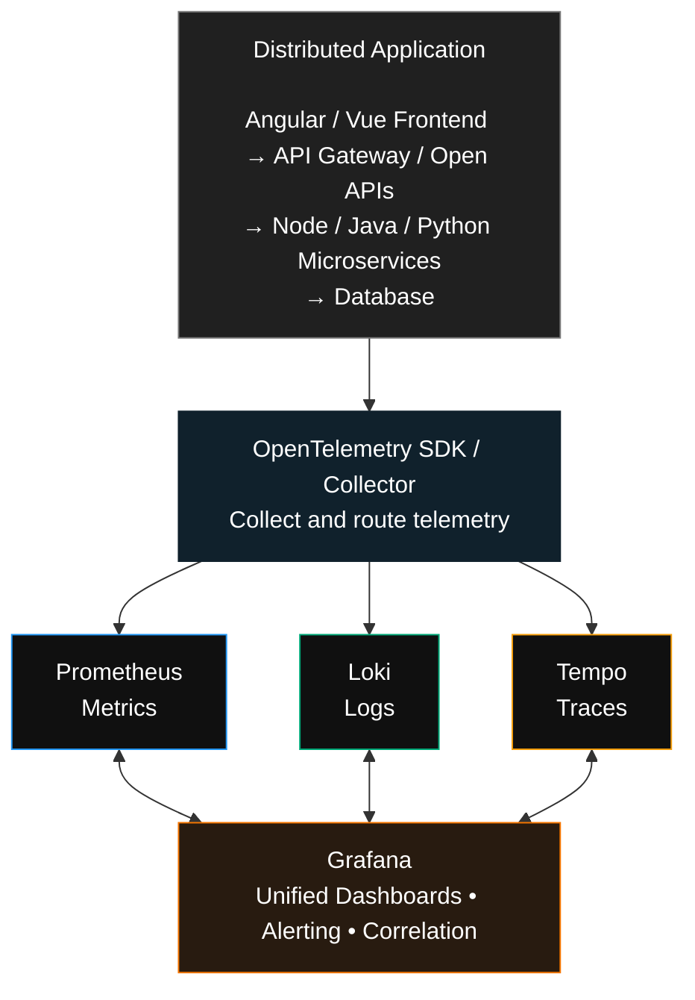
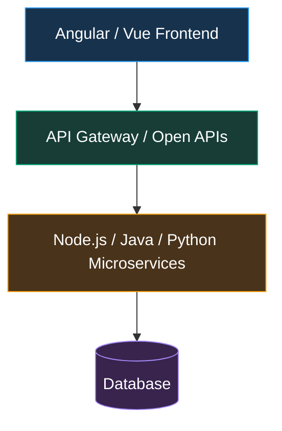
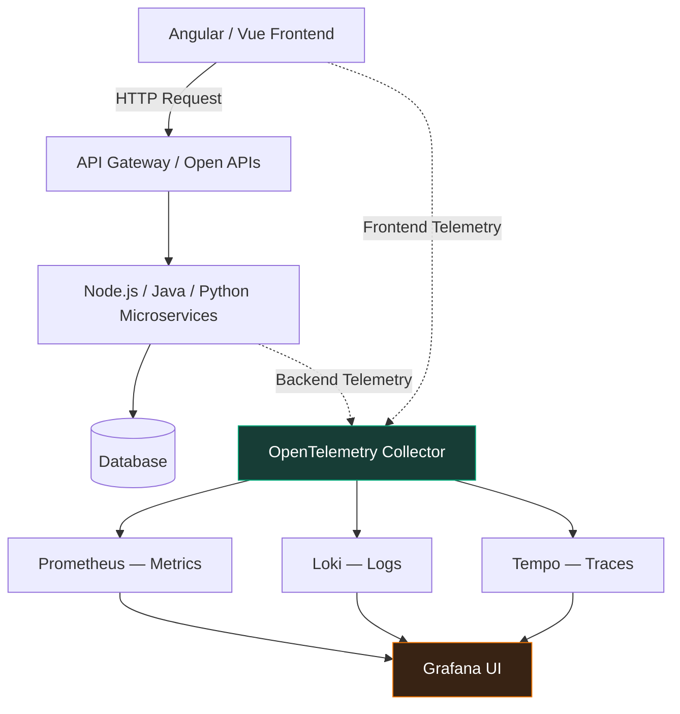
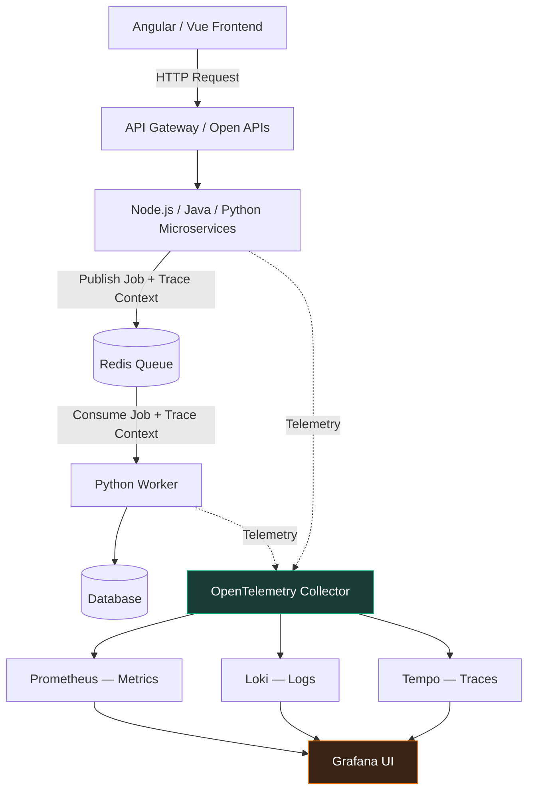
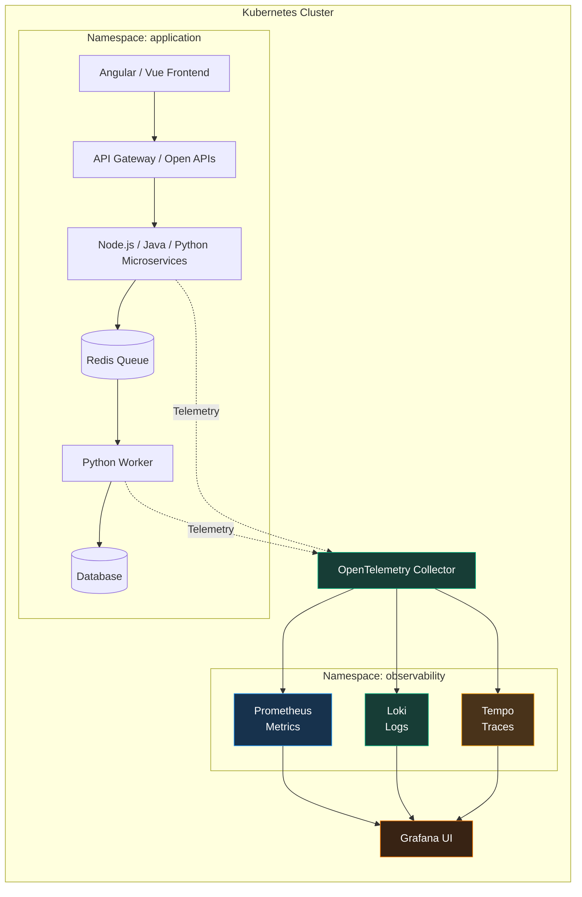

# Observability Foundations（可觀測性基礎）

## 1. Three Pillars of Observability 三個核心主題

可觀測性的三大支柱：

- Metrics（指標）：系統的量化數據，例如 CPU、Memory、Latency、Error Rate。
- Logs（日誌）：記錄系統發生的事件、錯誤及操作。
- Traces（追蹤）：追蹤一個 Request 經過哪些服務及各階段的執行時間。

## 2. Reliability Management

可靠性管理的四個概念：

| 名稱                            | 說明                                          |
| ----------------------------- | ------------------------------------------- |
| SLI — Service Level Indicator | 衡量服務品質的**實際指標**，例如成功率 99.95%                    |
| SLO — Service Level Objective | 內部設定的服務品質**目標**，例如成功率 ≥ 99.9%                   |
| SLA — Service Level Agreement | 與**客戶約定的服務水準**及違約責任                             |
| Error Budget                  | 允許服務未達到目標的容錯空間，例如 SLO 99.9% 代表允許 0.1% 的失敗比例 |

## 3. Four Golden Signals

Google SRE 提出的四個黃金監控訊號：

| Signal     | 中文  | 監控範例                              |
| ---------- | --- | --------------------------------- |
| Latency    | 延遲  | API Response Time、P95/P99         |
| Traffic    | 流量  | Requests per Second               |
| Errors     | 錯誤  | HTTP 5xx、Failed Transactions      |
| Saturation | 飽和度 | CPU、Memory、DB Connection Pool 使用率 |

## 與 Langfuse 的關係

以你目前使用的 RAG Chatbot + Langfuse + DeepEval 為例：

- Metrics：LLM Token Usage、Cost、Latency、Evaluation Scores。
- Logs：LLM 呼叫錯誤、RAG Retrieval Error。
- Traces：User Query → Embedding → Vector Search → LLM → Response。
- SLI/SLO：例如 99% 的 Chatbot Requests 在 5 秒內完成。
- Golden Signals：監控回應時間、請求量、錯誤率與系統資源。

重點：Langfuse 主要負責 **LLM Observability**；**Prometheus + Grafana + OpenTelemetry** 則可以補足**整個應用程式**與**基礎設施**的 Observability。

---
# Deploying the Observability Stack（部署可觀測性技術架構）

> 主要使用 Grafana 生態系統的三個後端元件：Prometheus、Loki、Tempo，再透過 Grafana UI 統一呈現。

## 1. Observability Stack 核心元件

| 元件            | 主要用途                                        | 負責的訊號           |
| ------------- | ------------------------------------------- | --------------- |
| Prometheus    | 收集及儲存 CPU、Memory、API Latency、Error Rate 等指標 | Metrics         |
| Loki          | 集中儲存及查詢 Application Logs                    | Logs            |
| Tempo         | **儲存分散式**追蹤資料，分析**跨服務**的 Request Flow               | Traces          |
| Grafana       | 統一查詢、視覺化、Dashboard 和 Alerting               | All Three       |
| OpenTelemetry | 為應用程式產生及收集 Metrics、Logs、Traces              | Instrumentation |

## 2. Observability Stack 架構



概念架構：實際部署時 Prometheus 也可以直接抓取應用程式的 `/metrics` Endpoint；不一定所有資料都必須經過 OpenTelemetry Collector。

### Microservices Architecture


> Angular / Vue Frontend → API Gateway / Open APIs → Node.js / Java / Python Microservices → Database.

## 3. Distributed Sample Application 是甚麼？

這是用來測試 Observability Stack 的分散式範例應用程式，例如：

1. Angular Frontend 呼叫 Payment API。
2. Payment API 呼叫 Account Microservice。
3. Account Microservice 查詢 Database。
4. Database 回應緩慢，導致 Payment API 延遲。

透過三個工具可以分析：

- Prometheus：發現 Payment API 的 P95 Latency 從 200ms 上升到 3 秒。
- Loki：找到 Database Connection Timeout 的錯誤日誌。
- Tempo：看到整個 Request Trace，確認延遲主要發生在 Database Query。
- Grafana：從 Dashboard 發現異常，再關聯 Metrics、Logs 和 Traces 進行調查。

## 4. 與 Langfuse 有甚麼不同？

| 比較                     | Grafana Observability Stack             | Langfuse                   |
| ---------------------- | --------------------------------------- | -------------------------- |
| 主要目標                   | Application / Infrastructure Monitoring | LLM Application Monitoring |
| API Latency            | 強                                       | 支援 LLM 呼叫延遲                |
| CPU / Memory           | 強                                       | 非主要功能                      |
| Distributed Tracing    | Tempo                                   | LLM Tracing                |
| Token Usage / Cost     | 需要自訂 Metrics                            | 原生支援                       |
| Prompt / Response      | 需要自訂                                    | 原生支援                       |
| LLM Quality Evaluation | 需要額外工具                                  | 支援 Scores / Evaluations    |
| RAG / Agent Debugging  | 基礎服務追蹤                                  | 專門支援                       |

建議：兩套可以一起使用，而不是互相取代。

對於你的 RAG Chatbot 或銀行 Microservices 架構：

- 使用 Prometheus + Loki + Tempo + Grafana 監控整個 Application、Docker / Kubernetes 和 API。
- 使用 **Langfuse** + **DeepEval** 監控 LLM、RAG Retrieval、Prompt、Token Cost，以及回答品質。

這樣可以同時回答兩個不同問題：

- Grafana：系統為甚麼慢了或出錯？
- Langfuse：LLM 為甚麼給出這個回答，以及回答是否正確？

---

# OpenTelemetry Concepts（OpenTelemetry 核心概念）

## 主要包含三個部分：

1. Vendor-neutral Telemetry：透過 OpenTelemetry APIs、SDKs 和 Collector，以不依賴特定廠商的方式收集監控資料。
2. Automatic / Manual Instrumentation：自動或手動埋設監控程式碼，產生 Metrics、Logs、Traces。
3. Semantic Conventions：統一監控資料的欄位名稱及格式，讓不同系統的資料可以互通。

## 1. OpenTelemetry 核心元件

| Component      | 作用                                         |
| -------------- | ------------------------------------------ |
| OTel APIs      | **定義**如何建立 Spans、Metrics 等 Telemetry 訊號        |
| OTel SDKs      | 實際產生、處理及匯出 Telemetry Data                  |
| OTel Collector | 接收、處理及轉送資料至不同 Observability Backends       |
| OTLP           | OpenTelemetry Protocol，用來傳輸 Telemetry Data |

## 2. Automatic vs Manual Instrumentation

|       | Automatic                        | Manual                              |
| ----- | -------------------------------- | ----------------------------------- |
| 方式    | 使用 Agent 或 Framework Integration | 開發人員自行加入程式碼                         |
| 程式碼修改 | **通常不需要或很少**                         | 需要                                  |
| 適用情境  | **HTTP、Database、Framework 呼叫**       | **Business Transactions**、自訂邏輯          |
| 範例    | 自動追蹤 Java Spring Boot API        | 手動追蹤 LC Issuance、Payment Processing |

以銀行 Microservices 為例，自動追蹤可以發現 API 或 Database 延遲；手動追蹤則可以知道一筆 LC Issuance 經過哪些業務處理階段。

## 3. Semantic Conventions 是甚麼？

就是使用標準化的名稱描述 Telemetry Data。

例如：

| Attribute                   | 範例              |
| --------------------------- | --------------- |
| `http.request.method`       | POST            |
| `http.response.status_code` | 200             |
| `service.name`              | payment-service |
| `db.system.name`            | postgresql      |

> 有了這些標準，不同 Java、Node.js、Python Microservices 產生的資料，就更容易在 Grafana 統一查詢及分析。

### Semantic（語意）舉例

假設三個 Microservices 都記錄 API 回應時間：

| Microservice | 原始欄位            | 意義       |
| ------------ | --------------- | -------- |
| Java         | `response_time` | API 回應時間 |
| Python       | `latency`       | API 回應時間 |
| Node.js      | `duration_ms`   | API 回應時間 |

雖然三個欄位名稱不同，但它們可能表達相同的 Semantic（語意）。

> OpenTelemetry Semantic Conventions 的目的，就是讓不同程式語言使用一致的標準來描述這些資料。

- 例如，HTTP Server Request Duration 可以統一使用 `http.server.request.duration` 作為 Metric 名稱，單位為秒（seconds）。 這樣 Grafana 就能更容易跨 Java、Python、Node.js Microservices 比較 API 效能。

---
# Instrumenting Single Services（單一服務的監控埋點）

> 主要說明如何使用 OpenTelemetry（OTel）收集單一服務的 Metrics、Logs、Traces，並透過 Grafana 進行分析。

## 1. 三個核心概念

| Concept               | 中文說明                     | 主要用途                                        |
| --------------------- | ------------------------ | ------------------------------------------- |
| OTel Collector        | 集中式、廠商中立的 Telemetry 資料管線 | 接收、處理及轉送監控資料                                |
| Instrumentation       | 監控埋點                     | 讓 Frontend 或 Backend 產生 Metrics、Traces、Logs |
| Log-Trace Correlation | 日誌與追蹤關聯                  | 在 **Grafana** 中透過 **Trace ID** 找到相關 Logs            |

> Log-Trace Correlation in Grafana via Environment-driven Configuration（環境變數配置）

## 2. Instrumentation 是甚麼？

Instrumentation = 在 Application 加入監控能力，讓系統自動或手動產生 Telemetry Data。

例如，一個 Angular / Vue Frontend 呼叫 Payment API：



### Frontend 埋點可以收集：

- Metrics：Page Load Time、API Latency、Frontend Error Count。
- Traces：追蹤 Frontend Request 到 Backend Microservices 的完整執行路徑。
- Logs：Frontend JavaScript Errors、Application Events。

> 注意：Browser 端的 Metrics 與 Logs 支援方式會因 OpenTelemetry JavaScript SDK 版本及配置而不同，部分資料可能需要自行實作。

## 3. Log-Trace Correlation（關聯分析）

> 假設使用者提交一筆 Payment，但 API 回應很慢。

### Grafana Tempo — Trace

- **Total Duration:** 3.2s 
- **Trace ID:** `abc123`

| Operation | Duration | Visualization |
|---|---:|---|
| Frontend HTTP Request | 80ms | 🟦 ██ |
| Payment API | 120ms | 🟦 ███ |
| Database Query | 3,000ms | 🟧 ████████████████████ |

> 透過同一個 `trace_id`，Grafana 可以從 Tempo 的 Trace 跳到 Loki 查詢相關 Logs，讓開發人員快速找到問題原因。

### 3.1. Environment-driven Configuration（環境變數配置）

代表不需要修改 Application Source Code，就可以透過環境變數調整 OpenTelemetry 配置。

例如：

```conf
OTEL_SERVICE_NAME=payment-service
OTEL_EXPORTER_OTLP_ENDPOINT=http://otel-collector:4318
OTEL_EXPORTER_OTLP_PROTOCOL=http/protobuf
OTEL_TRACES_SAMPLER=parentbased_traceidratio
OTEL_TRACES_SAMPLER_ARG=0.1
```

> 這個例子設定服務名稱、Collector Endpoint、OTLP 傳輸協定，並使用約 10% 的根追蹤抽樣率。實際生效情況取決於 SDK 與部署配置。

### 重點理解：

- Instrumentation：讓應用程式產生監控資料。
- OpenTelemetry Collector：集中接收、處理及轉送資料。
- Prometheus / Loki / Tempo：分別負責 Metrics、Logs、Traces。
- Grafana：透過 Trace ID 關聯 Logs 和 Traces，協助快速定位故障。

對你的 Angular / Vue + Java / Python / Node.js Microservices 架構而言，建議 Frontend 和 Backend 都加入 Instrumentation，才能更完整地追蹤使用者操作到資料庫處理的整個流程。

---
# Instrumenting Distributed Systems（分散式系統監控埋點）

> 重點是如何使用 OpenTelemetry 追蹤跨 Microservices、非同步 Queue 和背景 Worker 的完整執行流程。

## 1. 三個核心概念

| Concept                                                   | 中文說明                     | 主要用途                                   |
| --------------------------------------------------------- | ------------------------ | -------------------------------------- |
| Full Signal Coverage                                      | 完整監控 Metrics、Logs、Traces | 監控 Python Worker 的運作、效能及錯誤             |
| Distributed Context Propagation                           | 分散式追蹤上下文傳遞               | 跨 API、Redis Queue、Worker 保持相同 Trace ID |
| Custom Metrics, Spans, Redis Exporter, Structured Logging | 自訂指標、追蹤區段、Redis 監控及結構化日誌 | 深入分析業務流程與基礎設施問題                        |

## 2. Distributed Tracing 架構

假設 Angular / Vue Frontend 發起 Payment Request，而 Payment Service 將工作放進 Redis Queue，再交給 Python Worker 非同步處理。



Redis Queue 也可以由 RabbitMQ、Kafka 等 Message Broker 取代。

## 3. Distributed Context Propagation 是甚麼？

核心目的：讓一個 Request 經過多個 Microservices 或非同步 Worker 時，仍然能被追蹤為同一個業務流程。

例如：

| Component           | Trace ID | Span ID    |
| ------------------- | -------- | ---------- |
| Payment API         | `abc123` | `span-001` |
| Redis Queue Publish | `abc123` | `span-002` |
| Python Worker       | `abc123` | `span-003` |
| Database Query      | `abc123` | `span-004` |

這是示意值。實際 OpenTelemetry Trace ID 為 32 位十六進位字元，Span ID 為 16 位。

同一個 Trace ID 可以串接整個流程，但每個 Span 有自己的 Span ID。非同步服務需要在訊息中傳遞及提取 Trace Context，例如 W3C `traceparent`。

## 4. Custom Metrics、Spans 與 Structured Logging

| 功能                 | 實際例子                                                                   |
| ------------------ | ---------------------------------------------------------------------- |
| Custom Metrics     | `payment_processed_total`、`payment_failed_total`                       |
| Custom Spans       | `validate_payment`、`execute_payment`、`update_balance`                  |
| Redis Exporter     | Redis Memory Usage、Connected Clients、Queue Length（需視資料結構與 Exporter 能力） |
| Structured Logging | JSON Logs，包含 `trace_id`、`span_id`、`service.name`、`error`               |

例如 Python Worker 產生的結構化日誌：

```json
{
  "timestamp": "2026-10-16T10:00:00Z",
  "service": "payment-worker",
  "trace_id": "4bf92f3577b34da6a3ce929d0e0e4736",
  "span_id": "00f067aa0ba902b7",
  "level": "ERROR",
  "message": "Payment processing failed",
  "error": "Database timeout"
}
```

這樣就能從 Grafana Tempo 找到失敗的 Span，再透過 Trace ID 查詢 Loki 的相關錯誤日誌。

## 5. Single Service vs Distributed Systems

| 比較                      | Single Service | Distributed Systems        |
| ----------------------- | -------------- | -------------------------- |
| 監控範圍                    | 單一應用程式         | **多個 Microservices** / Workers |
| Metrics / Logs / Traces | 支援             | 支援                         |
| Context Propagation     | 通常較簡單          | 必須跨服務傳遞                    |
| Async Queue Tracking    | 非必要            | **重要**                         |
| Troubleshooting         | 單一服務分析         | **End-to-End 分析**              |

### 重點：

- 之前的 Instrumenting Single Services 教你如何監控個別服務。
- 現在的 Instrumenting Distributed Systems 則是將多個服務、Redis Queue、Python Worker 的監控資料關聯起來，實現真正的 End-to-End Distributed Observability。

> 這對銀行的 Payment Processing、Trade Finance Batch Processing，以及 AI Agent Background Jobs 都很實用。

---

這張圖片介紹的是 Deploying to Kubernetes（部署至 Kubernetes），重點是如何將 Distributed Application 與 Observability Stack 一起部署到 Kubernetes（K8s），並使用 Kustomize 管理不同環境的配置。

## 1. 三個核心概念

| Concept                           | 中文說明                    | 主要用途                                                       |
| --------------------------------- | ----------------------- | ---------------------------------------------------------- |
| Kubernetes Manifests              | Kubernetes 資源定義檔（YAML）  | 部署 Application、OpenTelemetry、Prometheus、Loki、Tempo、Grafana |
| **Kustomize**                         | Kubernetes 原生支援的配置客製化工具 | 管理 Dev、UAT、Production 等**環境差異**                                |
| End-to-End Telemetry Verification | 端到端監控驗證                 | 確認 Metrics、Logs、Traces 都能成功傳送及查詢                           |

## 2. Kubernetes + Observability Stack 架構



這是概念架構；實際部署可以加入 Frontend Telemetry、Kubernetes Metrics、Container Logs，以及獨立的 Database Monitoring。Database 也可以部署在 Kubernetes 外部。

## 3. Kubernetes Manifests 是甚麼？

Manifests 就是定義 Kubernetes 資源的 YAML 文件。

例如部署一個 Payment Microservice：

```yaml
apiVersion: apps/v1
kind: Deployment
metadata:
  name: payment-service
  namespace: application
spec:
  replicas: 2
  selector:
    matchLabels:
      app: payment-service
  template:
    metadata:
      labels:
        app: payment-service
    spec:
      containers:
        - name: payment-service
          image: payment-service:1.0
          ports:
            - containerPort: 8080
          env:
            - name: OTEL_SERVICE_NAME
              value: payment-service
            - name: OTEL_EXPORTER_OTLP_ENDPOINT
              value: http://otel-collector.observability.svc.cluster.local:4318
            - name: OTEL_EXPORTER_OTLP_PROTOCOL
              value: http/protobuf
```

這個例子表示：

- 部署 2 個 Payment Service Pods。
- 使用 HTTP/protobuf 傳送 OpenTelemetry 資料。
- 透過 Kubernetes Service DNS 連接位於 `observability` Namespace 的 Collector。

實際部署還需要對應的 Service、Collector 配置與應用程式 Instrumentation。

## 4. Kustomize 是甚麼？

Kustomize = 使用共用 Base YAML，加上不同環境的 Overlay，避免維護多套重複的 Kubernetes YAML。

例如：

```directory
k8s/
├── base/
│   ├── deployment.yaml
│   ├── service.yaml
│   └── kustomization.yaml
│
└── overlays/
    ├── dev/
    │   └── kustomization.yaml
    ├── uat/
    │   └── kustomization.yaml
    └── production/
        └── kustomization.yaml
```

| 配置             | Development | Production |
| -------------- | ----------- | ---------- |
| Replicas       | 1           | 3          |
| CPU Limit      | 500m        | 2000m      |
| Memory Limit   | 512Mi       | 2Gi        |
| Logging        | DEBUG       | INFO       |
| Trace Sampling | 100%        | 10%（示例策略）  |

部署指令：

```bash
# Preview Dev configuration
kubectl kustomize k8s/overlays/dev
# Deploy Dev
kubectl apply -k k8s/overlays/dev
# Deploy Production
kubectl apply -k k8s/overlays/production
```

Kustomize 也支援多個 Namespaces，但需要正確規劃 Namespace、RBAC、NetworkPolicy 和跨 Namespace Service DNS。

## 5. End-to-End Telemetry Verification

部署後需要確認監控資料能正常流通。

| Verification       | 檢查項目                          | 工具             |
| ------------------ | ----------------------------- | -------------- |
| Application Health | Pods 是否 Running / Ready       | kubectl        |
| Collector Health   | Collector 是否能接收及匯出資料          | OTel Collector |
| Metrics            | API Latency、Error Rate 是否可查詢  | Prometheus     |
| Logs               | Application Logs 是否正常匯入       | Loki           |
| Traces             | 跨 Microservices Trace 是否完整    | Tempo          |
| Correlation        | Grafana 能否透過 Trace ID 關聯 Logs | Grafana        |

例如：

```bash
kubectl get pods -A
kubectl get svc -n observability
kubectl logs deployment/otel-collector -n observability
kubectl get events -n application
```

這些指令主要檢查 Kubernetes 資源及 Collector 狀態。完整驗證仍需要發送測試 Request，並在 Grafana 查詢三類 Telemetry Data。

## 6. Kustomize vs Helm

| 比較               | Kustomize          | Helm            |
| ---------------- | ------------------ | --------------- |
| 核心方式             | Base + Overlays    | Charts + Values |
| YAML Templates   | 不需要                | 支援              |
| Kubernetes 原生整合  | `kubectl apply -k` | 需要 Helm CLI     |
| 適合               | 自家 Microservices   | 複雜第三方系統         |
| Grafana Stack 部署 | 可以                 | 通常更方便           |

對於你的 Docker Desktop + Kubernetes 開發環境，我比較建議採用混合方式：

- **Kustomize**：管理 Angular / Vue、API Gateway、Java / Python / Node.js Microservices。
- Helm：安裝 OpenTelemetry Collector、Prometheus、Loki、Tempo、Grafana。
- Grafana UI：統一查詢 Metrics、Logs、Traces。

這樣可以減少手寫 Observability Stack YAML 的維護成本，同時保留自家 Application 的部署彈性。

最重要的觀念：Kubernetes 負責部署與運行服務；Kustomize / Helm 負責管理部署配置；OpenTelemetry + Grafana Stack 負責監控服務運作情況。

---

# Aligning Expectations（建立共同預期／明確課程目標）

> 這門 OpenTelemetry 課程希望學員達到的能力。

## 1. 課程的三大目標

| 目標                         | 課程內容                                                           | 實際價值                         |
| -------------------------- | -------------------------------------------------------------- | ---------------------------- |
| OpenTelemetry Fundamentals | 掌握 OpenTelemetry 核心概念及 Application Instrumentation             | 能在真實專案建立 Metrics、Logs、Traces |
| Hands-on Experience        | 透過實作 Lab 和專案建立監控系統                                             | 具備實際部署及 Troubleshooting 能力   |
| Advanced Observability     | Manual Instrumentation、Context Propagation、Distributed Tracing | 能夠追蹤複雜的分散式 Microservices     |

## 2. 課程涵蓋的進階技術

- Manual Instrumentation：自行加入 Custom Spans、Metrics，監控業務邏輯。
- **Context Propagation**：讓不同 Microservices、Queues、Workers 保持**完整的 Trace 關聯**。
- Distributed Tracing：分析跨服務的 Request Flow，**找出延遲及錯誤**。
- Production Observability：將 OpenTelemetry 與 Prometheus、Loki、Tempo、Grafana 整合，建立可用於實際系統的監控架構。

## 3. 最終學習成果

課程強調同時建立：

- Theoretical Foundation（理論基礎）：理解 Observability 原理、標準與架構。
- Practical Foundation（實作基礎）：能設定 Instrumentation、Collector、Monitoring Backends 及 Grafana。

最終目標是能將這些技術運用在 Real-world Production Projects（真實生產環境專案）。

## 4. 對你的技術架構有甚麼價值？

例如在 Angular / Vue + Node.js / Java / Python Microservices + Kubernetes 架構中，完成這些學習後，便能設計以下監控能力：

| 問題                                | 對應技術                                    |
| --------------------------------- | --------------------------------------- |
| 哪個 API 執行緩慢？                      | **Prometheus Metrics**                      |
| 哪個服務發生錯誤？                         | **Loki** Logs                               |
| 哪個 Microservice 造成延遲？             | **Tempo** Distributed Tracing               |
| 非同步 Worker 是否與原始 Request 關聯？      | Context Propagation                     |
| LC Issuance / Payment 哪個業務步驟耗時最久？ | Manual Instrumentation                  |
| 如何在 Kubernetes 統一管理監控？            | OpenTelemetry Collector + Grafana Stack |

> 總結： 這門課程的目的不只是學會 OpenTelemetry，而是學會如何建立一套完整、可用於 Production 的 End-to-End Observability Solution。

- 不過，真正的 Production Readiness 還需要考慮 High Availability、Telemetry Sampling、資料保留政策、敏感資料保護、RBAC、容量規劃及監控系統自身的可靠性。

---
