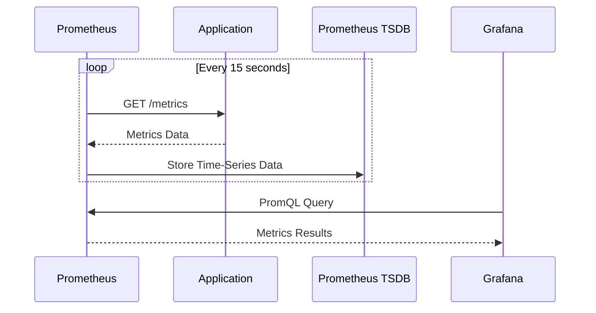
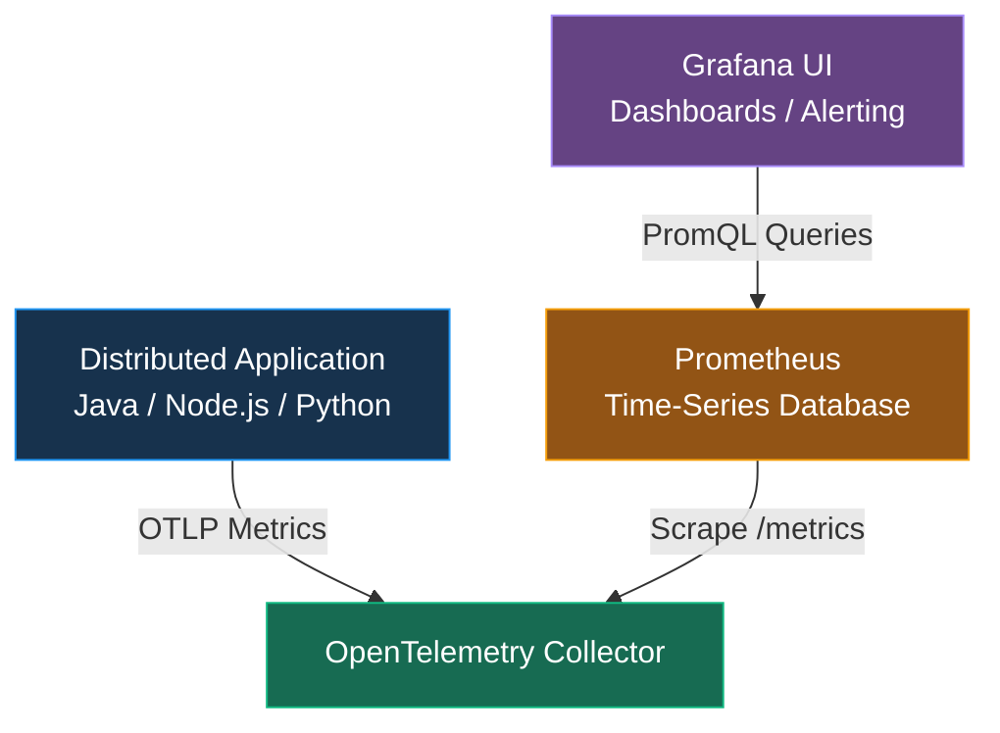
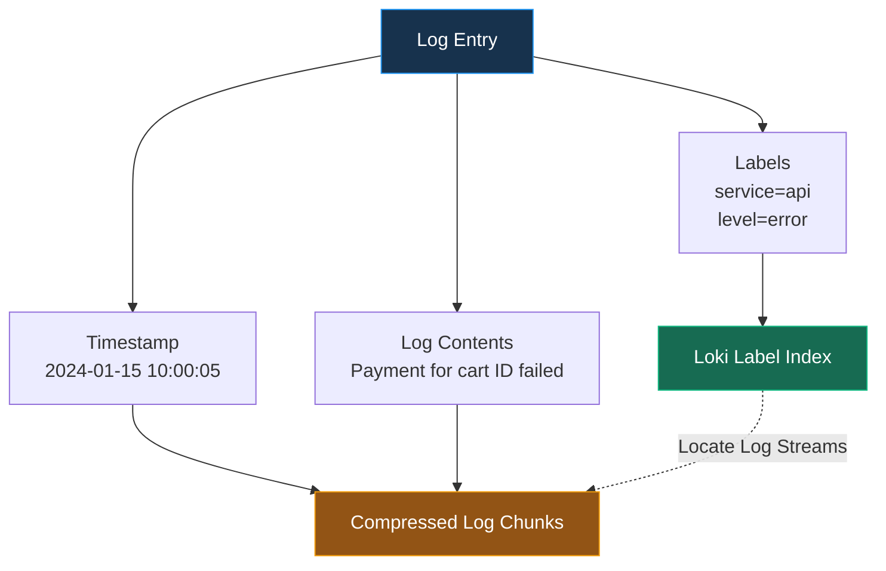
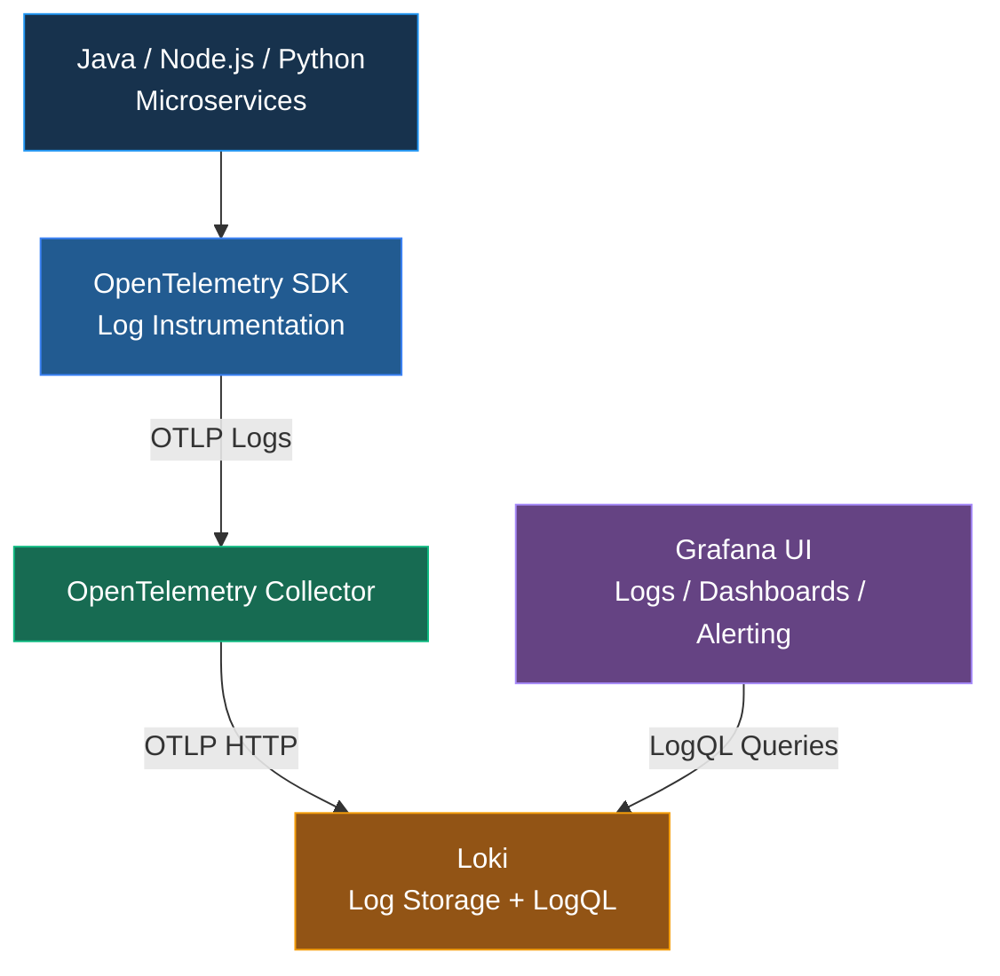

# Setting Up the Observability Stack（建立可觀測性技術架構）

## Section Overview（章節概覽）

### 1. Local Environment Setup（本地環境設定）

- 建立本地開發及測試環境。
- 準備 Docker / Docker Compose，以部署 Observability Stack。

### 2. Deploy Observability Backends（部署可觀測性後端）

1. 了解 **Prometheus、Loki、Tempo 和 Grafana** 在 Observability Stack 中各自扮演的角色。
2. 使用 **Docker Compose** 部署及運行各項服務。

| Component | Responsibility（主要職責） |
|---|---|
| **Prometheus** | Metrics Collection & Storage（指標收集與儲存） |
| **Loki** | Logs Storage & Query（日誌儲存與查詢） |
| **Tempo** | Distributed Tracing（分散式追蹤） |
| **Grafana** | Unified Visualization & Alerting（統一視覺化與告警） |

### 3. Application and Architecture（應用程式與系統架構）

1. 使用 **Distributed Translation Application（分散式翻譯應用程式）** 作為課程的 Instrumentation Target（監控埋點對象）。
2. 了解 Telemetry Signals（Metrics、Logs、Traces）如何從 Application 傳送至 Observability Backends，最後透過 Grafana UI 統一查詢及呈現。

### 核心架構

**Distributed Application → OpenTelemetry → Prometheus / Loki / Tempo → Grafana UI**

> **學習目標：** 能夠在本地使用 Docker Compose 建立完整的 Observability Stack，並理解 Application Telemetry Data 的收集、傳送、儲存及視覺化流程。

---

# Environment Check

Refer to `lab-setup.md`

```bash
# Docker
docker --version

# k8s
kubectl version
​kubectl config current-context

```

---

# Prometheus in 5 Minutes（5 分鐘了解 Prometheus）

Understand the Main Components and Characteristics of Prometheus（了解 Prometheus 的主要元件與特性）

Prometheus 是一個開源的 Time-Series Database（時間序列資料庫）與 Monitoring System，主要用來收集、儲存、查詢 Metrics，並支援監控與告警。

## 1. Prometheus 核心概念

| Component / Concept | 中文說明                      | 主要用途                         |
| ------------------- | ------------------------- | ---------------------------- |
| Prometheus          | 時間序列資料庫及監控系統              | 儲存與查詢 Metrics                |
| Pull-Based System   | 主動抓取監控數據                  | 定期從 `/metrics` Endpoint 收集指標 |
| Time-Series Data    | 時間序列資料                    | 記錄 Metrics 隨時間的變化            |
| Labels              | 指標的 Key-Value 屬性          | 區分 HTTP Method、Path、Status   |
| PromQL              | Prometheus Query Language | 查詢、聚合及計算 Metrics             |
| Exporter            | 指標匯出元件                    | 將系統或服務資訊暴露為 Metrics          |
| Grafana             | 視覺化平台                     | Dashboard、查詢及 Alerting       |

## 2. Pull-Based System（主動抓取模式）

Prometheus 預設透過 Pull-Based 方式收集 Metrics。



`15 seconds` 是常見的 Scrape Interval 範例，**可自行配置**。

## 3. Data Structure（資料結構）

Prometheus Metrics 由 Metric Name + Labels + Timestamp + Value 組成。

例如：

```json
http_requests_total{method="GET", path="/api/users"}
http_requests_total{method="POST", path="/api/users"}

```

這兩筆 Metrics 使用相同的 Metric Name，但 Labels 不同，因此屬於不同的 Time Series。

| Element     | 說明        | 範例                     |
| ----------- | --------- | ---------------------- |
| Metric Name | 指標名稱      | `http_requests_total`  |
| Label       | 用來區分指標的維度 | `method="GET"`         |
| Timestamp   | 採樣時間      | `2026-10-20T10:00:00Z` |
| Value       | 指標數值      | `1250`                 |

## 4. PromQL — Prometheus Query Language

PromQL 是用於查詢及計算時間序列資料的語言。

### PromQL 常用語法

| 功能 | PromQL 範例 | 說明 |
|---|---|---|
| **Filter by Labels** | `http_requests_total{status="500"}` | 查詢 HTTP 500 的累計請求數 |
| **Rate** | `rate(http_requests_total[5m])` | 計算最近 5 分鐘的每秒平均請求增加率 |
| **Aggregation** | `sum by (path) (rate(http_requests_total[5m]))` | 依 API Path 統計每秒請求量 |
| **Percentiles** | `histogram_quantile(0.99, ...)` | 估算 P99 Latency |

> 以上假設相應 Metric Names 與 Labels 已存在，並且使用對應的 Prometheus Histogram 類型。

## 5. Prometheus + OpenTelemetry + Grafana 架構



此圖代表 Collector 暴露 Prometheus 相容的 `/metrics` Endpoint，再由 Prometheus 抓取。實際配置也可以使用 Prometheus OTLP Receiver 接收 Push Metrics。

## 6. Prometheus、Loki、Tempo 的差異

| Component  | Data Type             | Query Language     |
| ---------- | --------------------- | ------------------ |
| Prometheus | Metrics               | PromQL             |
| Loki       | Logs                  | LogQL              |
| Tempo      | Distributed Traces    | TraceQL            |
| Grafana    | Unified Visualization | 透過各 Data Source 查詢 |

### 核心觀念

- Prometheus = Metrics Collection + Time-Series Storage + PromQL
- OpenTelemetry = Instrumentation + Telemetry Collection / Export
- Grafana = Unified Dashboard + Visualization + Alerting

對你的 Kubernetes + Microservices 架構而言，Prometheus 特別適合監控 API Request Rate、Error Rate、P95/P99 Latency、CPU/Memory Usage，以及 Database Connection Pool Saturation。

另外，應避免使用高基數（High Cardinality）的 Metrics Labels，例如每一筆交易的 Transaction ID 或每位客戶的 ID；這些識別資訊較適合放在 Logs 或 Traces，以免造成 Prometheus Time-Series 數量急劇增加。

---

## Hands on Prometheus

Refer to `opentelemetry-course/labs/section-setup/lab-deploy-prometheus.md` 

Create 3 files in folder `handson-lab/componse`: # 9090 => 9100

- prometheus.yaml
- compose.observability.yaml
- compose.yaml

```bash
cd handson-labs/compose/
docker compose up

docker compose up -d
docker compose ps
```

- Open http://localhost:9100 in your browser => Status > Target health

Try these queries in the Prometheus UI:

- **Current scrape duration**: `scrape_duration_seconds`
- **Rate of HTTP requests**: `rate(prometheus_http_requests_total[5m])`
- **Memory usage**: `process_resident_memory_bytes / 1024 / 1024` (converts to MB)
- **Uptime**: `time() - process_start_time_seconds`

---
# Loki in 5 Minutes（5 分鐘了解 Loki）

- Grafana Loki 是一個開源的 Log Aggregation System（日誌聚合系統），專門用來集中儲存、查詢及分析 Application Logs。
- Loki 的主要設計特色是 Metadata Indexing（中繼資料索引）：主要索引 Labels，而**不是對所有 Log Contents 建立全文索引**，因此通常可以降低日誌索引及儲存成本。


## 1.1 Loki 核心概念

| Component / Concept | 中文說明 | 主要用途 |
|---|---|---|
| **Loki** | 日誌聚合系統（Log Aggregation System） | 集中儲存及查詢 Application Logs |
| **Metadata Indexing** | 中繼資料索引 | 主要索引 Labels，不對所有 Log Contents 建立全文索引 |
| **Labels** | Key-Value 標籤 | 區分 Service、Environment、Namespace |
| **Log Streams** | 日誌資料流 | 將具有相同 Labels 的 Logs 組成一個 Stream |
| **LogQL** | Loki Query Language | 查詢、篩選、解析及統計 Logs |
| **OpenTelemetry Collector** | Telemetry 收集及轉送 | 將 Application Logs 傳送至 Loki |
| **Grafana** | 統一視覺化平台 | 查詢 Logs、Dashboard、Alerting |

## 1.2 Metadata Indexing（中繼資料索引）

Loki 將 Logs 分成兩個主要部分：


### Loki — Log Storage Structure - Metadata Indexing

| Log Entry | Example | Loki Storage | Description |
|---|---|---|---|
| **Timestamp** | `2024-01-15 10:00:05` | Log Chunks + 時間範圍索引資訊 | 記錄事件發生時間，協助依時間範圍查詢 |
| **Labels** | `service="api"`、`level="error"` | Label Index | 索引 Metadata，用來定位相關 Log Streams |
| **Log Contents** | `Payment for cart {id} failed` | Compressed Log Chunks | 儲存實際日誌內容，不建立一般全文索引 |

### 核心觀念

- **Labels**：用來快速找到相關 Log Streams。
- **Log Contents**：保存實際事件、錯誤及上下文。
- **Metadata Indexing**：減少全面建立文字索引所需的資源。

> Loki 仍然支援 Log Contents 搜尋，但不像 OpenSearch 那樣主要依賴文件欄位及全文索引進行搜尋。



## 2. LogQL — Loki Query Language

LogQL 是 Loki 的查詢語言，結合 Label Selection、Log Filtering、Parsing 以及 Metrics Aggregation。

### LogQL 常用語法

| 功能 | LogQL 範例 | 說明 |
|---|---|---|
| **Filter by Labels** | `{job="frontend", environment="production"}` | 查詢 Production Frontend Logs |
| **Line Filter** | `{job="frontend"} \|= "error"` | 搜尋包含 `error` 的 Logs |
| **Regex Filter** | `{job="frontend"} \|~ "timeout\|failed"` | 使用 Regex 搜尋 Timeout 或 Failed |
| **JSON Parser** | `{job="frontend"} \| json \| status_code >= 500` | 解析 JSON 並查詢 HTTP 5xx |
| **Log Rate** | `sum(rate({job="frontend"} \|= "error" [5m]))` | 計算最近 5 分鐘每秒平均 Error Log 數量 |

上述查詢假設對應 Labels 與 JSON 欄位存在。

### LogQL 實際範例

查詢 Payment Service 的 Error Logs：

```sql
{service_name="payment-service"} |= "ERROR"
```

如果 Application 使用 Structured JSON Logging：

```sql
{service_name="payment-service"} | json | level="ERROR"
```

可依照 JSON 欄位進行更精確的篩選。

## 3. Loki + OpenTelemetry + Grafana 架構



這裡的 OpenTelemetry SDK 負責 Log Instrumentation，Collector 負責接收及轉送。

對 Kubernetes Container stdout/stderr Logs，也可以使用 Collector 的 `filelog` Receiver 或其他 Log Agent 收集，不一定需要在 Application 內加入 Logging SDK。

## 4. Loki 與 OpenSearch 的差異

| 比較項目                 | Loki                               | OpenSearch                            |
| -------------------- | ---------------------------------- | ------------------------------------- |
| 主要用途                 | Log Aggregation                    | Search & Analytics                    |
| Indexing             | 主要索引 Labels                        | 索引文件欄位                                |
| Query Language       | LogQL                              | Query DSL / PPL / SQL                 |
| Log Storage          | 壓縮 Log Chunks                      | Indexed Documents                     |
| Full-text Search     | 支援掃描內容搜尋                           | 強大的全文索引搜尋                             |
| Trace ID Correlation | 支援                                 | 支援                                    |
| Grafana Integration  | 原生整合                               | 可透過 Data Source 整合                    |
| 資源成本                 | 通常較低                               | 通常較高                                  |
| 適合用途                 | Microservices Logs、Troubleshooting | Complex Log Analytics、Security Search |

## 5. 核心總結

- Loki = Log Aggregation + Metadata Indexing + LogQL
- OpenTelemetry = Log Instrumentation + Collection + Export
- Grafana = Unified Log Visualization + Alerting

對 Kubernetes + Microservices 架構而言，Loki 特別適合集中管理 Application Logs，並透過 Trace ID 關聯 Tempo 的 Distributed Traces。

> 建議在 Production 使用 Structured JSON Logging，並合理設計 Labels，避免將 Transaction ID、User ID 或 Trace ID 等高基數資料設定為一般索引 Labels，以免增加 Loki 的資源消耗。

## 6. Loki vs Prometheus vs Tempo

| Component  | Data Type | Query Language     | 主要功能        |
| ---------- | --------- | ------------------ | ----------- |
| Prometheus | Metrics   | PromQL             | 指標與效能監控     |
| Loki       | Logs      | LogQL              | 日誌搜尋及錯誤分析   |
| Tempo      | Traces    | TraceQL            | 分散式追蹤       |
| Grafana    | All Three | 透過各 Data Source 查詢 | 統一查詢、視覺化與告警 |

最重要的觀念：Prometheus 告訴你系統何時出現異常；Tempo 協助定位問題發生在哪裡；Loki 提供詳細 Logs，幫助分析為甚麼發生異常。

---

## Hands on Loki

Refer to `opentelemetry-course/labs/section-setup/lab-deploy-loki.md` 

Create 1 file in folder `handson-lab/componse`: 

- loki-config.yaml
- Then update `compose.observability.yaml` & `prometheus.yaml`

> Change to port 3200 for Loki

```bash
docker compose up -d
docker compose ps
docker network inspect observability
docker network ls | grep observability

docker compose restart prometheus
```

```json docker network inspect observability
{
  "Containers": {
    "abc123": {
      "Name": "prometheus"
    },
    "def456": {
      "Name": "loki"
    }
  }
}
```

### Test Loki
1. Check health
curl http://localhost:3200/ready

2. Check metrics
curl http://localhost:3200/metrics

3. List label names (may be empty at first)
curl http://localhost:3200/loki/api/v1/labels

- http://localhost:9100/targets


### Prometheus - Loki

```sql - Loki
loki_build_info
loki_bytes_per_line_bucket
```
---

## Test Scripts

`handson-labs/compose` folder

- compose.yaml
- compose.observability.yaml
- loki-config.yaml
- prometheus.yaml
- scrapepad.md

`handson-labs/compose/test_scripts` folder

- validate-loki.sh
- cleanup-loki.sh
- loki-promql-queries.md


The scripts:

- Use Loki at `http://localhost:3200`
- Require only `curl`
- Send and query a test log
- Clean up logs asynchronously
- Work with Git Bash on Windows ARM

Run:

```bash
cd test_scripts
bash validate-loki.sh
bash cleanup-loki.sh
```

Git Bash syntax validation passed. A live Loki test was not run because Docker’s engine pipe was inaccessible from this environment.

---

# Loki checks in Prometheus

```sql promql
loki_build_info
up{job="loki"}

loki_distributor_lines_received_total[5m]
loki_distributor_lines_received_total

rate(loki_distributor_lines_received_total[30m])

rate(loki_request_duration_seconds_count{job="loki", method="POST", route="loki_api_v1_push", status_code=~"2.."}[5m])
rate(loki_request_duration_seconds_count{status_code=~"5.."}[5m])

process_resident_memory_bytes{job="loki"} / 1024 / 1024

histogram_quantile(
  0.99,
  sum by (le, route) (
    rate(loki_request_duration_seconds_bucket[5m])
  )
)

histogram_quantile(
  0.99,
  sum by (le, route) (
    rate(
      loki_request_duration_seconds_bucket{
        job="loki",
        route=~"loki_api_v1_query.*"
      }[10h]
    )
  )
)

loki_ingester_memory_streams
loki_ingester_memory_chunks
loki_ingester_flush_queue_length
rate(loki_ingester_chunks_flushed_total[5m])
loki_compactor_pending_delete_requests_count

rate(
  loki_request_duration_seconds_count{
    job="loki",
    method="POST",
    route="loki_api_v1_push",
    status_code=~"2.."
  }[5m]
)

rate(loki_request_duration_seconds_count{
  job="loki",
  method="POST",
  route="loki_api_v1_delete",
  status_code="204"
}[5m])

```
