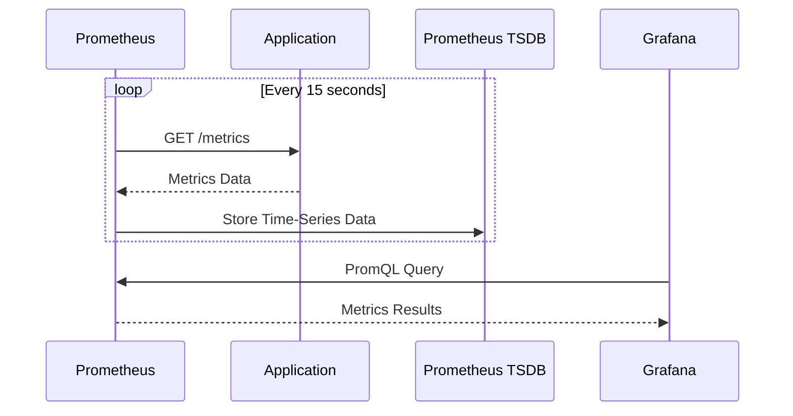
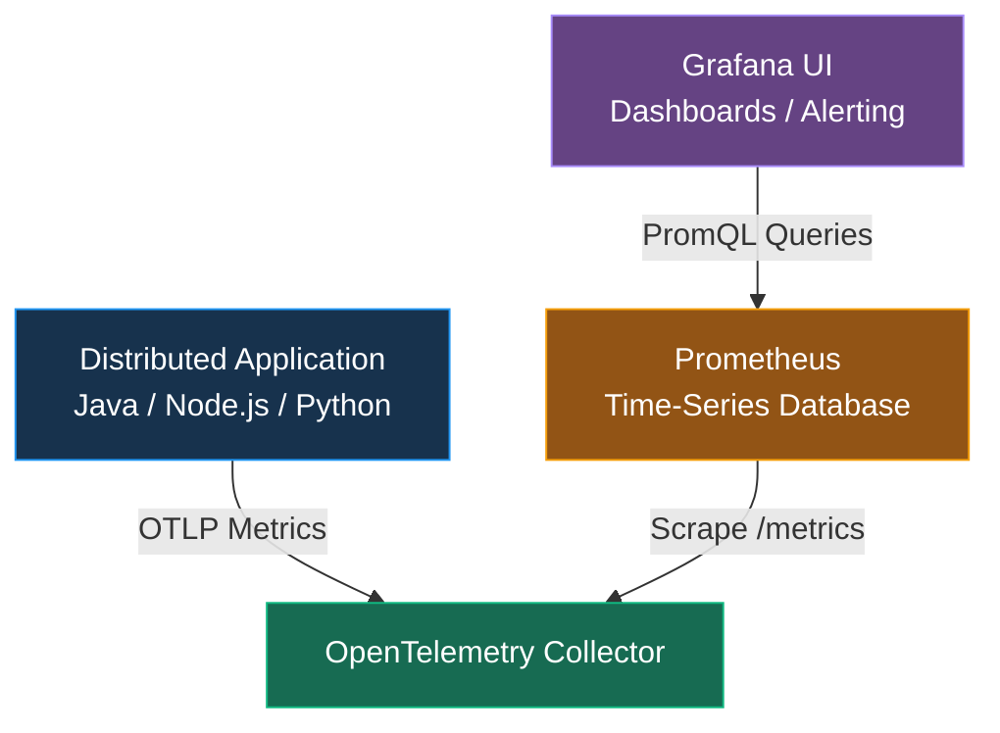

# Setting Up the Observability Stack（建立可觀測性技術架構）

## Section Overview（章節概覽）

### 1. Local Environment Setup（本地環境設定）

- 建立本地開發及測試環境。
- 準備 Docker / Docker Compose，以部署 Observability Stack。

### 2. Deploy Observability Backends（部署可觀測性後端）

1. 了解 **Prometheus、Loki、Tempo 和 Grafana** 在 Observability Stack 中各自扮演的角色。
2. 使用 **Docker Compose** 部署及運行各項服務。

| Component | Responsibility（主要職責） |
|---|---|
| **Prometheus** | Metrics Collection & Storage（指標收集與儲存） |
| **Loki** | Logs Storage & Query（日誌儲存與查詢） |
| **Tempo** | Distributed Tracing（分散式追蹤） |
| **Grafana** | Unified Visualization & Alerting（統一視覺化與告警） |

### 3. Application and Architecture（應用程式與系統架構）

1. 使用 **Distributed Translation Application（分散式翻譯應用程式）** 作為課程的 Instrumentation Target（監控埋點對象）。
2. 了解 Telemetry Signals（Metrics、Logs、Traces）如何從 Application 傳送至 Observability Backends，最後透過 Grafana UI 統一查詢及呈現。

### 核心架構

**Distributed Application → OpenTelemetry → Prometheus / Loki / Tempo → Grafana UI**

> **學習目標：** 能夠在本地使用 Docker Compose 建立完整的 Observability Stack，並理解 Application Telemetry Data 的收集、傳送、儲存及視覺化流程。

---

# Environment Check

Refer to `lab-setup.md`

```bash
# Docker
docker --version

# k8s
kubectl version
​kubectl config current-context

```

---

# Prometheus in 5 Minutes（5 分鐘了解 Prometheus）

Understand the Main Components and Characteristics of Prometheus（了解 Prometheus 的主要元件與特性）

Prometheus 是一個開源的 Time-Series Database（時間序列資料庫）與 Monitoring System，主要用來收集、儲存、查詢 Metrics，並支援監控與告警。

## 1. Prometheus 核心概念

| Component / Concept | 中文說明                      | 主要用途                         |
| ------------------- | ------------------------- | ---------------------------- |
| Prometheus          | 時間序列資料庫及監控系統              | 儲存與查詢 Metrics                |
| Pull-Based System   | 主動抓取監控數據                  | 定期從 `/metrics` Endpoint 收集指標 |
| Time-Series Data    | 時間序列資料                    | 記錄 Metrics 隨時間的變化            |
| Labels              | 指標的 Key-Value 屬性          | 區分 HTTP Method、Path、Status   |
| PromQL              | Prometheus Query Language | 查詢、聚合及計算 Metrics             |
| Exporter            | 指標匯出元件                    | 將系統或服務資訊暴露為 Metrics          |
| Grafana             | 視覺化平台                     | Dashboard、查詢及 Alerting       |

## 2. Pull-Based System（主動抓取模式）

Prometheus 預設透過 Pull-Based 方式收集 Metrics。



`15 seconds` 是常見的 Scrape Interval 範例，**可自行配置**。

## 3. Data Structure（資料結構）

Prometheus Metrics 由 Metric Name + Labels + Timestamp + Value 組成。

例如：

```json
http_requests_total{method="GET", path="/api/users"}
http_requests_total{method="POST", path="/api/users"}

```

這兩筆 Metrics 使用相同的 Metric Name，但 Labels 不同，因此屬於不同的 Time Series。

| Element     | 說明        | 範例                     |
| ----------- | --------- | ---------------------- |
| Metric Name | 指標名稱      | `http_requests_total`  |
| Label       | 用來區分指標的維度 | `method="GET"`         |
| Timestamp   | 採樣時間      | `2026-10-20T10:00:00Z` |
| Value       | 指標數值      | `1250`                 |

## 4. PromQL — Prometheus Query Language

PromQL 是用於查詢及計算時間序列資料的語言。

### PromQL 常用語法

| 功能 | PromQL 範例 | 說明 |
|---|---|---|
| **Filter by Labels** | `http_requests_total{status="500"}` | 查詢 HTTP 500 的累計請求數 |
| **Rate** | `rate(http_requests_total[5m])` | 計算最近 5 分鐘的每秒平均請求增加率 |
| **Aggregation** | `sum by (path) (rate(http_requests_total[5m]))` | 依 API Path 統計每秒請求量 |
| **Percentiles** | `histogram_quantile(0.99, ...)` | 估算 P99 Latency |

> 以上假設相應 Metric Names 與 Labels 已存在，並且使用對應的 Prometheus Histogram 類型。

## 5. Prometheus + OpenTelemetry + Grafana 架構



此圖代表 Collector 暴露 Prometheus 相容的 `/metrics` Endpoint，再由 Prometheus 抓取。實際配置也可以使用 Prometheus OTLP Receiver 接收 Push Metrics。

## 6. Prometheus、Loki、Tempo 的差異

| Component  | Data Type             | Query Language     |
| ---------- | --------------------- | ------------------ |
| Prometheus | Metrics               | PromQL             |
| Loki       | Logs                  | LogQL              |
| Tempo      | Distributed Traces    | TraceQL            |
| Grafana    | Unified Visualization | 透過各 Data Source 查詢 |

### 核心觀念

- Prometheus = Metrics Collection + Time-Series Storage + PromQL
- OpenTelemetry = Instrumentation + Telemetry Collection / Export
- Grafana = Unified Dashboard + Visualization + Alerting

對你的 Kubernetes + Microservices 架構而言，Prometheus 特別適合監控 API Request Rate、Error Rate、P95/P99 Latency、CPU/Memory Usage，以及 Database Connection Pool Saturation。

另外，應避免使用高基數（High Cardinality）的 Metrics Labels，例如每一筆交易的 Transaction ID 或每位客戶的 ID；這些識別資訊較適合放在 Logs 或 Traces，以免造成 Prometheus Time-Series 數量急劇增加。

---

## Hands on Prometheus

Refer to `opentelemetry-course/labs/section-setup/lab-deploy-prometheus.md` 

Create 3 files in folder `handson-lab/componse`: # 9090 => 9100

- prometheus.yaml
- compose.observability.yaml
- compose.yaml

```bash
cd handson-labs/compose/
docker compose up

docker compose up -d
docker compose ps
```

- Open http://localhost:9100 in your browser => Status > Target health

Try these queries in the Prometheus UI:

- **Current scrape duration**: `scrape_duration_seconds`
- **Rate of HTTP requests**: `rate(prometheus_http_requests_total[5m])`
- **Memory usage**: `process_resident_memory_bytes / 1024 / 1024` (converts to MB)
- **Uptime**: `time() - process_start_time_seconds`
