# Introduction to OpenTelemetry Concepts（OpenTelemetry 核心概念介紹）

Section Overview（章節概覽）

這個章節主要介紹 OpenTelemetry 的五個核心概念，從 OpenTelemetry 的設計目的，到 APIs、SDKs、Instrumentation、Collector 和 Semantic Conventions。

## Section Overview（章節概覽）

| Topic | 中文名稱 | 學習重點 |
|---|---|---|
| **What is OpenTelemetry and Why It Exists** | 甚麼是 OpenTelemetry，以及為甚麼需要它 | 了解 Vendor-neutral Observability 的設計目的 |
| **APIs and SDKs** | API 與 SDK | 理解 API 和 SDK 的職責及兩者之間的區別 |
| **Automatic Instrumentation** | 自動監控埋點 | 使用現成 Framework Instrumentation，**盡量不修改** Application Source Code |
| **Manual Instrumentation** | 手動監控埋點 | 加入 Custom Business Spans、Metrics 和業務上下文 |
| **OpenTelemetry Collector** | 遙測資料收集器 | 集中接收、處理及轉送 Metrics、Logs、Traces |
| **Semantic Conventions** | 語意命名規範 | 標準化 Telemetry Attributes 和 Metric Names |

## 1. What Is OpenTelemetry and Why It Exists?

OpenTelemetry（OTel）是一套 Vendor-neutral 的 Observability Framework，提供標準化工具來產生、收集和傳送 Metrics、Logs、Traces。

主要目的：

- 避免依賴特定 Observability Vendor。
- 統一不同程式語言的 Telemetry 格式。
- 支援**跨 Microservices** 的 **Distributed Tracing**。
- 與 Prometheus、Loki、Tempo、Grafana 等系統整合。

## 2. APIs and SDKs

| Component | Responsibility | Example |
|---|---|---|
| **OTel API** | 定義產生 Telemetry 的標準介面 | Tracer、Span、Meter |
| **OTel SDK** | 實作 Telemetry Recording、Processing 和 Exporting | Java / Python / Node.js SDK |

- API = **定義介面**；
- SDK = **實際執行。**

## 3. Automatic and Manual Instrumentation

| Type | Automatic Instrumentation | Manual Instrumentation |
|---|---|---|
| Source Code Changes | 通常不需要 | 需要 |
| Implementation | Java Agent、Python / Node.js Auto Instrumentation | OTel API / SDK |
| HTTP / Database Tracing | ✅ | ✅ |
| Custom Business Spans | 需要**額外配置**或程式碼 | ✅ |
| Examples | HTTP Request、SQL Query | Payment Validation、LC Issuance |

## 4. OpenTelemetry Collector

Collector 是 Vendor-neutral Telemetry Pipeline，主要包含：

- **Receivers**：接收 Metrics、Logs、Traces。
- **Processors**：批次處理、過濾、轉換與資料保護。
- **Exporters**：將資料送到 Observability Backends。
- **Pipelines**：定義 Telemetry Data Flow。

## 5. Semantic Conventions

Semantic Conventions 定義標準化的 Telemetry 名稱及意義。

| Attribute / Metric | Example |
|---|---|
| `service.name` | `payment-service` |
| `http.request.method` | `POST` |
| `http.response.status_code` | `200` |
| `http.route` | `/api/payments` |
| `db.system.name` | `postgresql` |
| `http.server.request.duration` | HTTP Server Request Duration Metric |

**核心目標：** 讓 Java、Python、Node.js 等服務使用一致的 Telemetry 語意與命名。


## 2. Mermaid — OpenTelemetry 核心架構

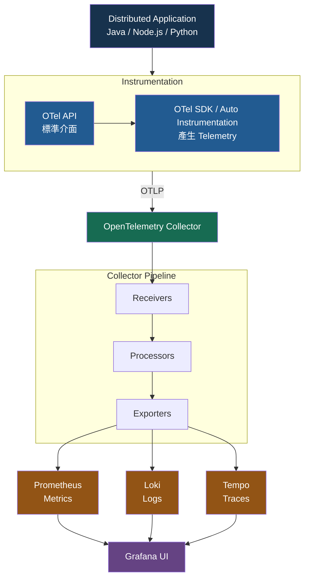

概念架構：OpenTelemetry SDK 通常嵌入 Application 或由 Auto Instrumentation 載入；Collector 可使用不同 Exporters / Receivers 連接各 Backend，不一定全部直接使用 OTLP。

## 3. 對你的 Microservices 架構的實際應用

| Component             | Recommended OpenTelemetry Approach |
| --------------------- | ---------------------------------- |
| Angular / Vue         | 可不安裝 OTel SDK，先從 API Gateway 開始追蹤  |
| Kong API Gateway      | Native OpenTelemetry Plugin        |
| Keycloak              | Built-in Tracing / Metrics         |
| Java Microservices    | OpenTelemetry Java Agent           |
| Python Microservices  | OTel Auto Instrumentation          |
| Node.js Microservices | OTel Auto Instrumentation          |
| Kubernetes Logs       | Collector `filelog` / Log Agent    |
| Grafana Stack         | Prometheus + Loki + Tempo          |

核心觀念：

- OTel API：定義如何建立監控資料。
- OTel SDK / Auto Instrumentation：實際產生 Telemetry。
- OTel Collector：集中接收、處理及轉送資料。
- OTLP：標準化 Telemetry 傳輸協定。
- Semantic Conventions：統一 Telemetry 資料的意義與命名。

這五個概念是理解 OpenTelemetry 如何整合進 Production Microservices Architecture 的重要基礎。

---
# OpenTelemetry API 與 SDK 的使用時機

> 主要取決於你是否需要自行加入 Instrumentation（監控埋點），以及是否已有 Auto Instrumentation。

簡單來說：

- OTel API：開發人員用來定義或建立 **Custom Spans、Metrics** 等 Telemetry。
- OTel SDK：負責記錄、處理、Sampling，以及 Export Telemetry Data。
- Auto Instrumentation：自動監控 HTTP、Database、Framework 等操作，通常**不需要修改** Application Source Code。

## 1. OTel API vs SDK 比較

| 比較項目           | OTel API                                | OTel SDK                        |
| -------------- | --------------------------------------- | ------------------------------- |
| 主要作用           | 定義 Instrumentation 介面                   | 實際執行 Telemetry 處理               |
| 使用者            | Application Developer、Library Developer | Application / Platform Engineer |
| Custom Spans   | ✅ 建立                                    | ✅ 記錄及匯出                         |
| Custom Metrics | ✅ 定義及記錄                                 | ✅ 聚合及匯出                         |
| Sampling       | ❌                                       | ✅                               |
| Export OTLP    | ❌                                       | ✅                               |
| Configuration  | 少量                                      | 較多                              |
| 程式碼依賴          | 較輕量                                     | 較多                              |

## 2. 甚麼時候使用 OTel API？

當你需要監控 Business Logic（業務邏輯） 時，適合使用 OTel API。

例如銀行 Payment Processing：

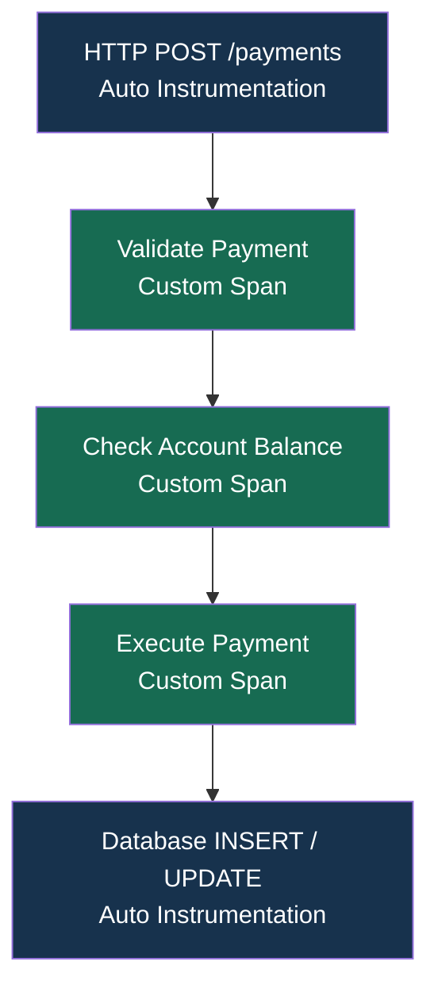

例如 Java Code：

```java
import io.opentelemetry.api.GlobalOpenTelemetry;
import io.opentelemetry.api.trace.Span;
import io.opentelemetry.api.trace.Tracer;
import io.opentelemetry.context.Scope;

Tracer tracer = GlobalOpenTelemetry.getTracer("payment-service");

Span span = tracer.spanBuilder("validate-payment").startSpan();

try (Scope scope = span.makeCurrent()) {
    // Business validation logic
} finally {
    span.end();
}
```

這裡 Application 只依賴 OTel API。若執行環境有正確配置 SDK，例如使用 Java Agent，便可以將這個 Span 匯出至 Collector。

不需要為每個 Custom Span 都手動建立 SDK。

## 3. 甚麼時候使用 OTel SDK？

當你需要自行配置 Telemetry 的處理與匯出方式，而且沒有使用已經配置 SDK 的 Agent 或 Framework Integration 時，就需要使用 OTel SDK。

例如：

- 設定 Trace Sampling Rate。
- 配置 OTLP Exporter。
- 設定 Batch Span Processor。
- 設定 Service Name 和 Resource Attributes。
- 控制 Metrics Aggregation 與 Export。

OpenTelemetry 官方建議 **Java 可優先**使用 **SDK Auto-configuration**，減少手動初始化程式碼。

## 4. 最常見的三種使用情境

| Scenario                            | OTel API | OTel SDK   | 建議   |
| ----------------------------------- | -------- | ---------- | ---- |
| Auto Instrumentation                | 不需手動呼叫   | Agent 內部提供 | 最簡單  |
| Manual Instrumentation + Java Agent | ✅ 使用     | Agent 內部提供 | **最推薦**  |
| 完全自行建置 OTel                         | ✅ 使用     | ✅ 自行配置     | 特殊需求 |

### 推薦方案：Java Agent + OTel API

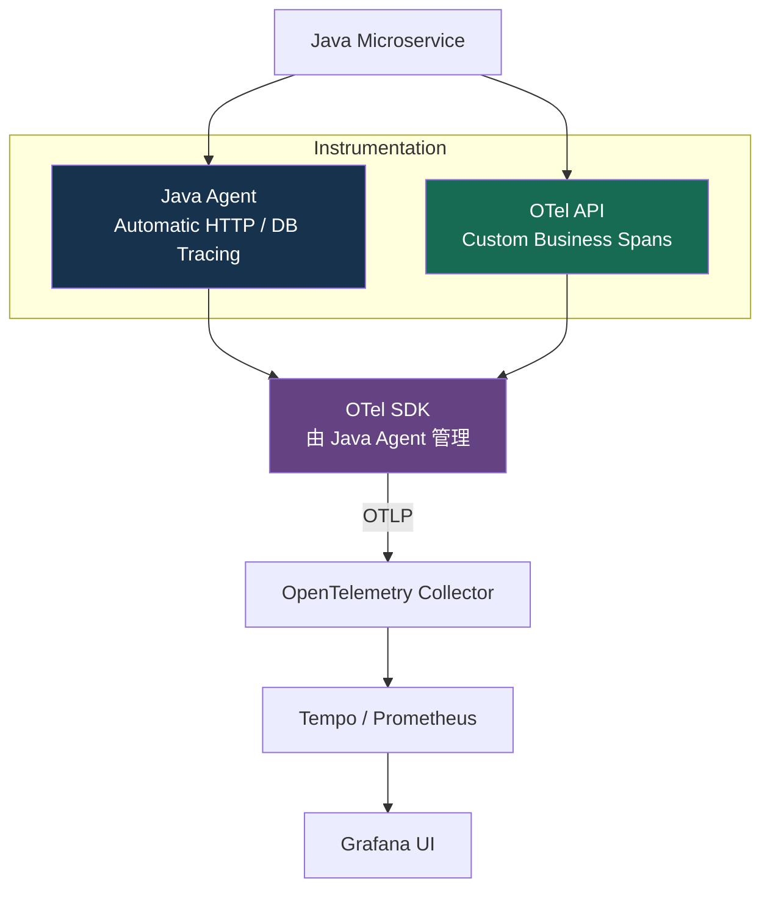

這也是官方支援的組合：Java Agent 負責自動 Instrumentation，而 Application 使用 OTel API 補充 Custom Spans 和 Metrics。


## 5. 對你的架構，如何選擇？

| Component          | 建議方式                                    |
| ------------------ | --------------------------------------- |
| Angular / Vue      | 不使用 SDK，先從 Gateway 追蹤                   |
| Kong API Gateway   | **使用 Native OTel Plugin**                   |
| Keycloak           | **使用內建 OTel Integration**                   |
| Java Microservices | **Java Agent + 視需要加入 OTel API**             |
| Node.js / Python   | **Auto Instrumentation + 視需要加入 Manual API** |
| Kubernetes Logs    | **Collector / Log Agent**                   |
| OTel Collector     | 獨立部署，不需要 Application SDK                |

### 最重要的觀念

- OTel API = What to record（記錄甚麼）
- OTel SDK = How to record and export（如何處理及匯出）
- Auto Instrumentation = Record automatically（自動記錄）

還有一個容易忽略的地方：

- 如果只有 OTel API，卻沒有有效的 SDK Implementation，API 呼叫通常只會執行 No-op，不會真正產生可匯出的 Telemetry。


因此對銀行 Microservices，我建議：

- Auto Instrumentation 為主，OTel API 用於重要 Business Operations，OTel SDK 優先由 Agent 管理。
- 這樣既能減少程式碼修改，又能追蹤 LC Issuance、Payment Processing、Settlement 等重要業務流程。

---
## 1. 實際例子：Payment Processing

以你的 Java Microservices + Banking Payment / LC Issuance 為例，最推薦的設計是：

- Automatic Instrumentation 負責技術層面的監控；OTel API（Manual Instrumentation）負責重要業務流程；OTel SDK 由 Java Agent 自動管理。
- 這樣可以在不大量修改現有 Java 程式碼的情況下，同時監控技術效能與業務處理流程。

假設一筆銀行 Payment Transaction 需要經過：

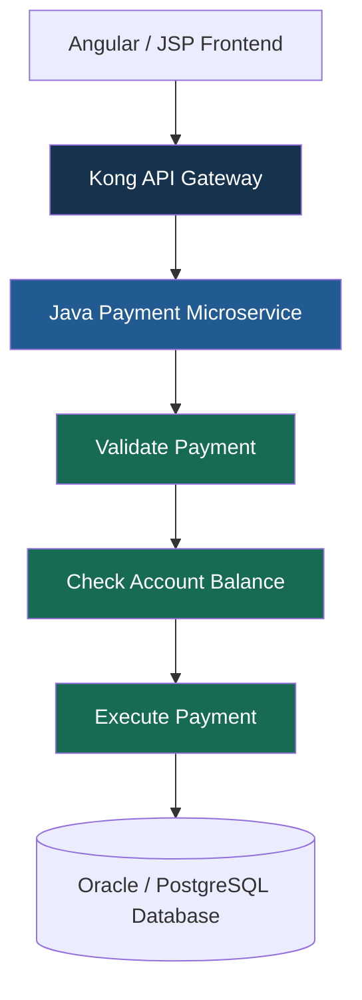

### 哪些操作使用 Auto，哪些使用 Manual？

| Operation                    | Instrumentation    | 原因                                 |
| ---------------------------- | ------------------ | ------------------------------------ |
| `POST /payments`           | Automatic          | Java Agent 自動追蹤 HTTP Request     |
| `validatePayment()`        | Manual — OTel API | 自訂業務驗證 Span                    |
| `checkAccountBalance()`    | Manual — OTel API | 了解餘額檢查耗時                     |
| `executePayment()`         | Manual — OTel API | 監控付款執行階段                     |
| JDBC SQL Query               | Automatic          | Java Agent 自動追蹤 Database Calls   |
| HTTP Call to Account Service | Automatic          | Java Agent 自動建立 HTTP Client Span |
| Trace Export / Sampling      | OTel SDK           | Java Agent 內部負責                  |

> 關鍵差異：Java Agent 知道你的程式執行了 HTTP 和 SQL，但不一定知道 `validatePayment()` 是甚麼銀行業務步驟。
> 所以重要業務操作才需要 Manual Instrumentation。

## 2. Java Agent — Automatic Instrumentation

假設原本有 Java Spring Boot Payment Microservice：

```java
@RestController
public class PaymentController {

    @PostMapping("/payments")
    public String processPayment() {
        validatePayment();
        checkAccountBalance();
        executePayment();

        return "SUCCESS";
    }
}
```

不修改程式碼，也可以使用 OpenTelemetry Java Agent：

```bash
java \
  -javaagent:/opt/otel/opentelemetry-javaagent.jar \
  -Dotel.service.name=payment-service \
  -Dotel.exporter.otlp.endpoint=http://otel-collector:4318 \
  -Dotel.exporter.otlp.protocol=http/protobuf \
  -jar payment-service.jar
```

Java Agent 會自動為支援的技術建立 Spans，例如：

```text
Trace: POST /payments
│
├── HTTP Server Span
│
├── JDBC SELECT account_balance
│
├── HTTP Client: Account Service
│
└── JDBC UPDATE payments
```

但你可能無法直接知道每個 Business Operation 的執行時間。

## 3. OTel API — Manual Instrumentation

現在希望追蹤 `validatePayment()`。

只需要在 Java Project 加入 OTel API Dependency，例如 Maven：

```xml
<dependency>
    <groupId>io.opentelemetry</groupId>
    <artifactId>opentelemetry-api</artifactId>
    <version>${otel.version}</version>
</dependency>
```

`otel.version` 應由專案的 Dependency Management / BOM 管理，並選擇與部署環境相容的版本。

然後在業務程式碼加入：

```java
import io.opentelemetry.api.GlobalOpenTelemetry;
import io.opentelemetry.api.trace.Span;
import io.opentelemetry.api.trace.StatusCode;
import io.opentelemetry.api.trace.Tracer;
import io.opentelemetry.context.Scope;

public class PaymentService {

    private static final Tracer tracer =
        GlobalOpenTelemetry.getTracer("payment-service");

    public void validatePayment() {
        Span span = tracer.spanBuilder("validate-payment")
                .startSpan();

        try (Scope scope = span.makeCurrent()) {
            // Existing business validation logic
            performValidation();

        } catch (RuntimeException e) {
            span.recordException(e);
            span.setStatus(StatusCode.ERROR);
            throw e;

        } finally {
            span.end();
        }
    }

    private void performValidation() {
        // Existing validation logic
    }
}
```

如此 Tempo 可以看到：

```text
Trace: POST /payments
│
├── validate-payment            ← Manual Span
│
├── check-account-balance       ← Manual Span
│   └── JDBC SELECT             ← Auto Span
│
└── execute-payment             ← Manual Span
    └── JDBC UPDATE             ← Auto Span
```

前提是另外兩個 Business Methods 也加入相應的 Manual Spans。

你不需要在這段 Java Code 裡自行建立 `SdkTracerProvider`、設定 Span Processor 或 OTLP Exporter，因為這些工作可以由 Java Agent 管理。

## 4. OTel SDK 由 Java Agent 管理，是甚麼意思？

Java Agent 內部已經整合 OTel SDK，因此不需要每個 Microservice 都自行撰寫 SDK 初始化程式。

| 功能                    | 負責元件         | 是否需修改 Business Code |
| ----------------------- | ---------------- | ------------------------ |
| HTTP Request Tracing    | Java Agent       | ❌                       |
| JDBC Database Tracing   | Java Agent       | ❌                       |
| Custom Business Spans   | OTel API         | ✅                       |
| Custom Business Metrics | OTel API         | ✅                       |
| Sampling                | OTel SDK / Agent | ❌                       |
| Batch Span Processing   | OTel SDK / Agent | ❌                       |
| OTLP Export             | OTel SDK / Agent | ❌                       |
| Telemetry Routing       | OTel Collector   | ❌                       |

OpenTelemetry 官方也建議先使用 Java Agent，再透過 OTel API 補充業務專屬的 Instrumentation。

## 5. 再舉一個 Trade Finance 例子：LC Issuance

假設 Import LC Issuance 涉及以下處理：

| Business Operation        | Instrumentation |
| ------------------------- | --------------- |
| `POST /import-lc/issue` | Automatic       |
| Validate LC Application   | Manual          |
| Check Customer Limit      | Manual          |
| Calculate LC Charges      | Manual          |
| Reserve LC Balance        | Manual          |
| Database INSERT / UPDATE  | Automatic       |
| Call External Banking API | Automatic       |

在 Grafana Tempo 中，可以看到類似：

Import LC Issuance — Trace Timeline Example


### Import LC Issuance — Span Duration

| Operation | Duration | Relative Duration |
|---|---:|---|
| 🔵 POST /import-lc/issue | 1,500 ms | ████████████████████ 100% |
| 🟢 Validate LC Application | 150 ms | ██ 10% |
| 🟢 Check Customer Limit | 300 ms | ████ 20% |
| 🟢 Calculate LC Charges | 100 ms | █ 6.7% |
| 🟢 Reserve LC Balance | 800 ms | ███████████ 53.3% |
| 🔵 JDBC UPDATE | 650 ms | █████████ 43.3% |

**Legend:** 🔵 Automatic | 🟢 Manual

> 所有百分比均以 Root Span 的 1,500 ms 作為比較基準，而非各項作業所佔的互斥比例。

透過這些 Spans，就能辨識 LC Issuance 的主要效能瓶頸。例如 `Reserve LC Balance` 花費 800ms，而其中 JDBC Update 花費 650ms，便可以進一步調查 Database Performance。

## 6. 最終建議

對你的 Java Banking Microservices，我建議採用以下原則：

- 80%–90% 的常見技術監控由 Auto Instrumentation 處理，**重要 Business Operations 再使用 OTel API** 補充。 這是實務上的工作分配方向，不是 OpenTelemetry 規定的固定比例。

如此便可取得：

- 技術層面的 HTTP、SQL、Service-to-Service Tracing。
- 業務層面的 Payment、LC Issuance、Settlement Operation Tracing。
- 統一由 Java Agent 管理 SDK、Sampling 和 OTLP Export。
- 最後經由 Collector 傳送到 Tempo，在 Grafana 分析。

一句話：Java Agent 自動追蹤「系統做了甚麼技術操作」，**OTel API 手動補充**「系統正在執行甚麼銀行業務」，OTel SDK 則負責將兩者產生的資料處理並送出去。

---
# What Is OpenTelemetry?（甚麼是 OpenTelemetry？）

OpenTelemetry（OTel）是一套開源、Vendor-neutral（廠商中立）的 Observability Framework and Toolkit（可觀測性框架與工具集），用來建立及管理 Metrics、Logs、Traces 等 Telemetry Data。

## 1. OpenTelemetry 的核心定位

| Concept                 | 中文說明                                            |
| ----------------------- | ----------------------------------------------- |
| Observability Framework | 建立及管理 Metrics、Logs、Traces                       |
| Vendor Neutrality       | **不依賴特定 Observability Vendor**                      |
| Standardization         | 提供統一的 Telemetry API、SDK 與資料標準                   |
| Backend Independence    | 可整合 Prometheus、Loki、Tempo、Datadog、New Relic 等系統 |

### 重要觀念

- ❌ OpenTelemetry 不是另一套用來儲存及視覺化資料的 Observability Backend。
- ✅ OpenTelemetry 是位於 **Application** 與 **Observability Backend** 之間的**標準化技術層**。
- ✅ 可以**降低 Vendor Lock-in**（供應商鎖定），減少更換監控平台時所需修改的應用程式碼。

## 2. OpenTelemetry 四大核心元件

| Component                 | Responsibility                         | 使用時機                               |
| ------------------------- | -------------------------------------- | ---------------------------------- |
| **OTel API**                  | 提供 Vendor-neutral APIs，定義及建立 Telemetry | 手動建立 Custom Business Spans、Metrics |
| **OTel SDK**                  | 實作 APIs，處理 Batching、Sampling、Exporting | 由 Agent 自動配置，或自行初始化                |
| Automatic Instrumentation | 自動追蹤常見 Framework 和 Libraries           | HTTP、Database、RPC 等技術操作            |
| OTel Collector            | 接收、處理及轉送 Telemetry Data                | 集中管理 Telemetry Pipeline            |

## 3. OpenTelemetry Architecture

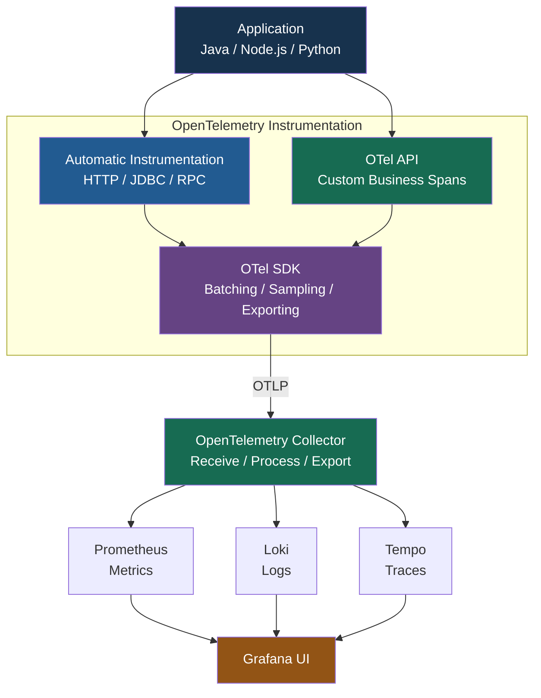

概念架構：OTel SDK 可由 Java Agent 等自動配置；Collector 是可選元件。實際 Metrics、Logs、Traces 的接收方式依 Backend 配置而定。

## 4. Automatic vs Manual Instrumentation

以銀行 Payment Microservice 為例：

| Operation                    | Instrumentation         | Component        |
| ---------------------------- | ----------------------- | ---------------- |
| `POST /payments`             | Automatic               | Java Agent       |
| `validatePayment()`          | Manual                  | OTel API         |
| `checkAccountBalance()`      | Manual                  | OTel API         |
| `executePayment()`           | Manual                  | OTel API         |
| JDBC SQL Queries             | Automatic               | Java Agent       |
| HTTP Calls to Other Services | Automatic               | Java Agent       |
| Sampling / Export            | Automatic Configuration | OTel SDK / Agent |

使用 Java Agent 時，Auto Instrumentation 和 Manual Instrumentation 都可以共用由 Agent 管理的 SDK。

## 5. Why Use OpenTelemetry?（為甚麼使用 OTel？）

| Traditional Vendor-specific Approach | OpenTelemetry Approach      |
| ------------------------------------ | --------------------------- |
| Application 整合 Vendor SDK            | Application 整合標準 OTel API   |
| 更換 Backend 可能修改程式碼                   | 通常只需調整 Exporter / Collector |
| 多套 Vendor Instrumentation            | 統一 Instrumentation          |
| Vendor Lock-in 風險較高                  | 降低 Vendor Lock-in           |
| 各系統 Telemetry 不一致                    | 使用 Semantic Conventions 標準化 |

OpenTelemetry 可以將同一份 Telemetry Data 分別傳送到多個支援的 Backends，方便評估或遷移 Observability 平台。不過 Dashboard、Query Language、Alert Rules 仍可能需要調整。

## 6. 核心總結

| Technology           | 最簡單的理解                                 |
| -------------------- | -------------------------------------- |
| OTel API             | What to Instrument — 記錄甚麼              |
| OTel SDK             | How to Process & Export — 如何處理及匯出      |
| Auto Instrumentation | Instrument Automatically — 自動監控埋點      |
| OTel Collector       | Receive / Process / Forward — 接收、處理、轉送 |
| OTLP                 | Telemetry Transport Protocol — 標準傳輸協定  |

最重要的觀念：OpenTelemetry = Instrument Once, Observe Anywhere（一次標準化埋點，支援不同可觀測性平台）。

對你的 Java / Node.js / Python Banking Microservices，建議以 Automatic Instrumentation 為主，OTel API 補充重要 Business Operations，OTel SDK 優先由 Agent 管理，最後透過 Collector 整合 Grafana Observability Stack。

---
# Observability 工具基本上都支援 OpenTelemetry（OTel）整合。

> 但要注意：支援 OpenTelemetry 不代表每個產品都直接支援完整的 Metrics、Logs、Traces 三種訊號。

## 1. 各工具的 OpenTelemetry 支援

| Product           | Metrics | Logs | Traces            | 主要定位                            |
| ----------------- | ------- | ---- | ----------------- | ------------------------------- |
| New Relic         | ✅       | ✅    | ✅                 | Full Observability Platform     |
| Jaeger            | —       | —    | ✅                 | Distributed Tracing             |
| Honeycomb         | ✅       | 有條件  | ✅                 | Observability / Trace Analytics |
| Datadog           | ✅       | ✅    | ✅                 | Full Observability Platform     |
| Prometheus        | ✅       | ❌    | ❌                 | Metrics Backend                 |
| Grafana Tempo     | ❌       | ❌    | ✅                 | Distributed Tracing Backend     |
| Amazon CloudWatch | ✅       | ✅    | 搭配 AWS Tracing 服務 | AWS Observability               |

這裡的 ✅ 代表可透過原生接收、OTLP、Collector 或相容整合方式支援；不代表每種訊號都使用相同的 Endpoint。

目前官方文件也確認，New Relic、Honeycomb 和 Amazon CloudWatch 都支援 OTLP 資料接收。

## 2. 最大的好處：Vendor Independence

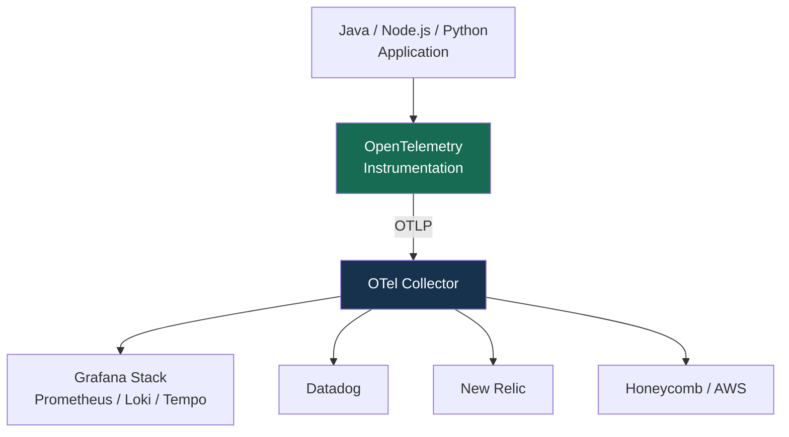

你可以使用相同的 OpenTelemetry Instrumentation，再透過 Collector 配置，將 Telemetry 發送到不同平台，甚至同時發送到多個平台進行比較。

結論：圖片中的工具都可以整合 OpenTelemetry，但它們的角色及支援訊號不同。OpenTelemetry 最大的價值，是讓 Application 不必直接依賴特定 Observability Vendor。

---

# OpenTelemetry APIs and SDKs — Node.js / TypeScript / Python / Java

## 1. OTel API vs OTel SDK

OpenTelemetry 建議將 **SDK Configuration** 與 **Business Instrumentation** 分離。

| Component | Responsibility | 使用時機 |
|---|---|---|
| **OTel API** | 定義及建立 Custom Spans、Metrics | Manual Instrumentation |
| **OTel SDK** | Recording、Processing、Sampling、Exporting | 自行配置或由 Agent 管理 |
| **Auto Instrumentation** | 自動追蹤 HTTP、Database、Framework Operations | 減少程式碼修改 |
| **OTel Collector** | Receive、Process、Export Telemetry | 集中管理 Telemetry Pipeline |

### 設計原則

- Application Business Code 只依賴 OTel API。
- SDK Configuration 獨立管理。
- SDK 必須在 Application / Framework Instrumentation 啟動前初始化。
- 使用 Java Agent 或其他 Auto Instrumentation 初始化 SDK 時，不應重複初始化。
- Manual Spans 應正確管理 Active Context、Exceptions 和 Span Lifecycle。

## 2. 建議架構

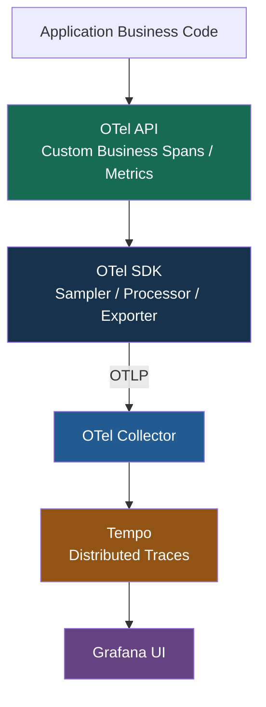

## 3. Mode 1 — Manual SDK Configuration

此模式由 Application 自行初始化 OTel SDK，適合需要直接控制 TracerProvider、Processors、Samplers 和 Exporters 的情況。

### 3.1 Node.js / TypeScript

#### A. `instrumentation.ts` — SDK Configuration

```typescript
import { NodeSDK } from '@opentelemetry/sdk-node';
import { OTLPTraceExporter } from '@opentelemetry/exporter-trace-otlp-http';

const sdk = new NodeSDK({
  traceExporter: new OTLPTraceExporter({
    url: 'http://otel-collector:4318/v1/traces'
  }),
  serviceName: 'translator-api'
});

sdk.start();
```

這段程式負責初始化 SDK、配置 Service Name 及 OTLP Trace Exporter。

#### B. `app.ts` — OTel API Manual Instrumentation

```typescript
import { trace, SpanStatusCode } from '@opentelemetry/api';

const tracer = trace.getTracer('translator');

app.post('/', async (req, res) => {
  return tracer.startActiveSpan(
    'translate_content',
    async (span) => {
      try {
        const result = await translateContent(req.body);

        res.json({ result });
      } catch (error) {
        span.recordException(
          error instanceof Error ? error : String(error)
        );

        span.setStatus({
          code: SpanStatusCode.ERROR
        });

        res.status(500).json({
          error: 'Translation failed'
        });
      } finally {
        span.end();
      }
    }
  );
});
```

`translateContent()` 代表 Application 已有的業務函式。

**重點：**

- `startActiveSpan()` 建立並啟用 Span Context。
- 後續支援 Context Propagation 的非同步操作可以繼承 Active Span。
- `recordException()` 記錄 Exception。
- `setStatus()` 標記 Span Error。
- `span.end()` 結束 Span。

**注意：** Node.js 應配置適當的 Async Context Manager，並在載入 Express / HTTP Instrumentation 之前初始化 SDK。若要讓 HTTP Server Spans 自動建立，還需另外配置 Auto Instrumentation。

### 3.2 Python

#### A. `instrumentation.py` — SDK Configuration

```python
from opentelemetry import trace
from opentelemetry.sdk.resources import Resource
from opentelemetry.sdk.trace import TracerProvider
from opentelemetry.sdk.trace.export import BatchSpanProcessor
from opentelemetry.exporter.otlp.proto.http.trace_exporter import OTLPSpanExporter

provider = TracerProvider(
    resource=Resource.create({
        "service.name": "payment-service"
    })
)

exporter = OTLPSpanExporter(
    endpoint="http://localhost:4318/v1/traces"
)

provider.add_span_processor(
    BatchSpanProcessor(exporter)
)

trace.set_tracer_provider(provider)
```

這段程式負責配置 TracerProvider、Resource Attributes、BatchSpanProcessor 和 OTLP Exporter。

#### B. `payment_service.py` — OTel API Manual Instrumentation

```python
from opentelemetry import trace

tracer = trace.get_tracer("payment-service")

def process_payment():
    with tracer.start_as_current_span("process-payment"):

        with tracer.start_as_current_span("validate-payment"):
            validate_payment()

        with tracer.start_as_current_span("check-balance"):
            check_account_balance()

        with tracer.start_as_current_span("execute-payment"):
            execute_payment()
```

以上三個函式代表既有的 Business Logic。

**重點：**

- `start_as_current_span()` 建立並啟用 Span。
- Nested Context Managers 自動建立 Parent-Child Relationships。
- 離開 `with` Block 時自動結束 Span。
- 未處理的 Exceptions 預設可由此 Context Manager 記錄並標記 Error。

### 3.3 Java

#### A. `OtelConfiguration.java` — SDK Configuration

```java
import io.opentelemetry.api.common.Attributes;
import io.opentelemetry.api.common.AttributeKey;
import io.opentelemetry.sdk.OpenTelemetrySdk;
import io.opentelemetry.sdk.resources.Resource;
import io.opentelemetry.sdk.trace.SdkTracerProvider;
import io.opentelemetry.sdk.trace.export.BatchSpanProcessor;
import io.opentelemetry.exporter.otlp.trace.OtlpHttpSpanExporter;

public class OtelConfiguration {

    public static void initialize() {

        Resource resource = Resource.getDefault().merge(
            Resource.create(Attributes.of(
                AttributeKey.stringKey("service.name"),
                "payment-service"
            ))
        );

        OtlpHttpSpanExporter exporter =
            OtlpHttpSpanExporter.builder()
                .setEndpoint(
                    "http://localhost:4318/v1/traces"
                )
                .build();

        SdkTracerProvider provider =
            SdkTracerProvider.builder()
                .setResource(resource)
                .addSpanProcessor(
                    BatchSpanProcessor.builder(exporter).build()
                )
                .build();

        OpenTelemetrySdk sdk = OpenTelemetrySdk.builder()
            .setTracerProvider(provider)
            .buildAndRegisterGlobal();

        Runtime.getRuntime().addShutdownHook(
            new Thread(sdk::close)
        );
    }
}
```

這段程式負責初始化 SDK，設定 Service Name、BatchSpanProcessor 和 OTLP Exporter。

#### B. `PaymentService.java` — OTel API Manual Instrumentation

```java
import io.opentelemetry.api.GlobalOpenTelemetry;
import io.opentelemetry.api.trace.Tracer;
import io.opentelemetry.api.trace.Span;
import io.opentelemetry.api.trace.StatusCode;
import io.opentelemetry.context.Scope;

public class PaymentService {

    private static final Tracer tracer =
        GlobalOpenTelemetry.getTracer("payment-service");

    public void processPayment() {

        Span span = tracer.spanBuilder("process-payment")
            .startSpan();

        try (Scope scope = span.makeCurrent()) {

            validatePayment();
            checkAccountBalance();
            executePayment();

        } catch (RuntimeException e) {
            span.recordException(e);
            span.setStatus(StatusCode.ERROR);
            throw e;
        } finally {
            span.end();
        }
    }

    private void validatePayment() {
        Span span = tracer.spanBuilder("validate-payment")
            .startSpan();

        try (Scope scope = span.makeCurrent()) {
            // Existing validation logic
        } catch (RuntimeException e) {
            span.recordException(e);
            span.setStatus(StatusCode.ERROR);
            throw e;
        } finally {
            span.end();
        }
    }

    private void checkAccountBalance() {
        Span span = tracer.spanBuilder("check-account-balance")
            .startSpan();

        try (Scope scope = span.makeCurrent()) {
            // Existing balance-checking logic
        } catch (RuntimeException e) {
            span.recordException(e);
            span.setStatus(StatusCode.ERROR);
            throw e;
        } finally {
            span.end();
        }
    }

    private void executePayment() {
        Span span = tracer.spanBuilder("execute-payment")
            .startSpan();

        try (Scope scope = span.makeCurrent()) {
            // Existing payment execution logic
        } catch (RuntimeException e) {
            span.recordException(e);
            span.setStatus(StatusCode.ERROR);
            throw e;
        } finally {
            span.end();
        }
    }
}
```

**重點：**

- `spanBuilder().startSpan()` 建立 Span。
- `span.makeCurrent()` 將 Span 設為 Active Context。
- `Scope` 管理 Context Lifecycle。
- `recordException()` 記錄 Exception。
- `setStatus(StatusCode.ERROR)` 標記錯誤。
- `span.end()` 結束 Span。

在實際 Java Application 中，應於 Spring Boot 或其他 Framework 啟動前完成 SDK Initialization。

## 4. Mode 2 — Agent-managed SDK（推薦）

使用 Agent / Auto Instrumentation 管理 SDK，Application Business Code 仍可透過 OTel API 建立 Custom Spans。

### Node.js / TypeScript

```bash
node --require ./instrumentation.js app.js
```

此例使用已編譯並配置 Auto Instrumentation 的初始化程式。若希望完全使用 OTel 的標準自動埋點，亦可採用 `@opentelemetry/auto-instrumentations-node` 的啟動方式。

### Python

```bash
opentelemetry-instrument \
  --service_name payment-service \
  python payment_service.py
```

### Java

```bash
java \
  -javaagent:/opt/otel/opentelemetry-javaagent.jar \
  -Dotel.service.name=payment-service \
  -Dotel.exporter.otlp.endpoint=http://otel-collector:4318 \
  -Dotel.exporter.otlp.protocol=http/protobuf \
  -jar payment-service.jar
```

### Mode 1 vs Mode 2

| Comparison | Mode 1 — Manual SDK | Mode 2 — Agent-managed SDK |
|---|---|---|
| SDK Initialization | Application 自行配置 | Agent / Bootstrap 管理 |
| Automatic HTTP Tracing | 需要額外 Instrumentation | ✅ 支援的 Framework 自動追蹤 |
| Automatic DB Tracing | 需要額外 Instrumentation | ✅ 支援的 DB Libraries 自動追蹤 |
| Custom Business Spans | OTel API | OTel API |
| Sampling | Application Configuration | Agent / Environment Configuration |
| OTLP Export | Application Configuration | Agent / Environment Configuration |
| Maintenance | 較多 | 通常較少 |
| 建議用途 | 特殊整合需求 | Production Microservices 優先 |

> 不要在同一個 Application 中同時建立兩套互相衝突的 Global SDK Configuration。

## 5. Payment Processing — Trace Structure

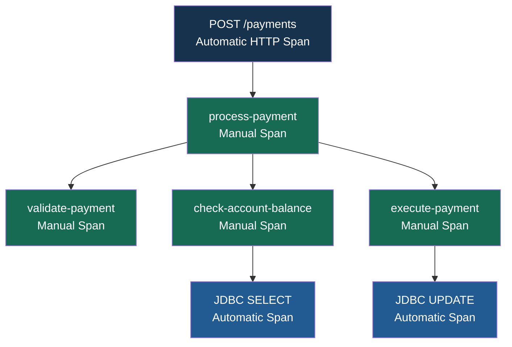

此圖假設 HTTP Server Span 由 Auto Instrumentation 建立，而 Business Spans 透過 OTel API 手動建立。

## 6. 最終建議

對 Java / Python / Node.js Banking Microservices：

| Layer | Recommended Approach |
|---|---|
| HTTP / REST APIs | Automatic Instrumentation |
| Database / JDBC | Automatic Instrumentation |
| Service-to-Service Calls | Automatic Instrumentation |
| Payment Validation | Manual OTel API |
| Account Balance Checking | Manual OTel API |
| LC Issuance | Manual OTel API |
| Settlement Processing | Manual OTel API |
| Sampling / Processing / Export | Agent-managed OTel SDK |
| Central Telemetry Pipeline | OpenTelemetry Collector |
| Trace Storage / Analysis | Tempo + Grafana |

**核心原則：**

- **Automatic Instrumentation**：追蹤技術層面操作。
- **OTel API**：追蹤重要 Business Operations。
- **OTel SDK**：管理 Telemetry Recording、Sampling、Processing 和 Export。
- **OTel Collector**：接收、處理及轉送 Telemetry。
- **Grafana Tempo**：儲存、查詢及視覺化 Distributed Traces。

**總結：Application Business Code → OTel API → Agent-managed SDK → OTel Collector → Tempo → Grafana。**

---


---
# What Is OpenTelemetry?（甚麼是 OpenTelemetry？）

OpenTelemetry（OTel）是一套開源、Vendor-neutral（廠商中立）的 Observability Framework and Toolkit（可觀測性框架與工具集），用來產生、收集及管理三種 Telemetry Data：

- Metrics：系統指標
- Logs：系統日誌
- Traces：分散式追蹤

圖片主要說明 OpenTelemetry 的三大核心優勢：Vendor Neutrality、Industry Standardization、Rich Ecosystem。

## 1. OpenTelemetry 的三大優勢

### OpenTelemetry — Three Key Benefits

| Benefit | 中文名稱 | 核心價值 |
|---|---|---|
| **Vendor Neutrality** | **廠商中立性** | 使用 OpenTelemetry Instrumentation，降低對特定 Observability Backend 的依賴 |
| **Industry Standardization** | **產業標準**化 | Prometheus、Grafana、Datadog、New Relic 等主流平台均支援 OTel 整合 |
| **Rich Ecosystem** | 豐富的技術生態系統 | 提供大量 Automatic Instrumentation Libraries，減少開發人員手動埋點的工作 |

### 1.1 Vendor Neutrality（廠商中立）

**Instrument Once, Export to Multiple Backends.**

- 使用 OpenTelemetry API / SDK 進行標準化 Instrumentation。
- 可以更換 Observability Backend，而不必大量修改 Application Code。
- 可以同時將 Telemetry 傳送到不同平台進行比較。
- 降低 Vendor Lock-in（廠商綁定）風險。

### 1.2 Industry Standardization（產業標準化）

OpenTelemetry 已被主流 Observability 平台廣泛支援。

例如：

- Prometheus：Metrics
- Loki：Logs
- Tempo：Traces
- Datadog：Metrics / Logs / Traces
- New Relic：Metrics / Logs / Traces

透過標準化的 OTel API、SDK、OTLP 和 Semantic Conventions，讓不同程式語言及 Observability Backends 更容易整合。

### 1.3 Rich Ecosystem（豐富的技術生態）

OpenTelemetry 提供大量 Automatic Instrumentation Libraries。

| Technology | Instrumentation |
|---|---|
| Java / Spring Boot | OpenTelemetry Java Agent |
| Node.js / Express | OTel Auto Instrumentation |
| Python / FastAPI | OTel Auto Instrumentation |
| HTTP Requests | Automatic Tracing |
| JDBC / Database | Automatic Tracing |
| Custom Business Logic | Manual Instrumentation — OTel API |

**核心原則：** Automatic Instrumentation 處理常見技術操作，Manual Instrumentation 補充重要 Business Operations。

## 2. Mermaid — OpenTelemetry 三大優勢

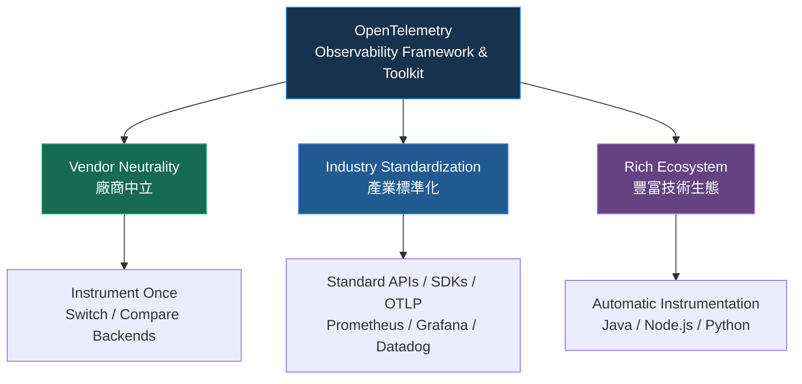

## 3. 實際價值：避免 Vendor Lock-in

假設目前使用 Grafana Stack，未來希望評估 Datadog 或 New Relic：

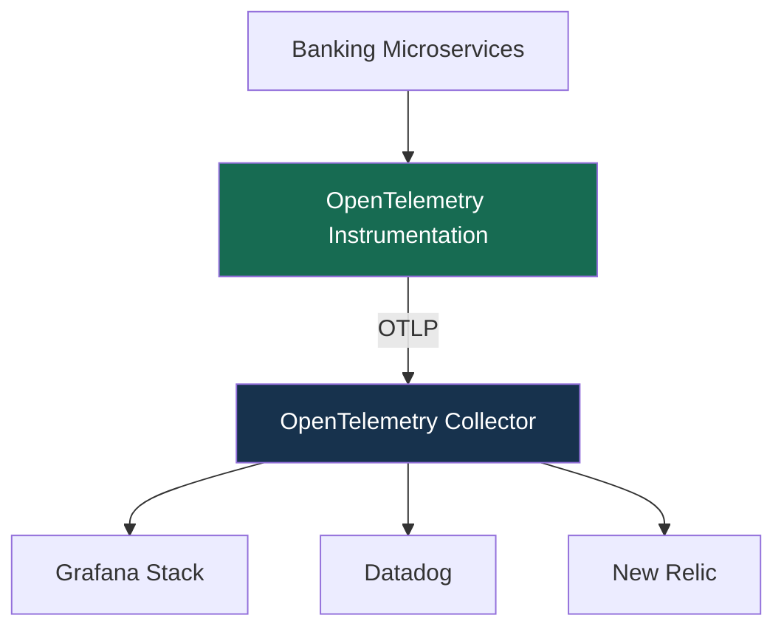

只需要調整 Collector 的 Exporter 和相關配置，就可以將 Telemetry 傳送到其他支援的平台，而不必重新替每個 Microservice 加入 Vendor-specific Instrumentation。

不過，各平台的 Dashboard、Alert Rules、資料模型及部分功能仍可能需要調整。

## 4. 核心總結

| OpenTelemetry Benefit    | 最簡單的理解                             |
| ------------------------ | ---------------------------------- |
| Vendor Neutrality        | 不被特定 Observability Vendor 綁定       |
| Industry Standardization | 統一 Telemetry 標準與整合方式               |
| Rich Ecosystem           | 使用現成的 Auto Instrumentation，減少程式碼修改 |

一句話總結：OpenTelemetry 最大的價值，是讓 Application 使用一套標準化 Instrumentation，便能靈活整合不同 Observability Backends，同時降低開發及維護成本。

---
# OpenTelemetry SDKs — 核心配置

> 當你在 Application 中配置 OpenTelemetry SDK 時，主要需要決定四件事情：

Exporters、Processors、Samplers、Resource Attributes。

## 1. SDK 四大核心配置

| Component           | 核心問題                    | 主要用途               | 範例                                 |
| ------------------- | ----------------------- | ------------------ | ---------------------------------- |
| Exporters           | Where to send?          | 決定 Telemetry 傳送到哪裡 | OTLP Collector、Console             |
| Processors          | How to process?         | 決定 Telemetry 如何處理  | Batch Processing、Simple Processing |
| Samplers            | What to record?         | 決定哪些 Traces 被採樣    | 100%、10% Sampling                  |
| Resource Attributes | Who generated the data? | 標識 Telemetry 的來源   | Service Name、Version、Environment   |

## 2. Exporters（資料匯出）

決定 Telemetry Data 要傳送到哪裡。

例如：

- OTLP Exporter：傳送至 OpenTelemetry Collector。
- Console Exporter：輸出到 Console，方便開發測試。
- Prometheus Exporter：將 Metrics 暴露給 Prometheus 抓取（依語言與 SDK 支援）。

範例：

```conf
OTEL_EXPORTER_OTLP_ENDPOINT=http://otel-collector:4318
OTEL_EXPORTER_OTLP_PROTOCOL=http/protobuf
```

## 3. Processors（資料處理）

決定如何處理 Telemetry Data。

例如：

| Processor           | 用途                             |
| ------------------- | ------------------------------ |
| BatchSpanProcessor  | 批次匯出 Spans，減少傳輸負擔              |
| SimpleSpanProcessor | Span 結束時立即交給 Exporter，適合簡單開發測試 |

注意：Sampling 通常由 SDK 的 Sampler 決定；加入或過濾 Attributes 則可在 Instrumentation 或 Collector Processor 中處理。SDK Processor 與 Collector Processor 並不完全相同。

## 4. Samplers（追蹤採樣）

決定哪些 Traces 要被記錄。

| Environment | Sampling Rate（示例） |
| ----------- | ----------------- |
| Development | 100%              |
| UAT         | 50%               |
| Production  | 10%               |

例如：

```conf
OTEL_TRACES_SAMPLER=parentbased_traceidratio
OTEL_TRACES_SAMPLER_ARG=0.1
```

這代表對沒有上游採樣決策的新 Root Traces，採用約 10% 的機率進行採樣，並尊重上游 Parent Trace 的採樣決策。

Production 的比例應根據流量、成本及故障分析需求調整，不一定固定為 10%。

## 5. Resource Attributes（資源屬性）

決定每一筆 Telemetry Data 屬於哪個 Application / Service。

例如：

```conf
OTEL_SERVICE_NAME=payment-service
OTEL_RESOURCE_ATTRIBUTES=service.version=1.2.0,deployment.environment.name=production
```

在 Grafana Tempo 中，你便可以根據：

- `service.name`
- `service.version`
- `deployment.environment.name`

來查詢特定服務與環境的 Traces。

## 6. SDK Configuration 架構

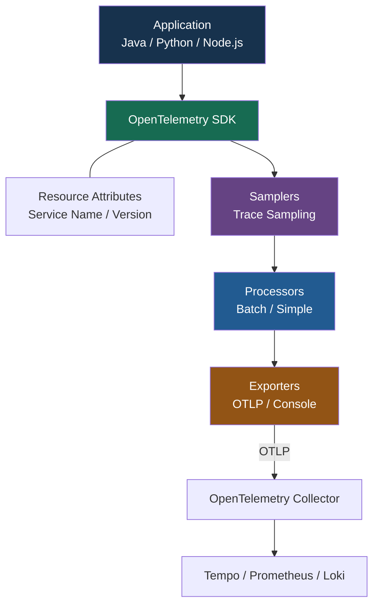

此圖以 Trace Pipeline 為主要例子。Resource Attributes 是附加於 Telemetry 的來源資訊，不是實際依序執行的處理階段。

## 7. Java Agent 可以自動管理這些配置嗎？

✅ 可以。 若你使用 OpenTelemetry Java Agent，通常不必在 Application Business Code 中自行初始化 SDK。

例如 Kubernetes Deployment：

```yaml
env:
  - name: OTEL_SERVICE_NAME
    value: payment-service

  - name: OTEL_EXPORTER_OTLP_ENDPOINT
    value: http://otel-collector.observability.svc.cluster.local:4318

  - name: OTEL_EXPORTER_OTLP_PROTOCOL
    value: http/protobuf

  - name: OTEL_TRACES_SAMPLER
    value: parentbased_traceidratio

  - name: OTEL_TRACES_SAMPLER_ARG
    value: "0.1"

  - name: OTEL_RESOURCE_ATTRIBUTES
    value: service.version=1.2.0,deployment.environment.name=production

```

前提是 Java Agent 已正確附加至 JVM，並且 Collector Endpoint 可以連線。

這些配置可以由 DevOps / Platform Team 統一管理，而 Java Developer 只需要使用 OTel API 加入重要的 Business Spans。

### 核心總結

OTel SDK Configuration = Exporters + Processors + Samplers + Resource Attributes

- Exporters：資料送去哪裡？
- Processors：資料如何處理？
- Samplers：哪些 Traces 要記錄？
- Resource Attributes：資料由哪個服務產生？

對你的銀行 Microservices 架構，建議 OTel SDK 由 Java Agent 管理，配置由 Platform Team 控制，OTel API 用於 Custom Business Instrumentation。

如此便可將 Application Business Logic 與 Observability Infrastructure 分離，降低長期維護成本。

---
# OpenTelemetry Instrumentation（監控埋點）

Understand the Differences Between Automatic and Manual Instrumentation（了解自動與手動監控埋點的差異）

OpenTelemetry 的兩種 Instrumentation 方式，以及為甚麼在實際 **Microservices** 專案中，應該結合 **Automatic + Manual** Instrumentation。

## 1. Automatic vs Manual Instrumentation

| 比較項目                  | Automatic Instrumentation                        | Manual Instrumentation |
| --------------------- | ------------------------------------------------ | ---------------------- |
| 中文名稱                  | 自動監控埋點                                           | 手動監控埋點                 |
| 程式碼修改                 | 通常不需要                                            | 需要                     |
| 主要目的                  | 自動監控 Framework、Libraries                         | 監控**自訂 Business Logic**    |
| 技術方式                  | Java Agent、Python / Node.js Auto Instrumentation | **OTel API**               |
| HTTP Tracing          | ✅                                                | ✅                      |
| Database Tracing      | ✅                                                | ✅                      |
| Custom Business Spans | 不會自動理解業務含義                                       | ✅                      |
| Custom Metrics        | 有限的自動支援                                          | ✅                      |
| Span Attributes       | 自動產生標準 Attributes                                | 自行加入業務 Attributes      |
| 建議使用方式                | 優先使用                                             | 補充重要業務操作               |

## 2. Automatic Instrumentation（自動埋點）

OpenTelemetry 提供常見 Framework 和 Libraries 的 Instrumentation，不需要開發人員自行編寫追蹤程式碼。

例如：

- Node.js / Express
- Python / FastAPI / Flask
- Java / Spring Boot
- JDBC / Database
- Redis
- HTTP Client / Server

### Redis 自動追蹤範例

圖片中的 Automatic Span：

```yaml
Span: BLPOP translation:jobs
  db.system: redis
  db.operation: BLPOP
```

圖片使用簡化的 Redis Attributes 示意，實際產生的欄位會依 OTel Semantic Conventions 與 Instrumentation 版本而不同。

Auto Instrumentation 可以知道：

- 呼叫了 Redis。
- 執行 `BLPOP` 操作。
- 操作執行時間。
- 是否發生相關錯誤。

但是，Auto Instrumentation 不一定知道這個 Redis 操作屬於「翻譯工作處理」的業務流程。

## 3. Manual Instrumentation（手動埋點）

Manual Instrumentation 是使用 OTel API，手動建立 Custom Spans、加入 Attributes 或記錄 Custom Metrics。

### 翻譯業務的 Manual Span

```yaml
Span: process_translation_job
  translation.job_id: abc-123
  translation.target_language: es
  translation.status: success
```

這些 Attributes 用來描述業務操作，而不只是技術呼叫。

| Attribute                     | Description         |
| ----------------------------- | ------------------- |
| `translation.job_id`          | Translation Job 識別碼 |
| `translation.target_language` | 翻譯目標語言              |
| `translation.status`          | 業務處理狀態              |

注意：`translation.job_id` 這類高基數識別碼可以用於 Traces，但不應直接作為一般 Prometheus Metric Label。敏感資料也應避免寫入 Telemetry。

### 實際運作流程

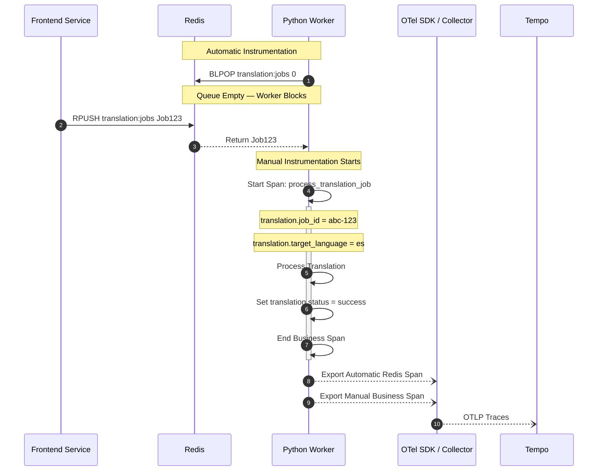
## 4. Automatic + Manual Instrumentation 整合

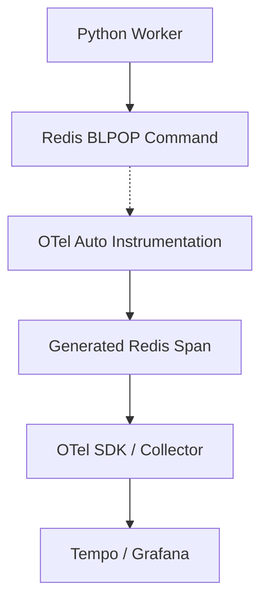

藍色代表 Automatic Instrumentation，綠色代表 Manual Instrumentation。實際 Parent-Child 關係依程式執行流程與 Context Propagation 而定。

## 5. Java Example — Manual Business Span

假設 Spring Boot 已使用 OpenTelemetry Java Agent，自動產生 HTTP 和 JDBC Spans。

開發人員只需要為重要業務流程補充 OTel API：

```java

import io.opentelemetry.api.GlobalOpenTelemetry;
import io.opentelemetry.api.trace.Span;
import io.opentelemetry.api.trace.StatusCode;
import io.opentelemetry.api.trace.Tracer;
import io.opentelemetry.context.Scope;

public class ImageService {

    private static final Tracer tracer =
        GlobalOpenTelemetry.getTracer("image-service");

    public void uploadArticleImages() {

        Span span = tracer
            .spanBuilder("upload_article_images")
            .startSpan();

        try (Scope scope = span.makeCurrent()) {

            validateImages();
            saveImageMetadata();
            uploadToStorage();

        } catch (RuntimeException e) {
            span.recordException(e);
            span.setStatus(StatusCode.ERROR);
            throw e;

        } finally {
            span.end();
        }
    }

    // Existing business methods
}

```

在此例中：

- `upload_article_images` 是 Manual Span。
- HTTP Request Span 由 Java Agent 自動建立。
- JDBC / HTTP Client Spans 由 Java Agent 自動建立（前提是使用受支援的 Libraries）。
- OTel SDK、Sampling 和 Exporter 由 Java Agent 管理。

## 6. Which One to Use?（應該使用哪一種？）

圖片中的建議是：

Normally start with Auto Instrumentation, then extend with Manual Instrumentation for relevant Business Operations.

對銀行系統可採用以下方式：

| Banking Operation         | Instrumentation |
| ------------------------- | --------------- |
| `POST /payments`          | Automatic       |
| Validate Payment          | Manual          |
| Check Customer Balance    | Manual          |
| Execute Payment           | Manual          |
| JDBC SELECT / UPDATE      | Automatic       |
| Redis Queue Operations    | Automatic       |
| LC Application Validation | Manual          |
| LC Charges Calculation    | Manual          |
| LC Balance Reservation    | Manual          |

這樣在 Tempo 中，不只能看到 HTTP、SQL、Redis 的技術操作，也能看到 Payment、LC Issuance 等業務階段的執行時間。

## 7. 核心總結

| Technology           | Responsibility                          |
| -------------------- | --------------------------------------- |
| Auto Instrumentation | 自動追蹤 HTTP、Database、Redis 等技術操作          |
| OTel API             | 手動追蹤重要 Business Operations              |
| OTel SDK             | Recording、Sampling、Processing、Exporting |
| OTel Collector       | 接收、處理及轉送 Telemetry                      |
| Tempo + Grafana      | 儲存、查詢及視覺化 Distributed Traces            |

最重要的觀念：

- Automatic Instrumentation = What technical operations happened?
- Manual Instrumentation = What business operations were being performed?

因此，最適合 Java / Node.js / Python Microservices 的方式通常是：

Auto Instrumentation + Manual Business Spans + Agent-managed SDK + OpenTelemetry Collector + Tempo / Grafana。

---
# The OpenTelemetry Collector（OpenTelemetry 收集器）

Understand What the Collector Does and How It Works（了解 Collector 的功能與運作原理）

OpenTelemetry Collector 是一個 Vendor-agnostic Telemetry Pipeline（廠商中立的遙測資料管線），可以接收不同格式的 Metrics、Logs、Traces，進行處理後，再傳送至一個或多個 Observability Backends。

## 1. OpenTelemetry Collector 核心概念

| Component  | 中文說明   | 主要用途                                   |
| ---------- | ------ | -------------------------------------- |
| Receivers  | 接收器    | 接收 OTLP、Prometheus 等格式的 Telemetry      |
| Processors | 處理器    | Batch、Filter、Transform、Attributes      |
| Exporters  | 匯出器    | 將資料傳送至 Tempo、Loki、Prometheus 等 Backend |
| Extensions | 擴充功能   | Health Check、pprof、zPages 等            |
| Pipelines  | 資料處理管線 | 分別定義 Metrics、Logs、Traces 的處理流程         |

## 2. Collector 的運作架構

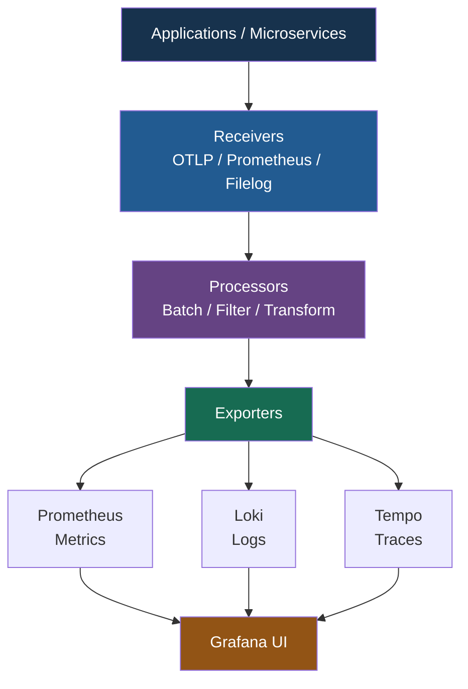

Collector 可以配置多條 Pipelines，例如：

| Pipeline | Receiver       | Processor      | Exporter            |
| -------- | -------------- | -------------- | ------------------- |
| Metrics  | OTLP           | Batch          | Prometheus Exporter |
| Logs     | OTLP / Filelog | Batch / Filter | OTLP HTTP → Loki    |
| Traces   | OTLP           | Batch          | OTLP → Tempo        |

注意：Collector 的實際支援元件取決於使用的發行版本，例如 Core 或 Contrib。Prometheus 也可以直接 Scrape Metrics，並不一定要透過 Collector。

## 3. Deployment Patterns（部署模式）

圖片介紹兩種主要部署方式。

### Agent Deployment

在每個 Host 或 Pod 附近部署 Collector，負責就近收集 Telemetry。

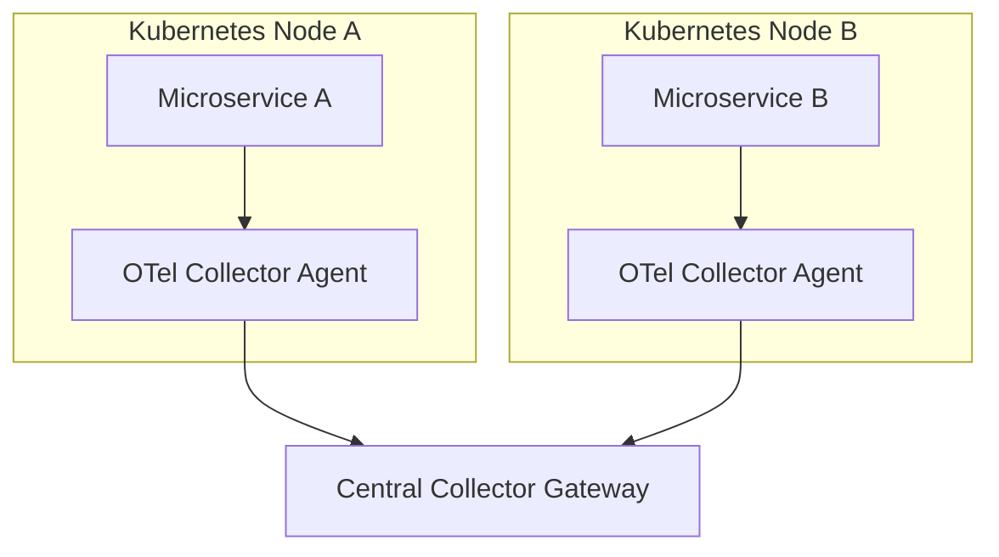

Agent 常見的部署方式包括 Kubernetes DaemonSet，或者與 Application 同一個 Pod 的 Sidecar。

### Gateway Deployment

將 Collector 作為集中式服務，讓多個 Applications 將 Telemetry 發送到同一個 Gateway。

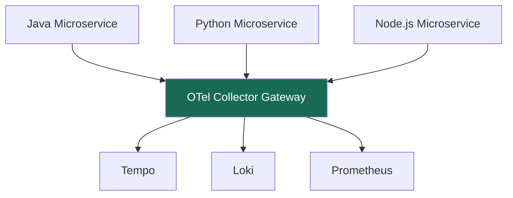

## 4. Agent vs Gateway Deployment

| 比較項目                 | Agent Deployment             | Gateway Deployment             |
| -------------------- | ---------------------------- | ------------------------------ |
| 部署位置                 | 每個 Node 或 Application Pod 附近 | 集中部署                           |
| Kubernetes 方式        | DaemonSet / Sidecar          | Deployment                     |
| Telemetry Collection | 就近收集 Logs、Metrics、Traces     | 集中接收及處理                        |
| 資源消耗                 | 分散於各節點                       | 集中於 Gateway                    |
| Scaling              | 跟隨 Node / Pod 數量             | 可獨立擴展 Replicas                 |
| 適用情境                 | Container Logs、Node Metrics  | 集中 Routing、Filtering、Export    |
| 建議                   | 基礎設施監控                       | Application Telemetry Pipeline |

## 5. Kubernetes + OpenTelemetry 推薦架構

對於你的 Kubernetes + Java / Node.js / Python Microservices，我建議採用 Agent + Gateway Hybrid Architecture。

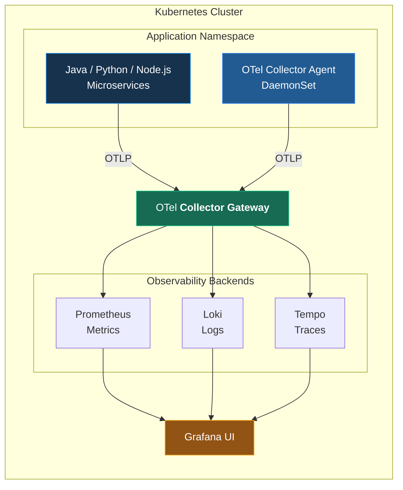

Application 的 Traces 可以直接送往 Gateway，而 Kubernetes Container Logs 可以由 Agent 收集。實際上 Agent 還需要配置對應的 Filelog、Kubernetes 或 Host Receivers。

## 6. OTel SDK vs OTel Collector

這是最容易混淆的地方。

| 比較項目             | OTel SDK                            | OTel Collector               |
| ---------------- | ----------------------------------- | ---------------------------- |
| 執行位置             | Application Process / Agent Runtime | 獨立 Process / Container       |
| 主要任務             | Instrumentation、Sampling、Export     | Receive、Process、Route、Export |
| Receivers        | 不屬於一般 SDK Pipeline                  | ✅                            |
| Processors       | Span / Log Processing               | Batch、Filter、Transform 等     |
| Exporters        | OTLP 等                              | OTLP、Prometheus 等            |
| Application Code | 可能需要配置                              | 通常不需要修改                      |
| 是否必要             | 視 Instrumentation 方式                | 可選，但 Production 常用           |

簡單理解：OTel SDK 負責應用程式內的 Telemetry；OTel Collector 負責應用程式外的 Telemetry Pipeline。

## 7. 核心總結

| Concept            | Responsibility                             |
| ------------------ | ------------------------------------------ |
| Receiver           | Where does telemetry come from?            |
| Processor          | How should telemetry be processed?         |
| Exporter           | Where should telemetry go?                 |
| Extension          | How to support Collector operations?       |
| Agent Deployment   | Collect telemetry close to the source      |
| Gateway Deployment | Centralize telemetry processing and export |

最重要的觀念：

Application / OTel SDK → Collector Receivers → Processors → Exporters → Observability Backends

對目前的 Docker Compose 學習環境，先部署單一 OTel Collector Gateway 即可，沒有必要一開始就採用 Agent + Gateway 雙層架構。

當未來轉移到 Kubernetes Production，並需要集中收集 Container Logs、Node Metrics 或管理大量 Microservices 時，再考慮使用 Agent + Gateway Hybrid Deployment。

---
# OpenTelemetry Collector — 為甚麼需要使用 Collector？

<https://opentelemetry.io/docs/collector/>

Understand What the Collector Does and How It Works（了解 Collector 的用途與運作原理）

OpenTelemetry Collector 是一套 Vendor-neutral Telemetry Pipeline（廠商中立的遙測資料管線），負責接收、處理及轉送 Metrics、Logs、Traces。

圖片主要介紹使用 OTel Collector 的 五大優勢與應用情境。

## 1. OpenTelemetry Collector 的五大優勢

| Benefit                                 | 中文說明                                          | 實際應用                                          |
| --------------------------------------- | --------------------------------------------- | --------------------------------------------- |
| Decouple Backends from Application Code | 將 Observability Backend 與 Application Code 解耦 | 更換 Tempo、Datadog 等 Backend，不需要修改業務程式碼         |
| Multiple Backend Export                 | 同時傳送 Telemetry 到多個 Backends                   | 同時使用內部 Grafana Stack 與外部 Observability Vendor |
| Centralized Sampling / Filtering        | 集中管理採樣與過濾規則                                   | 統一過濾不必要的 Traces、Logs、敏感資料                     |
| Legacy Migration                        | 支援舊系統逐步遷移                                     | 接收 Jaeger / Zipkin Traces，轉送至 OTLP Backend    |
| Transform / Enrich Data                 | 轉換及補充 Telemetry Attributes                    | 加入 Environment、Service Metadata，移除敏感資料        |

## 2. OpenTelemetry Collector — Why Use It?

OpenTelemetry Collector 是一套 Vendor-neutral Telemetry Pipeline，負責接收、處理及匯出 Metrics、Logs、Traces。

### 2.1 Five Key Benefits

| Benefit | Description | Example |
|---|---|---|
| **Backend Decoupling** | 將 Application Code 與 Observability Backend 分離 | 不修改 Application，即可更換 Collector Exporter |
| **Multiple Backends** | 同時將 Telemetry 發送至多個 Observability Platforms | Tempo + Datadog |
| **Centralized Sampling / Filtering** | 集中管理 Telemetry 採樣、過濾及傳送策略 | Tail Sampling、Filter Error Logs |
| **Legacy Migration** | 支援舊版 Tracing Protocol，協助逐步遷移 | Jaeger / Zipkin → OTLP |
| **Transform / Enrich** | 增加、修改或移除 Telemetry Attributes | 添加 Environment、遮罩敏感資料 |

### 核心觀念

- **Receive**：接收來自 Applications、Agents 的 Telemetry。
- **Process**：進行 Batch、Sampling、Filtering、Transformation。
- **Export**：將 Telemetry 傳送至一個或多個 Backends。

> Collector 並非必要元件，但對多個 Microservices、集中管理 Telemetry 及 Production Observability 特別有價值。


## 3. Collector 如何與 Application 解耦？

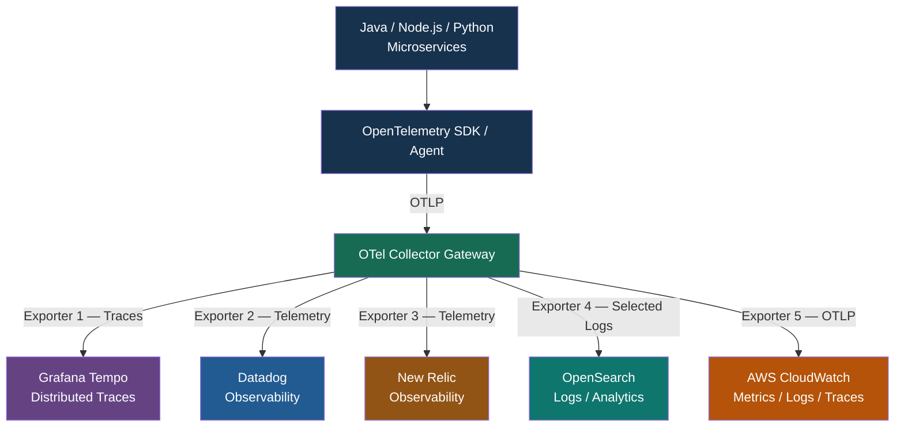

例如原本使用 Tempo，未來改為 Datadog，只需要調整 Collector Exporter 與相關設定，不必重新為每個 Microservice 加入 Datadog 專用 SDK。

> AWS CloudWatch OTel Integration, Amazon CloudWatch natively ingests OpenTelemetry metrics, logs, and traces.

## 4. Centralized Sampling / Filtering

Collector 可以集中控制 Telemetry Data 的處理。

| Processing    | Example                    | 用途                       |
| ------------- | -------------------------- | ------------------------ |
| Batch         | 將多個 Spans 批次匯出             | 減少傳輸開銷                   |
| Filter        | 排除不必要的 Health Check Traces | 降低資料量                    |
| Tail Sampling | 依完整 Trace 判斷是否保留           | 優先保留 Error / Slow Traces |
| Attributes    | 添加或移除 Attributes           | 統一 Metadata、保護敏感資訊       |
| Transform     | 修改 Telemetry Attributes    | 標準化欄位                    |

需要注意：Collector 的 Tail Sampling 通常要求同一 Trace 的 Spans 被路由至相同的 Collector Instance，並且有足夠記憶體及等待時間，以便做出採樣決策。

此外，Collector 的 Filtering 並不能取代 Application 端的敏感資料保護；最好在資料產生時就避免記錄密碼、Token、銀行帳號等敏感資訊。

## 5. 實際應用：你的 Banking Microservices

對於以下架構：

Angular / Vue → Traefik → Java / Node.js / Python Microservices → Database

可以使用：

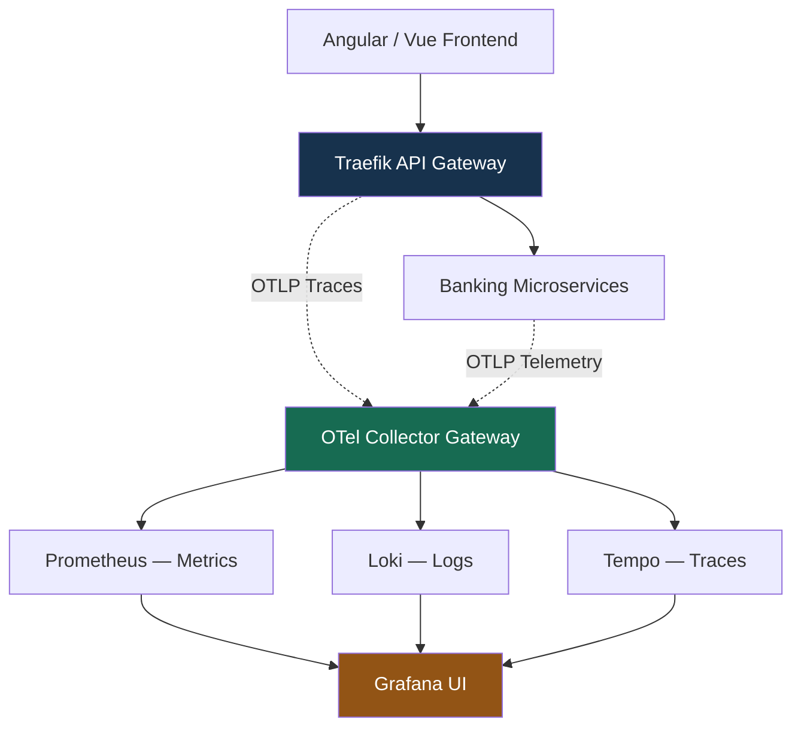

這是概念架構。實際上 Prometheus 可以透過 Scrape 收集 Metrics；Kubernetes Container Logs 需要另外配置 Log Collection；Grafana 是透過 Data Sources 查詢 Backends。

## 6. 是否一定要使用 Collector？

| 情境                          | Collector 是否必要？ | 建議               |
| --------------------------- | --------------- | ---------------- |
| 單一 Java Application → Tempo | ❌               | 可以直接 OTLP Export |
| 少量 Microservices            | ❌               | 視部署複雜度決定         |
| 多個 Microservices            | 非強制             | ✅ 推薦             |
| 多個 Observability Backends   | 非強制             | ✅ 強烈推薦           |
| 集中 Filtering / Sampling     | 通常需要集中處理層       | ✅ 推薦             |
| Kubernetes Production       | 非強制             | ✅ 推薦             |

### 核心結論

OpenTelemetry Collector 的最大價值，不只是收集資料，而是把 Application Instrumentation 與 Observability Backend 解耦。

你可以在 Collector 集中管理：

Receivers → Processors → Exporters

對目前的 Docker Compose / Kubernetes 學習環境，建議先使用 OTel Collector Gateway Deployment。當需要跨節點收集 Container Logs 或 Node Metrics 時，再加入 Agent（DaemonSet）形成 Hybrid Architecture。

---
# Semantic Conventions（語意命名規範）

- https://opentelemetry.io/docs/specs/semconv/

Standardized Naming Rules for Spans, Metrics, and Attributes（標準化 Spans、Metrics 與 Attributes 的命名規則）

OpenTelemetry Semantic Conventions 定義 Telemetry Data 的標準化命名、資料型別、語意與使用規範，涵蓋 Spans、Metrics、Logs、Events、Resource Attributes 等，使不同程式語言、Framework 和 Microservices 產生一致且可互通的 Observability Data。

例如，Java、Node.js、Python 和 Go 都可以使用相同的 HTTP Attributes，讓 Grafana 能統一查詢及比較不同服務的效能。

## 1. Semantic Conventions 的四大核心規範

| Convention           | 中文說明               | Example               |
| -------------------- | ------------------ | --------------------- |
| Span Names           | 定義 Span 應如何命名      | `GET /api/payments`   |
| Attribute Names      | 統一 Attribute 欄位名稱  | `http.request.method` |
| Attribute Values     | 定義允許的資料型別及數值       | `GET`、`POST`、`200`    |
| Required vs Optional | 定義必要與選用 Attributes | 依 HTTP、Database 等規範決定 |

### Attribute Names（欄位名稱）

不同團隊可能使用不同欄位名稱記錄相同資訊：

| Team    | 自訂欄位             | OTel Standard         |
| ------- | ---------------- | --------------------- |
| Node.js | `httpMethod`     | `http.request.method` |
| Python  | `request_method` | `http.request.method` |
| Go      | `method`         | `http.request.method` |

透過 Semantic Conventions，所有團隊都能使用相同名稱。

### Attribute Values（欄位值）

| Attribute                   | Type    | Example           |
| --------------------------- | ------- | ----------------- |
| `http.request.method`       | String  | `POST`            |
| `http.response.status_code` | Integer | `200`             |
| `http.route`                | String  | `/api/payments`   |
| `service.name`              | String  | `payment-service` |
| `db.system.name`            | String  | `postgresql`      |

注意：圖片中的 `db.name` 是較早期規範的示例。現代 OpenTelemetry Database Semantic Conventions 對資料庫名稱與系統類型有更明確的屬性定義，不能假設所有 Database 都使用同一個 `db.name` 欄位。

## 2. 不同程式語言使用相同的 Semantic Conventions

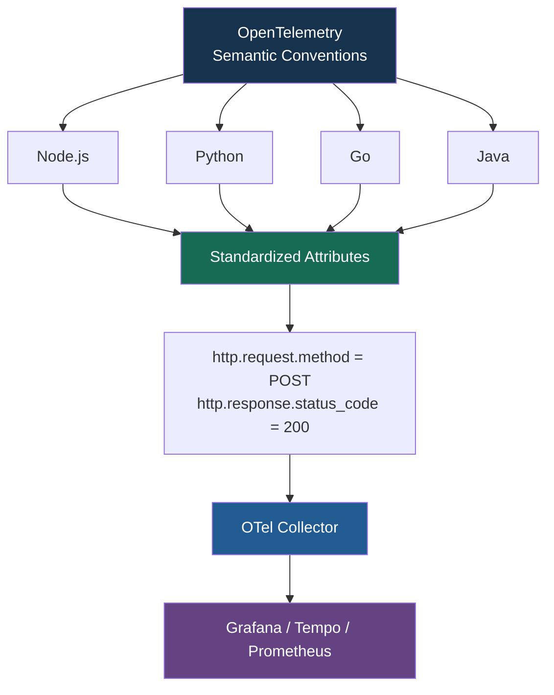

## 3. 實際例子：Payment API

假設有三個不同語言開發的 Payment Microservices：

```json

{
  "service.name": "payment-service",
  "http.request.method": "POST",
  "http.route": "/api/payments",
  "http.response.status_code": 200
}

```

不論是 Java、Python 或 Node.js，只要遵循相同的 Semantic Conventions，就可以使用一致的方式分析：

- HTTP Request Method
- HTTP Status Code
- API Route
- Service Name
- Response Latency
- Error Conditions

## 4. Semantic Conventions 與 Auto Instrumentation

Automatic Instrumentation 通常會自動產生符合 OpenTelemetry Semantic Conventions 的 Attributes。

例如 Java Agent 自動追蹤：

```yaml
Span: POST /api/payments

Attributes:
  http.request.method: POST
  http.route: /api/payments
  http.response.status_code: 200
```

開發人員也可以透過 Manual Instrumentation 加入自訂 Business Attributes：

```yaml
Span: validate-payment

Attributes:
  payment.type: outward
  payment.currency: USD
  payment.validation.status: success
```

其中 `payment.*` 是自訂 Business Attributes，不是 OpenTelemetry 官方標準的 Semantic Conventions。

## 5. 為甚麼 Semantic Conventions 很重要？

| Benefit             | 說明                             |
| ------------------- | ------------------------------ |
| Consistency         | 不同團隊使用一致的 Telemetry Naming     |
| Interoperability    | 不同 Framework、語言及 Backend 更容易整合 |
| Unified Queries     | Grafana 可以使用相同欄位查詢不同服務         |
| Reusable Dashboards | Dashboard 可以跨多個服務重複使用          |
| Reduced Maintenance | 降低資料轉換及自訂 Mapping 的維護工作        |

另外，Semantic Conventions 會隨 OpenTelemetry 規範持續演進，實際欄位名稱可能因 SDK / Instrumentation 版本與穩定性設定而不同。

## 6. 核心總結

- Semantic = What the data means（資料代表甚麼）
- Semantic Conventions = Standardized names, types and meanings（標準化名稱、型別與語意）

對你的銀行 Microservices 架構：

- Java / Node.js / Python → OpenTelemetry → Collector → Prometheus / Loki / Tempo → Grafana
- Semantic Conventions 可以確保不同團隊產生的 Telemetry 使用一致的資料語意。

> 最重要的觀念：OpenTelemetry API / SDK 負責產生和處理 Telemetry，而 Semantic Conventions 負責定義 Telemetry 應該如何標準化描述。

---

# OpenTelemetry Semantic Conventions — 使用標準 Constants

**官方文件：** https://opentelemetry.io/docs/specs/semconv/

OpenTelemetry Semantic Conventions 提供標準化的 Attribute Names、資料型別及語意，讓 Java、Node.js / TypeScript、Python 等不同語言使用一致的 Telemetry Naming。

**建議：使用 Semantic Convention Constants，而不是在 Application Code 中直接寫死標準 Attribute Names。**

## 1. 為甚麼使用 Semantic Convention Constants？

| Benefit | 中文說明 | 實際價值 |
|---|---|---|
| **Avoid Typos** | 避免 Attribute 名稱拼寫錯誤 | 減少手動輸入錯誤 |
| **Auto-completion** | IDE 自動補全 | 快速找到可用的標準 Attributes |
| **Maintainability** | 提高維護性 | 更容易識別及遷移已變更的規範 |
| **Self-documenting** | 提高程式碼可讀性 | 清楚表明正在使用 OTel 標準 |
| **Consistency** | 跨語言命名一致 | Java、Python、Node.js 使用相同語意 |

> 使用 Constants 並不代表 Semantic Conventions 更新後，程式碼一定會自動遷移。部分 Attribute Names、Values 或套件 API 變更仍需要開發人員調整。

## 2. Standard Attributes — 各語言範例

### 2.1 Node.js / TypeScript

```typescript
import {
  ATTR_HTTP_REQUEST_METHOD,
  ATTR_HTTP_RESPONSE_STATUS_CODE
} from '@opentelemetry/semantic-conventions';

span.setAttribute(
  ATTR_HTTP_REQUEST_METHOD,
  'GET'
);

span.setAttribute(
  ATTR_HTTP_RESPONSE_STATUS_CODE,
  200
);
```

Constants 對應：

| Constant | Attribute Name |
|---|---|
| `ATTR_HTTP_REQUEST_METHOD` | `http.request.method` |
| `ATTR_HTTP_RESPONSE_STATUS_CODE` | `http.response.status_code` |

### 2.2 Python

```python
from opentelemetry import trace
from opentelemetry.semconv.attributes.http_attributes import (
    HTTP_REQUEST_METHOD,
    HTTP_RESPONSE_STATUS_CODE,
)

tracer = trace.get_tracer("payment-service")

with tracer.start_as_current_span("GET /api/payments") as span:
    span.set_attribute(
        HTTP_REQUEST_METHOD,
        "GET"
    )

    span.set_attribute(
        HTTP_RESPONSE_STATUS_CODE,
        200
    )
```

需要安裝相容版本的 `opentelemetry-semantic-conventions`。

### 2.3 Java

```java
import static io.opentelemetry.semconv.HttpAttributes.HTTP_REQUEST_METHOD;
import static io.opentelemetry.semconv.HttpAttributes.HTTP_RESPONSE_STATUS_CODE;

span.setAttribute(
    HTTP_REQUEST_METHOD,
    "POST"
);

span.setAttribute(
    HTTP_RESPONSE_STATUS_CODE,
    200L
);
```

Java 使用 Typed Attribute Keys，因此 HTTP Status Code 使用 `Long` 數值。

**Java Dependency：**

```xml
<dependency>
    <groupId>io.opentelemetry.semconv</groupId>
    <artifactId>opentelemetry-semconv</artifactId>
    <version>${otel.semconv.version}</version>
</dependency>
```

> Java Semantic Conventions 的類別與套件版本可能變動。應使用已鎖定、相容的版本，並確認對應 Constants 存在。

### 2.4 跨語言的共同結果

無論使用 Java、Python 或 Node.js，產生的 Telemetry Attributes 都可以遵循相同標準：

```json
{
  "http.request.method": "POST",
  "http.response.status_code": 200
}
```

**核心觀念：不同程式語言使用不同的 Constants API，但最終的 Telemetry Attribute Names 與語意一致。**

## 3. Custom Business Attributes（自訂業務屬性）

OpenTelemetry 允許開發人員自行定義 Custom Attributes，用於記錄 Business Operations。

例如：

```typescript
span.setAttribute('payment.type', 'outward');
span.setAttribute('payment.currency', 'USD');
span.setAttribute('payment.validation.status', 'success');
```

這些 Attributes 不是 OpenTelemetry 官方 Semantic Conventions，而是 Application-specific Business Attributes。

### 3.1 建議集中管理 Banking Attribute Constants

#### TypeScript — `banking-attributes.ts`

```typescript
export const BANKING_ATTRIBUTES = {
  PAYMENT_TYPE: 'payment.type',
  PAYMENT_CURRENCY: 'payment.currency',
  PAYMENT_VALIDATION_STATUS: 'payment.validation.status',
  LC_ISSUANCE_STAGE: 'lc.issuance.stage'
} as const;
```

使用方式：

```typescript
span.setAttribute(
  BANKING_ATTRIBUTES.PAYMENT_TYPE,
  'outward'
);
```

#### Python — `banking_attributes.py`

```python
class BankingAttributes:
    PAYMENT_TYPE = "payment.type"
    PAYMENT_CURRENCY = "payment.currency"
    PAYMENT_VALIDATION_STATUS = "payment.validation.status"
    LC_ISSUANCE_STAGE = "lc.issuance.stage"
```

使用方式：

```python
span.set_attribute(
    BankingAttributes.PAYMENT_TYPE,
    "outward"
)
```

#### Java — `BankingAttributes.java`

```java
import io.opentelemetry.api.common.AttributeKey;

public final class BankingAttributes {

    private BankingAttributes() {}

    public static final AttributeKey<String> PAYMENT_TYPE =
        AttributeKey.stringKey("payment.type");

    public static final AttributeKey<String> PAYMENT_CURRENCY =
        AttributeKey.stringKey("payment.currency");

    public static final AttributeKey<String> PAYMENT_VALIDATION_STATUS =
        AttributeKey.stringKey("payment.validation.status");

    public static final AttributeKey<String> LC_ISSUANCE_STAGE =
        AttributeKey.stringKey("lc.issuance.stage");
}
```

使用方式：

```java
span.setAttribute(
    BankingAttributes.PAYMENT_TYPE,
    "outward"
);
```

### 3.2 Standard vs Custom Attributes

| Type | Attribute | Source |
|---|---|---|
| **Standard** | `http.request.method` | OpenTelemetry Semantic Conventions |
| **Standard** | `http.response.status_code` | OpenTelemetry Semantic Conventions |
| **Standard** | `service.name` | OpenTelemetry Semantic Conventions |
| **Custom** | `payment.type` | Banking Application |
| **Custom** | `payment.currency` | Banking Application |
| **Custom** | `payment.validation.status` | Banking Application |
| **Custom** | `lc.issuance.stage` | Trade Finance Application |

## 4. Resource Attributes vs Span Attributes

這兩種類型的 Attributes 作用不同，應分開管理。

| Attribute Type | Description | Example |
|---|---|---|
| **Resource Attributes** | 識別產生 Telemetry 的 Service / Process / Environment | `service.name` |
| **Standard Span Attributes** | 描述特定技術操作 | `http.request.method` |
| **Custom Span Attributes** | 描述特定業務操作 | `payment.validation.status` |

### 4.1 Resource Attributes

Resource Attributes 用來描述 Telemetry 的來源，例如：

```text
service.name = payment-service
service.version = 1.2.0
deployment.environment.name = production
```

建議由 OTel SDK / Agent 統一配置：

```bash
OTEL_SERVICE_NAME=payment-service
OTEL_RESOURCE_ATTRIBUTES=service.version=1.2.0,deployment.environment.name=production
```

這些設定通常不需要在每個 Span 中重複加入。

### 4.2 Span Attributes

Span Attributes 描述個別 Operation。

例如：

```text
Span: POST /api/payments

  http.request.method = POST
  http.route = /api/payments
  http.response.status_code = 200
```

Custom Business Span：

```text
Span: validate-payment

  payment.type = outward
  payment.currency = USD
  payment.validation.status = success
```

以上為易讀的 Telemetry 示意，不是 Configuration File。

## 5. Semantic Conventions 與 Auto Instrumentation

Automatic Instrumentation 通常會自動建立符合其支援版本之 Semantic Conventions 的 Attributes。

例如 Java Agent 可以自動記錄：

- HTTP Request Method
- HTTP Route
- HTTP Response Status Code
- Database Operation
- HTTP Client Calls

因此：

**Automatic Instrumentation：**

通常不需要手動重新設定已經存在的標準 Attributes。

**Manual Instrumentation：**

優先使用官方 Semantic Convention Constants，並補充必要的 Custom Business Attributes。

## 6. 建議的 Attribute Management Architecture

```mermaid
flowchart TB
    A["Application Instrumentation"]

    A --> B["Standard Attributes"]
    A --> C["Custom Business Attributes"]
    A --> D["Resource Attributes"]

    B --> E["OpenTelemetry<br/>Semantic Convention Constants"]
    C --> F["Banking Attribute Constants"]
    D --> G["SDK / Agent Configuration"]

    E --> H["OTel SDK / Agent"]
    F --> H
    G --> H

    H --> I["OpenTelemetry Collector"]
    I --> J["Prometheus / Loki / Tempo"]
    J --> K["Grafana UI"]

    style A fill:#17324D,color:#fff
    style E fill:#225B91,color:#fff
    style F fill:#176B52,color:#fff
    style G fill:#654383,color:#fff
    style I fill:#176B52,color:#fff
    style K fill:#925415,color:#fff
```

## 7. 建議的 Banking Microservices 開發規範

| Area | Recommended Practice |
|---|---|
| **HTTP / Database / Messaging** | 使用官方 OTel Semantic Conventions |
| **Payment / LC / Settlement** | 建立 Banking Custom Attribute Constants |
| **Service Name / Version / Environment** | 使用 Resource Attributes |
| **Automatic Instrumentation** | 優先使用 Agent / Framework Instrumentation |
| **Manual Instrumentation** | 補充重要 Business Spans / Metrics |
| **Sensitive Data** | 避免記錄 Account Number、PII、API Keys |
| **High Cardinality** | 避免將 Transaction ID、User ID 當成 Metrics Labels |
| **Version Management** | 統一管理 OTel API、SDK、Semantic Convention 套件版本 |

### 自訂 Banking Attribute 命名規則

建議採用：

`<domain>.<operation>.<attribute>`

例如：

| Domain | Custom Attribute |
|---|---|
| Payment | `payment.validation.status` |
| Payment | `payment.currency` |
| Trade Finance | `lc.issuance.stage` |
| Settlement | `settlement.processing.status` |
| SCF | `scf.invoice.validation.status` |

Custom Attributes 的名稱、型別、允許值、敏感性及用途，建議由團隊統一管理。

## 8. 核心總結

**Standard Attributes：** 使用 OpenTelemetry 官方 Semantic Convention Constants。

**Custom Business Attributes：** 由團隊制定並集中管理 Banking Constants。

**Resource Attributes：** 由 OTel SDK / Agent 配置，用來標識 Service、Version 和 Environment。

### 最終設計原則

**OTel Standard Constants + Banking Custom Constants + Resource Attributes 分層管理**

這樣可以確保 Java、Python、Node.js 等 Microservices 使用一致的 Telemetry Naming，同時降低跨團隊整合及 OpenTelemetry 版本升級的維護成本。

> 最重要的觀念：Semantic Conventions 負責統一 Telemetry 的名稱與意義；OTel API 負責建立 Telemetry；OTel SDK / Agent 負責處理及匯出 Telemetry。

---
