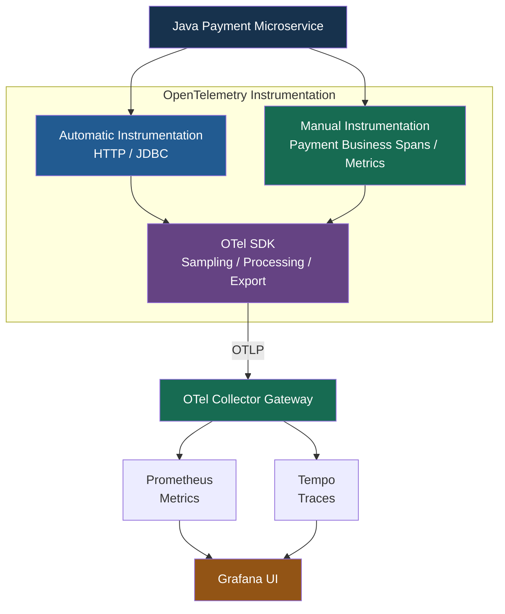
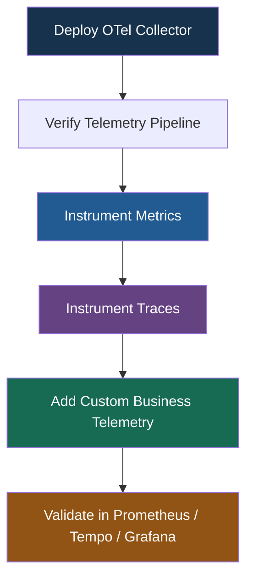
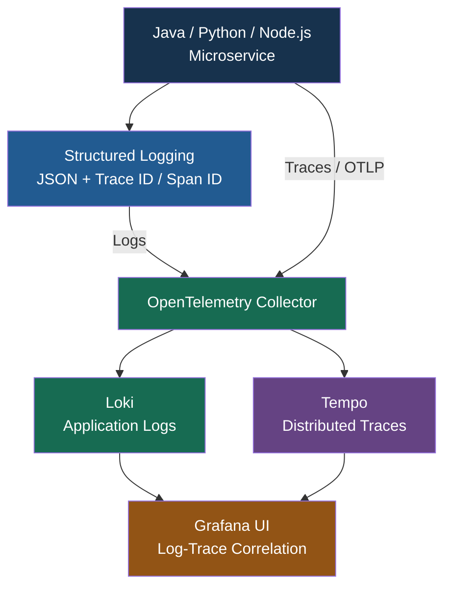

# Instrumenting Single Services（單一服務的監控埋點）

Section Overview（章節概覽）

這個章節主要介紹如何對單一 Application / Microservice 加入 OpenTelemetry Instrumentation，包括部署 OTel Collector、收集 Metrics，以及建立 Automatic / Manual Traces。

## 1. 三大學習主題

| Topic                                  | 中文名稱                       | 主要學習內容                                                              |
| -------------------------------------- | -------------------------- | ------------------------------------------------------------------- |
| Setting Up the OpenTelemetry Collector | 部署 OpenTelemetry Collector | 建立 Vendor-neutral Telemetry Pipeline，驗證資料流及 Collector 健康狀態          |
| Instrumenting Metrics                  | 指標監控埋點                     | Automatic Metrics、Custom Business Metrics、Labels                    |
| Instrumenting Traces                   | 分散式追蹤埋點                    | Automatic Spans、Custom Business Spans、Error Handling、Span Lifecycle |

## 2. Instrumenting Single Services（單一服務的監控埋點）Section Overview（章節概覽）

### 2.1. Setting Up the OpenTelemetry Collector

**部署 OpenTelemetry Collector**

1. 將 Collector 部署在 Application 與 Observability Backends 之間，作為 Vendor-neutral Telemetry Pipeline。
2. 驗證 End-to-End Telemetry Data Flow，並監控 Collector 自身的 Operational Health。

### 2.2 Instrumenting Metrics

**指標監控埋點**

1. 使用 Automatic Instrumentation 收集 Framework-level Metrics，並透過 Manual Instrumentation 建立 Custom Business Metrics。
2. 使用 Labels / Attributes 增加 Metrics 的分析維度，並透過 Prometheus 查詢。

### 2.3. Instrumenting Traces

**追蹤監控埋點**

1. 使用 Automatic Instrumentation 建立 Framework Spans，並為重要 Business Logic 建立 Custom Spans。
2. 管理 Span Lifecycle、Exception Handling，並將 Instrumentation Code 重構成容易維護的形式。

### 核心觀念

- **Collector**：集中接收、處理及轉送 Telemetry。
- **Metrics**：衡量系統效能、負載及重要業務指標。
- **Traces**：記錄服務內部操作及執行時間。
- **Automatic Instrumentation**：自動監控 HTTP、Database、Framework。
- **Manual Instrumentation**：監控 Custom Business Operations。

## 3. Single Service Instrumentation 架構

以下以 Java Payment Microservice 為例：



概念架構：Prometheus 可以抓取 Collector 暴露的 Metrics，或使用 OTLP Receiver；實際資料流取決於 Collector 配置。

## 4. Automatic vs Manual Instrumentation

| Operation                     | Instrumentation | Telemetry                          |
| ----------------------------- | --------------- | ---------------------------------- |
| `POST /payments`              | Automatic       | HTTP Server Span / Request Metrics |
| JDBC SQL Query                | Automatic       | Database Span                      |
| `validatePayment()`           | Manual          | Custom Business Span               |
| `checkAccountBalance()`       | Manual          | Custom Business Span               |
| `executePayment()`            | Manual          | Custom Business Span               |
| `payment_processed_total`     | Manual          | Custom Counter Metric              |
| `payment_processing_duration` | Manual          | Custom Histogram Metric            |

Manual Metrics 可以協助衡量業務處理量和時間，但應避免將 Transaction ID、Account Number 等高基數或敏感欄位加入 Metrics Labels。

## 5. Collector Health Monitoring

部署 Collector 後，除了確認 Application 的 Telemetry 能成功送達 Backend，也需要監控 Collector 本身。

| Monitoring Item        | 目的                          |
| ---------------------- | --------------------------- |
| Receiver Accepted Data | 確認 Collector 正在接收 Telemetry |
| Receiver Refused Data  | 偵測接收失敗或拒絕的資料                |
| Exporter Sent Data     | 確認資料成功匯出                    |
| Exporter Send Failures | 偵測 Backend 連線或匯出異常          |
| Exporter Queue Size    | 觀察資料是否開始堆積                  |
| Collector CPU / Memory | 監控資源使用情況                    |

這些指標可透過 Collector 的 Internal Telemetry Metrics 監控，實際 Metrics 名稱依 Collector 版本及配置而定。

## 6. 核心總結

這個章節的學習順序可以整理成：



最重要的觀念：

- Collector：確保 Telemetry 能正確接收、處理與匯出。
- Automatic Instrumentation：用較少程式碼取得 Framework / Technical Observability。
- Manual Instrumentation：加入重要的 Business Metrics、Business Spans 和 Context。
- Grafana Stack：驗證 Metrics 和 Traces 是否能正確查詢及關聯。

對你的 Java / Node.js / Python Banking Microservices，我建議先完成單一 Payment Service 的 Metrics + Traces，再逐步擴展至多個服務的 Distributed Tracing。

---
## 4. Instrumenting Logs（日誌監控埋點）

> Instrumenting Logs 主要介紹如何建立 Structured Logging（結構化日誌）、加入 Trace Context，以及透過 Grafana 關聯 Logs 和 Traces。

### 4.1 學習重點

1. **Structured Logging with Trace Context Injection**
   - 配置 Structured JSON Logging。
   - 自動注入 `trace_id`、`span_id` 等 Trace Context。
   - 加入 Manual Log Statements，記錄重要 Business Events。

2. **Log-Trace Correlation and Environment Configuration**
   - 在 Grafana 中建立 Loki Logs 與 Tempo Traces 的關聯。
   - 使用 Trace ID 從 Logs 導航至 Distributed Traces。
   - 透過 Environment Variables 管理 Logging Level、OTLP Endpoint 等設定。

### 核心觀念

- **Structured Logging**：使用 JSON 格式記錄 Logs，方便解析及查詢。
- **Trace Context Injection**：將 Trace ID / Span ID 加入 Logs。
- **Manual Logging**：記錄重要業務事件及錯誤資訊。
- **Log-Trace Correlation**：透過 Trace ID 關聯 Loki 和 Tempo。
- **Environment Configuration**：將 Logging / Telemetry 設定與 Business Code 分離。


### 4.2 實際例子：Payment Microservice

假設 Payment Service 產生以下 Structured Log：

```json

{
  "timestamp": "2026-10-23T10:00:00Z",
  "level": "ERROR",
  "service": "payment-service",
  "trace_id": "4bf92f3577b34da6a3ce929d0e0e4736",
  "span_id": "00f067aa0ba902b7",
  "message": "Payment processing failed",
  "error.type": "DATABASE_TIMEOUT"
}

```

透過 `trace_id`，可以在 Grafana 中將 Loki 的 Error Log 與 Tempo 的 Distributed Trace 關聯起來。

### 4.3 Mermaid — Log-Trace Correlation



這是概念架構。Logs 可透過 OTLP SDK 或 Container stdout/stderr 搭配 Log Collector 收集；Trace ID 注入與 Grafana 關聯仍需正確配置。

### 4.4 與前三個章節的關係

| Section | Topic                                  | Learning Objective                                               |
| ------- | -------------------------------------- | ---------------------------------------------------------------- |
| 1       | Setting Up the OpenTelemetry Collector | 部署及驗證 Telemetry Pipeline                                         |
| 2       | Instrumenting Metrics                  | Automatic / Custom Metrics、Labels                                |
| 3       | Instrumenting Traces                   | Automatic / Manual Spans、Lifecycle                               |
| 4       | Instrumenting Logs                     | Structured Logging、Trace Context Injection、Log-Trace Correlation |

核心總結：

- Metrics：衡量系統健康與效能。
- Traces：定位 Request 在哪個操作發生異常。
- Logs：取得詳細錯誤及業務事件資訊。
- Trace Context Injection：將 Logs 與 Traces 連結起來。

完成 Section 4 後，便能將 Metrics + Logs + Traces 整合成完整的 Single Service Observability。

---

## Hands on Lab Local Development

Refer to `lab-local-development.md`

1. In this lab, you'll create two additional compose files for different environments:

    - `compose.dev.yaml` - Development environment with hot-reload
    - `compose.prod.yaml` - Production environment with registry images

2. **Delete the `image` configuration from compose.app.yaml**:

3. Extract `api-versions\code` folder from `v1.1.0.zip`

```bash
cd handson-labs/app-versions/code/frontend/
npm ci

cd ../worker/
pyenv global 3.12.10
pyenv local 3.12.10

# Remove line `-e /Users/lauromueller/Documents/courses/_labs/lm_labs` in the requirements.txt
pip install -r requirements.txt
uv sync --all-extras

cd ../../../..
```

4. This allows you to select environments with the `-f` flag:

- Development: `docker compose -f compose.dev.yaml up`
- Production: `docker compose -f compose.prod.yaml up`

5. **Start Development Environment**

```bash
cd handson-labs/compose/
docker compose -f compose.dev.yaml up --build -d
docker compose -f compose.dev.yaml ps

docker network inspect observability | grep Name
docker network inspect app | grep Name
docker network ls | grep observability
docker network ls | grep app
```

    - **Frontend Test:**

    Make a change to `app-versions/code/frontend/src/index.ts`. You should see tsx detecting the change and restarting the frontend service.

    - **Worker Test:**

    Make a change to `app-versions/code/worker/src/main.py`. You should see watchmedo detecting the change and restarting the Python worker.

6. **Switch to Production Mode**

   To use pre-built images:

```bash
docker compose -f compose.dev.yaml down
docker compose -f compose.prod.yaml up -d
docker compose -f compose.prod.yaml ps

docker network inspect observability | grep Name
docker network inspect app | grep Name
docker network ls | grep observability
docker network ls | grep app
```