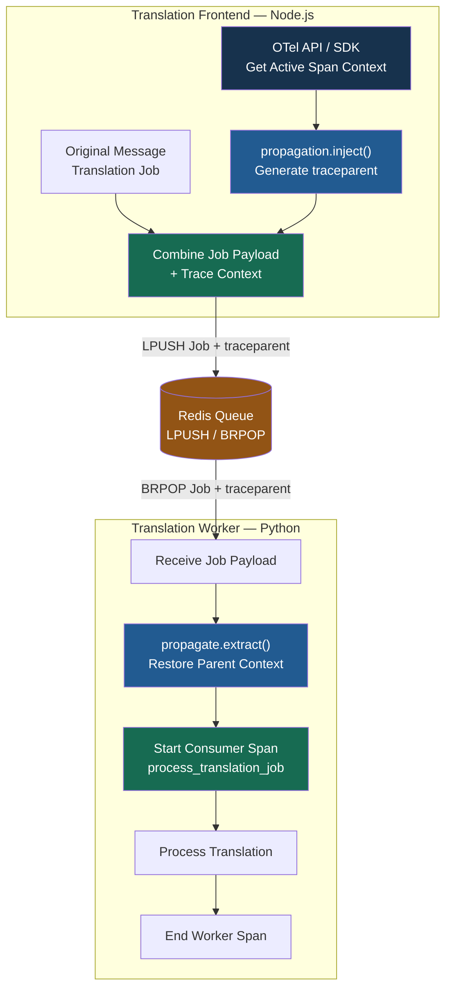
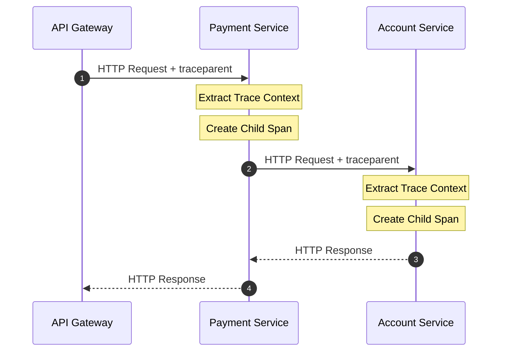
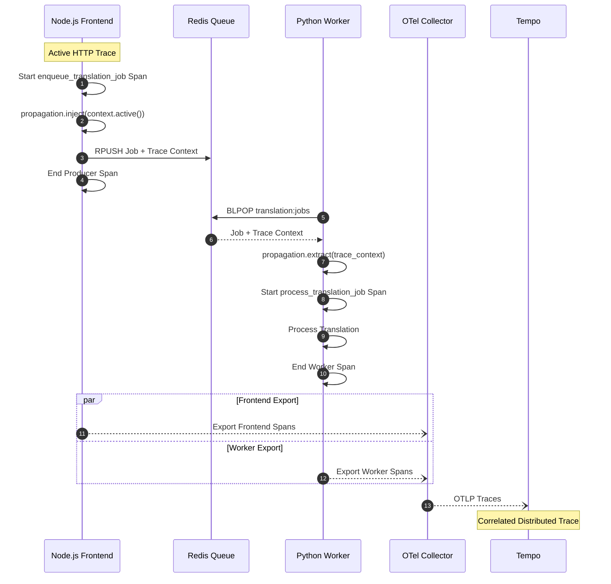
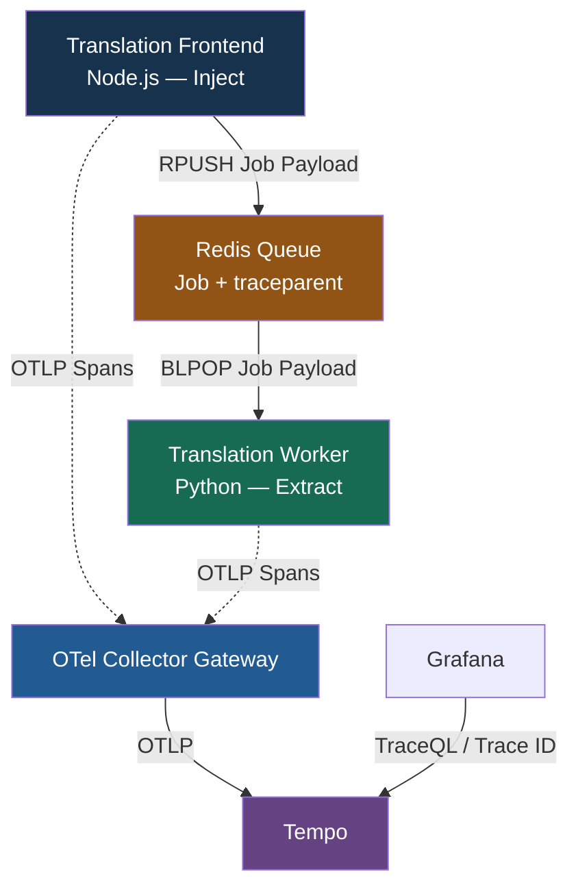
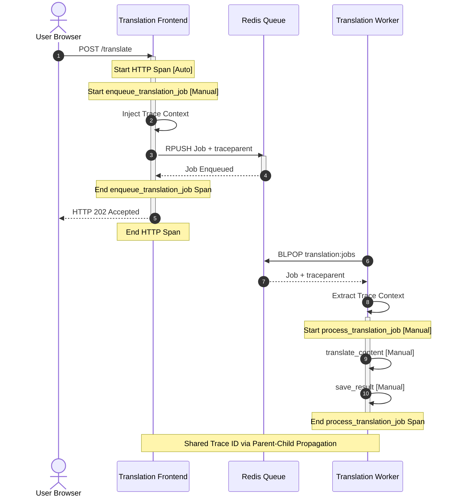
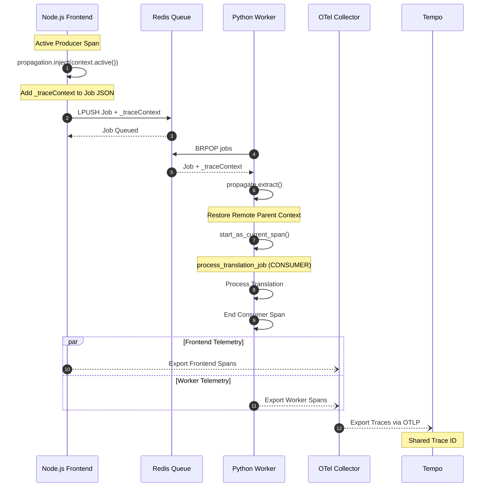

# Context Propagation（分散式追蹤上下文傳遞）

**Understand How Automatic and Manual Context Propagation Work（了解自動與手動 Trace Context 傳遞機制）**

OpenTelemetry 使用 **W3C Trace Context**，讓不同 Microservices 能夠傳遞追蹤上下文，並透過 Trace ID、Span ID 及 Span Relationships 關聯跨服務操作。

Context Propagation 主要有兩種方式：

- **Automatic Context Propagation**：透過 HTTP / gRPC 等 Instrumentation，自動注入及提取 Trace Context。
- **Manual Context Propagation**：開發人員使用 OTel API，將 Trace Context 注入 Message Headers 或 Payload，再由接收端提取。

**核心目的：讓跨服務的操作可以被正確關聯，實現 End-to-End Distributed Tracing。**

## 1. W3C Trace Context — `traceparent`

`traceparent` 是 W3C Trace Context 定義的標準 HTTP Header，用來在不同服務之間傳遞 Trace Context。

### 1.1 Traceparent Header Structure（追蹤上下文標頭結構）

```text
traceparent: 00-0af7651916cd43dd8448eb211c80319c-b7ad6b7169203331-01
```

### Header Fields

| Field | Value | Size | Description |
|---|---|---|---|
| **Version** | `00` | 8-bit | W3C Trace Context 版本 |
| **Trace ID** | `0af7651916cd43dd8448eb211c80319c` | 128-bit | 整條 Distributed Trace 的共同識別碼 |
| **Parent ID** | `b7ad6b7169203331` | 64-bit | 傳送端目前 Span 的 ID，供接收端建立 Parent-Child Relationship |
| **Trace Flags** | `01` | 8-bit | 包含 Sampled Flag 等追蹤旗標 |

### Header Format

```text
traceparent: {version}-{trace-id}-{parent-id}-{trace-flags}
```

### Trace Flags

- `00`：Sampled Flag 未設定。
- `01`：Sampled Flag 已設定。
- Sampled Flag 是上游的採樣提示，不保證 Trace 一定會被儲存。
- 實際資料是否保留，仍取決於 SDK、Collector 及 Backend 的 Sampling / Retention Policy。



### 核心觀念

- **Version**：標示 Trace Context Protocol 的版本。
- **Trace ID**：同一條 Distributed Trace 中的所有 Spans 共享相同的 Trace ID。
- **Parent ID**：傳送端目前 Span 的 ID，接收端可用它建立自己的 Child Span。
- **Trace Flags**：傳遞採樣等追蹤旗標。

> **重要：** Trace ID 在同一條 Trace 的跨服務傳遞中保持不變；每個 Span 擁有自己的 Span ID。當新的服務傳送下游 Request 時，`traceparent` 的 Parent ID 通常會更新為該服務目前傳送 Span 的 ID。

## 2. Automatic vs Manual Context Propagation

| 比較項目 | Automatic | Manual |
|---|---|---|
| **適用場景** | HTTP、gRPC | Redis List、Custom Message Queue |
| **Trace Context 傳遞** | Instrumentation 自動處理 | Developer 使用 Inject / Extract |
| **傳遞位置** | HTTP Headers、gRPC Metadata | Message Headers / Payload |
| **業務程式碼修改** | 通常不需要 | 通常需要 |
| **Trace ID 關聯** | 自動延續 | 正確提取後延續 |
| **主要 API** | Instrumentation Library | `propagation.inject()` / `propagation.extract()` |

### 注意事項

- Automatic Propagation 需要啟用相容的 Instrumentation。
- 不同 Messaging Systems 的支援程度不同。
- Kafka、RabbitMQ 等可能提供 Automatic Messaging Instrumentation。
- Redis List 的自訂 Job Payload 通常需要自行設計 Trace Context 傳遞。

## 3. HTTP — Automatic Context Propagation

HTTP Client / Server Instrumentation 可以自動在 Request Headers 中傳送 `traceparent`。



### Automatic Propagation 流程

1. API Gateway 建立或延續 Trace Context。
2. Gateway 將 `traceparent` 注入 HTTP Request。
3. Payment Service 提取 Context，建立自己的 Span。
4. Payment Service 呼叫 Account Service 時，再注入目前的 Trace Context。
5. Account Service 提取 Context，繼續建立 Child Span。

只要相關 Instrumentation 與 Context Propagator 已正確配置，就可以自動建立跨服務 Trace Relationships。

## 4. Redis Queue — Manual Context Propagation

假設系統架構：

**Node.js Frontend → Redis Queue → Python Worker**

Redis List 的 Job Payload 沒有 HTTP Headers，因此需要在 Payload 中加入 Trace Context。

### 4.1 End-to-End Sequence Diagram



這裡使用 `RPUSH + BLPOP` 作為 FIFO Queue 範例。

### 重要觀念

- Frontend 在 Active Producer Span 中 Inject Trace Context。
- Redis 傳遞 Job Payload，不負責解讀 Trace Context。
- Python Worker 收到 Job 後 Extract Trace Context。
- Worker 根據提取的 Context 建立 Business Span。
- Frontend 與 Worker 的 Trace Relationships 由 Instrumentation 決定。

### 4.2 Job Payload Example

```json
{
  "job_id": "JOB-123",
  "text": "Hello world",
  "target_language": "es",
  "trace_context": {
    "traceparent": "00-0af7651916cd43dd8448eb211c80319c-b7ad6b7169203331-01"
  }
}
```

`trace_context` 是 Application 自訂的 Payload 欄位，而 `traceparent` 使用 W3C 標準格式。

實際系統也可以傳遞 `tracestate` 等標準 Trace Context 欄位。

## 5. TypeScript — Inject Trace Context

在 Node.js Frontend 將 Job 加入 Redis Queue 前，先建立 Producer Span，再注入目前的 Active Trace Context。

```typescript
import {
  trace,
  context,
  propagation
} from '@opentelemetry/api';

const tracer = trace.getTracer('translation-frontend');

async function enqueueTranslationJob(
  redis: RedisClient,
  text: string,
  targetLanguage: string
): Promise<void> {

  await tracer.startActiveSpan(
    'enqueue_translation_job',
    async (span) => {
      try {
        const traceContext: Record<string, string> = {};

        propagation.inject(
          context.active(),
          traceContext
        );

        const job = {
          job_id: 'JOB-123',
          text,
          target_language: targetLanguage,
          trace_context: traceContext
        };

        await redis.rPush(
          'translation:jobs',
          JSON.stringify(job)
        );

      } finally {
        span.end();
      }
    }
  );
}
```

`RedisClient` 代表專案中已配置的 Redis Client Type，需依實際 Redis Library 調整。

### Inject 的作用

`propagation.inject()` 會將 Active Trace Context 序列化到指定的 Carrier。

在此範例中：

```typescript
const traceContext: Record<string, string> = {};

propagation.inject(
  context.active(),
  traceContext
);
```

得到的 Carrier 可以包含：

```json
{
  "traceparent": "00-0af7651916cd43dd8448eb211c80319c-b7ad6b7169203331-01"
}
```

### 為甚麼要在 Producer Span 內 Inject？

因為 `startActiveSpan()` 會將 `enqueue_translation_job` 設定為 Active Span。

因此，Inject 時使用的是該 Producer Span 的 Context，而不是不相關或已結束的 Context。

這有助於 Worker 正確關聯到 Frontend Producer Operation。

## 6. Python — Extract Trace Context

Python Worker 從 Redis Queue 取得 Job 後，提取 Trace Context，並建立新的 Worker Business Span。

```python
import json

from opentelemetry import trace, propagation

tracer = trace.get_tracer("translation-worker")

result = redis_client.blpop(
    "translation:jobs",
    timeout=0
)

if result:
    _, payload = result

    job = json.loads(payload)

    parent_context = propagation.extract(
        job.get("trace_context", {})
    )

    with tracer.start_as_current_span(
        "process_translation_job",
        context=parent_context
    ) as span:

        span.set_attribute(
            "translation.target_language",
            job["target_language"]
        )

        process_translation(job)
```

### Extract 的作用

`propagation.extract()` 會從 Job Payload 的 Carrier 還原 Trace Context。

Worker 使用提取的 Context 建立 Span：

```python
with tracer.start_as_current_span(
    "process_translation_job",
    context=parent_context
):
    process_translation(job)
```

在這個範例中，Worker Span 將採用傳入 Context 作為 Parent Context。

### 必要條件

- Frontend 與 Worker 使用相容的 W3C Trace Context Propagator。
- OTel SDK / Auto Instrumentation 已正確初始化。
- Redis Job Payload 保留完整 Trace Context。
- 應驗證外部傳入 Context 的可信任程度及敏感資訊政策。
- 需要正確處理 Job Failure、Retry、Malformed Payload 和 Trace Export Failure。

### 特別注意：Redis BLPOP Span

Redis `BLPOP` 本身可能由 Automatic Instrumentation 建立 Span。

但 `BLPOP` 開始時，Worker 尚未取得 Job Payload，因此通常無法預先取得該 Job 的 Producer Trace Context。

因此：

**Redis BLPOP Automatic Span 不一定與後續 Worker Business Span 屬於同一條 Trace。**

建議分開監控 Redis Blocking Wait Time 與 Translation Processing Duration，避免誤判效能瓶頸。

## 7. Trace ID、Span ID、Parent-Child 與 Span Links

### 7.1 Trace ID vs Span ID

| Field | Frontend | Worker |
|---|---|---|
| **Trace ID** | 相同（Parent-Child 模式） | 相同 |
| **Span ID** | Producer Span ID | Worker 自己的 Span ID |
| **Parent Span ID** | 指向 **Frontend 上游 Span** | 指向傳入的 Producer Span |
| **Instrumentation** | Auto + Manual | Auto + Manual |

### 7.2 Parent-Child Model

本課程使用的簡單單筆 Job 情境，可以採用 Parent-Child Context Propagation。

```text
Trace ID: 0af7651916cd43dd8448eb211c80319c

POST /translate                  ← Automatic HTTP Span
  │
  └── enqueue_translation_job   ← Manual Producer Span
        │
        └── process_translation_job  ← Manual Worker Span
```

Worker 透過 Extracted Parent Context 建立新的 Child Span，因此共享同一個 Trace ID。

### 7.3 Span Links Model

對複雜的非同步訊息處理，OpenTelemetry Messaging Semantic Conventions 通常建議使用 **Span Links** 關聯訊息的 Creation Context。

例如：

- Batch Processing
- Fan-out Processing
- Multiple Producers
- Multiple Message Contexts
- Independent Worker Traces

```text
Trace A — Frontend

POST /translate
  └── enqueue_translation_job
          │
          │ Span Link
          ▼

Trace B — Python Worker

process_translation_job
  └── translate_content
```

### Parent-Child vs Span Links

| Comparison | Parent-Child | Span Links |
|---|---|---|
| Relationship | 父子關係 | 關聯關係 |
| Trace ID | 通常相同 | 可以不同 |
| 適合情境 | 簡單單筆 Job | 非同步、Batch、Fan-out |
| Multiple Contexts | 不適合作為多父節點模型 | 支援多個 Links |
| Trace Visualization | 單一 Trace Tree | 不同 Traces 之間的關聯 |

**重要：** Parent-Child 與 Span Links 都是有效的關聯方式，但應依實際 Messaging Architecture 選擇。

對於 Redis List 單筆 Translation Job，使用 Parent-Child 模式容易學習及驗證。

Production 中若存在複雜非同步處理、重試或多訊息聚合，應評估 Span Links。

## 8. 核心總結

### Automatic Context Propagation

HTTP / gRPC Instrumentation 自動：

1. 在傳送端 Inject Trace Context。
2. 透過 Headers / Metadata 傳送 Context。
3. 在接收端 Extract Trace Context。
4. 建立相關的 Spans。

### Manual Context Propagation

Redis List / Custom Message Queue 由開發人員：

1. 建立 Producer Span。
2. 使用 `propagation.inject()` 將 Context 加入 Payload。
3. 將 Payload 傳送至 Message Queue。
4. Worker 接收並使用 `propagation.extract()`。
5. 建立 Worker Span，並選擇 Parent-Child 或 Span Links 的關聯方式。

### 核心對照

| Concept | Responsibility |
|---|---|
| **Trace ID** | 識別一條 Distributed Trace |
| **Span ID** | 識別個別 Span |
| **Parent Span ID** | 定義 Span 的父子關係 |
| **Trace Flags** | 傳遞採樣等追蹤旗標 |
| **Inject** | 將 Trace Context 序列化至 Carrier |
| **Extract** | 從 Carrier 還原 Trace Context |
| **Parent-Child** | 在同一條 Trace 中建立上下游關係 |
| **Span Links** | 關聯不同或多個 Trace / Span Contexts |

### 最重要的觀念

**Context Propagation 的目的不是讓所有服務使用相同 Span ID，而是讓跨服務 Operations 保留正確的 Trace Context，並透過 Parent-Child Relationships 或 Span Links 建立可追蹤的關聯。**

對 Node.js Frontend → Redis Queue → Python Worker：

**Producer Inject → Redis Payload → Worker Extract → Business Span → OTel Collector → Tempo → Grafana**

這就是 Distributed Context Propagation 的基本運作原理。

---

**Reference**

- W3C Trace Context：https://www.w3.org/TR/trace-context/
- OpenTelemetry Context Propagation：https://opentelemetry.io/docs/concepts/context-propagation/
- OpenTelemetry Messaging Semantic Conventions：https://opentelemetry.io/docs/specs/semconv/messaging/

---

# Translation Frontend 與 Translation Worker — OpenTelemetry Context Propagation

**End-to-End Distributed Tracing Across Node.js, Redis Queue, and Python Worker**

透過 OpenTelemetry Context Propagation，將 Translation Frontend 與 Translation Worker 產生的 Spans 關聯起來，實現跨服務的 Distributed Tracing。

## 1. 核心概念

| Concept | 中文說明 | 主要用途 |
|---|---|---|
| **Tracer** | 建立 Spans 的元件 | 每個服務可以使用自己的 Tracer |
| **Trace** | 一組共享 Trace ID 的相關 Spans | 追蹤完整的 Request Processing Flow |
| **Span** | 單一操作的追蹤區段 | 記錄 Operation、Duration、Attributes、Status |
| **Trace ID** | Distributed Trace 識別碼 | 關聯不同服務的 Spans |
| **Span ID** | 個別 Span 識別碼 | 每個 Span 都有獨立的 ID |
| **Parent Span ID** | 父 Span 識別碼 | 建立 Parent-Child Relationship |
| **Context Propagation** | 追蹤上下文傳遞 | 跨服務傳遞 Trace Context |

### Tracer Name vs Service Name

這兩者不應混淆：

- **Tracer Name**：識別 Instrumentation Scope，例如 `translation-frontend`。
- **Service Name**：識別產生 Telemetry 的服務，通常透過 Resource Attribute `service.name` 設定。

例如：

| Component | Frontend | Worker |
|---|---|---|
| **Service Name** | `translation-frontend` | `translation-worker` |
| **Tracer Name** | `translation-frontend` | `translation-worker` |
| **Language** | Node.js / TypeScript | Python |
| **OTel SDK** | Node.js SDK | Python SDK |

Tracer Name 與 Service Name 可以使用相同字串，但兩者是不同的概念。

## 2. Translation Frontend + Worker — Distributed Trace

### 2.1 System Architecture



### 2.2 Context Propagation Flow

1. Frontend 接收 `POST /translate` HTTP Request。
2. HTTP Auto Instrumentation 建立 Server Span。
3. Frontend 建立 `enqueue_translation_job` Producer Span。
4. Frontend 在 Active Producer Span 中使用 `propagation.inject()`。
5. 將 `traceparent` 加入 Redis Job Payload。
6. Frontend 透過 `RPUSH` 將 Job 放入 Redis Queue。
7. Worker 使用 `BLPOP` 取得 Job Payload。
8. Worker 使用 `propagation.extract()` 還原 Trace Context。
9. Worker 根據提取的 Context 建立 `process_translation_job` Span。
10. Frontend 和 Worker 分別透過 OTLP 將 Spans 傳送至 Collector。
11. Collector 將 Spans 轉送至 Tempo。
12. Grafana 依 Trace ID 查詢及呈現完整的 Distributed Trace。

### 2.3 Redis Job Payload

```json
{
  "job_id": "JOB-123",
  "target_language": "es",
  "trace_context": {
    "traceparent": "00-0af7651916cd43dd8448eb211c80319c-b7ad6b7169203331-01"
  }
}
```

這裡的 `trace_context` 是 Application 自訂的 Payload 欄位，而 `traceparent` 使用 W3C Trace Context 標準格式。

**重要：**

- Inject 由 Frontend 執行。
- Redis 只負責儲存與傳遞 Job Payload。
- Extract 由 Worker 執行。
- Redis 本身不會自動建立跨服務的 Parent-Child Relationship。
- OTel Collector 不負責在 Frontend 和 Worker 之間傳遞 Trace Context。

## 3. Trace、Tracer、Span 與 Tempo 的關係

### 3.1 Frontend vs Worker

| Component | translation-frontend | translation-worker |
|---|---|---|
| **Tracer** | `translation-frontend` | `translation-worker` |
| **Trace ID** | 相同 | 相同 |
| **Span ID** | 各自不同 | 各自不同 |
| **Spans** | HTTP、Enqueue、Redis RPUSH | Process、Translate、Save |
| **Context Propagation** | Inject | Extract |
| **OTel SDK** | Node.js SDK | Python SDK |
| **Exporter** | OTLP → Collector | OTLP → Collector |

此表以 Parent-Child Context Propagation 模式為前提。

### 3.2 Grafana Tempo — Distributed Trace Tree

採用 Parent-Child 模式時，Tempo 可以看到：

```text
Trace ID: 0af7651916cd43dd8448eb211c80319c

POST /translate                     [Frontend - Auto]
│
└── enqueue_translation_job         [Frontend - Manual]
    │
    ├── Redis RPUSH                  [Frontend - Auto]
    │
    └── process_translation_job     [Worker - Manual]
        │
        ├── translate_content       [Worker - Manual]
        │
        └── save_result             [Worker - Manual]
```

### 3.3 Span Relationships

| Span | Service | Instrumentation | Parent |
|---|---|---|---|
| `POST /translate` | Frontend | Automatic | Root |
| `enqueue_translation_job` | Frontend | Manual | HTTP Server Span |
| `Redis RPUSH` | Frontend | Automatic | Producer Span |
| `process_translation_job` | Worker | Manual | Producer Span |
| `translate_content` | Worker | Manual | Worker Processing Span |
| `save_result` | Worker | Manual | Worker Processing Span |

以上是示意的 Parent-Child Trace Structure，實際層級取決於 Active Context 與 Instrumentation。

### 3.4 Parent-Child 不等於 Sequential Execution

Parent-Child Relationship 代表追蹤上下文關係，並不代表所有 Operations 必須依序執行。

- Child Spans 可以 Sequential Execution。
- Child Spans 也可以 Parallel Execution。
- Child Span 的執行時間可以與 Parent Span 重疊。
- 非同步 Worker 的處理可能在 Frontend Producer Span 結束後才開始。

例如：



此圖為時間關係示意，並非實際量測數據。

### 3.5 Redis BLPOP Automatic Span

Python Worker 的 `BLPOP` 可能由 Redis Auto Instrumentation 建立 Span。

但 `BLPOP` 在 Job 到達之前就已經開始等待，因此此時通常尚未取得 Job 的 Trace Context。

所以：

**Redis BLPOP Automatic Span 不一定屬於該 Translation Job 的 Distributed Trace。**

建議分開觀察：

| Operation | 主要用途 |
|---|---|
| **Redis BLPOP Span** | Redis Queue Waiting / Blocking Operation |
| **process_translation_job Span** | Translation Business Processing |
| **translate_content Span** | Translation Execution |
| **save_result Span** | Result Persistence |

特別注意：`BLPOP` 的 Duration 可能主要來自等待工作，不能直接視為 Redis 效能瓶頸。

## 4. Parent-Child vs Span Links

OpenTelemetry 可以使用 Parent-Child Relationships 或 Span Links 關聯非同步服務。

### 4.1 Parent-Child Context Propagation

適合本課程的單筆 Redis Translation Job。

```text
One Business Request
       ↓
One Distributed Trace
       ↓
Multiple Services
       ↓
Multiple Spans
       ↓
Shared Trace ID
```

Frontend 與 Worker 使用相同的 Trace ID，每個 Span 有自己的 Span ID。

### 4.2 Span Links

對於較複雜的非同步處理，可以使用 Span Links 關聯不同 Trace Context。

例如：

```text
Trace A — Frontend

POST /translate
    │
    └── enqueue_translation_job
                 │
                 │ Span Link
                 ▼

Trace B — Worker

process_translation_job
    │
    ├── translate_content
    └── save_result
```

Span Links 可關聯不同 Traces，也可以連結同一條 Trace 中的其他 Spans；並不要求一定使用不同 Trace ID。

### 4.3 Comparison

| Comparison | Parent-Child | Span Links |
|---|---|---|
| **Relationship** | 父子關係 | 關聯關係 |
| **Trace ID** | 相同 | 可以相同或不同 |
| **Parent Span ID** | 指向 Parent Span | 不透過 Link 改變 Parent |
| **Simple Job Processing** | ✅ 適合 | ✅ |
| **Batch Processing** | 較受限制 | ✅ 適合 |
| **Fan-out / Fan-in** | 可以使用 | ✅ 適合 |
| **Multiple Message Contexts** | 只能選擇單一 Parent | 可以建立多個 Links |
| **Visualization** | 單一 Trace Tree | Span / Trace Links |

對 Redis List 單筆 Translation Job，使用 Parent-Child 模式較容易理解。

若未來擴展到 Kafka、Batch Processing、Fan-out 或多個 Producers，建議評估 Span Links。

## 5. 核心總結

### 5.1 Tracer、Trace、Span

- **Tracer**：負責建立 Spans，每個服務可以使用不同 Tracer。
- **Trace**：由一組共享 Trace ID 的 Spans 組成。
- **Span**：記錄個別 Operation 的時間、Attributes 和 Status。
- **Trace ID**：在 Parent-Child 模式下，跨服務保持一致。
- **Span ID**：每個 Span 各自獨立。

### 5.2 Inject / Extract vs OTLP Export

| Function | Communication Path | Purpose |
|---|---|---|
| **Inject** | Frontend → Redis | 將 Trace Context 放入 Job Payload |
| **Extract** | Redis → Worker | 還原傳入的 Trace Context |
| **OTLP Export** | Frontend / Worker → Collector | 傳送已建立的 Telemetry |
| **Trace Storage** | Collector → Tempo | 儲存 Distributed Traces |
| **Visualization** | Grafana → Tempo | 查詢及分析 Spans |

### 5.3 最重要的觀念

**兩個服務不需要共用同一個 Tracer 或 SDK Instance。**

Frontend 和 Worker 各自透過 OTel Tracer 建立 Spans，再使用 Context Propagation 建立正確的追蹤關係。

**Parent-Child Propagation：**

One Business Request → One Distributed Trace → Multiple Services → Multiple Spans → Shared Trace ID

**Span Links：**

One Business Workflow → Multiple Related Spans / Traces → Span Links

### 最終架構

**Translation Frontend → Inject → Redis Queue → Extract → Translation Worker**

**Frontend Spans + Worker Spans → OTLP → OTel Collector → Tempo → Grafana**

> **核心結論：Context Propagation 負責跨服務關聯 Spans；OTLP 負責傳輸 Telemetry Data；Tempo 負責儲存及查詢 Distributed Traces。**

---
# Context Propagation — Manual Instrumentation

Understand How Automatic and Manual Context Propagation Work（了解自動與手動追蹤上下文傳遞機制）

這張圖片示範如何透過 TypeScript Frontend（Inject）與 Python Worker（Extract），將 OpenTelemetry Trace Context 放入 Redis Job Payload，讓兩個服務的 Spans 關聯成同一條 Distributed Trace。

## 1. Manual Context Propagation 流程

| Component            | File            | Operation                 | Responsibility                        |
| -------------------- | --------------- | ------------------------- | ------------------------------------- |
| Translation Frontend | `queue.ts`      | `propagation.inject()`    | 將 Active Trace Context 注入 Job Payload |
| Redis Queue          | Redis List      | `LPUSH`                   | 儲存包含 Trace Context 的 Job              |
| Translation Worker   | `worker.py`     | `propagate.extract()`     | 從 Job Payload 提取 Trace Context        |
| Translation Worker   | `worker.py`     | `start_as_current_span()` | 建立與 Frontend 關聯的 Consumer Span        |
| OTel Collector       | Collector       | OTLP                      | 接收及轉送 Spans                           |
| Tempo                | Tracing Backend | Trace ID                  | 儲存並關聯 Distributed Trace               |

## 2. TypeScript — `queue.ts`（Inject）

以下保留圖片中的主要程式邏輯：

```ts

import { propagation, context } from '@opentelemetry/api';

// ...

const _traceContext: Record<string, string> = {};

propagation.inject(context.active(), _traceContext);

const jobJson = JSON.stringify({
  ...job,
  _traceContext
});

await this.client.lpush(this.queueKey, jobJson);

```

### 主要功能

- `context.active()`：取得目前的 Active Context。
- `propagation.inject()`：將 Trace Context 序列化到 `_traceContext`。
- `JSON.stringify()`：將 Job 與 Trace Context 一起序列化。
- `LPUSH`：將 Job 放入 Redis Queue。

產生的 Redis Job Payload 類似：

```json

{
  "job_id": "JOB-123",
  "target_language": "es",
  "_traceContext": {
    "traceparent": "00-0af7651916cd43dd8448eb211c80319c-b7ad6b7169203331-01"
  }
}

```

## 3. Python — `worker.py`（Extract）

圖片中的 Python Worker 使用 `propagate.extract()` 還原 Context：

```python

from opentelemetry import trace, propagate
from opentelemetry.trace import SpanKind, StatusCode

# ...

remote_ctx = propagate.extract(
    job.get("_traceContext", {})
)

with tracer.start_as_current_span(
    "process_translation_job",
    context=remote_ctx,
    kind=SpanKind.CONSUMER,
    attributes={
        "translation.job_id": job_id,
        "translation.session_id": session_id,
        "translation.target_language": target_lang,
        "translation.text_length": len(text) if text else 0,
    },
) as span:
    # Process translation job
    ...

```

### 主要功能

| Python API / Attribute        | 說明                              |
| ----------------------------- | ------------------------------- |
| `propagate.extract()`         | 提取傳入的 W3C Trace Context         |
| `context=remote_ctx`          | 使用傳入的 Context 作為 Parent Context |
| `SpanKind.CONSUMER`           | 標示該 Span 為訊息消費者操作               |
| `translation.job_id`          | Job 識別碼                         |
| `translation.session_id`      | Session 識別碼                     |
| `translation.target_language` | 翻譯目標語言                          |
| `translation.text_length`     | 原始文字長度                          |

`translation.*` 是自訂 Business Attributes，應遵循團隊的 Telemetry Data Dictionary，並考慮敏感資料及高基數問題。

## 4. Mermaid — End-to-End Sequence Diagram



圖片使用 `LPUSH`；這裡搭配 `BRPOP`，符合 FIFO Queue 的處理方式。

## 5. Grafana Tempo — Trace Structure

在使用 Parent-Child Propagation 的情況下：

```text

Trace ID: 0af7651916cd43dd8448eb211c80319c

POST /translate                   [Frontend — Auto]
│
└── enqueue_translation_job       [Frontend — Manual]
    │
    ├── Redis LPUSH                [Frontend — Auto]
    │
    └── process_translation_job   [Worker — Consumer]
        │
        ├── translate_content     [Worker — Manual]
        │
        └── Redis PUBLISH         [Worker — Auto]

```

此 Trace Tree 假設 `_traceContext` 是在 `enqueue_translation_job` 的 Active Span 內注入。

特別注意： 如果 Inject 發生在沒有有效 Active Span 的位置，Worker 就不一定能與 Frontend 共享 Trace ID。

另外，Worker 的 `BRPOP` 在收到 Job 之前便開始執行，因此通常不會自然成為該 Job 的 Child Span。

## 6. 核心總結

| Concept          | Frontend                       | Worker                |
| ---------------- | ------------------------------ | --------------------- |
| Operation        | Producer                       | Consumer              |
| Language         | TypeScript                     | Python                |
| Propagation API  | `propagation.inject()`         | `propagate.extract()` |
| Context Carrier  | `_traceContext`                | `_traceContext`       |
| Span Kind        | `PRODUCER`（若有建立 Producer Span） | `CONSUMER`            |
| Trace ID         | 相同                             | 相同                    |
| Span ID          | 各自不同                           | 各自不同                  |
| Telemetry Export | OTLP → Collector               | OTLP → Collector      |

### 最重要的觀念

Frontend Inject → Redis 傳遞 → Worker Extract → 建立 Consumer Span

這就是跨 Redis Queue 的 Manual Context Propagation。

但要區分兩件事：

- Trace Context Propagation：透過 Redis Job Payload 傳送 `traceparent`，建立跨服務追蹤關係。
- OTLP Export：Frontend 和 Worker 將各自完成的 Spans 傳送至 Collector，再交由 Tempo 儲存與查詢。

本例使用 Parent-Child 模式。對更複雜的非同步訊息處理，也可使用 Span Links 建立關聯。

---
# Hands on Frontend-to-Worker Propagation

- Refer to `lab-context-propagation.md`

## 1. Add `_traceContext` to the `TranslationJob` type

Open `app-versions/code/frontend/src/types.ts` and add the optional `_traceContext` field to `TranslationJob`:

```typescript
// Before:
export interface TranslationJob {
  jobId: string;
  sessionId: string;
  text: string;
  sourceLanguage: string;
  targetLanguage: string;
  createdAt: string;
}

// After:
export interface TranslationJob {
  jobId: string;
  sessionId: string;
  text: string;
  sourceLanguage: string;
  targetLanguage: string;
  createdAt: string;
  _traceContext?: Record<string, string>;
}
```

## 2. Inject trace context in `enqueueJob`

Open `app-versions/code/frontend/src/services/queue.ts` and add the propagation import and inject call inside `enqueueJob`:

```typescript
// Add import at the top of the file:
import { propagation, context } from '@opentelemetry/api';
```

Update `enqueueJob` to inject the active trace context before serialising:

```typescript
// Before:
async enqueueJob(job: TranslationJob): Promise<void> {
  if (!this.client) {
    throw new Error('QueueService not connected');
  }
  const jobJson = JSON.stringify(job);
  await this.client.lpush(this.queueKey, jobJson);
  logger.info('Job enqueued', { ... });
}

// After:
async enqueueJob(job: TranslationJob): Promise<void> {
  ...
// Context Propagation
  // Inject current trace context into the job payload so the worker
  // can restore it and create a child span linked to this trace.
  const _traceContext: Record<string, string> = {};
  propagation.inject(context.active(), _traceContext);

  const jobJson = JSON.stringify({ ...job, _traceContext });
  await this.client.lpush(this.queueKey, jobJson);

  // Context Propagation
  logger.info(`Translation job enqueued - ${job.targetLanguage}`, {
    job_id: job.jobId,
    session_id: job.sessionId,
    target_language: job.targetLanguage,
    queue: this.queueKey,
  });
}
  ...

```

## 3. Extract trace context and create a root span in `src/main.py`

Open `app-versions/code/worker/src/main.py` and add the OTel trace imports:

```python
# Add these imports at the top:
from opentelemetry import trace, propagate
from opentelemetry.trace import SpanKind, StatusCode
```

Then add a module-level tracer and wrap the job processing loop body with a span.

Add the tracer after the imports:

```python
logger = logging.getLogger(__name__)
tracer = trace.get_tracer(__name__)  # Add this line
```

In the main processing loop, replace the job processing block with one that extracts the remote context and wraps the work in a span. Locate the section that starts with `# Validate target language` and update the structure:

```python
if not all([job_id, session_id, text, target_lang]):
    logger.error(f"Invalid job data: {job}")
    continue

# Context Propagation
# Extract the W3C trace context injected by the frontend.
# Missing or malformed context produces a background context,
# so the worker still processes the job as a new root trace.
remote_ctx = propagate.extract(job.get("_traceContext") or {})

with tracer.start_as_current_span(
    f"process_translation_job - {target_lang}",
    context=remote_ctx,
    kind=SpanKind.CONSUMER,
    attributes={
        "translation.job_id": job_id,
        "translation.session_id": session_id,
        "translation.target_language": target_lang,
        "translation.text_length": len(text) if text else 0,
    },
) as span:
    try:
        # Validate target language
        if target_lang not in config.supported_languages:
            error_msg = f"Unsupported target language: {target_lang}"
            logger.error(error_msg)
            # Context Propagation
            span.set_status(Status(StatusCode.ERROR, error_msg))
            result = {
                "jobId": job_id,
                "sessionId": session_id,
                "targetLanguage": target_lang,
                "status": "error",
                "error": error_msg,
                "durationMs": 0,
                "completedAt": datetime.now(timezone.utc).isoformat()
                + "Z",
            }
            queue_consumer.publish_result(result)
            continue

        # Translate
        # Ensure text is not None 
        assert text is not None
        logger.info(
            f"Processing job {job_id}: {source_lang} -> {target_lang}"
        )
        start_time = time.time()

        # Simulate realistic API latency (0.5-2 seconds)
        delay = random.uniform(0.5, 2.0)
        logger.debug(f"Simulating {delay:.2f}s translation latency")
        time.sleep(delay)

        translated_text = translator.translate(
            text, source_lang, target_lang
        )
        duration_ms = int((time.time() - start_time) * 1000)

        # Context Propagation
        span.set_attribute("translation.duration_ms", duration_ms)

        result = {
            "jobId": job_id,
            "sessionId": session_id,
            "targetLanguage": target_lang,
            "translatedText": translated_text,
            "status": "completed",
            "durationMs": duration_ms,
            "completedAt": datetime.now(timezone.utc).isoformat() + "Z",
        }

        logger.info(
            f"Job {job_id} completed successfully in {duration_ms}ms"
        )

    except Exception as e:
        duration_ms = int((time.time() - start_time) * 1000)
        error_msg = str(e)
        logger.error(
            f"Translation failed for job {job_id}: {error_msg}"
        )
        # Context Propagation
        span.record_exception(e)
        span.set_status(Status(StatusCode.ERROR, error_msg))
        result = {
            "jobId": job_id,
            "sessionId": session_id,
            "targetLanguage": target_lang,
            "status": "error",
            "error": error_msg,
            "durationMs": duration_ms,
            "completedAt": datetime.now(timezone.utc).isoformat() + "Z",
        }

    # Publish result
    queue_consumer.publish_result(result)

```

## 4. Deploy both services

The frontend has changed (TypeScript source change, hot-reloads automatically). The worker source also changed (Python file, watchmedo picks it up automatically). No rebuild needed:

```bash
cd compose/
docker compose -f compose.dev.yaml up -d

docker compose -f compose.dev.yaml logs frontend
docker compose -f compose.dev.yaml logs worker
```

Wait a few seconds for both services to restart.

## 5. Generate traffic

```bash
curl -X POST http://localhost:3001/api/translate \
  -H "Content-Type: application/json" \
  -d '{"text": "Hello world", "targetLanguages": ["es", "fr"]}'
```

**6. Verify end-to-end trace in Grafana Tempo**

Open Grafana at http://localhost:3010 → Explore → Tempo → Search

Filter by `service.name = translation-frontend`. Open a recent trace.

Expected span hierarchy:

```
request handler - /api/translate (3.93ms)
└── create_translation_session (3.85ms)
    ├── validate_request (15.4µs)
    ├── enqueue_translation_jobs (2.02ms)
    │   ├── lpush (1.22ms)
    │   ├── lpush (1.11ms)
    │   ├── translation-worker: process_translation_job - es (1.04s)
    │   │   └── PUBLISH (435.22µs)
    │   └── process_translation_job - fr (1.77s)
    │       └── PUBLISH (390.62µs)
    ├── translation-frontend: hset (411.32µs)
    └── expire (149.41µs)

```

The worker spans should appear as children of `enqueue_translation_jobs` with `span.kind = CONSUMER`. The `is_remote` flag indicates the span boundary crossed a service.

> The propagation implementation matches the README design and should connect frontend enqueue_translation_jobs to worker process_translation_job.
---

